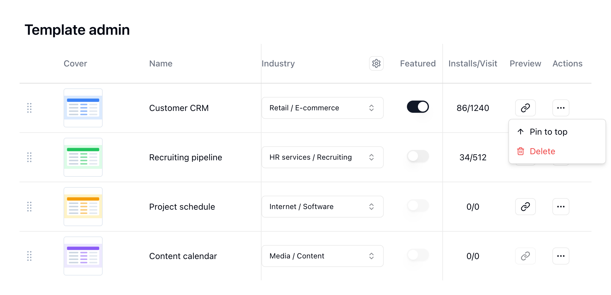

{/* mintlify-resync: 2026-10-22 */}

<Tip>متاحة لخطة Business ذاتية الاستضافة والخطط الأعلى</Tip>

### إدارة القوالب

تأتي القوالب من المشاريع المرسلة: يرسل الأعضاء المشروع للمراجعة عبر **النشر في مركز القوالب**، ولا يُنشر القالب ويظهر في مركز القوالب إلا بعد أن يوافق عليه المسؤول في **مراجعة القوالب**. ويمكن للمسؤولين هنا تعديل معلومات القالب والتحكم في نشره وترتيبه.

#### معلومات القالب

* **الغلاف**: صورة غلاف بطاقة القالب
* **الاسم** و**الوصف**: العنوان والوصف الموجز المعروضان في مركز القوالب
* **وصف Markdown**: وصف تفصيلي يدعم تنسيق Markdown
* **التصنيف**: تجميع القوالب حسب القطاع والقطاع الفرعي، أو حسب الفريق. انقر أيقونة الإعدادات بجوار عنوان العمود لفتح **إدارة التصنيفات**، حيث يمكنك إنشاء القطاعات والقطاعات الفرعية والفرق
* **المعرّف في الرابط (slug)**: المعرّف المستخدم في عنوان URL لصفحة القالب العامة، ولا يقبل إلا الأحرف الإنجليزية الصغيرة والأرقام والشرطات
* **مميّز**: إبراز القالب في مركز القوالب. لا يتاح إلا بعد نشر القالب
* **التكاملات**: المنصات التي تحتاج أتمتة القالب إلى الاتصال بها، ويُرشَد المستخدمون إلى إكمال هذه الاتصالات بعد التثبيت
* **وقت اللقطة**: آخر وقت تمت فيه الموافقة على محتوى القالب في المراجعة
* **أُنشئ بواسطة**: المستخدم الذي نشر القالب
* **الاستخدام/زيارة**: عدد مرات استخدام القالب وزيارته

#### عمليات القالب

* **منشور**: التبديل بين إدراج القالب وإلغاء إدراجه في مركز القوالب. يتطلب لقطة واسمًا ووصفًا.
* **معاينة**: فتح القالب في علامة تبويب جديدة
* **التثبيت في الأعلى**: نقل القالب إلى أعلى القائمة. ويمكنك أيضًا سحب المقبض في بداية الصف لإعادة ترتيب القوالب
* **حذف**: إزالة القالب

لتحديث محتوى القالب، افتح **النشر في مركز القوالب** مرة أخرى في المشروع المصدر وانقر **Submit v\{الإصدار\} for review**. وإلى أن تتم الموافقة، يظل الآخرون يثبّتون الإصدار الحالي.

### مراجعة القوالب

في **إدارة النظام** > **مراجعة القوالب**، اعرض الإرسالات المنتظرة في **قائمة المراجعة** مع المؤلف ووقت الإرسال ونتائج الفحوص التلقائية. الفحوص التلقائية للتنبيه فقط ولا تمنع المراجعة: يشير **الاتصالات** إلى أن القالب يستخدم تكاملات لا يستطيع هذا النشر الاتصال بها؛ ويشير **الخصوصية** إلى أن القالب يحمل سجلات ويلزم التأكد من خلوّها من المعلومات الشخصية؛ ويشير **تقدير التشغيلات** إلى أن حجم التشغيل الشهري قد يتجاوز الحصة المجانية؛ ويشير **تشغيل تجريبي** إلى أن الأتمتة لا تحتاج إلى أي حساب، فتأكد من أنها تعمل من دون ربط حسابات. انقر **عرض** لفتح تفاصيل الإرسال ونسخة المعاينة، واختيار قطاع القالب.

* **موافقة**: تُنشر النسخة التي أرسلها المؤلف كما كانت لحظة الإرسال، ويزيد رقم إصدار القالب المنشور بمقدار واحد مع كل تحديث تتم الموافقة عليه. وأي تعديلات لاحقة يجريها المؤلف تحتاج إلى إرسال جديد
* **رفض**: يتلقى المؤلف ملاحظتك، ويمكنه إعادة الإرسال بعد التعديل

يمكنك إضافة ملاحظة في كلتا الحالتين، ويُبلَّغ المؤلف بالنتيجة دائمًا.

### استخدام القوالب الرسمية

يمكن لمستخدمي الاستضافة الذاتية استيراد القوالب من Teable السحابية الرسمية:

1. **التنزيل**: احصل على ملف تصدير مشروع Teable (`.tea`) من [مركز القوالب الرسمي](https://teable.ai/templates)
2. **الاستيراد**: استورد ملف `.tea` كمشروع جديد في مساحتك
3. **فتح نافذة النشر**: في المشروع المستورد، انقر اسم المشروع أعلى الشريط الجانبي واختر **النشر في مركز القوالب**
4. **إدخال التفاصيل**: أدخل الاسم والوصف التفصيلي، واختر المحتوى المضمَّن وما إذا كنت تريد تضمين بيانات تجريبية، وارفع غلافًا عند الحاجة
5. **الإرسال والموافقة**: انقر **إرسال للمراجعة**، ثم انقر **موافقة** في **إدارة النظام** > **مراجعة القوالب**. يُنشر القالب فورًا ويظهر في **إدارة النظام** > **إدارة القوالب**
