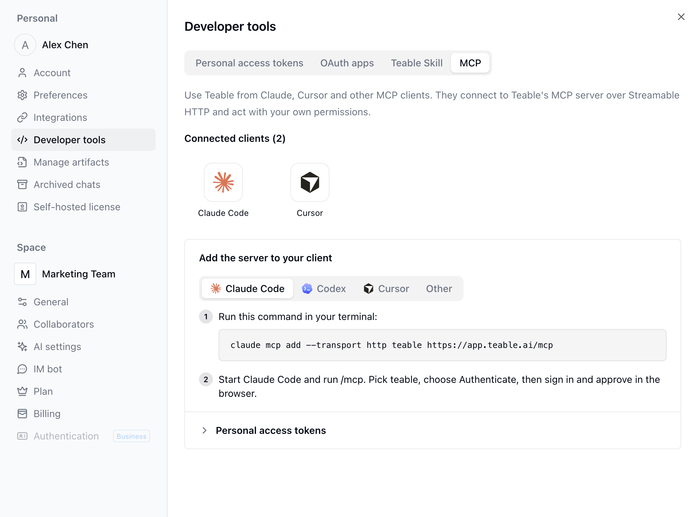

{/* mintlify-resync: 2026-10-22 */}

## تثبيت مهارة Teable

افتح صورتك أسفل الشريط الجانبي ← **الإعدادات** ← **أدوات المطوّرين** ← **مهارة Teable** لنسخ مطالبة التثبيت أو الأمر المناسب لنسخة Teable الحالية.

انسخ هذه المطالبة إلى وكيل الذكاء الاصطناعي لديك:

```text wrap
يرجى قراءة https://github.com/teableio/teable-mcp واتباع الدليل لمساعدتي في تثبيت مهارة وكيل Teable وإكمال مصادقة Teable CLI.
```

أو ثبّتها مباشرةً:

```bash
npx skills add https://github.com/teableio/teable-mcp
```

## تجربة مهارة Teable

بعد تثبيت المهارة، جرّب هذه المطالبات.

<CodeGroup>

```text مطالبات بداية بسيطة wrap
أنشئ جدول CRM بسيطًا في <المشروع> {الصق عنوان URL للمشروع}.
```

```text الملفات المحلية → Teable wrap
حمّل جميع الفواتير في هذا المجلد المحلي إلى <جدول الإيصالات> {الصق عنوان URL للجدول} واستخرج الحقول الرئيسية.
```

```text بيانات من منصات أخرى → Teable wrap
استورد مسائل GitHub الجديدة إلى <متتبع الأخطاء> {الصق عنوان URL للجدول}.
```

```text تنظيف بيانات Teable أو تنظيمها wrap
تحقق من <جدول المهام> {الصق عنوان URL للجدول} وميّز المهام المتأخرة.
```

</CodeGroup>

## تطوير التطبيقات محليًا

بعد تثبيت مهارة Teable، يمكنك أن تطلب من وكلاء الذكاء الاصطناعي مثل Claude Code وCodex تطوير تطبيقات [منشئ التطبيقات](/ar/basic/ai/app-builder) على جهازك: ينشئ الوكيل تطبيقًا جديدًا أو يستنسخ شيفرة تطبيق موجود عبر Teable CLI، ويُحفظ ما يدفعه كإصدار جديد من التطبيق، ويمكنه أيضًا نشره مباشرةً. ويتطلب العمل على تطبيق موجود صلاحية تعديله.

```text wrap
استنسخ <التطبيق> {الصق عنوان URL للتطبيق} محليًا، وحوّل الصفحة الرئيسية إلى تخطيط لوحة معلومات، ثم ادفع التغييرات وانشر التطبيق.
```

## الاتصال عبر MCP

يمكن لعملاء MCP مثل Claude Code وCursor وCodex وclaude.ai أيضًا الاتصال مباشرةً بخادم MCP الخاص بـ Teable، دون تثبيت المهارة. ومن العميل، يمكنك عرض بنية المشاريع والجداول، وقراءة السجلات وكتابتها، واستدعاء Teable API. ويتصرف العميل بالنيابة عنك، بالصلاحيات نفسها التي تملكها في كل مشروع.

<Steps>
  <Step title="فتح إعدادات MCP">
    انقر على صورتك أسفل الشريط الجانبي ثم افتح **الإعدادات** ← **أدوات المطوّرين** ← **MCP**. ضمن **أضف الخادم إلى عميلك**، تعرض الصفحة علامة تبويب لكل عميل: **Claude Code** و**Codex** و**Cursor** و**أخرى**، وتتضمن كل علامة تبويب الأمر أو الإعداد الخاص بذلك العميل. ويظهر **عنوان URL للخادم** في علامة التبويب **أخرى**.
  </Step>
  <Step title="إضافة الخادم إلى العميل">
    اختر عميلك وانسخ الأمر أو الإعداد من الصفحة. وبالنسبة إلى Claude Code، يتضمن الأمر المعروض في الصفحة عنوان URL للخادم مسبقًا، فانسخه وشغّله في الطرفية:

    ```bash
    claude mcp add --transport http teable <عنوان URL للخادم>
    ```
  </Step>
  <Step title="تسجيل الدخول والتفويض">
    عند الاتصال لأول مرة، يفتح العميل متصفحًا. سجّل الدخول إلى Teable، وحدد **أتعرّف على عنوان URL هذا وأثق به**، ثم انقر على **متابعة** لإكمال التفويض.
  </Step>
</Steps>

تظهر العملاء المفوّضة ضمن **العملاء المتصلون** أعلى صفحة **MCP**. انقر على عميل لفتح نافذة تعرض **أول اتصال** و**آخر استخدام**. ولإيقاف استخدام العميل، انقر على **إزالة** في النافذة نفسها لإلغاء وصوله.

وبالنسبة إلى CI أو النصوص البرمجية أو البيئات التي لا يتوفر فيها متصفح، وسّع **رموز الوصول الشخصية** واتصل باستخدام [رمز وصول شخصي](/ar/api-doc/token) بدلًا من ذلك، وأرسله في الترويسة `Authorization`. لا يعرض MCP إلا الأدوات التي تسمح بها نطاقات أذونات الرمز، ويتحقق من كل استدعاء وفقًا لها: لاستخدام جميع الأدوات، أنشئ رمزًا بصلاحية **وصول كامل** ونطاق وصول **كل المساحات والمشاريع**؛ وإذا كان العميل لا يحتاج إلا إلى بعض المشاريع، فاختر **مساحات أو مشاريع محددة** وامنحه الصلاحيات التي يحتاج إليها فقط. ويتبع الأمر أو الإعداد المعروض هناك علامة تبويب العميل المحددة.



للاطلاع على أمثلة لاستخدام هذه الميزة، اقرأ [أمثلة MCP لأدوات Claude Code وCodex وCursor](https://teable.ai/ar/blog/connect-ai-tools-to-teable-with-mcp).
