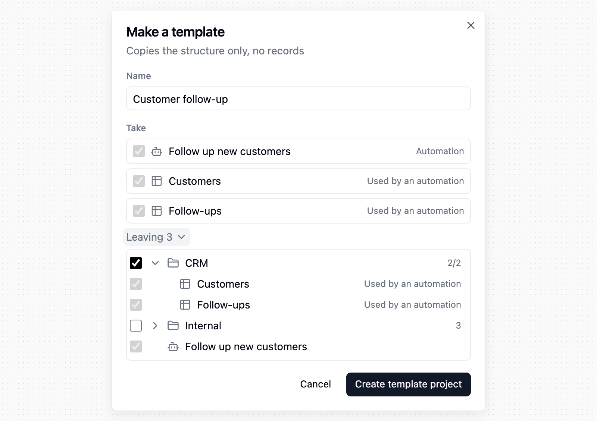

تُصنع القوالب في **مشروع قالب**. تختار ما تريد مشاركته من مشروع تعمل فيه، فينسخ Teable بنيته إلى مشروع قالب منفصل. لا يتغير المشروع الأصلي ولا بياناته، ولا يُنشران أبدًا.

## التحويل إلى قالب

في الشريط الجانبي للمشروع، انقر بزر الفأرة الأيمن على جدول أو تطبيق أو أتمتة أو مجلد، واختر **تحويل إلى قالب**. وللاختيار من المشروع كله، انقر على اسم المشروع في الزاوية العلوية اليسرى واختر **تحويل إلى قالب**.

إذا بدأت من قائمة عنصر، فسيكون ذلك العنصر محددًا مسبقًا؛ وإذا بدأت من اسم المشروع، فحدّد من العناصر المعروضة ما تريد أخذه. وتُضاف تلقائيًا الجداول التي يستخدمها تطبيق أو أتمتة أو لوحة معلومات، مع ذكر السبب بجانب كل منها. ويبقى كل ما سواها ضمن **يبقى: N**، ويمكنك فتحه لتحديد المزيد. تحقق من الاسم ثم انقر **إنشاء مشروع القالب**.

ينسخ مشروع القالب البنية فقط: لا تُنقل السجلات، وتبدأ الأتمتة متوقفة، ويتحول حقل الارتباط بجدول يبقى خارج القالب إلى نص. وتحتاج إلى صلاحية **منشئ** أو أعلى في كل من المشروع الأصلي والمساحة. أما المشروع الذي نُشر مباشرة من قبل ولا يزال مُدرجًا، فتعرض قائمة اسمه **النشر في مركز القوالب** بدلًا من ذلك؛ ولإنشاء قالب جديد منه، ابدأ من قائمة أحد العناصر في الشريط الجانبي.

## تجهيز مشروع القالب

عند النقر على **إنشاء مشروع القالب**، يفتح Teable مشروع القالب الجديد. يظهر وسم **قالب** بعد اسمه، ويعرض أعلى شريطه الجانبي حالته ومصدره (**من المبيعات**، ولا يظهر إلا لك)، والزرين **تجربة** و**إرسال للمراجعة**.

بعد ذلك يعثر Cuppy على ما يخصك وحدك، ويعرض ما سيحل محل كل منها، ثم يستبدلها بعد تأكيدك، ويضيف سجلات المثال ويكتب مسودة دليل التثبيت. ويمكنك أيضًا إضافة سجلات المثال بنفسك: فعند الإرسال تُنشر سجلات مشروع القالب بوصفها بيانات المثال الخاصة بالقالب.

## تجربة القالب

انقر **تجربة** لينشئ Teable نسخة تجريبية بالطريقة نفسها التي يتم بها التثبيت ويفتحها، فترى ما سيحصل عليه الآخرون. انقر **العودة إلى مشروع القالب** للرجوع، أو **حذف النسخة التجريبية** عندما لا تعود بحاجة إليها. وعند التجربة مرة أخرى تُنقل نسختك التجريبية السابقة إلى سلة المحذوفات.

## الإرسال للمراجعة

انقر **إرسال للمراجعة**، واملأ الاسم والوصف والغلاف، واختر ما يُفتح افتراضيًا بعد التثبيت. يُرسل مشروع القالب بأكمله، ويعرض **العُقد المنشورة** عدد العناصر وسجلات المثال التي ستُنشر.

تحجب **فحوصات قبل الإرسال** في جانب النافذة ما يخصك وحدك: أسماء من يمكنهم فتح المساحة أو المشروع وعناوين بريدهم الإلكتروني ونطاقات بريد شركاتهم، والنصوص التي تشبه مفتاح API. استبدلها، أو انقر **معالجة** ليستبدلها Cuppy. ويضع **هذه أمثلة** علامة المثال على كل ما هو مُدرج ويسمح بمروره، لذا لا تستخدمه إلا إذا كان كله مختلقًا.

عندما تظهر علامة صح خضراء بجانب **المحتوى**، انقر **إرسال للمراجعة**. أما الصفوف الأخرى فهي تذكيرات ولا تمنع الإرسال.

يضيف صف **الدليل** في النافذة عدة خطوات إعداد إلى القالب. لكل خطوة عنوان ووصف من سطر واحد ومكان يُفتح وشرط إنجاز. اكتب مسودته باستخدام **اكتب مسودته مع Teable AI** أو استخدم **تعديل في المشروع**. من الشروط: استبدال بيانات المثال بمحتوى حقيقي، أو نشر تطبيق، أو تشغيل أتمتة بنجاح مرة واحدة، أو ربط الحسابات المطلوبة، أو أن يضع المستخدم العلامة بنفسه. يجب ألا يكون الشرط المتعلق بالبيانات متحققًا أصلًا على سجلات المثال، وإلا تعذّر إرسال القالب.

## المراجعة والنشر

بعد الإرسال تُفتح نافذة **تم الإرسال للمراجعة**، ويمكنك فيها النقر على **سحب** إلى أن تنتهي المراجعة. ويعرض الشريط الجانبي **قيد المراجعة**؛ انقر **عرض الإرسال** للاطلاع على ما أرسلته.

عند الموافقة يُدرج القالب في مركز القوالب، ويعرض الشريط الجانبي **متاح · v1**. وإذا أُعيد إليك، يعرض الشريط الجانبي **أُعيد للتعديل** ويتضمن الإشعار ملاحظات المراجع؛ أجرِ تعديلاتك ثم انقر **إعادة الإرسال**.

بعد النشر، واصل التعديل في مشروع القالب نفسه وانقر **إرسال v2** لإرسال إصدار جديد. وإلى أن تتم الموافقة على الإصدار الجديد، يحصل من يثبّت القالب على الإصدار الحالي.

## العثور على مشاريع القوالب في المساحة

تضم الصفحة الرئيسية للمساحة تبويبين: **المشاريع** و**مشاريع القوالب**. يعرض تبويب **مشاريع القوالب** حالة كل قالب ومصدره، وافتح أي صف لرؤية محتواه ونسخته التجريبية. وللبدء من مشروع فارغ، انقر **مشروع قالب جديد** في أعلى هذا التبويب.

<Note>يؤدي نقل مشروع قالب إلى سلة المحذوفات إلى إزالة القالب المنشور من مركز القوالب، ولا تؤدي استعادة المشروع من سلة المحذوفات إلى إدراجه من جديد. ويُسحب الإرسال قيد المراجعة، وتُنقل نسخك التجريبية إلى سلة المحذوفات أيضًا. ولا تتأثر النسخ التي ثبّتها الآخرون.</Note>
