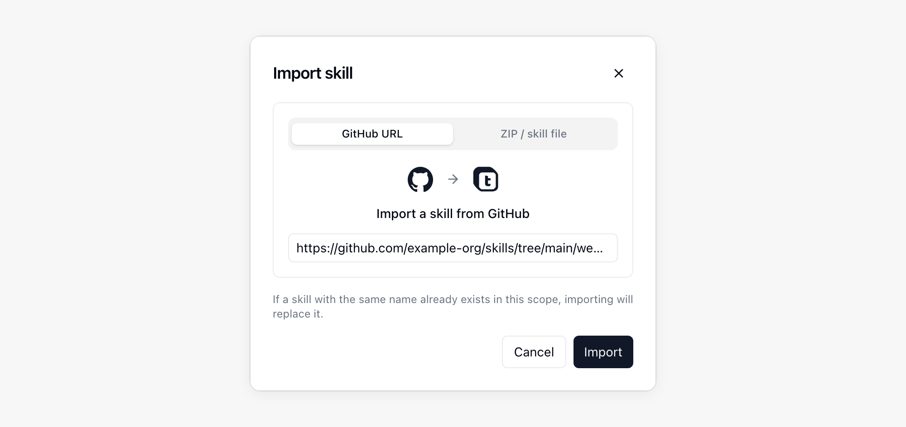
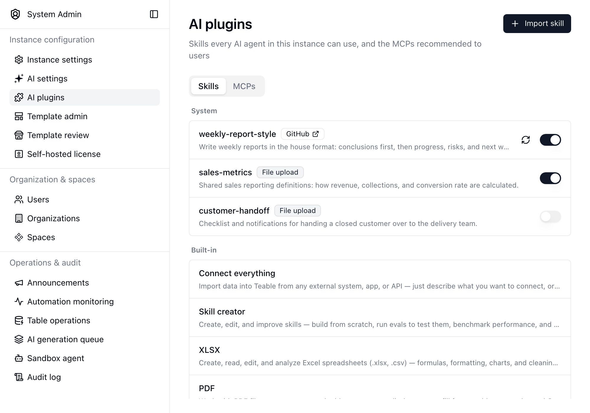

{/* mintlify-resync: 2026-11-13 */}

<Tip>Verfügbar ab dem selbst gehosteten Business-Plan</Tip>

Pfad: Systemverwaltung → KI-Plugins

Im Tab **Skills** unter **KI-Plugins** veröffentlichen Sie Skills für die gesamte Instanz; der Tab **MCPs** verwaltet die Nutzern empfohlenen MCPs. Ein hier hinzugefügter Skill ist in jeder Unterhaltung mit KI-Chat, App Builder und Bots verfügbar. Verwenden Sie ihn daher für Arbeitsweisen, die Ihre Organisation standardmäßig teilen sollte, etwa einen einheitlichen Schreibstil, eine Berichtskonvention oder einen gemeinsamen Integrationsprozess.

Skills, die Benutzer an anderer Stelle hinzufügen, bleiben in ihrem eigenen Geltungsbereich. Siehe [KI-Chat](/de/basic/ai/ai-chat) für persönliche Skills sowie Skills auf Projekt- und Space-Ebene.

## Empfohlene MCPs

Die Liste **Empfohlen** im Tab **MCPs** steuert, welche empfohlenen Server Nutzer unter **Einstellungen** → **Integrationen** → **MCP hinzufügen** sehen. Sie können sie einzeln ein- oder ausschalten oder mit **Alle ausschalten** auf einmal alle ausschalten (sind alle aus, wird die Schaltfläche zu **Alle einschalten**). Ein ausgeschalteter Server erscheint nicht mehr in der Empfehlungsliste; bereits hinzugefügte Server bleiben unberührt. Sind alle ausgeschaltet, sehen Nutzer **Empfohlen** nicht mehr.

## Einen Skill hinzufügen

Klicken Sie auf **Fähigkeit importieren** und wählen Sie aus, woher der Skill stammt:

| Quelle | Bereitzustellen |
| --- | --- |
| **GitHub-URL** | Der Link zum Skill-Ordner oder zur darin enthaltenen Datei `SKILL.md`, zum Beispiel `https://github.com/owner/repo/tree/main/skills/my-skill`. Liegt der Skill im Stammverzeichnis des Repositorys, fügen Sie einfach den Repository-Link ein |
| **ZIP-Datei** | Eine `.zip`- oder `.skill`-Datei, die `SKILL.md` enthält |

Wenn in diesem Geltungsbereich bereits ein Skill mit demselben Namen existiert, wird er durch den Import ersetzt.

## Veröffentlichte Skills verwalten

Die Liste gruppiert Skills nach Geltungsbereich und zeigt, woher jeder einzelne stammt. Integrierte Skills werden unten zur Referenz aufgeführt und können nicht bearbeitet werden.

- Verwenden Sie den Schalter in einer Zeile, um einen Skill zu aktivieren oder zu deaktivieren, ohne ihn zu löschen. Ein deaktivierter Skill bleibt in der Liste, wird Agents jedoch nicht angeboten.
- Klicken Sie bei einem aus GitHub importierten Skill auf die Aktualisierungsschaltfläche, um die neueste Version aus seiner Quelle abzurufen.
- Klicken Sie auf eine Zeile, um deren `SKILL.md` zu lesen, Namen und Beschreibung zu bearbeiten, den Skill herunterzuladen, seine Dateien zu ersetzen oder ihn zu löschen.

<Info>Nur Instanzadministratoren können auf dieser Seite Skills hinzufügen, ändern oder entfernen. Jeder angemeldete Benutzer kann die veröffentlichten Skills in seinen Unterhaltungen verwenden.</Info>

## Wenn ein Name zweimal verwendet wird

Ein hier veröffentlichter Skill ist der Instanzstandard. Wenn ein Skill auf Projekt-, Space-, persönlicher, App- oder Bot-Ebene denselben Namen verwendet, gilt für diese Unterhaltung der spezifischere Skill und der Instanz-Skill wird dort ignoriert.

