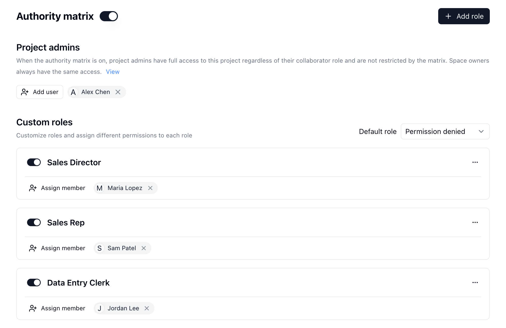
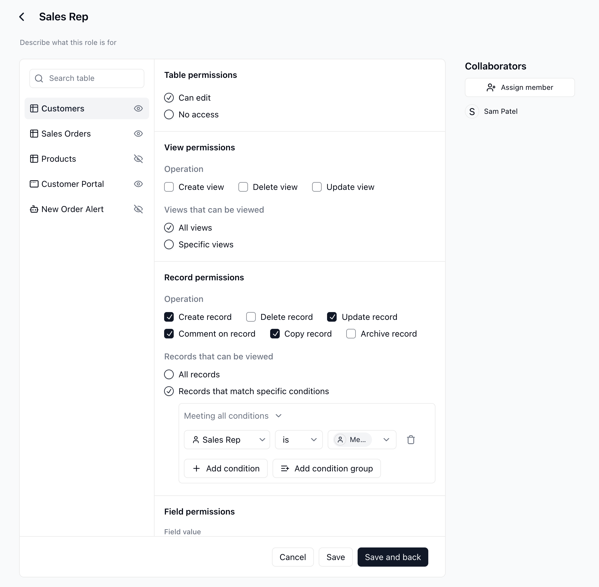
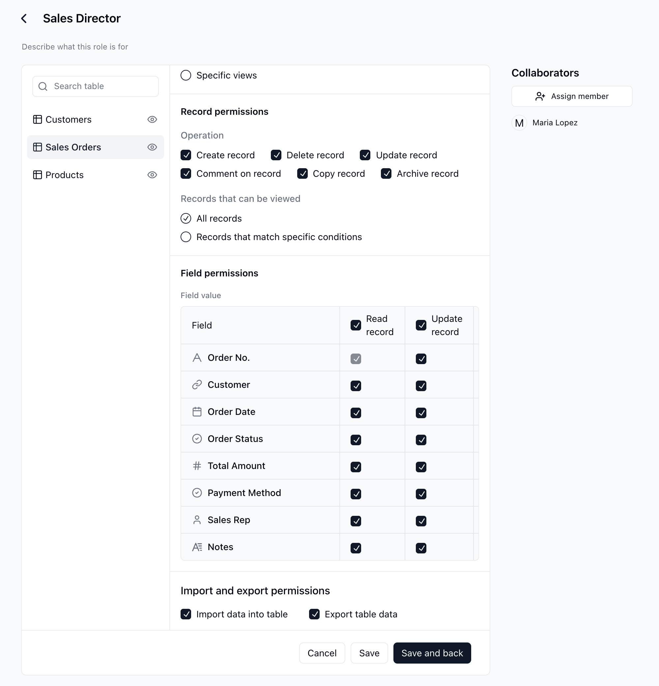
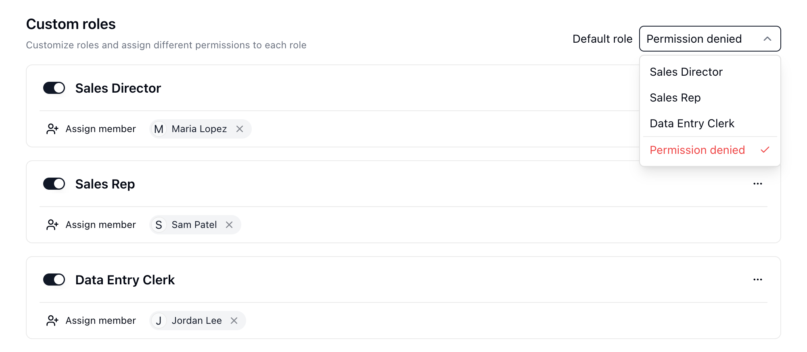

{/* mintlify-resync: 2026-05-28 */}
<Tip>Verfügbar ab dem Business-Plan</Tip>

Wenn Vertrieb, Finanzen, Betrieb und Führung dasselbe Projekt nutzen, bestimmen Berechtigungen, wer das Projekt betreten kann, welche Daten angezeigt oder bearbeitet werden können und ob Daten importiert oder exportiert werden dürfen. Die Berechtigungsmatrix hilft Teams, Daten an einem Ort zu halten und den Zugriff gleichzeitig nach Verantwortlichkeiten zu trennen.

Sie können Mitgliedern oder Abteilungen benutzerdefinierte Rollen zuweisen und jeder Rolle Zugriff nur auf die benötigten Tabellen, Apps und Workflows geben. Für Tabellen können Sie außerdem sichtbare Ansichten, sichtbare Datensätze, bearbeitbare Felder sowie Import- oder Exportberechtigungen einschränken. So kann beispielsweise der Vertrieb seine eigenen Kunden verwalten, die Finanzabteilung kann Abrechnungsfelder anzeigen und die Führung kann den vollständigen Datensatz anzeigen.

## Wann sie verwendet werden sollte

| Szenario | Geeignet für |
| --- | --- |
| Zugriff auf Abteilungsebene | Der Vertrieb kann Kundendatensätze verwalten, während die Finanzabteilung nur Abrechnungsfelder sieht. |
| Zugewiesene Datensätze | Vertriebsmitarbeitende können nur ihnen zugewiesene Datensätze anzeigen und aktualisieren. |
| Eingeschränkte Dateneingabe | Mitglieder können neue Datensätze erstellen, ohne vorhandene Datensätze zu bearbeiten oder zu löschen. |
| Sensible Felder in einem gemeinsam genutzten Projekt | Mitglieder können Bestelldatensätze anzeigen, ohne Zahlungs- oder Kostenfelder zu sehen. |
| Gesteuerte Apps und Workflows | Rollen können ausgewählte Apps oder Workflows öffnen, während nicht freigegebene Ressourcen ausgeblendet bleiben. |

## So funktionieren Berechtigungen

Die Berechtigungsmatrix weist Zugriffe nach Rollen zu. Nutzer können Berechtigungen über direkt zugewiesene Rollen oder über Abteilungsrollen erhalten. Wenn mehrere Rollen gelten, kombiniert Teable die von diesen Rollen erlaubten Berechtigungen.

<Info>Space-Nutzer mit der Berechtigung **Eigentümer** und **Projektadministratoren** können die Berechtigungsmatrix verwalten und unterliegen keinen Einschränkungen durch sie.</Info>

Die Rollenliste enthält einen Abschnitt `Projektadministratoren` und einen Abschnitt `Benutzerdefinierte Rollen`:

Verwenden Sie `Rolle hinzufügen`, um eine benutzerdefinierte Rolle zu erstellen. Weisen Sie auf der Detailseite der Rolle Mitarbeitende zu, verfassen Sie eine kurze Beschreibung und konfigurieren Sie den Zugriff für jede Ressource im Projekt:

## Rollenzugriff konfigurieren

Jede Tabelle, App, jeder Workflow und jede Routine hat eine eigene Zugriffseinstellung.

| Ressourcentyp | Verfügbare Einstellung |
| --- | --- |
| Tabelle | Wählen Sie `Bearbeiten erlaubt` oder `Kein Zugriff`. Nachdem eine Tabelle auf `Bearbeiten erlaubt` gesetzt wurde, konfigurieren Sie ihre detaillierten Berechtigungen. |
| App | Wählen Sie `Zugriff erlaubt` oder `Kein Zugriff`. Damit wird festgelegt, ob die Rolle die App öffnen kann. |
| Workflow | Wählen Sie `Zugriff erlaubt` oder `Kein Zugriff`. Damit wird festgelegt, ob die Rolle den Workflow öffnen kann. |
| Routine | Wählen Sie `Zugriff erlaubt` oder `Kein Zugriff`. Damit wird festgelegt, ob die Rolle die Routine öffnen kann. |
| Ordner | Ordner dienen der Navigation. Ist keine Ressource im Ordner zugänglich, erscheint neben dem Ordner ein Ausblenden-Symbol (Tooltip `automatisch ausblenden`), und die Rolle sieht den Ordner nicht. |

Um Ansichts-, Datensatz-, Feld- und andere detaillierte Tabellenberechtigungen zu konfigurieren, setzen Sie die Tabelle zuerst auf `Bearbeiten erlaubt`. Eine Tabelle mit `Kein Zugriff` wird für Mitglieder dieser Rolle ausgeblendet.

## Tabellenberechtigungen

Wenn eine Tabelle auf `Bearbeiten erlaubt` gesetzt ist, konfigurieren Sie diese Berechtigungsbereiche:

| Berechtigungsbereich | Was er steuert |
| --- | --- |
| Ansichtsberechtigungen | Ob die Rolle Ansichten erstellen, aktualisieren oder löschen kann und ob sie `Alle Ansichten` oder nur `Bestimmte Ansichten` anzeigen kann. |
| Datensatzberechtigungen | Ob die Rolle Datensätze erstellen, aktualisieren, löschen, kommentieren oder kopieren kann. Sichtbare Datensätze können `Alle Datensätze` sein oder Datensätze, die Filterbedingungen entsprechen. |
| Feldberechtigungen | Ob die Rolle Werte in bestimmten Feldern anzeigen, aktualisieren oder erstellen kann. Das primäre Feld muss sichtbar bleiben. |
| Import- und Exportberechtigungen | Ob die Rolle Daten in die Tabelle importieren oder Tabellendaten exportieren kann. |

Datensatzfilter eignen sich gut für Zugriffsbereiche, die sich nach Inhaber, Abteilung oder ähnlichen Feldern ändern. Beispielsweise ermöglicht eine Bedingung wie `Vertriebsinhaber` `ist` `aktueller Nutzer`, dass jeder Vertriebsmitarbeitende nur seine eigenen Datensätze sieht. Feldberechtigungen können sensible Feldwerte in Datensätzen, auf die die Rolle zugreifen kann, zusätzlich ausblenden oder sperren.

## Standardrolle

Verwenden Sie `Standardrolle` für Mitglieder, denen keine benutzerdefinierte Rolle zugewiesen wurde. Sie können eine aktivierte benutzerdefinierte Rolle auswählen oder `Zugriff verweigert` wählen, damit diese Mitglieder nicht auf von der Berechtigungsmatrix gesteuerte Inhalte zugreifen können.

## Hinweise

- Nachdem die Berechtigungsmatrix aktiviert wurde, unterliegen Nutzer mit einer Space-Berechtigung unterhalb von `Eigentümer` ihren Einschränkungen, sofern sie nicht als Projektadministratoren hinzugefügt wurden.
- Der Nutzer, der die Berechtigungsmatrix aktiviert, wird automatisch zu `Projektadministratoren` hinzugefügt.
- Neue benutzerdefinierte Rollen werden aktiviert, wenn sie über `Rolle hinzufügen` erstellt werden; jede Tabelle, App und jeder Workflow benötigt jedoch weiterhin eine eigene Zugriffseinstellung.
- Eine für eine Rolle auf `Kein Zugriff` gesetzte Tabelle wird für diese Rolle ausgeblendet, auch wenn ihre detaillierten Berechtigungsoptionen zuvor bearbeitet wurden.
- Das Zuweisen einer Rolle über `Benutzer hinzufügen` oder `Aus Organisation hinzufügen` kann ausgewählte Mitglieder oder Abteilungen als Mitarbeitende des Projekts hinzufügen. Die Berechtigungsmatrix schränkt anschließend ein, worauf sie innerhalb des Projekts zugreifen können.

<Note>Informationen zu grundlegenden Berechtigungsebenen für Spaces und Projekte finden Sie unter [Berechtigungen für die Zusammenarbeit](/de/basic/space/space-permission).</Note>

