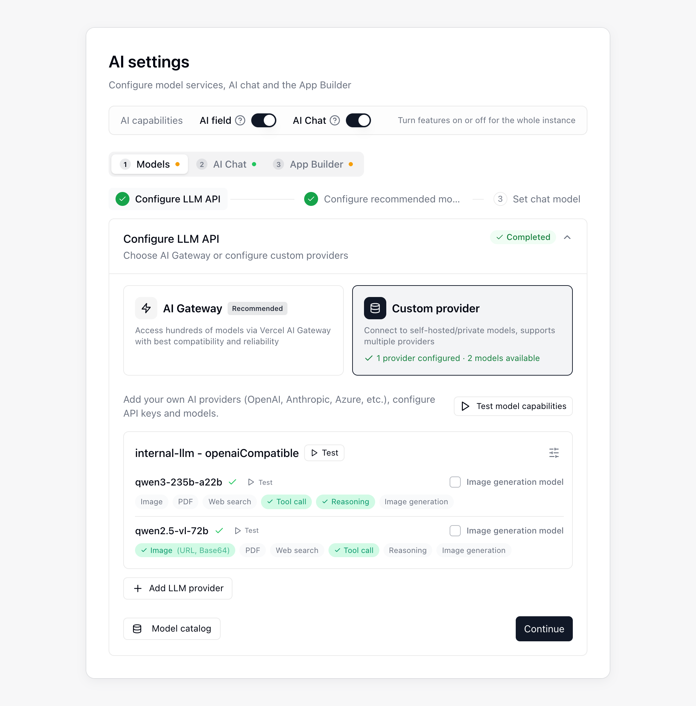

{/* mintlify-resync: 2026-10-22 */}
<Tip>Available for self-hosted Business plan and above</Tip>

Path: System Admin → AI settings

The **AI settings** page is used to configure **AI Chat**, **AI fields**, **AI automation**, and **App Builder**. The **AI capabilities** switches sit at the top of the page, and the settings below are split into three tabs, **Models**, **AI Chat**, and **App Builder**, completed in order. Each tab depends on the one before it, and the page tells you what is still missing until that one is done. The **Pending configuration** panel on the right lists the required items still missing; click one to jump to its tab and step.

## Before you start

Before you open the AI settings page, make sure the following items are ready.

| Requirement | Required? | Notes |
|------|------|------|
| **Agent Runtime setup** | Required for AI Chat and App Builder | Used by AI Chat and App Builder |
| **Custom provider** | Required when AI Chat or App Builder uses your own key (BYOK) | Use an **OpenAI Compatible** or **Anthropic** provider |
| **OpenAI API key** | Optional | Only needed if you want to enable **Voice input** in AI Chat |
| **Public access** | Required when the **Vercel** deployment engine is selected | Your **Teable instance** and **object storage (MinIO / S3)** must be publicly accessible to Vercel |

## Setup steps

The setup wizard on the **Models** tab walks through three steps for connecting and choosing models. Completed steps are collapsed; click one to expand and change it:

<Steps>
  <Step title="Configure LLM API">
    Set up your model connection and complete the initial test.
  </Step>
  <Step title="Configure recommended models">
    Choose the recommended models for AI fields and AI automation.
  </Step>
  <Step title="Set chat model">
    Choose a model for each of the four chat model tiers.
  </Step>
</Steps>

AI Chat and App Builder also need a runtime and app deployment, configured on the **AI Chat** and **App Builder** tabs respectively. Choose a [deployment option](/en/deploy/choose) and complete the deployment first, then configure them as described below.

### Configure LLM API

In the **Configure LLM API** step, click **Add LLM provider** to add a model provider, then test its models. If you use your own key (BYOK), choose **OpenAI Compatible** or **Anthropic** as the provider type.

A model's context window and maximum output per response are resolved automatically from the **Model catalog**; there is nothing to fill in. To check the values resolved for a model, open **Model catalog**, choose a **Scope** under **Inspect model** and select the model; **Parameter details** then lists the context, max output, and the source of each value.

When the catalog holds no matching entry (a newly released or self-built model, for example), the model runs on the values set under **Nothing matched** in **Matching rules**: a context window of 200000 and a max output of 32000 by default, with **Matching rule** shown as the source of both in **Parameter details**. If those values do not fit the model, adjust them in **Matching rules** and click **Save**.

### Configure recommended models

Choose the recommended models users can select in **AI fields** and **AI automation**.

### Set chat model

In **Chat model tiers**, pick a model for **Ultra**, **Smart**, **Standard**, and **Lite**; the models you can pick are grouped by source into **Vercel AI Gateway** and **Custom provider**, and the **Vercel AI Gateway** group lists only the recommended models enabled in step 2. Users choose by tier in the model menu of sidebar **AI Chat** and see the tier name rather than the model name, so you can swap the model behind a tier at any time without affecting anyone who already picked it.

| Tier | Description |
|------|------|
| **Ultra** | Top capability, for demanding work. Left empty it shows **Not offered** and stays out of the user's model menu.|
| **Smart** | The main model. AI fields, background tasks, and any tier without its own model use it, so it must be set.|
| **Standard** | Everyday chat and general tasks; also used for medium background tasks. Left empty it falls back to **Smart**.|
| **Lite** | Low-cost, high-frequency routine work; also used for lightweight tasks such as generating chat titles. Left empty it falls back to **Smart**.|

Each tier has two more controls on its right:

- **Set as default**: the tier users land on when they open the model menu. An **Ultra** with no model cannot be the default.
- **Enabled**: turn it off and the tier is no longer offered to users. The default tier cannot be turned off.

### Configure the runtime

The runtime is configured under **AI Chat runtime** on the **AI Chat** tab. After the deployment is complete, click **Run test** to verify the AI Chat runtime.

### Enable AI features

In **AI capabilities** at the top of the page, enable **AI field** and **AI Chat** as needed; these switches apply to the whole instance. Configure the runtime before using **AI Chat**.

### Configure App Builder

On the **App Builder** tab, choose how apps are deployed in **Deployment engine**:

| Deployment engine | Setup requirements |
|------|------|
| **Vercel** | Enter a Vercel access token, click **Test connection**, and use **Test public access** to confirm that Vercel can reach your Teable instance and object storage. |
| **Teable Infra** | Uses the configured Teable Infra container runtime. No additional credentials or public access test is required here. |

You can add these optional App Builder settings when needed:

| Optional item | When you need it |
|------|------|
| **Custom domain** | When you want to publish apps under your own domain |
| **App auth** | When generated apps need **Email OTP**, **Google**, or **SSO (OIDC)** sign-in |

In **App auth**, you can configure sign-in providers for generated apps:

- **Email OTP** uses an independent SMTP mailbox for app login verification emails.
- **Google OAuth** requires a client ID and client secret. Add the redirect URI shown on this page to the authorized redirect URI list in Google Cloud Console.
- **SSO (OIDC)** lets app visitors sign in through your organization's identity provider. Register the URL shown on this page as a redirect URI with your identity provider, then fill in **Authorization URL**, **Token URL**, **User info URL**, **Client ID**, and **Client secret**. If **Scope** is left empty, it defaults to `openid email profile`. If you later change a saved **Token URL**, enter the **Client secret** again.

**Teable** sign-in is available by default. **Email OTP** appears in App Builder only after the SMTP settings are complete, **Google** appears only after both OAuth credentials are configured, and **SSO (OIDC)** appears only after every SSO field except Scope is filled in.

**Auto-inject AI API key into apps** under **App settings** is on by default, so apps can call the platform's AI models. Turn it off and apps can no longer reach them.

If older apps fail to preview or publish after an upgrade, click **Run repair** under **Legacy app compatibility** in **Maintenance tools** to restore the missing files.

### Optional. Configure Voice input

To use voice input in AI Chat, enable **Voice input** on the **AI Chat** tab and enter an **OpenAI API key**. Configure the **Transcription endpoint** only when using a custom transcription service; if you change a saved **Transcription endpoint**, enter the **OpenAI API key** again. You can also limit the recording length and requests per minute.

### Verify the setup

After the setup is done, first confirm that all required items in the **Pending configuration** panel are green. Then test **AI Chat**, **AI fields**, **AI automation**, and **App Builder** one by one.

## FAQ

<AccordionGroup>
<Accordion title="I get a credit exceeded error">

Check the account or provider used by your configured model service. Top up or change the model configuration if needed.
</Accordion>

</AccordionGroup>
