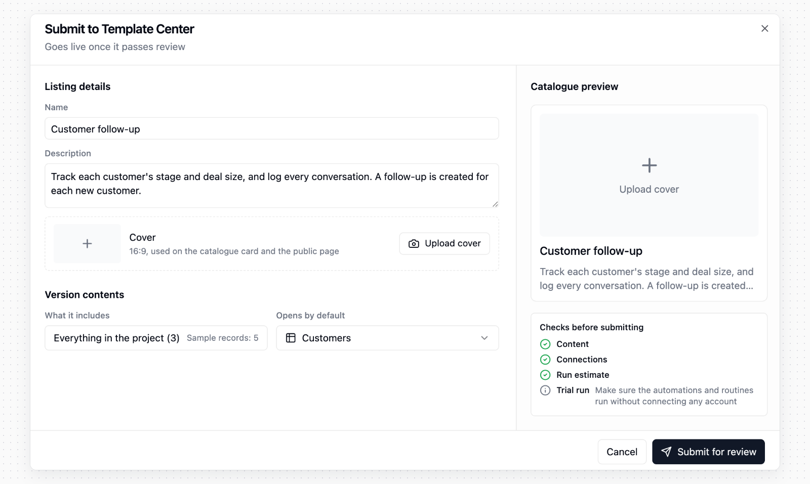

Templates are made in a **template project**. You pick what to share from a project you work in, and Teable copies its structure into a separate template project. The original project and its data are not changed, and they are never published.

## Make a template

In the project sidebar, right-click a table, app, automation or folder and choose **Make a template**. To pick from the whole project, click the project name in the top-left corner and choose **Make a template**.

Started from an item's menu, that item is already ticked; started from the project name, tick what to take in the list. Tables that an app, automation or dashboard uses come along by themselves, with the reason shown on the right. Everything else sits under **Leaving N**, which you can open to tick more. Check the name and click **Create template project**.

A template project copies the structure only: no records come along, automations start switched off, and a link to a table that stays behind becomes text. You need **Creator** access or higher in both the original project and the space. A project that was published directly before and is still listed shows **Publish to Template Center** in its project-name menu instead; to make a new template from it, start from an item's menu in the sidebar.

## Get the template project ready

When you click **Create template project**, Teable opens the new template project. It has a **Template** tag after its name, and the top of its sidebar shows its status, where it came from (**From Sales**, visible only to you), **Try it** and **Submit for review**.

Cuppy then finds what belongs only to you, lists what each would become, replaces them once you confirm, then adds sample records and drafts the setup guide. You can also add sample records yourself: when you submit, the records in the template project ship as the template's sample data.

## Try it

Click **Try it** and Teable makes a trial copy the way an install would and opens it, so you can see what others get. Click **Back to the template project** to return, or **Delete trial** when you no longer need it. Trying again moves your previous trial copy to the trash.

## Submit for review

Click **Submit for review**, fill in the name, description and cover, and choose what opens by default after an install. The whole template project is submitted: **What it includes** shows how many items and sample records go out.

**Checks before submitting** on the right holds back what belongs only to you: names, email addresses and company mail domains of people who can open the space or the project, and text that looks like an API key. Replace them, or click **Fix it** to have Cuppy replace them. **These are samples** marks everything listed as sample content and lets it through, so use it only when all of it is made up.

Once **Content** shows a green tick, click **Submit for review**. The other rows are reminders and do not block the submission.

The **Guide** row in the dialog adds a few setup steps to the template. Each step has a title, a one-line description, a place to open, and a completion condition. Use **Draft it with Teable AI** or **Edit in project**. Conditions include: sample data replaced with real content, an app published, an automation run successfully once, required accounts connected, or the user ticking it off. A data condition must not already be true on the sample records, or the template cannot be submitted.

## Review and going live

After you submit, **Submitted for review** opens, where you can **Withdraw** until the review is done. The sidebar shows **Under review**; click **View submission** to look at what you submitted.

Once approved, the template is listed in Template Center and the sidebar shows **Live · v1**. If it is sent back, the sidebar shows **Sent back** and the notification includes the reviewer's notes; make your changes and click **Resubmit**.

After it goes live, keep editing the same template project and click **Submit v2** to submit a new version. Until the new version is approved, people who install the template get the current one.

## Find template projects in a space

A space's home page has two tabs: **Projects** and **Template projects**. The **Template projects** tab shows each template's status and source; open a row to see its contents and trial copy. To start from an empty project, click **New template project** in the top-right corner of that tab.

<Note>Moving a template project to the trash takes a live template off Template Center, and restoring the project from the trash does not list it again. A submission under review is withdrawn, and your trial copies move to the trash too. Copies that others have installed are not affected.</Note>
