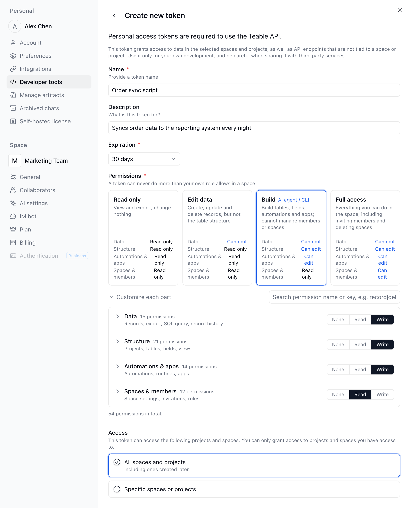

{/* mintlify-resync: 2026-10-22 */}

Los tokens de acceso personales son ideales para scripts, herramientas internas e integraciones del lado del servidor.

Si estás creando una integración multiusuario para usuarios externos, usa OAuth en su lugar: consulta [Aplicación OAuth](/es/api-doc/oauth).

## Crear un token

1. Haz clic en tu avatar de la esquina inferior izquierda y abre **Configuración** → **Herramientas para desarrolladores** → **Tokens de acceso personal** (o entra directamente en la [página de gestión de tokens](https://app.teable.ai/setting/personal-access-token)). Haz clic en **Crear nuevo token**.

2. Elige un período de caducidad para tu token. Ten en cuenta que este período no se puede modificar una vez establecido.

3. En **Permisos**, elige un nivel. Los tokens nuevos tienen seleccionado **Construir** de forma predeterminada:

   | Nivel | Qué puede hacer |
   | --- | --- |
   | **Solo lectura** | Ver y exportar, sin cambiar nada |
   | **Editar datos** | Crear, actualizar y eliminar registros, sin modificar la estructura de las tablas |
   | **Construir** | Crear tablas, modificar campos y configurar automatizaciones y apps, pero no gestionar miembros ni espacios; pensado para agentes de IA y la CLI |
   | **Acceso total** | Todo lo que puedes hacer en el espacio, incluido invitar miembros y eliminar el espacio |

   Si necesitas ajustarlo con más detalle, despliega **Personalizar cada parte** y elige **Ninguno**, **Leer** o **Escribir** para **Datos**, **Estructura**, **Automatizaciones y apps** y **Espacios y miembros**. Un token nunca puede hacer más de lo que permite tu propio rol en el espacio.

4. En **Acceso**, selecciona **Todos los espacios y proyectos** para dar acceso al token a todos los Espacios y Proyectos actuales y a los que se creen más adelante. Si solo necesita acceder a algunos recursos, selecciona **Espacios o proyectos concretos** y haz clic en **Agregar proyecto o espacio** para elegir Proyectos o Espacios concretos.



<Note>Una vez creado, tu token solo se mostrará una vez. Te recomendamos copiarlo y guardarlo en una ubicación segura.</Note>


## Usar el token

Envía el token en la cabecera `Authorization`:

```bash
curl -H 'Authorization: Bearer __token__' \
  'https://app.teable.ai/api/table/__tableId__/record'
```

¿Necesitas ayuda para encontrar IDs como `tbl...`? Consulta [Obtener IDs](/es/api-doc/get-id).
