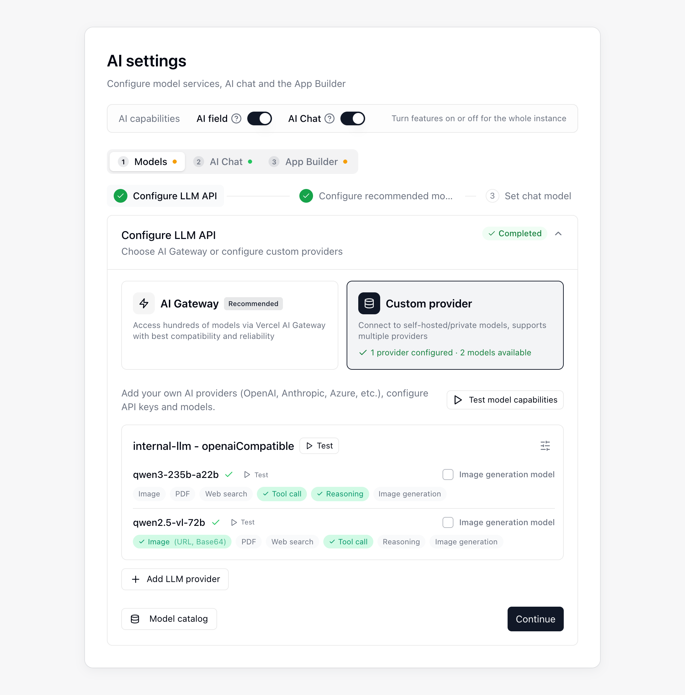

{/* mintlify-resync: 2026-10-22 */}
<Tip>Disponible para el plan Business autoalojado y los planes superiores</Tip>

Ruta: Administración del sistema → Ajustes de IA

La página **Ajustes de IA** permite configurar el **Chat de IA**, los **Campos de IA**, las **automatizaciones de IA** y **App Builder**. En la parte superior de la página está el interruptor **Capacidades de IA**; debajo, la configuración se completa en orden en las pestañas **Modelos**, **Chat de IA** y **Creador de aplicaciones**. Cada pestaña depende de la anterior y, mientras esta no esté completa, la página indica qué ajustes faltan. El panel **Configuración pendiente** de la derecha enumera los elementos obligatorios que faltan; al hacer clic en uno, se abre la pestaña y el paso correspondientes.

## Antes de empezar

Antes de abrir la página Ajustes de IA, asegúrate de que los siguientes elementos estén preparados.

| Requisito | ¿Es obligatorio? | Notas |
|------|------|------|
| **Configuración del entorno de ejecución de agentes** | Obligatoria para el Chat de IA y App Builder | La utilizan el Chat de IA y App Builder |
| **Proveedor personalizado** | Obligatorio cuando el Chat de IA o App Builder usan tu propia clave (BYOK) | Usa un proveedor **Compatible con OpenAI** o **Anthropic** |
| **Clave de API de OpenAI** | Opcional | Solo es necesaria si quieres habilitar la **Entrada de voz** en el Chat de IA |
| **Acceso público** | Obligatorio cuando se selecciona el motor de implementación **Vercel** | Tu **instancia de Teable** y el **almacenamiento de objetos (MinIO / S3)** deben ser accesibles públicamente para Vercel |

## Pasos de configuración

El asistente de configuración de la pestaña **Modelos** tiene tres pasos para conectar y elegir modelos. Los pasos completados aparecen contraídos de forma predeterminada; haz clic en uno para desplegarlo y modificarlo:

<Steps>
  <Step title="Configurar la API del LLM">
    Configura la conexión con el modelo y completa la prueba inicial.
  </Step>
  <Step title="Configurar modelos recomendados">
    Elige los modelos recomendados para los Campos de IA y las automatizaciones de IA.
  </Step>
  <Step title="Establecer modelo de chat">
    Elige un modelo para cada uno de los cuatro niveles de modelo de chat.
  </Step>
</Steps>

El Chat de IA y App Builder también necesitan un entorno de ejecución y la implementación de aplicaciones, que se configuran en las pestañas **Chat de IA** y **Creador de aplicaciones**, respectivamente. Elige primero una [opción de implementación](/es/deploy/choose) y completa la implementación; después, sigue las indicaciones de más abajo.

### Configurar la API de LLM

En el paso **Configurar la API del LLM**, haz clic en **Agregar proveedor de LLM** para añadir un proveedor de modelos y prueba sus modelos. Si usas tu propia clave (BYOK), elige **Compatible con OpenAI** o **Anthropic** como tipo de proveedor.

La ventana de contexto y la salida máxima por respuesta se obtienen automáticamente del **Catálogo de modelos**; no hay que rellenar nada. Para comprobar los valores obtenidos para un modelo, abre **Catálogo de modelos**, elige un **Ámbito** en **Inspeccionar modelo** y selecciona el modelo; **Detalle de parámetros** mostrará el contexto, la salida máxima y el origen de cada valor.

Cuando el catálogo no tiene una entrada coincidente (por ejemplo, un modelo recién publicado o propio), el modelo funciona con los valores definidos en **Sin coincidencias**, dentro de **Reglas de coincidencia**: de forma predeterminada, una ventana de contexto de 200000 y una salida máxima de 32000, y **Detalle de parámetros** indica **Regla de coincidencia** como origen de ambos. Si esos valores no se ajustan al modelo, modifícalos en **Reglas de coincidencia** y pulsa **Guardar**.

### Configurar los modelos recomendados

Elige los modelos recomendados que los usuarios pueden seleccionar en los **Campos de IA** y las **automatizaciones de IA**.

### Establecer modelo de chat

En **Niveles de modelo de chat**, elige un modelo para **Ultra**, **Smart**, **Standard** y **Lite**; los modelos disponibles se agrupan según su origen en **Vercel AI Gateway** y **Proveedor personalizado**, y el grupo **Vercel AI Gateway** solo incluye los modelos recomendados que activaste en el paso 2. Los usuarios eligen por nivel en el menú de modelos del **Chat de IA** de la barra lateral y ven el nombre del nivel en lugar del modelo, así que puedes cambiar el modelo de un nivel en cualquier momento sin afectar a quienes ya lo seleccionaron.

| Nivel | Descripción |
|------|------|
| **Ultra** | Máxima capacidad, para trabajos exigentes. Si se deja vacío, muestra **No disponible** y no aparece en el menú de modelos de los usuarios.|
| **Smart** | El modelo principal. Lo usan los campos de IA, las tareas en segundo plano y cualquier nivel sin modelo propio, por lo que debe estar configurado.|
| **Standard** | Conversaciones cotidianas y tareas generales; también se usa para tareas de fondo intermedias. Si se deja vacío, hereda **Smart**.|
| **Lite** | Trabajo rutinario de bajo costo y alta frecuencia; también se usa para tareas ligeras como generar los títulos de las conversaciones. Si se deja vacío, hereda **Smart**.|

A la derecha de cada nivel hay dos controles más:

- **Establecer como predeterminado**: el nivel con el que los usuarios abren el menú de modelos. Un **Ultra** sin modelo no puede ser el predeterminado.
- **Habilitado**: al desactivarlo, ese nivel deja de ofrecerse a los usuarios. El nivel predeterminado no se puede desactivar.

### Configurar el entorno de ejecución

El entorno de ejecución se configura en **Entorno de ejecución del chat de IA**, dentro de la pestaña **Chat de IA**. Cuando termine la implementación, haz clic en **Ejecutar la prueba** para verificar el entorno de ejecución del Chat de IA.

### Habilitar funciones de IA

En **Capacidades de IA**, en la parte superior de la página, habilita **Campo IA** y **Chat IA** según sea necesario. Estos interruptores se aplican a toda la instancia. Configura el entorno de ejecución antes de usar el **Chat de IA**.

### Configurar App Builder

En la pestaña **Creador de aplicaciones**, elige en **Motor de despliegue** cómo se implementan las aplicaciones:

| Motor de implementación | Requisitos de configuración |
|------|------|
| **Vercel** | Introduce un token de acceso de Vercel, haz clic en **Probar conexión** y usa **Probar el acceso público** para confirmar que Vercel puede acceder a tu instancia de Teable y al almacenamiento de objetos. |
| **Teable Infra** | Usa el entorno de ejecución de contenedores de Teable Infra configurado. Aquí no se requieren credenciales adicionales ni una prueba de acceso público. |

Puedes añadir estos ajustes opcionales de App Builder cuando los necesites:

| Elemento opcional | Cuándo lo necesitas |
|------|------|
| **Dominio personalizado** | Cuando quieras publicar aplicaciones en tu propio dominio |
| **Autenticación de aplicaciones** | Cuando las aplicaciones generadas necesiten iniciar sesión mediante **Código de un solo uso por correo**, **Google** o **SSO (OIDC)** |

En **Autenticación de aplicaciones**, puedes configurar proveedores de inicio de sesión para las aplicaciones generadas:

- **Código de un solo uso por correo** usa un buzón SMTP independiente para los mensajes de verificación de inicio de sesión de las aplicaciones.
- **OAuth de Google** requiere un ID de cliente y un secreto de cliente. Añade la URI de redirección que aparece en esta página a la lista de URI de redirección autorizadas de Google Cloud Console.
- **SSO (OIDC)** permite que los visitantes de la aplicación inicien sesión con el proveedor de identidad de tu empresa. Registra la URL que aparece en la página como URI de redirección en tu proveedor de identidad y, después, rellena **URL de autorización**, **URL del token**, **URL de información de usuario**, **Client ID** y **Client Secret**. Si dejas **Scope** vacío, se usa `openid email profile`. Si cambias la **URL del token** guardada, debes volver a introducir el **Client Secret**.

El inicio de sesión con **Teable** está disponible de forma predeterminada. **Código de un solo uso por correo** solo aparece en App Builder cuando se han completado los ajustes de SMTP, **Google** solo aparece cuando se han configurado ambas credenciales de OAuth, y **SSO (OIDC)** solo aparece cuando se han rellenado todos los campos de SSO salvo el scope.

La opción **Inyectar automáticamente la clave de API de IA en las aplicaciones** de **Ajustes de apps** está activada de forma predeterminada, por lo que las aplicaciones pueden llamar a los modelos de IA de la plataforma. Si la desactivas, las aplicaciones dejan de tener acceso a ellos.

Si después de una actualización las aplicaciones antiguas no se pueden previsualizar ni publicar, haz clic en **Ejecutar la reparación** en **Compatibilidad con proyectos antiguos**, dentro de **Herramientas de mantenimiento**, para restaurar automáticamente los archivos que falten.

### Opcional: configurar la Entrada de voz

Para usar la Entrada de voz en el Chat de IA, habilita **Entrada de voz** en la pestaña **Chat de IA** e introduce una **Clave de API de OpenAI**. Configura el **Endpoint de transcripción** únicamente cuando uses un servicio de transcripción personalizado; si cambias el **Endpoint de transcripción** guardado, debes volver a introducir la **Clave de API de OpenAI**. También puedes limitar la duración de las grabaciones y las solicitudes por minuto.

### Verificar la configuración

Cuando termines la configuración, confirma primero que todos los elementos obligatorios del panel **Configuración pendiente** estén en verde. Después, prueba uno por uno el **Chat de IA**, los **Campos de IA**, las **automatizaciones de IA** y **App Builder**.

## Preguntas frecuentes

<AccordionGroup>
<Accordion title="Aparece un error que indica que se han superado los Créditos">

Comprueba la cuenta o el proveedor que usa el servicio de modelos configurado. Añade saldo o cambia la configuración del modelo si es necesario.
</Accordion>

</AccordionGroup>
