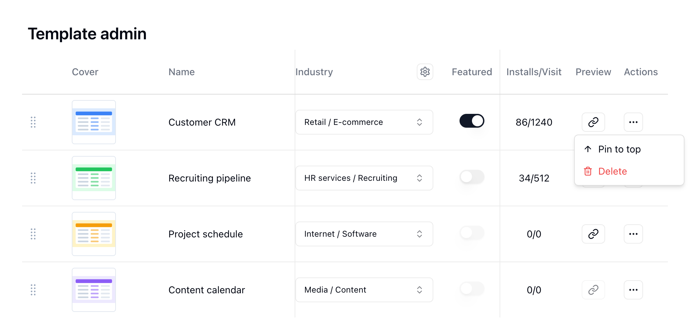

{/* mintlify-resync: 2026-10-22 */}

<Tip>Disponible para el plan Business autoalojado y los planes superiores</Tip>

### Gestión de plantillas

Las plantillas proceden de lo que publican los miembros. En cuanto un miembro publica una plantilla, su enlace se puede abrir e instalar; cuando un administrador la incluye en **Revisión de plantillas**, se publica y aparece en el centro de plantillas. Aquí, los administradores pueden ajustar la información de las plantillas, controlar su publicación y cambiar su orden.

#### Información de la plantilla

* **Portada**: La imagen de portada de la tarjeta de la plantilla
* **Nombre** y **Descripción**: El título y la descripción breve que se muestran en el centro de plantillas
* **Descripción Markdown**: Descripción detallada compatible con formato Markdown
* **Categoría**: Agrupa las plantillas por sector y subsector, o por equipo. Haz clic en el icono de ajustes junto al encabezado de la columna para abrir **Gestionar categorías**, donde puedes crear sectores, subsectores y equipos
* **Slug de URL**: El identificador que aparece en la dirección de la página pública de la plantilla. Solo admite letras minúsculas, números y guiones
* **Destacado**: Destaca la plantilla en el centro de plantillas. Solo está disponible cuando la plantilla está publicada
* **Integraciones**: Las plataformas a las que deben conectarse las automatizaciones de la plantilla. Tras instalarla, se guía al usuario para completar esas conexiones
* **Hora de instantánea**: Cuándo se publicó por última vez el contenido de la plantilla
* **Creado por**: El usuario que publicó la plantilla
* **Uso/Visitas**: Cuántas veces se ha usado y visitado la plantilla

#### Operaciones de plantilla

* **Publicado**: Activa o desactiva la publicación de la plantilla en el centro de plantillas. No afecta al enlace ni a las instalaciones. Requiere una instantánea, un nombre y una descripción.
* **Vista previa**: Abre la plantilla en una pestaña nueva
* **Fijar arriba**: Mueve la plantilla al principio de la lista. También puedes arrastrar el controlador situado al inicio de la fila para reordenar las plantillas
* **Eliminar**: Elimina la plantilla

Para actualizar el contenido de una plantilla, vuelve a abrir la ventana de publicación en el Proyecto de origen y haz clic en **Publicar v\{versión\}**. La nueva versión queda en línea al momento y las nuevas instalaciones la reciben; una plantilla incluida vuelve después a la cola de revisión.

### Revisar plantillas

En **Administración del sistema** > **Revisión de plantillas**, la **Cola de revisión** muestra las plantillas pendientes con su autor, la fecha de publicación y el resultado de las comprobaciones automáticas. Estas comprobaciones son solo avisos y no impiden aprobar: **Conexiones** indica que la plantilla usa integraciones que no se pueden conectar en esta implementación; **Privacidad** indica que la plantilla incluye registros y conviene confirmar que no contienen datos personales; **Estimación de ejecuciones** indica que el volumen de ejecuciones mensual podría superar la cuota gratuita; **Ejecución de prueba** indica que las automatizaciones no necesitan ninguna cuenta, así que conviene confirmar que funcionan sin conectar ninguna. Haz clic en **Ver** para abrir el detalle de la plantilla, previsualizar la copia y elegir el sector de la plantilla.

* **Incluir**: Muestra la versión actual en el centro de plantillas. Las nuevas versiones que publique el autor quedan en línea al momento y vuelven a la cola de revisión
* **No incluir**: La plantilla no se muestra en el centro de plantillas, y si ya estaba incluida se retira; su enlace se puede seguir abriendo e instalando

En ambos casos puedes añadir una nota, y el autor recibe una notificación con el resultado.

### Usar plantillas oficiales

Los usuarios de la versión autoalojada pueden importar plantillas desde Teable Cloud oficial:

1. **Descargar**: Obtén el archivo de exportación de Proyecto de Teable (`.tea`) del [Centro oficial de plantillas](https://teable.ai/templates)
2. **Importar**: Importa el archivo `.tea` como un Proyecto nuevo en tu Espacio
3. **Convertir en plantilla**: En el Proyecto importado, haz clic en el nombre del Proyecto en la esquina superior izquierda, elige **Convertir en plantilla**, marca lo que quieres llevar y haz clic en **Crear proyecto de plantilla**. El proyecto de plantilla solo copia la estructura, sin Registros; añade datos de ejemplo en él si los necesitas. Consulta [Convertir un Proyecto en plantilla](/es/basic/template)
4. **Completar los datos**: En la barra lateral del proyecto de plantilla, haz clic en **Publicar plantilla**, escribe un nombre y una descripción, y sube una portada
5. **Publicar e incluir**: Haz clic en **Publicar plantilla** y luego en **Incluir** en **Administración del sistema** > **Revisión de plantillas**. La plantilla se publica al momento y aparece en **Administración del sistema** > **Administración de plantillas**
