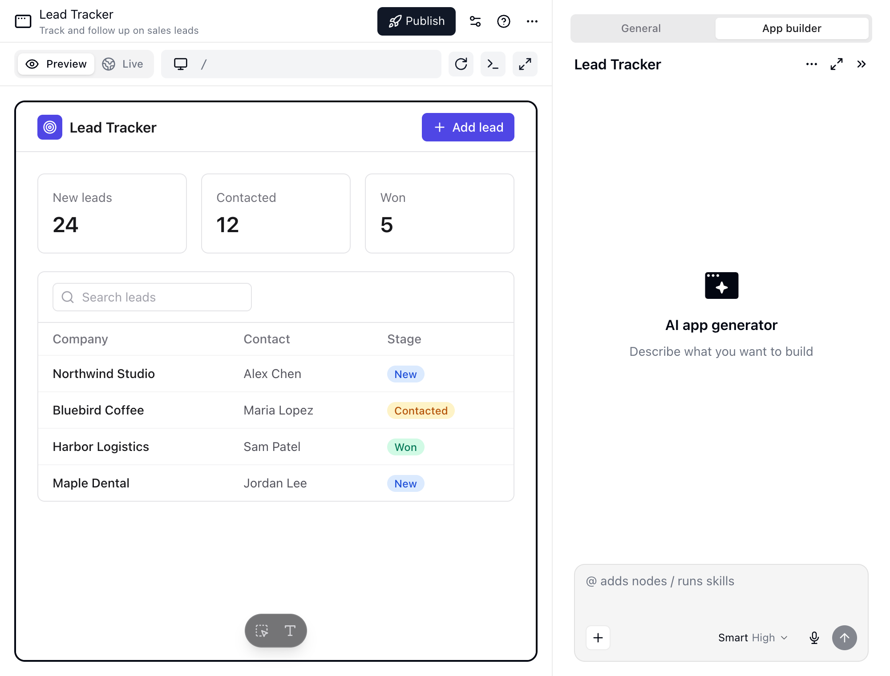
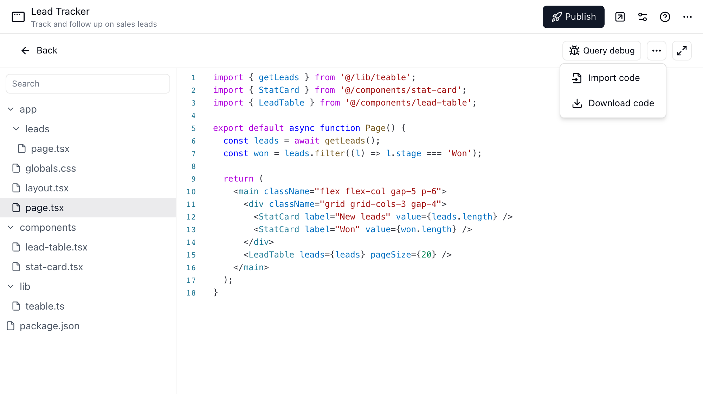
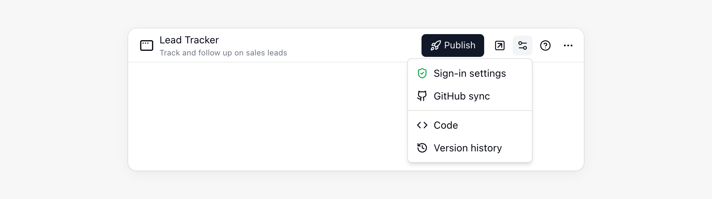
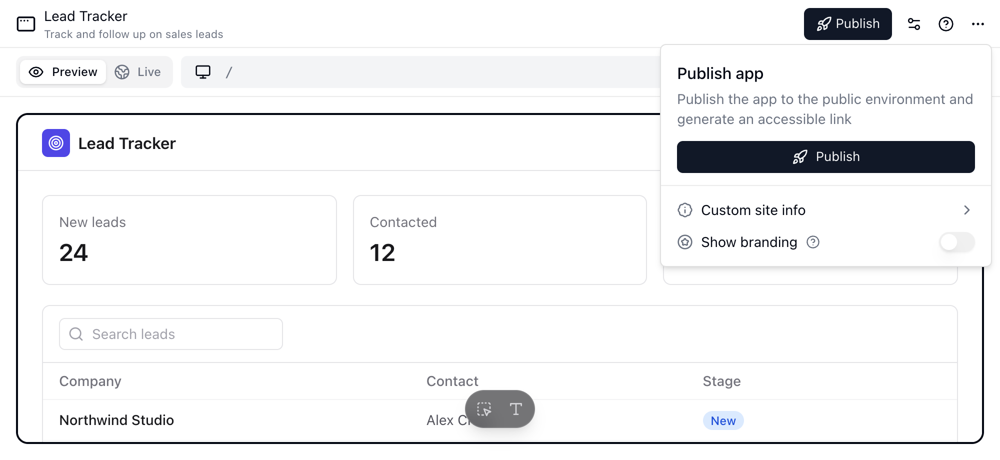
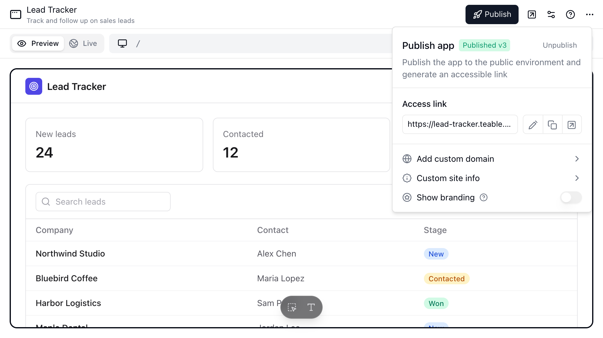
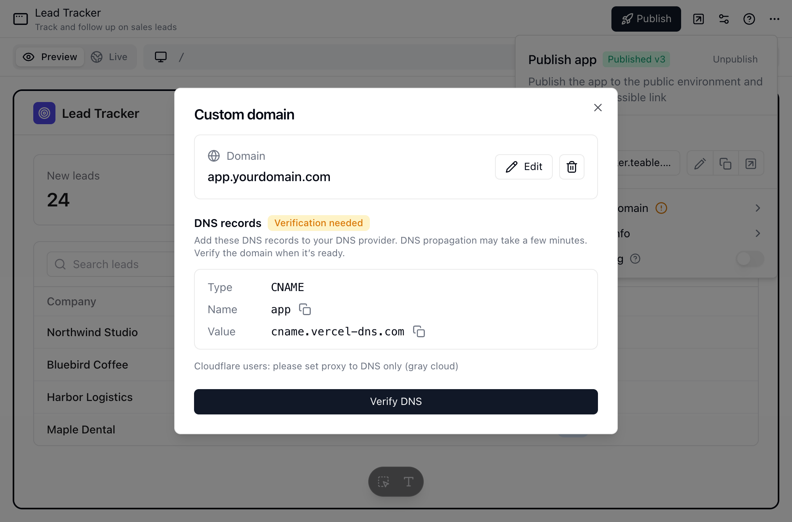
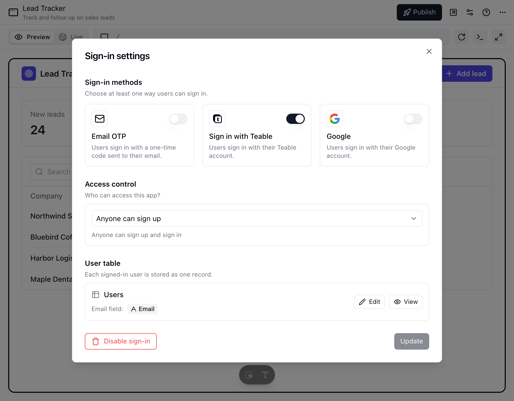
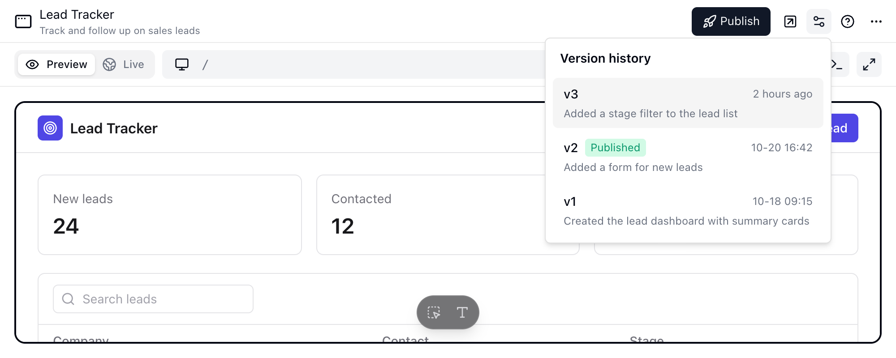

<Note>Disponible en todos los planes de Cloud; la versión autoalojada requiere el plan Business o uno superior.</Note>

App Builder de Teable permite convertir tus proyectos en aplicaciones web personalizadas y plenamente funcionales sin escribir código. Al combinar la potencia de tu estructura de datos con un diseño impulsado por IA, puedes lanzar herramientas internas, portales para clientes y paneles de datos en cuestión de minutos.

## Descripción general

App Builder sigue un flujo de trabajo de «Instrucción a aplicación». Tú describes lo que quieres y la IA crea la estructura, las páginas y la lógica de la aplicación. Después puedes ajustar cada detalle mediante el editor visual o el código.

<Note>
Usa App Builder para crear interfaces personalizadas y aplicaciones independientes. Para realizar análisis interactivos de datos y consultas puntuales dentro del Proyecto, usa el [Chat de IA](/es/basic/ai/ai-chat).
</Note>

Para ver casos de uso prácticos, consulta [ejemplos de aplicaciones creadas con IA](https://teable.ai/es/ai-app-builder).

## Crear una aplicación

Hay dos formas principales de crear una aplicación:

1. **Desde un Proyecto**: En cualquier Proyecto, haz clic en «Crear aplicación» para generar una aplicación enlazada a tus datos actuales.
2. **Desde el Chat**: Abre el Chat de IA y di «Crea una aplicación de CRM para esta Tabla de clientes».

Como ejemplo educativo, descubre cómo [Zakrly organiza los datos de enseñanza y diseña interfaces para su portal de estudiantes](https://teable.ai/es/customers/zakrly).

## Interfaz del editor de aplicaciones

App Builder ofrece una interfaz doble tanto para usuarios sin conocimientos técnicos como para desarrolladores.

### 1. Interfaz de chat (impulsada por IA)
El centro de control de tu aplicación.
- **Edición mediante lenguaje natural**: Describe cambios como *«Haz que el encabezado sea azul»* o *«Añade un formulario para enviar Registros nuevos»*.
- **Enrutamiento automático**: La IA entiende a qué componente o página te refieres y lo modifica directamente.
- **Solicitudes de credenciales**: Cuando la aplicación necesita acceder a una cuenta externa o a un secreto al ejecutarse, App Builder fija una tarjeta en el panel de chat, por ejemplo **Esta aplicación necesita tu conexión de Slack**. Haz clic en **Conectar mi cuenta** para iniciar un flujo de OAuth; la nueva conexión se concede de inmediato a esta aplicación. Si ya tienes una conexión o un secreto que sirva, basta con concederlo: no hace falta volver a conectar. Con **Omitir** no facilitas la credencial; la IA continúa con las partes que puede completar sin ella.
- **Habilidades**: Abre el menú **+** y elige **Habilidades** para administrar las habilidades de esta conversación de la aplicación. Las habilidades añadidas aquí solo están disponibles para la aplicación actual; también pueden usarse las que se comparten con el Proyecto y el Espacio de la aplicación. Escribe `/` en el cuadro de entrada para elegir una habilidad habilitada.
- **Gestionar archivos**: Abre **+** → **Más** → **Gestionar archivos** para consultar los archivos del entorno aislado de la aplicación. Úsalo para obtener una vista previa de los archivos compatibles, descargar archivos generados o eliminar los archivos y carpetas que ya no necesites.
- **Borrar conversación**: Si la conversación actual se ha desviado, haz clic en el botón **`...`** de la parte superior del panel de chat y selecciona **Borrar chat** para iniciar una sesión nueva. Esto borra el historial del chat de la conversación actual, pero no elimina la aplicación. La primera vez se muestra una confirmación, y puedes elegir que no vuelva a aparecer.

### 2. Panel de vista previa
- **Vista previa y publicada**: El panel tiene dos pestañas. **Vista previa** ejecuta la versión que estás creando, incluidos los cambios que aún no se han publicado. **En vivo** carga la aplicación publicada desde su dirección pública para que puedas comparar lo que ven los usuarios con aquello en lo que estás trabajando. Hasta que se publique la aplicación, **En vivo** muestra una indicación para publicarla. App Builder abre las aplicaciones publicadas en **En vivo** y las no publicadas en **Vista previa**; después recuerda la última pestaña que usaste con cada aplicación.
- **Simulación multidispositivo**: Usa el selector de la parte superior para alternar entre las Vistas **Escritorio**, **Tableta** y **Móvil**.
- **Generación en directo**: El panel de vista previa puede mostrar cómo toma forma la aplicación mientras App Builder la genera.
- **Respuesta inmediata**: Cuando App Builder termina un cambio, la vista previa se actualiza con la última versión guardada.

En la pestaña **Vista previa**, usa la barra de herramientas flotante de la parte inferior para realizar cambios específicos:

- Haz clic en **Selecciona un elemento para editarlo** y haz clic en un elemento de la vista previa. App Builder añade el elemento a la entrada del chat. Añade tu instrucción y envía el mensaje para que la IA pueda actualizar esa parte concreta de la aplicación.
- Elige **Editar el texto directamente**, haz clic en un texto estático de la vista previa y escribe el contenido que lo sustituirá. Puedes editar más de un elemento de texto antes de hacer clic en **Guardar**. Haz clic en **Descartar los cambios** para deshacer los cambios de texto pendientes.

El texto dinámico, como el contenido cargado desde los datos o calculado por la aplicación, no se puede editar directamente. Selecciona el elemento y describe el cambio en el chat. La selección de elementos y la edición directa de texto se ponen en pausa mientras la IA está generando. Pulsa `Esc` para salir de cualquiera de los modos.

### 3. Modo de desarrollador (editor de código)
Para una personalización ilimitada, tienes acceso directo al código.
- **Editor Monaco**: Una experiencia similar a VS Code directamente en el navegador.
- **Componentes de React**: Edita el código React subyacente, las clases de Tailwind CSS y la lógica.
- **Árbol de archivos**: Navega por la estructura del proyecto.

#### Descargar código
Puedes descargar toda la aplicación como archivo ZIP en cualquier momento:
1. Haz clic en el botón **Configuración** (icono de controles deslizantes) del encabezado de la aplicación y selecciona **Código**.
2. Haz clic en el menú **`...`** de la parte superior de la vista de código.
3. Selecciona **Descargar código** y, en el cuadro de diálogo, vuelve a hacer clic en **Descargar código** para guardar un archivo ZIP que incluya todos los archivos de origen.

De forma predeterminada, el ZIP no incluye las credenciales válidas de la aplicación. En su raíz hay un `.env.example` que enumera las [variables de ejecución inyectadas por la plataforma](#teable-access-token) (las que Teable añade automáticamente a cada aplicación), con el token de acceso de Teable y la clave de acceso a la IA en blanco, y un `.gitignore` que deja los archivos `.env` fuera de Git.

Para ejecutar el código en local de inmediato, marca **Incluir el .env con las credenciales válidas** en el cuadro de diálogo. En ese caso, el ZIP incluye el `.env` real: las variables de ejecución inyectadas por la plataforma, incluidos el token de acceso de Teable y, cuando el acceso a la IA está activado, la clave de acceso a la IA. Las credenciales concedidas a la aplicación no forman parte de él.

<Warning>
Cualquier persona que tenga este `.env` puede leer y modificar todos los datos del Proyecto al que pertenece la aplicación. No lo confirmes en un repositorio ni lo compartas; si puede haberse filtrado, [rota el token de acceso de Teable](#teable-access-token).
</Warning>

#### Importar código
Puedes actualizar el código de la aplicación importando un archivo ZIP:
1. Haz clic en el botón **Configuración** del encabezado de la aplicación y selecciona **Código**.
2. Haz clic en el menú **`...`** de la parte superior de la vista de código.
3. Selecciona **Importar código** y elige un archivo ZIP de hasta 20 MB.

<Note>
- Incluye únicamente archivos de origen. `node_modules`, `.next` y otros artefactos de compilación se ignoran automáticamente.
- El ZIP sustituye el proyecto existente. Los archivos que omitas se eliminan de la versión nueva.
- Si el ZIP contiene una carpeta contenedora, Teable elimina esa carpeta. Puedes comprimir directamente la carpeta de nivel superior del proyecto.
- El proyecto importado debe incluir `package.json` en la raíz del proyecto.
- Las variables personalizadas de un archivo `.env` situado en la raíz del ZIP se guardan como secretos tuyos y se conceden a la aplicación con esos mismos nombres. Las demás variantes `.env*`, como `.env.local`, se ignoran.
</Note>

#### Credenciales y configuración

No escribas claves de API, credenciales ni valores de configuración en el código fuente. Una aplicación usa **tus credenciales**: una conexión OAuth o un secreto que guardas. En el panel de chat del App Builder, abre **+** → **Más** → **Credenciales y configuración** y concede una credencial a la aplicación.

| Detalle | Comportamiento |
| --- | --- |
| Disponibilidad | Las credenciales concedidas a la aplicación están disponibles en el entorno de vista previa y en la aplicación publicada |
| Nombre de la variable | El alias que introduces al conceder; empieza por mayúscula y solo admite mayúsculas, dígitos y guiones bajos |
| Leer un secreto | El código de servidor lee variables de entorno como `process.env.MY_API_KEY` |
| Leer una conexión | El código de servidor llama a `getConnectionToken('ALIAS')` para obtener un token de acceso |
| Valores guardados | Los valores son de solo escritura tras guardarlos; introduce uno nuevo para sustituirlo |

Después de añadir o quitar una concesión, o de sustituir el valor de una credencial, el entorno de vista previa usa el valor nuevo. La aplicación publicada solo lo usa cuando vuelves a publicarla.

Copiar una aplicación no copia sus credenciales: el panel conserva marcadores **Sin vincular** y **Vincular la mía** aporta la tuya. Al copiar o exportar un Proyecto, o al usar una plantilla, el `.env` del código de la aplicación tampoco se traslada, y cada aplicación copiada recibe su propio token de acceso de Teable. Para gestionar credenciales y ver dónde se usan, consulta [Credenciales e integraciones](/es/basic/credential); para saber cómo se copian las Tablas, los Registros y el resto de un Proyecto, consulta [Duplicar un Proyecto en otro Espacio](/es/basic/base#duplicate-a-base-to-another-space).

#### Token de acceso de Teable {#teable-access-token}

Las variables de entorno de una aplicación proceden de dos fuentes:

- **Variables inyectadas por la plataforma**: Teable las proporciona a todas las aplicaciones; incluyen el token de acceso de Teable (`TEABLE_APP_TOKEN`), el punto de conexión de la API y los ID de la aplicación y del Proyecto. Con el **Acceso a la IA** activado, se añaden el punto de conexión y la clave de acceso a la IA.
- **Credenciales concedidas a la aplicación**: los secretos y las conexiones que concedes en **Credenciales y configuración**, descritos más arriba.

Los tokens de acceso personal (**Configuración** → **Herramientas para desarrolladores** → **Tokens de acceso personal**) nunca se inyectan en una aplicación, y el código de la aplicación no los necesita; sirven para llamar a Teable desde fuera de la aplicación. Consulta [Credenciales para servicios externos y MCP](#credentials-for-external-services-and-mcp).

El token de acceso de Teable es la credencial que usa la aplicación para leer y escribir datos. Puede acceder a todo el Proyecto al que pertenece la aplicación; no se puede limitar a algunas Tablas o Campos ni puede acceder a otros Proyectos. Se usa en el entorno de vista previa de la aplicación y en la aplicación publicada. Teable nunca lo confirma en el repositorio de la aplicación, y el código descargado no lo incluye de forma predeterminada. Normalmente, cada aplicación tiene su propio token; consulta [Cuándo cambia o deja de funcionar el token](#when-the-token-changes-or-stops-working).

Rota el token cuando:

- Pueda haberse filtrado; por ejemplo, si se confirmó un `.env` en un repositorio o se pegó en una incidencia de GitHub, una publicación de un foro o un chat.
- Un miembro que copió las variables de entorno o descargó el código con un `.env` ya no trabaje en el Proyecto.
- El código de la aplicación se haya entregado a alguien junto con su `.env`.

En el panel de chat, abre **+** → **Más** → **Credenciales y configuración** y haz clic en **Rotar**, en la esquina superior derecha de la tarjeta **Credenciales de la plataforma**. Aquí se rotan tanto el token de acceso de Teable como la clave de acceso a la IA, y para hacerlo se necesita acceso de edición a la aplicación.

Cuando la aplicación tiene el acceso a la IA activado, la confirmación permite elegir qué rotar: **Token de acceso de Teable**, **Clave de acceso a la IA** o ambos, que es la opción predeterminada. Un `.env` contiene los dos valores, así que, si sospechas que se ha filtrado, rota ambos. Tanto si rotas uno como los dos, la vista previa y la aplicación publicada se actualizan una sola vez. La confirmación enumera los efectos de lo que hayas seleccionado.

| Elemento | Tras la rotación |
| --- | --- |
| Token anterior | Deja de funcionar de inmediato |
| Vista previa en ejecución | Pasa al token nuevo sin reiniciarse |
| Aplicación publicada | Teable la vuelve a implementar en segundo plano con el token nuevo; no aparece nada nuevo en el historial de versiones. Hasta que termina la nueva implementación, normalmente en unos minutos, la aplicación no puede leer ni escribir datos del Proyecto. Si la aplicación tiene cambios sin publicar, Teable vuelve a implementar la versión ya publicada, y tus cambios sin publicar siguen sin publicar |
| Usuarios con sesión iniciada en la aplicación | Si la aplicación usa el [inicio de sesión en la aplicación](#inicio-de-sesión-en-la-aplicación), los visitantes deben volver a iniciar sesión |
| `.env` local y código descargado | El token anterior que contienen deja de funcionar; vuelve a copiar las variables de entorno o descarga el código marcando **Incluir el .env con las credenciales válidas** |

Algunas aplicaciones procedentes de copias antiguas de Proyectos comparten un mismo token. Al rotar una de ellas, también se rotan todas las demás aplicaciones del Proyecto que aún lo comparten, cada una con su propio token nuevo, y un aviso indica cuántas se han rotado.

La nueva implementación automática de Teable solo cambia el token: vuelve a implementar la versión ya publicada y nunca publica cambios que no hayas publicado. Volver a publicar significa que tú publicas la versión actual desde el panel de publicación, incluidos los cambios sin publicar. Si ves **Credenciales rotadas, pero la aplicación publicada no se pudo actualizar automáticamente. Vuelve a publicarla.**, o si esta aplicación (o una aplicación rotada con ella) sigue sin poder leer datos al cabo de unos minutos, vuelve a publicar esa aplicación para que use el token nuevo. Si la vista previa no puede leer datos, vuelve a cargarla.

#### Cuándo cambia o deja de funcionar el token {#when-the-token-changes-or-stops-working}

| Acción | Token de acceso de Teable |
| --- | --- |
| Crear una aplicación | Se emite un token nuevo |
| Copiar una aplicación, copiar o importar un Proyecto, usar una plantilla | Cada copia recibe su propio token nuevo; el token de la aplicación original no cambia |
| [Mover la aplicación a otro Proyecto](/es/basic/base#mover-recursos-a-otro-proyecto) | Se sustituye por un token nuevo y el anterior deja de funcionar de inmediato. La vista previa pasa al token nuevo y la aplicación publicada se vuelve a implementar en segundo plano, como tras una rotación |
| Publicar, volver a publicar, revertir a una versión | No cambia |
| Retirar la publicación | No cambia; el token sigue funcionando y la vista previa lo sigue usando |
| Descargar el código, copiar las variables de entorno | No cambia; obtienes el mismo token cada vez hasta que se rote |
| Rotar | Se sustituye por un token nuevo y el anterior deja de funcionar de inmediato (consulta más arriba) |
| Eliminar la aplicación | Deja de funcionar de inmediato. Si la aplicación se restaura desde la papelera, el mismo token vuelve a funcionar |

Los tokens se emiten con una validez de 10 años y funcionan hasta que se rotan o se elimina la aplicación; no caducan por sí solos. Si sospechas una filtración, rota el token. Si restauras una aplicación desde la papelera y su token puede haberse filtrado, rótalo después de restaurarla.

#### Entradas de auditoría {#audit-records}

Estas acciones quedan anotadas en el registro de auditoría:

- **Rotar token de acceso de la aplicación** y **Rotar clave de IA de la aplicación**: una rotación desde la tarjeta **Credenciales de la plataforma** genera una entrada por cada credencial rotada.
- **Copiar las variables de entorno de la app**: copiar las variables de entorno, que incluyen el token de acceso.
- **Exportar código de la app**: descargar el código; la entrada indica si se incluyó el `.env`.

Cuando una aplicación escribe datos del Proyecto con su token de acceso, el registro de auditoría muestra **App Robot** como operador. No hay historial de uso ni alertas por token, y las lecturas no se registran.

En las instancias autoalojadas (plan Business o superior), los administradores de la instancia consultan el registro en **Administración del sistema** → **Registro de auditoría**. Las entradas se conservan un mes y se pueden filtrar por usuario, Espacio, Proyecto y tipo de operación; las entradas indicadas arriba están en el grupo **Aplicaciones**. Consulta [Registro de auditoría](/es/basic/admin-panel/audit-log).

#### Credenciales para servicios externos y MCP {#credentials-for-external-services-and-mcp}

El token de acceso de Teable es solo para la propia aplicación. No lo uses en servicios ajenos a la aplicación; tampoco sirve para conectar MCP.

- **Servicios externos que llaman a la API de Teable** (por ejemplo, funciones serverless, scripts o CI): usa un [token de acceso personal](/es/api-doc/token). Añade solo los Proyectos o Espacios y los ámbitos de permisos que necesite, y define una fecha de caducidad. Un token de acceso personal actúa como el usuario que lo creó.
- **Clientes MCP**: conéctalos con OAuth (recomendado). El cliente actúa en tu nombre y puedes quitarlo en cualquier momento en **Configuración** → **Herramientas para desarrolladores** → **MCP**. Donde no haya navegador, usa en su lugar un token de acceso personal, también con solo los Proyectos y los ámbitos de permisos que necesite. Consulta [Conectar mediante MCP](/es/basic/ai/teable-skill#conectar-mediante-mcp).

#### Administrar los archivos de la aplicación

App Builder almacena los archivos cargados, los resultados generados y los archivos de ejecución en el entorno aislado de la aplicación. En el panel de chat, abre **+** → **Más** → **Gestionar archivos** para examinarlos. Los tipos de archivo compatibles se abren en una vista previa. También puedes descargar archivos o eliminar los archivos y carpetas que ya no necesites.

#### Añadir funciones de IA a una aplicación

Añade IA cuando la aplicación necesite resumir Registros, clasificar solicitudes, redactar respuestas o responder preguntas de sus usuarios.

Puedes indicar a App Builder lo que quieres, por ejemplo: «Añade un asistente de IA para responder incidencias de soporte» o «Resume cada envío de formulario». App Builder puede activar el **Acceso a la IA** y añadir el código de la función.

<Info>
Después de que App Builder añada la función de IA, la vista previa de la aplicación usa la versión nueva. La aplicación publicada solo la usa después de volver a publicarla.
</Info>

Teable también inyecta la clave de acceso a la IA, y la tarjeta **Credenciales de la plataforma** la muestra junto al token de acceso. Para sustituirla, haz clic en **Rotar** en la tarjeta y selecciona solo **Clave de acceso a la IA**: la clave anterior deja de funcionar de inmediato, la vista previa en ejecución pasa a la clave nueva y la aplicación publicada se vuelve a implementar en segundo plano; sus llamadas de IA fallan hasta que termine. Rotar solo la clave de acceso a la IA no cierra la sesión de los visitantes. Si la aplicación tiene cambios sin publicar, se vuelve a implementar la versión ya publicada y tus cambios siguen sin publicar. Si las llamadas de IA siguen fallando al cabo de unos minutos, vuelve a publicar la aplicación.

## Sincronizar el código con GitHub

<Note>Disponible en los planes Business de Cloud y superiores.</Note>

Vincula una aplicación con un repositorio privado de GitHub cuando quieras revisar el código en solicitudes de incorporación de cambios, conservar una copia fuera de Teable o trabajar en la aplicación desde tu editor local. Una vez vinculados, la aplicación y el repositorio se sincronizan en ambas direcciones: cada versión nueva de la aplicación se envía a GitHub y las confirmaciones que envíes a GitHub se convierten en versiones nuevas de la aplicación.

### Conectar una cuenta y crear el repositorio

Primero, genera la aplicación al menos una vez. Mientras la aplicación no tenga código, **Sincronización con GitHub** aparece atenuada en el menú **Configuración** y no se puede seleccionar.

<Steps>
  <Step title="Abrir el panel de GitHub">Haz clic en el botón **Configuración** del encabezado de la aplicación y selecciona **Sincronización con GitHub**. Necesitas acceso de edición a la aplicación.</Step>
  <Step title="Conectar una cuenta">Haz clic en **Conectar GitHub** y completa la instalación en la ventana emergente. Elige tu cuenta personal o una organización que administres. Permite las ventanas emergentes si el navegador las bloquea.</Step>
  <Step title="Elegir la cuenta">Selecciona la cuenta conectada en **Cuenta de GitHub**. Haz clic en **+** para conectar otra.</Step>
  <Step title="Asignar un nombre al repositorio">El **Nombre del repositorio** se completa previamente a partir del nombre de la aplicación. Los nombres pueden contener letras, dígitos, `.`, `-` y `_`, hasta un máximo de 100 caracteres.</Step>
  <Step title="Crear y vincular">Haz clic en **Crear repositorio y vincular**. En las cuentas personales, GitHub te pide que autorices la creación en otra ventana emergente.</Step>
</Steps>

Teable crea un repositorio privado nuevo y confirma el código actual de la aplicación en la rama `main`, junto con un archivo README que enlaza con la aplicación y explica cómo se mantienen sincronizados ambos elementos. No puedes vincular una aplicación con un repositorio que ya exista.

De forma predeterminada, las conexiones pertenecen a quien las creó. Para permitir que los colaboradores creen aplicaciones en la misma cuenta de organización, selecciona la conexión y activa **Permitir que otros miembros usen esta conexión**. Los demás miembros con acceso de edición a la aplicación podrán crear repositorios para sus propias aplicaciones en esa organización. Las conexiones personales no se pueden compartir porque GitHub exige la autorización del propietario de la cuenta para crear un repositorio.

### Cómo funciona la sincronización

| Dirección | Qué ocurre |
| --- | --- |
| Aplicación → GitHub | Cada versión nueva de la aplicación se envía a la rama `main` del repositorio. |
| GitHub → aplicación | Las confirmaciones enviadas a `main` se convierten en una versión nueva de la aplicación. Un mensaje del panel de chat informa de lo que se ha sincronizado, y las vistas previas abiertas vuelven a cargarse con el código nuevo. |

Los archivos de entorno nunca se envían. Consulta **Variables de entorno y desarrollo local** más adelante.

El panel muestra el estado actual junto al nombre del repositorio:

| Estado | Significado | Qué hacer |
| --- | --- | --- |
| **Sincronizado** | El repositorio coincide con la última versión de la aplicación. | No se requiere ninguna acción. |
| **Sincronizando** | Hay un envío en curso. | Espera; el panel se actualiza automáticamente. |
| **Conflicto** | La rama `main` tiene confirmaciones que Teable no produjo y que no se pueden combinar automáticamente. | Fusiona la rama `teable-sync` en GitHub. Consulta la información siguiente. |
| **En pausa** | Teable ha detenido la sincronización porque la aplicación de GitHub se ha desinstalado o suspendido. | El panel indica cuál de estas situaciones ha ocurrido. Al levantar una suspensión, la sincronización se reanuda automáticamente. |
| **Error** | El último intento de sincronización ha fallado. | Lee el motivo en el panel y haz clic en **Reintentar**. |

### Resolver un conflicto

Teable nunca fuerza el envío a tu rama. Cuando los historiales divergen, coloca la última versión de la aplicación en una rama llamada `teable-sync` y marca el vínculo como **Conflicto**. Fusiona `teable-sync` en `main` desde GitHub; la fusión vuelve como una versión nueva de la aplicación y el vínculo regresa al estado **Sincronizado**. Mientras dure el conflicto, las versiones posteriores de la aplicación siguen avanzando la rama `teable-sync`, por lo que fusionarla siempre incorpora el trabajo más reciente.

### Variables de entorno y desarrollo local

El repositorio solo contiene el código fuente. Teable nunca envía archivos cuyos nombres comiencen por `.env`: ni en la raíz del proyecto, ni en una subcarpeta ni en el historial de confirmaciones. Los valores de entorno proceden de las variables inyectadas por la plataforma y de las credenciales concedidas a la aplicación (consulta [Token de acceso de Teable](#teable-access-token)); Teable los gestiona y nunca entran en Git. El archivo `.gitignore` del repositorio ya incluye `.env*`, por lo que un clon local no confirmará ninguno por accidente.

Para ejecutar la aplicación en tu propio equipo:

<Steps>
  <Step title="Clonar e instalar">Clona el repositorio y ejecuta `pnpm install`.</Step>
  <Step title="Copiar las variables">En el panel de GitHub o en **Credenciales y configuración**, haz clic en **Copiar las variables de entorno al portapapeles** y pega el contenido del portapapeles en un archivo `.env` situado en la raíz del proyecto.</Step>
  <Step title="Iniciar la aplicación">Ejecuta `pnpm dev`.</Step>
</Steps>

Lo copiado son solo las variables de ejecución inyectadas por la plataforma: el punto de conexión de la API, el token de acceso y las variables de acceso a IA. En **Credenciales y configuración**, el botón también indica **Solo las variables de ejecución inyectadas por la plataforma: las credenciales concedidas no se incluyen**. Ni las variables copiadas ni el código descargado incluyen las credenciales concedidas a la aplicación; si las necesitas para depurar en local, añádelas tú mismo al archivo `.env`.

<Warning>
La línea `TEABLE_APP_TOKEN` de ese archivo concede acceso a los datos de la aplicación; por este motivo, solo pueden copiarla los miembros con acceso de edición a la aplicación. Nunca confirmes el archivo ni lo pegues en una incidencia o solicitud de incorporación de cambios. Si puede haberse filtrado, [rota el token de acceso de Teable](#teable-access-token).
</Warning>

Para añadir o sustituir una credencial que la aplicación usa en producción, utiliza **Credenciales y configuración** en Teable; editar el archivo local o confirmar un `.env` en GitHub no surte efecto. Cuando cambie una variable de plataforma, por ejemplo tras rotar el token de acceso de Teable o la clave de acceso a la IA, vuelve a copiar las variables para actualizar tu archivo `.env` local.

### Desvincular el repositorio

Haz clic en el icono de eliminación situado junto al nombre del repositorio y confirma. La sincronización se detiene, pero el repositorio y su código permanecen en GitHub. Si vuelves a vincular la misma aplicación más adelante, se creará un repositorio nuevo en lugar de reconectarla con el anterior.

## Publicación y gestión

### Publicar la aplicación
Cuando la aplicación esté lista, haz clic en el botón **Publicar** (icono de flecha) de la esquina superior derecha.
- **URL pública**: Teable genera una URL segura y de acceso público para tu aplicación.
- **Dominio personalizado**: Asocia tu propio dominio a la aplicación.
- **Mostrar la marca**: Usa **Mostrar la marca** en el menú **Publicar** para controlar si la aplicación publicada muestra el distintivo **Creado con Teable**. Si cambias este ajuste después de publicar, haz clic en **Volver a desplegar** para aplicarlo.
- **Despublicar**: En una aplicación publicada, usa **Despublicar** en el menú de publicación para desactivar el enlace público.
- **Cambios en la configuración de la aplicación**: Cuando el menú de publicación muestre **La configuración de ejecución ha cambiado. Vuelve a desplegar para aplicarla a la aplicación en vivo** o **La configuración de marca ha cambiado. Vuelve a desplegar para aplicarla a la aplicación en vivo**, haz clic en **Volver a desplegar**.
- **Abrir la aplicación publicada**: Una vez publicada la aplicación, el icono situado junto a **Publicar** abre la aplicación publicada en una pestaña nueva.

<Info>Ocultar el distintivo **Creado con Teable** requiere el plan Business o uno superior.</Info>

Como ejemplo de sitio público, descubre cómo [Waconzy reúne música, herramientas y servicios digitales con App Builder](https://teable.ai/es/customers/waconzy).

### Retirar la publicación de una aplicación

Para retirar una aplicación publicada, abre el menú **Publicar** y haz clic en **Despublicar**. Después de confirmar, ya no se podrá acceder a la URL pública de la aplicación.

Retirar la publicación no elimina la aplicación ni su historial de edición. Puedes seguir editándola y volver a publicarla más adelante.

### Dominios personalizados

<Note>Los dominios personalizados requieren el plan Business o uno superior.</Note>

En las implementaciones autoalojadas que no ejecutan las aplicaciones en Vercel, **Dominio personalizado** abre la guía [Dominios de aplicaciones](/es/deploy/app-domains), y es el administrador del servidor quien configura la asignación del dominio. Los pasos siguientes se aplican a Teable Cloud.

Usa **Dominio personalizado** para vincular un dominio a la aplicación publicada. Se recomienda un subdominio, como `app.yourdomain.com`. Después de introducir el dominio, Teable muestra los registros DNS que debes añadir. Añade los registros mediante tu proveedor de DNS, espera a que se propaguen y verifica después el dominio en Teable.

También puedes usar un subdominio disponible de `teable.app` y editar el prefijo de `teable.app`, por ejemplo, `your-name.teable.app`.

Cuando vence el plan Business del Espacio, Teable avisa a los propietarios del Espacio de que el dominio personalizado dejará de resolverse. Renueva antes de esa fecha para conservar el dominio. Si no se renueva, el dominio personalizado deja de resolverse y el enlace público de la aplicación vuelve a la dirección predeterminada de Teable. Si más adelante vuelves al plan Business, tendrás que vincular de nuevo el dominio personalizado manualmente.

### Información personalizada del sitio

Usa **Información personalizada del sitio** en el menú **Publicar** para definir el icono de la pestaña del navegador, el título y la descripción de la página de la aplicación publicada. El cuadro de diálogo muestra una vista previa conjunta mientras los editas.

| Ajuste | Qué controla |
| --- | --- |
| **Favicon** | El icono que aparece en la pestaña del navegador. Carga un archivo PNG, JPEG, WebP, SVG o ICO de hasta 5 MB; el tamaño recomendado es 32×32. Elimina el archivo cargado para volver al icono predeterminado de Teable. |
| **Título** | El título de la página, de hasta 120 caracteres. |
| **Descripción** | La descripción del sitio incluida en los metadatos de la página, de hasta 500 caracteres. |

Deja un Campo vacío para conservar el valor que App Builder escribió por ti. Al guardar, el cambio se aplica al entorno de vista previa de la aplicación; la aplicación publicada solo lo usa después de volver a publicarla.

### Inicio de sesión en la aplicación

Para exigir que los visitantes inicien sesión antes de poder usar la aplicación, haz clic en el botón **Configuración** del encabezado y selecciona **Añadir inicio de sesión**. Una vez configurado, esa opción del menú pasa a ser **Ajustes de inicio de sesión**; si desactivas el inicio de sesión, se muestra **Inicio de sesión desactivado**.

Cuando habilitas el inicio de sesión:

1. Elige dónde se almacenarán los usuarios de la aplicación. Puedes crear una Tabla **Usuarios** o reutilizar una Tabla existente que tenga un Campo de correo electrónico. Cada usuario que inicia sesión se almacena como un Registro y varias aplicaciones pueden reutilizar la misma Tabla de usuarios.
2. Elige al menos un método de inicio de sesión, como **Código de un solo uso por correo**, **Google**, **SSO (OIDC)** o **Iniciar sesión con Teable**. Los métodos disponibles dependen de los ajustes de autenticación de la instancia. Si activas **SSO (OIDC)** en una aplicación creada anteriormente, la IA añade automáticamente un botón de SSO a su página de inicio de sesión.
3. Elige una política de acceso: **Cualquiera puede registrarse**, **Dominios de correo permitidos** o **Solo por invitación**.

Los cambios en el inicio de sesión aparecen en el entorno de vista previa de la aplicación después de volver a cargarlo. Publica de nuevo la aplicación para aplicar esos cambios a la aplicación publicada.

Si necesitas tu propio cliente de Google OAuth, enviar códigos de acceso desde tu dirección de correo o iniciar sesión con contraseña, solicítalo expresamente en el chat. App Builder desactivará el inicio de sesión integrado de la plataforma e implementará uno personalizado en la aplicación. Comprueba el inicio de sesión y los controles de acceso a las páginas en la vista previa antes de volver a publicar la aplicación.

Para ver ejemplos de esta función, consulta [ejemplos de inicio de sesión en aplicaciones](https://teable.ai/es/blog/built-in-login-for-app-builder).

### Historial de versiones y reversión
Teable realiza un seguimiento automático de cada implementación.
- Haz clic en el botón **Configuración** del encabezado de la aplicación y selecciona **Historial de versiones** para consultar una lista de todas las versiones implementadas.
- **Reversión con un clic**: Si una actualización nueva provoca problemas, puedes devolver inmediatamente la aplicación publicada a cualquier versión estable anterior.

App Builder guarda los cambios de cada ronda como una versión nueva. Cuando el guardado falla, aparece una tarjeta en el chat.

<Warning>
Los cambios de la ronda fallida solo quedan en el sandbox; se pierden cuando el sandbox se recicla, y regenerar la respuesta tampoco los guarda. Atiende la tarjeta cuanto antes.
</Warning>

- **No se pudo guardar la versión**: esta versión no se guardó. Deja que App Builder siga trabajando: el próximo guardado correcto se llevará también estos cambios.
- **Cambios demasiado grandes para guardar**: esta ronda supera el límite de tamaño de guardado. Pulsa **Enviar a la IA** en la tarjeta y App Builder buscará artefactos de prueba, archivos de depuración o adjuntos demasiado grandes, los limpiará y volverá a guardar. Esos archivos pueden estar ya en el historial de confirmaciones sin guardar, así que borrarlos puede no bastar: deja que App Builder también ordene ese historial.

### Corrección automática
Si tus cambios en el código personalizado provocan un error de compilación, la implementación fallará. 
- Teable proporciona un botón **Corrección automática** junto al registro de errores.
- Al hacer clic en él, la IA puede analizar el error de compilación y aplicar automáticamente un parche al código para resolver el problema.

### Eliminar una aplicación
Para eliminar una aplicación, haz clic en el botón **`...`** del encabezado de la aplicación y selecciona **Eliminar**.

## Prácticas recomendadas

Para consultar patrones de instrucciones, consejos de creación, recomendaciones de reversión y soluciones a problemas habituales, consulta la [Guía práctica de App Builder](/es/basic/ai/app-builder-practical-guide).

## Preguntas frecuentes

<AccordionGroup>
  <Accordion title="¿Borrar la conversación elimina la aplicación?">
    No. Borrar la conversación solo elimina el historial del chat de la conversación actual de la aplicación. No elimina la propia aplicación. Úsalo cuando la conversación se haya desviado y quieras volver a empezar.
  </Accordion>

  <Accordion title="¿Cómo descargo o importo el código de una aplicación?">
    Haz clic en el botón **Configuración** del encabezado de la aplicación, selecciona **Código**, haz clic en el menú **`...`** de la parte superior de la vista de código y elige **Descargar código** o **Importar código**. Los archivos ZIP importados pueden tener hasta 20 MB y sustituyen el proyecto existente, así que incluye todos los archivos de origen que quieras conservar. El proyecto importado debe incluir un archivo `package.json` en la raíz. Las variables personalizadas de un archivo `.env` situado en la raíz se guardan como secretos tuyos y se conceden a la aplicación con esos mismos nombres.
  </Accordion>

  <Accordion title="¿Qué hago si se filtra el token de acceso de una aplicación?">
    En el panel de chat, abre **+** → **Más** → **Credenciales y configuración** y haz clic en **Rotar** en la tarjeta **Credenciales de la plataforma**; si la aplicación tiene acceso a la IA, mantén seleccionadas ambas credenciales. El token anterior deja de funcionar de inmediato, y la vista previa y la aplicación publicada pasan al nuevo automáticamente. Mientras la aplicación publicada se vuelve a implementar, normalmente durante unos minutos, no puede leer ni escribir datos y, si la aplicación tiene el inicio de sesión activado, los visitantes deben volver a iniciar sesión. Consulta [Token de acceso de Teable](#teable-access-token).
  </Accordion>

  <Accordion title="¿Cuándo se aplican los ajustes de inicio de sesión a la aplicación publicada?">
    Los ajustes de inicio de sesión aparecen en el entorno de vista previa de la aplicación después de volver a cargarlo. Publica de nuevo la aplicación para aplicar esos cambios a la aplicación publicada.
  </Accordion>

  <Accordion title="¿Cómo puede una aplicación llamar a modelos de IA durante la ejecución?">
    Indica a App Builder la función de IA que quieres, como un asistente de respuestas, un resumen de envíos o un clasificador de solicitudes. App Builder puede habilitar el **Acceso a la IA** y añadir el código de la función. La vista previa de la aplicación usa la versión nueva cuando App Builder termina el cambio. La aplicación publicada solo la usa después de volver a publicarla. Las llamadas de IA realizadas mediante esta aplicación aparecen como **IA de la aplicación** en los detalles de uso de Créditos.
  </Accordion>

  <Accordion title="¿Cómo se cobran la IA integrada y la IA dentro de las aplicaciones?">
    La **IA integrada** incluye las funciones de IA disponibles directamente en Teable, como la generación mediante Campos de IA, el Chat de IA, el Bot de mensajería instantánea y App Builder. Actualmente, estas funciones consumen Créditos con una tarifa considerablemente reducida.

    La **IA dentro de las aplicaciones** hace referencia a las funciones de IA utilizadas en las aplicaciones creadas con App Builder. El uso se cobra al [precio oficial de la API](https://vercel.com/ai-gateway/models) del proveedor de modelos seleccionado, sin recargos ni descuentos. Un dólar estadounidense de uso de la API equivale a 100 Créditos.
  </Accordion>

  <Accordion title="¿Cómo vuelvo a una versión anterior?">
    Haz clic en el botón **Configuración** del encabezado de la aplicación y selecciona **Historial de versiones** para consultar las versiones implementadas y restaura después la aplicación publicada a una versión estable anterior.
  </Accordion>

  <Accordion title="¿Por qué indica App Builder que se alcanzó el límite de conversaciones simultáneas?">
    Cada usuario puede ejecutar hasta 3 agentes al mismo tiempo, incluidos el Chat de IA y App Builder. Si App Builder muestra `Se alcanzó el límite de conversaciones simultáneas (3). Espera a que termine alguna.`, significa que todavía se está ejecutando otra tarea. Espera a que termine la tarea anterior antes de continuar.
  </Accordion>

  <Accordion title="¿Cómo se reembolsan los Créditos cuando falla una ejecución de App Builder?">
    Una ejecución de App Builder puede incluir varios pasos de procesamiento. Tanto la conversación como la página de facturación muestran el total de Créditos de esa ejecución. El trabajo que Cuppy ya haya completado y guardado se puede seguir usando. Si el último paso se interrumpe por un error inesperado, los Créditos de ese paso se reembolsan automáticamente. Puedes seguir trabajando en la misma conversación de la aplicación.
  </Accordion>

  <Accordion title="¿Dónde configuro App Builder para una instalación autoalojada?">
    Si ejecutas Teable en una instalación autoalojada, sigue la configuración de la página [Ajustes de IA](/es/basic/admin-panel/ai-setting). Si App Builder usa tu propia clave (BYOK), el modelo de chat debe proceder de un proveedor **Compatible con OpenAI** o **Anthropic**. Para obtener ayuda con la implementación, contacta con Teable en **support@teable.ai**.

    <Note>
    Si seleccionas **Vercel** en **Motor de despliegue**, asegúrate de que tanto la instancia de Teable como el almacenamiento de objetos (MinIO / S3) sean accesibles públicamente y usa después **Probar el acceso público** en la página [Ajustes de IA](/es/basic/admin-panel/ai-setting). Esta comprobación no es necesaria cuando seleccionas **Teable Infra**.
    </Note>
  </Accordion>
</AccordionGroup>

Si estás comparando plataformas, consulta [comparación de Teable y Lovable](https://teable.ai/es/compare/lovable-alternative) o [comparación de Teable y Softr](https://teable.ai/es/compare/softr-alternative).
