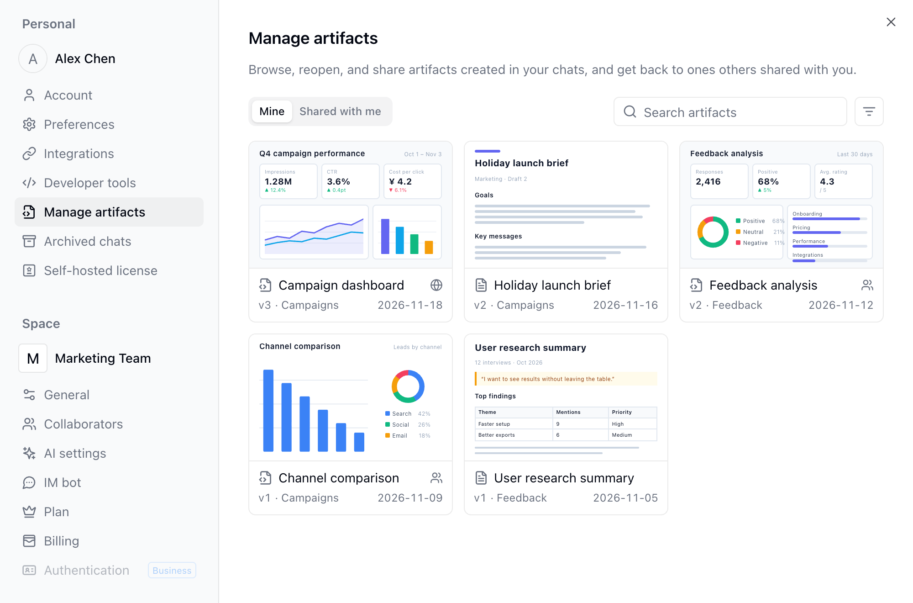

Cuando la IA genera en el chat un gráfico, un informe, una página similar a un panel o una pequeña herramienta como una calculadora, guarda el resultado como un **artefacto**: una página que se representa por separado, fuera de la conversación, y que puede ser una página HTML interactiva o un informe Markdown. El artefacto aparece como una tarjeta en el chat y sigue disponible cuando termina la conversación.

Para generar un artefacto, describe el resultado que quieres en el [Chat de IA](/es/basic/ai/ai-chat), por ejemplo «Genera un gráfico con la tendencia semanal de ventas» o «Crea un informe resumido a partir de estos Registros». Los artefactos generados durante la ejecución de una [rutina](/es/basic/ai/routine) pertenecen al responsable de esa ejecución.

<Info>
Un artefacto conserva los datos que la IA incluyó en él al crearlo, por lo que no se actualiza automáticamente, y la página no puede leer ni modificar Tablas. Para crear una página que siga leyendo datos activos de una Tabla o que recopile entradas y almacene estados, crea una aplicación con [App Builder](/es/basic/ai/app-builder).
</Info>

## Ver y modificar

Haz clic en la tarjeta del chat para abrir el visor del artefacto. Desde el visor puedes:

- Usar **Pantalla completa** o **Abrir en nueva página** para dar más espacio al artefacto.
- **Descargar** la versión que estás viendo: las páginas HTML se descargan como archivo `.html` y los informes Markdown como archivo `.md`.
- Abrir la lista de versiones para consultar las versiones anteriores.
- **Eliminar** el artefacto. La eliminación no se puede deshacer: sus tarjetas del chat pasan a mostrarse como eliminadas y el enlace para compartir deja de funcionar.

Para cambiar un artefacto, pídeselo a la IA en la misma conversación. Cada revisión se convierte en una nueva versión del mismo artefacto, no en uno independiente, por lo que el enlace para compartir sigue funcionando. Si abres una versión anterior y haces clic en **Restaurar esta versión**, se crea una versión nueva con su contenido y las versiones posteriores se conservan.

Si la página no se ejecuta, el visor muestra el error en la parte superior. Haz clic en **Arreglar con IA**: Teable inicia un chat nuevo en el proyecto al que pertenece el artefacto y envía el error a la IA. Haz clic en **Ver** en el aviso para abrir el chat de reparación y seguir su progreso.

## Compartir un artefacto

De forma predeterminada, solo quien creó el artefacto puede verlo; ni siquiera los demás miembros del mismo proyecto tienen acceso. Para que otras personas puedan verlo, activa el uso compartido.

<Steps>
  <Step title="Activar el uso compartido">
    Haz clic en **Compartir** en el visor y habilita **Activar compartir**. A partir de ese momento, otras personas pueden abrir el artefacto con su enlace.
  </Step>
  <Step title="Elegir quién puede verlo">
    **Quién puede ver** está establecido de forma predeterminada en **Cualquiera con el enlace**, que permite abrirlo sin iniciar sesión. Con **Miembros del espacio**, solo pueden abrirlo los miembros del espacio o del proyecto que hayan iniciado sesión.
  </Step>
  <Step title="Añadir una contraseña (opcional)">
    En **Avanzado**, activa **Protección con contraseña** y Teable generará una contraseña automáticamente; los visitantes deben introducirla antes de ver el contenido. La contraseña solo se muestra justo después de generarse, así que haz clic en ese momento en **Copiar enlace y contraseña** para copiar ambos a la vez. Más adelante puedes hacer clic en **Establecer contraseña** para definir una propia o cambiarla; después del cambio, los visitantes tendrán que introducir la nueva.
  </Step>
  <Step title="Enviar el enlace">
    Haz clic en el botón **Copiar enlace**, junto al enlace, para copiarlo. Si el enlace se ha difundido más de lo previsto, desactiva **Activar compartir** y dejará de funcionar para los demás. Al volver a activarlo, el enlace es el mismo y se conservan los ajustes de quién puede verlo y de contraseña; para impedir el acceso a quienes ya tienen el enlace, cambia a **Miembros del espacio** en cuanto lo actives, o activa **Protección con contraseña** y cambia la contraseña.
  </Step>
</Steps>

Quienes abren el artefacto mediante el enlace siempre ven la versión más reciente y no pueden consultar las anteriores. También pueden hacer clic en **Descargar** en la página para descargar esa versión. Con el uso compartido activado, el enlace también se puede insertar en otros sitios web mediante un iframe.

Para ver ejemplos de esta función, consulta [ejemplos de informes de IA compartibles](https://teable.ai/es/blog/introducing-artifacts-share-data-reports-anywhere).

## Encontrar artefactos más adelante

Abre tu avatar de la esquina inferior izquierda → **Configuración** → **Gestionar artifacts**. También puedes abrirlo desde un chat mediante **+** → **Más** → **Gestionar artifacts**.

- **Míos**: Muestra como tarjetas los artefactos que has creado, con una miniatura de la primera pantalla de la página en la parte superior de cada tarjeta y un icono que indica con quién está compartido. En el menú **...** de cada tarjeta puedes elegir **Compartir**, **Descargar**, **Abrir en nueva página** o **Eliminar**; haz clic en la tarjeta para abrir el visor.
- **Compartidos conmigo**: Los artefactos que tus compañeros han compartido con **Miembros del espacio** (los ves siempre que pertenezcas a ese espacio o proyecto, sin abrir antes el enlace), además de los compartidos con **Cualquiera con el enlace** que abriste con la sesión iniciada. Cada tarjeta muestra quién lo compartió; haz clic en uno para abrirlo en una pestaña nueva. Si se desactiva el uso compartido, deja de incluirte o se elimina el artefacto, el elemento deja de mostrarse.

Ambas pestañas se ordenan por la última actualización y se pueden buscar por nombre o por quién compartió. Haz clic en el botón **Filtrar** junto al cuadro de búsqueda para filtrar por **Quién puede ver** (en **Míos** también puedes elegir **Sin compartir**) y **Proyecto**; los proyectos eliminados o a los que ya no tienes acceso se agrupan en la opción **Proyectos no disponibles**.

La pestaña **Artifacts** del [panel de recursos](/es/basic/ai/ai-chat#ver-recursos-junto-al-chat) muestra de forma predeterminada los artefactos que has creado en el espacio actual y los que tus compañeros compartieron con los miembros del espacio. Haz clic en **Filtrar** para acotarlos por **Creador** (**Creados por mí** o **Compartidos por otros**) y **Proyecto** (por ejemplo, **Proyecto actual**). Tus artefactos se abren en el panel de recursos; los compartidos por compañeros, en una página nueva.

## Preguntas frecuentes

<AccordionGroup>
  <Accordion id="artifact-sharing-faq" title="¿Pueden mis compañeros de equipo abrir un artefacto que he creado?">
    De forma predeterminada, no, aunque estén en el mismo proyecto. Activa **Activar compartir** en el visor y envíales el enlace; elige **Miembros del espacio** si el contenido no debe salir del espacio. Los miembros del espacio también lo encontrarán directamente en **Compartidos conmigo** dentro de **Gestionar artifacts**.
  </Accordion>

  <Accordion title="¿En qué se diferencia un artefacto de una aplicación creada con App Builder?">
    Un artefacto es una instantánea de los datos en el momento en que la IA lo generó, adecuada para informes, gráficos y análisis puntuales. Una aplicación lee y escribe en las Tablas en tiempo real, puede recopilar entradas y guardar estados, y está pensada para herramientas y páginas de uso continuado.
  </Accordion>

  <Accordion title="¿Generar un artefacto consume créditos?">
    Generar y modificar un artefacto forma parte del Chat de IA, así que consume créditos según el uso real de la conversación. Verlo, compartirlo y descargarlo no consume créditos.
  </Accordion>
</AccordionGroup>
