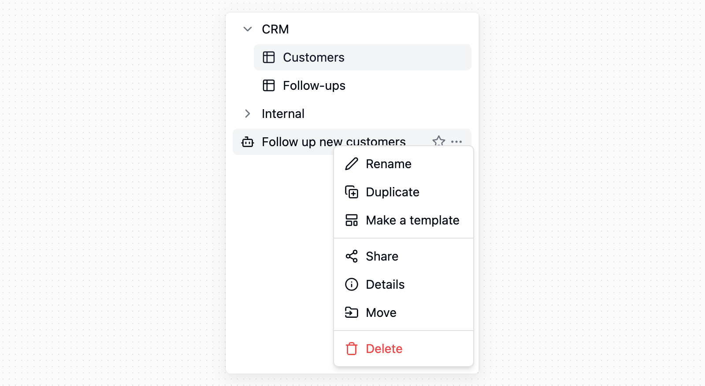
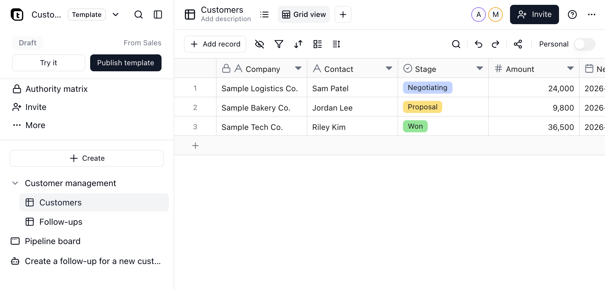

Las plantillas se crean en un **proyecto de plantilla**. Eliges qué compartir de un Proyecto en el que trabajas y Teable copia su estructura en un proyecto de plantilla aparte. El Proyecto original y sus datos no cambian, y nunca se publican.

## Crear una plantilla

En la barra lateral del Proyecto, haz clic con el botón derecho en una Tabla, una aplicación, una automatización o una carpeta y elige **Convertir en plantilla**. Para elegir entre todo el Proyecto, haz clic en el nombre del Proyecto en la esquina superior izquierda y elige **Convertir en plantilla**.

Si empiezas desde el menú de un elemento, ese elemento ya aparece marcado; si empiezas desde el nombre del Proyecto, marca en la lista lo que quieres llevar. Las Tablas que usa una aplicación, una automatización o un panel se incluyen solas, con el motivo indicado a la derecha. Todo lo demás queda en **Se quedan N**, que puedes desplegar para marcar más elementos. Revisa el nombre y haz clic en **Crear proyecto de plantilla**.

Un proyecto de plantilla solo copia la estructura: no incluye Registros, las automatizaciones empiezan desactivadas y un Campo de enlace a una Tabla que se queda fuera pasa a ser texto. Necesitas acceso de **Creador** o superior tanto en el Proyecto original como en el Espacio. Un Proyecto que se publicó antes directamente y sigue en el centro de plantillas muestra en cambio **Publicar en el centro de plantillas** en el menú de su nombre; para crear una plantilla nueva a partir de él, empieza desde el menú de un elemento de la barra lateral.

## Preparar el proyecto de plantilla

Al hacer clic en **Crear proyecto de plantilla**, Teable abre el nuevo proyecto de plantilla. Tiene la etiqueta **Plantilla** tras su nombre, y la parte superior de su barra lateral muestra su estado, su origen (**De Ventas**, visible solo para ti), **Probar** y **Publicar plantilla**.

Después, Cuppy busca lo que solo te pertenece a ti, indica por qué se sustituirá cada cosa, la sustituye cuando lo confirmas y luego añade Registros de ejemplo y redacta la guía de instalación. También puedes añadir Registros de ejemplo tú mismo: al publicar, los Registros del proyecto de plantilla se publican como datos de ejemplo de la plantilla.

## Probar la plantilla

Haz clic en **Probar** y Teable crea una copia de prueba igual que lo haría una instalación y la abre, para que veas lo que reciben los demás. Haz clic en **Volver al proyecto de plantilla** para regresar, o en **Eliminar prueba** cuando ya no la necesites. Si vuelves a probar, tu copia de prueba anterior pasa a la papelera.

## Publicar la plantilla

Haz clic en **Publicar plantilla**, completa el nombre y la descripción, sube una portada y elige qué se abre por defecto después de instalarla. La portada y la descripción son obligatorias: se muestran cuando se comparte el enlace de la plantilla. Se publica el proyecto de plantilla completo: **Publicar nodos** muestra cuántos elementos y Registros de ejemplo se publican.

**Comprobaciones antes de publicar**, a la derecha, retiene lo que solo te pertenece a ti: nombres, direcciones de correo y dominios de correo corporativo de las personas que pueden abrir el Espacio o el Proyecto, y texto que parece una clave de API. Sustitúyelos o haz clic en **Corregir** para que Cuppy los sustituya. **Son ejemplos** marca todo lo listado como contenido de ejemplo y lo deja pasar, así que úsalo solo si todo es inventado.

Cuando la fila **Contenido** muestre una marca verde, haz clic en **Publicar plantilla**. Las demás filas son avisos y no impiden publicar.

La fila **Guía** de la ventana añade a la plantilla unos pasos de configuración. Cada paso tiene un título, una descripción de una línea, un lugar que abrir y una condición de finalización. Redáctala con **Redactarla con Teable AI** o usa **Editar en el proyecto**. Las condiciones pueden ser: datos de ejemplo sustituidos por contenido real, un Registro propio añadido por el usuario, una aplicación publicada, una automatización ejecutada correctamente una vez, cuentas necesarias conectadas o que el usuario marque el paso como hecho. Una condición sobre datos no puede cumplirse ya con los Registros de ejemplo; si no, la plantilla no se puede publicar.

## Después de publicar

La plantilla queda en línea en cuanto haces clic en **Publicar plantilla**: se abre **¡Publicación exitosa!** con **Publicada · v1** y el enlace de la plantilla. Cualquiera con el enlace puede abrirla e instalarla al momento. Copia el enlace o compártelo directamente.

Tras publicar hay una revisión. Solo decide si el centro de plantillas incluye la plantilla y no afecta al enlace ni a las instalaciones. Una vez incluida, la barra lateral muestra también **En el centro de plantillas**. Si no se incluye, recibes una notificación, y el enlace se puede seguir abriendo, instalando y compartiendo.

Sigue editando en el mismo proyecto de plantilla y haz clic en **Publicar v2** para publicar una nueva versión. También queda en línea al momento, y las nuevas instalaciones la reciben. Si la plantilla está incluida, el centro de plantillas muestra también la nueva versión, y la revisión llega después.

Para retirar la plantilla, haz clic en **Despublicar** en la ventana de publicación. El enlace deja de abrirse y el centro de plantillas deja de mostrarla. Las copias que otros ya instalaron no se ven afectadas, y puedes volver a publicarla más adelante.

## Encontrar los proyectos de plantilla de un Espacio

La página de inicio de un Espacio tiene dos pestañas: **Proyectos** y **Proyectos de plantilla**. La pestaña **Proyectos de plantilla** muestra el estado y el origen de cada plantilla; abre una fila para ver su contenido y su copia de prueba. Para empezar desde un Proyecto vacío, haz clic en **Nuevo proyecto de plantilla** en la esquina superior derecha de esa pestaña.

<Note>Al mover un proyecto de plantilla a la papelera, su plantilla también se despublica: el enlace deja de abrirse, el centro de plantillas deja de mostrarla y restaurar el proyecto desde la papelera no la vuelve a publicar. Tus copias de prueba también van a la papelera. Las copias que otros ya instalaron no se ven afectadas.</Note>
