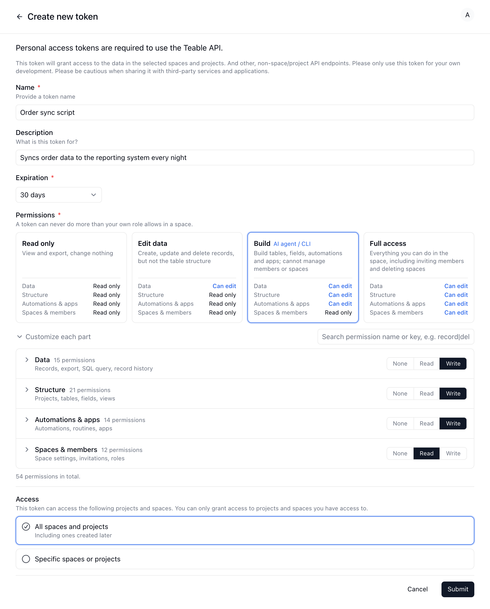
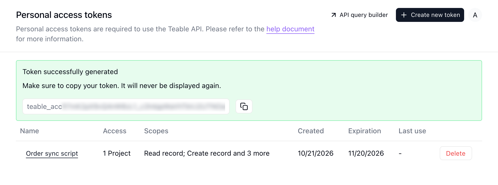

{/* mintlify-resync: 2026-10-22 */}

Les jetons d’accès personnels sont particulièrement adaptés aux scripts, aux outils internes et aux intégrations côté serveur.

Si vous créez une intégration multi-locataire destinée à des utilisateurs externes, utilisez plutôt OAuth : consultez [Application OAuth](/fr/api-doc/oauth).

## Créer un jeton

1. Cliquez sur votre avatar en bas à gauche, puis ouvrez **Paramètres** → **Outils de développement** → **Jetons d'accès personnel** (ou accédez directement à la [page de gestion des jetons](https://app.teable.ai/setting/personal-access-token)). Cliquez sur **Créer un nouveau jeton**.

2. Choisissez une durée d’expiration pour votre jeton. Notez que cette durée ne peut pas être modifiée une fois définie.

3. Dans **Permissions**, choisissez un niveau. Les nouveaux jetons sont réglés par défaut sur **Construire** :

   | Niveau | Ce que le jeton peut faire |
   | --- | --- |
   | **Lecture seule** | Consulter et exporter, sans rien modifier |
   | **Modifier les données** | Créer, modifier et supprimer des enregistrements, sans toucher à la structure des tables |
   | **Construire** | Créer des tables, modifier des champs, configurer des automatisations et des apps, sans gérer les membres ni les espaces ; adapté aux agents IA et à la CLI |
   | **Accès complet** | Tout ce que vous pouvez faire dans l’espace, y compris inviter des membres et supprimer l’espace |

   Pour un réglage plus fin, dépliez **Personnaliser chaque partie** et choisissez **Aucun**, **Lecture** ou **Écriture** pour **Données**, **Structure**, **Automatisations et apps** et **Espaces et membres**. Un jeton ne peut jamais faire plus que ce que votre propre rôle autorise dans l’espace.

4. Dans **Accès**, sélectionnez **Tous les espaces et projets** pour donner au jeton l’accès à tous les Espaces et Projets actuels et à ceux créés par la suite. Pour limiter l’accès à certaines ressources, sélectionnez **Espaces ou projets spécifiques**, puis cliquez sur **Ajouter un projet ou un espace** pour choisir des Projets ou des Espaces précis.



<Note>Une fois votre jeton créé, il ne sera affiché qu’une seule fois. Nous vous recommandons de le copier et de le conserver dans un emplacement sécurisé.</Note>



## Utiliser le jeton

Envoyez le jeton dans l’en-tête `Authorization` :

```bash
curl -H 'Authorization: Bearer __token__' \
  'https://app.teable.ai/api/table/__tableId__/record'
```

Vous avez besoin d’aide pour trouver des ID tels que `tbl...` ? Consultez [Obtenir des ID](/fr/api-doc/get-id).
