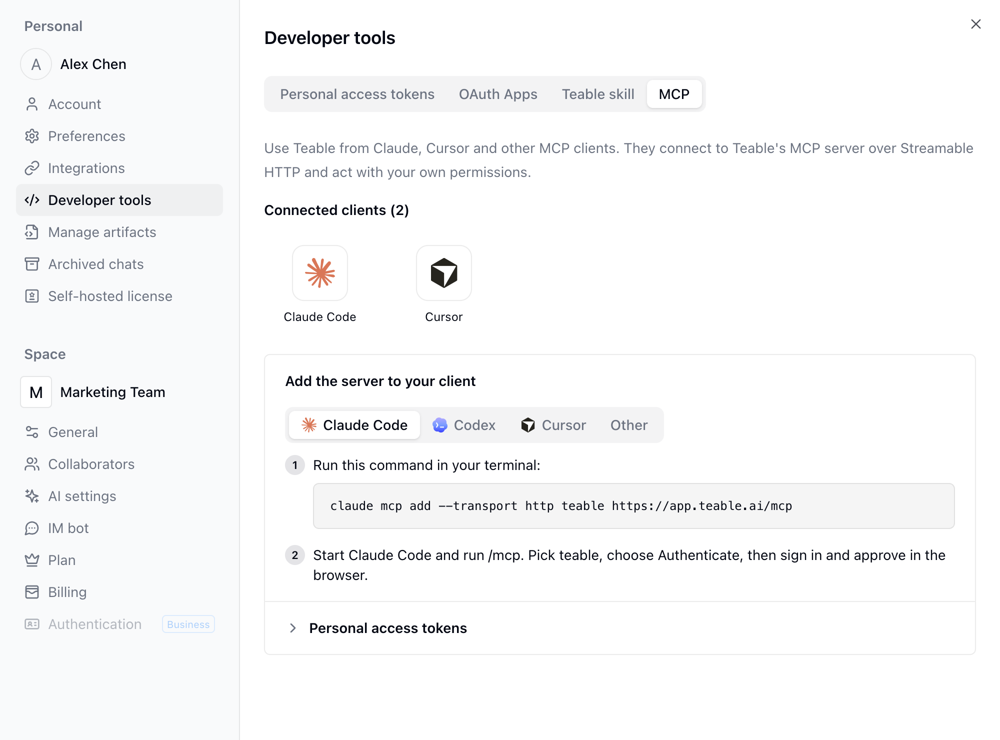

{/* mintlify-resync: 2026-10-22 */}

## Installer Teable Skill

Ouvrez votre avatar en bas à gauche → **Paramètres** → **Outils de développement** → **Compétence Teable** pour copier l’invite ou la commande d’installation de votre instance Teable actuelle.

Copiez cette invite dans votre agent IA :

```text wrap
Veuillez lire https://github.com/teableio/agent-skills, suivre le guide pour m’aider à installer la compétence d’agent Teable, puis terminer l’authentification Teable CLI.
```

Ou installez-la directement :

```bash
npx skills add https://github.com/teableio/agent-skills
```

## Essayer Teable Skill

Une fois la compétence installée, essayez ces invites.

<CodeGroup>

```text Invites simples pour débuter wrap
Créez une Table CRM simple dans <Projet> {collez l’URL du Projet}.
```

```text Fichiers locaux → Teable wrap
Importez toutes les factures de ce dossier local dans <Table des reçus> {collez l’URL de la Table} et extrayez les Champs clés.
```

```text Données multiplateformes → Teable wrap
Importez les nouvelles issues GitHub dans <Suivi des bugs> {collez l’URL de la Table}.
```

```text Nettoyer ou organiser les données Teable wrap
Vérifiez <Table des tâches> {collez l’URL de la Table} et marquez les tâches en retard.
```

</CodeGroup>

## Développer des applications en local

Une fois Teable Skill installé, des agents IA comme Claude Code ou Codex peuvent développer sur votre ordinateur des applications du [Créateur d’applications](/fr/basic/ai/app-builder) : l’agent crée une application ou clone le code d’une application existante via la CLI Teable, et chaque push est enregistré comme une nouvelle version de l’application, qu’il peut aussi publier directement. Pour une application existante, vous devez disposer du droit de modification.

```text wrap
Clonez <Application> {collez l’URL de l’application} en local, passez la page d’accueil en disposition tableau de bord, puis poussez et publiez.
```

## Se connecter via MCP

Les clients MCP comme Claude Code, Cursor, Codex et claude.ai peuvent aussi se connecter directement au serveur MCP de Teable, sans installer la compétence. Depuis le client, vous pouvez consulter la structure des Projets et des Tables, lire et écrire des enregistrements, et appeler l’API Teable. Le client agit en votre nom, avec les mêmes autorisations que celles dont vous disposez dans chaque Projet.

<Steps>
  <Step title="Ouvrir les paramètres MCP">
    Cliquez sur votre avatar en bas à gauche, puis ouvrez **Paramètres** → **Outils de développement** → **MCP**. Sous **Ajouter le serveur à votre client**, la page propose un onglet par client : **Claude Code**, **Codex**, **Cursor** et **Autres**. Chaque onglet fournit la commande ou la configuration de ce client, et le champ **URL du serveur** figure dans l’onglet **Autres**.
  </Step>
  <Step title="Ajouter le serveur à votre client">
    Choisissez votre client et copiez la commande ou la configuration indiquée sur la page. Pour Claude Code, la commande affichée sur la page contient déjà l’URL du serveur. Copiez-la et exécutez-la dans un terminal :

    ```bash
    claude mcp add --transport http teable <URL du serveur>
    ```
  </Step>
  <Step title="Se connecter et autoriser">
    Lors de la première connexion, le client ouvre un navigateur. Connectez-vous à Teable, cochez **Je reconnais cette URL et je lui fais confiance**, puis cliquez sur **Continuer** pour terminer l’autorisation.
  </Step>
</Steps>

Les clients autorisés apparaissent sous **Clients connectés**, en haut de la page **MCP**. Cliquez sur un client pour ouvrir une boîte de dialogue indiquant sa **Première connexion** et sa **Dernière utilisation**. Pour ne plus l’utiliser, cliquez sur **Supprimer** dans cette même boîte de dialogue afin de révoquer son accès.

Pour la CI, les scripts ou les environnements sans navigateur, développez **Jetons d'accès personnel** et connectez-vous plutôt avec un [jeton d’accès personnel](/fr/api-doc/token), envoyé dans l’en-tête `Authorization`. MCP ne liste que les outils autorisés par les portées du jeton et vérifie chaque appel par rapport à celles-ci : pour disposer de tous les outils, créez un jeton couvrant toutes les ressources et toutes les portées ; si le client n’a besoin que de certains Projets, n’accordez que ces Projets et les portées nécessaires. La commande ou la configuration affichée suit l’onglet client sélectionné.



Découvrez cette fonctionnalité en pratique : [exemples MCP pour Claude Code, Codex et Cursor](https://teable.ai/fr/blog/connect-ai-tools-to-teable-with-mcp).
