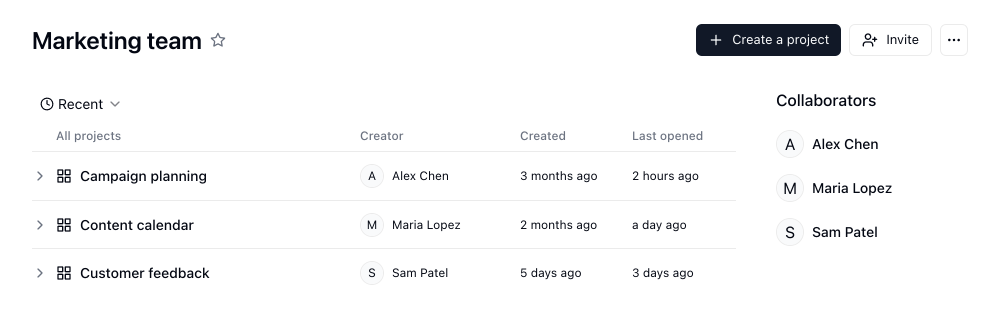
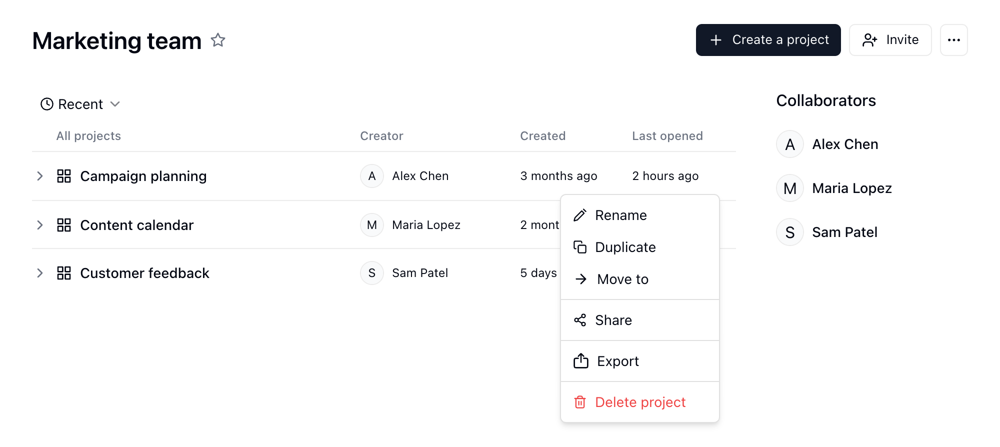
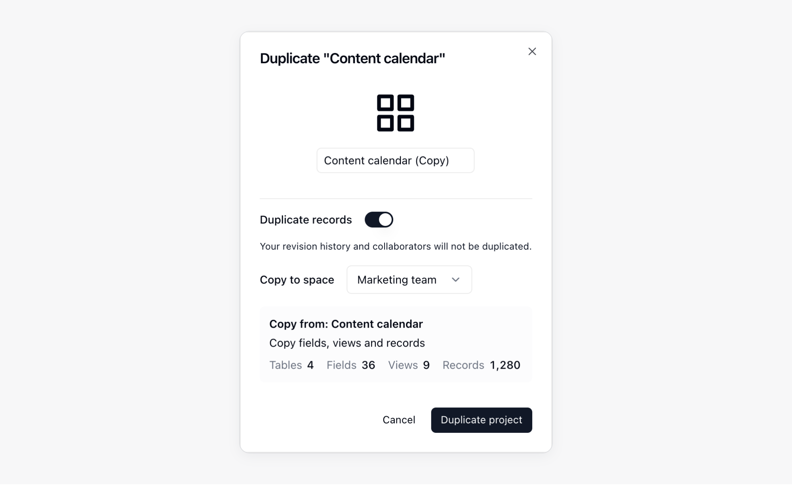
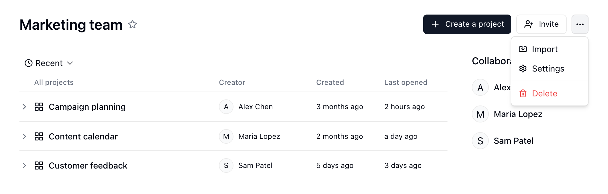
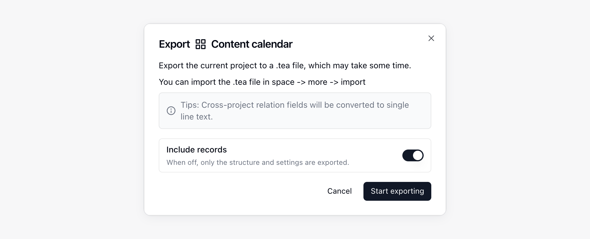
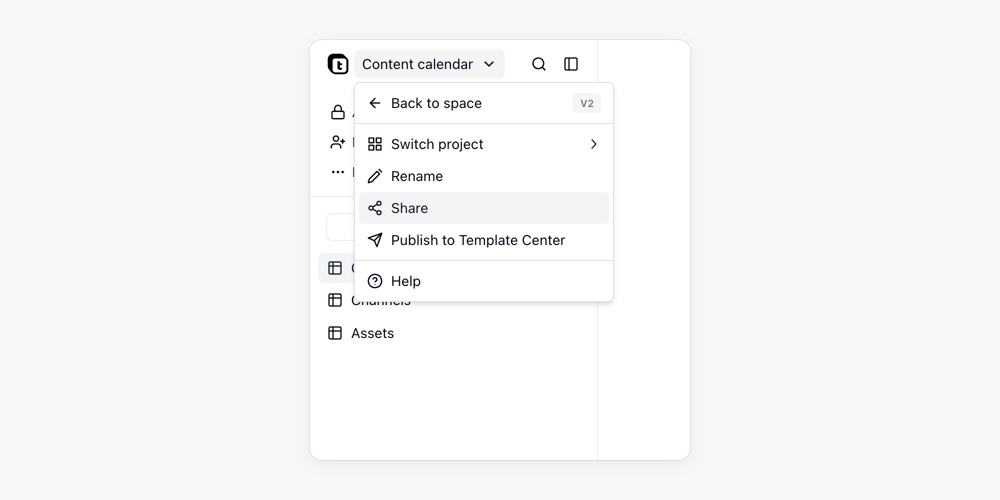

{/* mintlify-resync: 2026-05-26 */}
Un projet regroupe des tables, des applications et des automatisations liées. Chaque Espace peut contenir plusieurs projets, avec leurs propres ressources et autorisations de collaboration.

<Note>Projet est le nom affiché de la ressource `base` dans l’API et la CLI. Les champs comme `baseId`, le préfixe d’ID `bse` et les URL `/base/...` restent inchangés.</Note>

Pour les utilisateurs qui ne connaissent pas les Projets, vous pouvez les considérer comme des classeurs Excel, chaque classeur pouvant contenir plusieurs feuilles.

## Créer et gérer des Projets {#créer-et-gérer-des-bases}

### Ajouter un Projet {#ajouter-une-base}

1. Accédez à un Espace et cliquez sur **Projets** dans la barre latérale
2. Cliquez sur « Créer un projet » dans l’angle supérieur droit

Lorsque vous démarrez une discussion dans un nouveau Projet, l’IA nomme le Projet d’après votre message. Si le Projet a déjà un nom, l’IA ne le modifie pas.

### Créer un Projet à partir d’un modèle

Le centre de modèles rassemble des Projets utilisables tels quels. Ouvrez-le depuis **Modèle** dans la barre latérale de l’Espace, ou choisissez **À partir d'un modèle** au moment de créer un Projet. Dans le détail du modèle, cliquez sur **Installer**, choisissez **Nouveau projet** (un nouveau Projet portant le nom du modèle) ou **Ajouter à un projet existant** (un Projet que vous pouvez modifier), puis cliquez à nouveau sur **Installer**. Si vous installez depuis un lien de partage, choisissez d’abord l’Espace. Chaque modèle est placé dans son propre dossier du Projet ; c’est l’auteur du modèle qui décide s’il inclut des données d’exemple. Si le modèle comporte un guide d’installation, une carte **Pour commencer** apparaît après l’installation en bas à droite de ses tables, applications et automatisations et coche chaque étape d’elle-même d’après vos données. Chaque étape propose **Ouvrir** et, selon l’étape, **Demander à l'IA**, **Marquer comme fait** ou **Passer** (un saut peut être annulé) ; une fois tout terminé, cliquez sur **Masquer**.

Si les automatisations d’un modèle doivent se connecter à des plateformes externes, le détail du modèle les indique. Après l’installation, Teable ouvre la conversation du Projet et affiche au-dessus du champ de saisie la carte **Connecter des comptes** :

1. Connectez les comptes plateforme par plateforme. Lorsqu’une plateforme demande plusieurs comptes (par exemple deux chaînes YouTube), chaque compte occupe sa propre ligne et se lie séparément. Si vous n’avez connecté qu’un seul compte de cette plateforme dans **Paramètres** → **Intégrations**, il est lié automatiquement ; si vous en avez connecté plusieurs, cliquez sur **Autoriser le mien** pour choisir celui à utiliser. Pour ceux qui ne sont pas encore connectés, **Connecter un compte** lance un parcours OAuth.
2. Les entrées qui demandent une clé d’API figurent sous **Clés à saisir**. **Saisir** en crée une, ou reprenez un secret déjà enregistré.
3. Cliquez sur **Démarrer**. Les workflows et les [routines](/fr/basic/ai/routine) dont les identifiants sont complets sont activés. Ceux qui tournent sur planification effectuent aussitôt un premier passage, visible dans l’historique d’exécution ; ceux que déclenchent les événements d’une application tierce attendent le premier événement.

Cliquez sur **Plus tard** pour replier la carte en attendant. Tant qu’il reste une intégration non connectée dans le Projet, la page affiche **N intégrations ne sont pas connectées** ; **Connecter** permet de la compléter à tout moment. Voir [Identifiants et intégrations](/fr/basic/credential).

### Gérer les modèles installés

Dans la barre latérale de l’Espace, cliquez sur **...** à côté du Projet et choisissez **Modèles installés** pour voir l’état de chaque modèle du Projet (**Configuration requise**, **En cours d’exécution**, **Requiert votre attention**, **Désactivé**), activer ou désactiver ses automatisations, ou cliquer sur **Désinstaller**. La désinstallation désactive et supprime ses automatisations et ses routines ; les tables, applications et autres éléments qu’il a apportés sont placés dans la corbeille, et son dossier est supprimé une fois vide.

### Publier dans le centre de modèles

Cliquez sur le nom du Projet en haut à gauche, ou sur **...** à côté du Projet dans la barre latérale de l’Espace, puis choisissez **Publier dans le centre de modèles**. Renseignez le nom, la description détaillée et la couverture, choisissez le contenu inclus et s’il faut inclure des données d’exemple, puis cliquez sur **Soumettre pour validation**. Pendant l’examen, vous pouvez cliquer sur **Retirer** pour retirer la soumission. Une fois validé, le modèle est publié ; s’il est refusé, la notification contient la note de l’examinateur. Toute modification ultérieure du Projet doit être soumise à nouveau ; tant qu’elle n’est pas validée, les autres utilisateurs continuent d’installer la version actuelle. Un modèle publié peut être retiré avec **Dépublier** ; les copies déjà installées ne sont pas affectées.

Le **Guide** de la fenêtre de publication ajoute au modèle quelques étapes de configuration. Chaque étape a un titre, une description d’une ligne, un emplacement à ouvrir et une condition d’achèvement. Rédigez-le avec **Le rédiger avec Teable AI** ou utilisez **Modifier dans le projet**. Les conditions possibles : données d’exemple remplacées par du contenu réel, application publiée, automatisation exécutée avec succès une fois, comptes requis connectés, ou case cochée par l’utilisateur. Une condition portant sur les données ne doit pas déjà être vraie sur les données d’exemple, sinon le modèle ne peut pas être soumis.

### Renommer/supprimer un Projet {#renommersupprimer-une-base}

1. Accédez à un Espace
2. Survolez un Projet
3. Cliquez sur le bouton « ··· » pour ouvrir le menu
4. Cliquez sur « Renommer » ou « Supprimer »

### Organiser les ressources dans un Projet {#organiser-les-ressources-dans-une-base}

Cliquez sur le bouton de dossier **Afficher les ressources** à côté du nom du Projet dans la barre latérale de l’Espace pour parcourir son répertoire à droite de la conversation. Il contient les Tables, applications, automatisations et routines, que vous pouvez organiser en dossiers. Les ressources s’ouvrent dans des onglets ; cliquez sur **+** (**Nouvel onglet**) en haut du panneau pour revenir à la liste des ressources.

Les opérations courantes incluent :

- **Créer des dossiers** : créez des dossiers dans le répertoire du Projet pour regrouper les ressources associées.
- **Déplacer des ressources** : faites glisser des Tables, applications ou automatisations dans des dossiers, ou faites-les glisser pour les réorganiser.
- **Organiser la hiérarchie** : les dossiers peuvent contenir des ressources comme des Tables et des applications, ainsi que des sous-dossiers. Gardez une hiérarchie suffisamment simple pour faciliter la navigation.
- **Supprimer des dossiers** : un dossier part dans la corbeille avec tout son contenu et peut être restauré tant qu’il y est conservé ; la restauration conserve la structure du dossier. La fenêtre de confirmation liste ce qui est touché : les éléments qui ne peuvent pas être supprimés bloquent toute la suppression, les éléments hors du dossier qui référencent ses tables généreront des erreurs, une application publiée passe hors ligne immédiatement (son domaine personnalisé est libéré et ses paramètres de connexion sont supprimés ; après restauration, il faut la republier, relier à nouveau le domaine et reconfigurer la connexion), une application dont la table d’utilisateurs se trouve dans le dossier ne peut plus connecter personne, et les liens de partage sont supprimés définitivement. Si la suppression s’arrête en cours de route, ce qui a déjà été supprimé se trouve dans la corbeille élément par élément ; cliquez sur **Continuer la suppression** pour la terminer.
- **Ajouter des descriptions** : pour les Tables, applications et automatisations, cliquez sur **Ajouter une description** sous le nom de la ressource dans l’en-tête. Utilisez les descriptions pour consigner l’objectif, le responsable, les notes de transmission ou les règles d’utilisation. Teable ouvre une description lorsque vous ouvrez sa ressource pour la première fois, puis de nouveau après sa modification.
- **Vérifier les informations du nœud** : ouvrez le menu `...` d’une ressource et choisissez **Infos du noeud** pour afficher l’ID du dossier, de la Table, de l’automatisation ou de l’application, ainsi que les informations de création et de modification.

### Palette de commandes {#command-palette}

Appuyez sur `Ctrl + K`, ou `⌘ + K` sur Mac, ou cliquez sur l’icône de recherche en haut de la barre latérale gauche pour ouvrir la **Palette de commandes** :

- **Naviguer** : saisissez un nom pour rechercher des Tables, des vues, des applications et d’autres ressources. Sans saisie, la palette affiche les ressources et vues **Récemment consultés**. Si rien ne correspond, vous pouvez créer directement une Table portant ce nom, ou choisir **Rechercher dans la table actuelle** pour y chercher le texte saisi.
- **Exécuter une commande** : saisissez le nom d’une commande pour l’exécuter ; commencez par `>` pour ne rechercher que des commandes. Vous pouvez ainsi créer une Table, un tableau de bord, une application, une automatisation, une routine, un dossier ou une vue, inviter des collaborateurs, changer l’apparence, ou ouvrir les paramètres et les raccourcis clavier.
- **Demander à Cuppy** : dans un Projet, saisissez une question puis choisissez **Demander à Cuppy** ; la question est envoyée au Chat IA avec le Projet, la Table et la vue actuels. Voir [Chat IA](/fr/basic/ai/ai-chat).

Lorsque vous ouvrez la palette de commandes depuis la barre latérale de l’espace, les résultats sont répartis en onglets par type de ressource et incluent aussi les conversations dont le nom ou le contenu des messages correspond. Voir [Gérer les conversations](/fr/basic/ai/ai-chat#gérer-les-conversations).

### Dupliquer un Projet dans un autre Espace {#duplicate-a-base-to-another-space}

Étape 1 : dans l’Espace, sélectionnez le Projet que vous souhaitez dupliquer ;

Étape 2 : cliquez sur l’icône de menu et sélectionnez **Dupliquer** ;

Étape 3 : dans la fenêtre contextuelle, choisissez l’Espace cible. Vous devez disposer des autorisations de Créateur dans cet Espace.

Pour les Projets volumineux, Teable affiche la progression dans la boîte de dialogue de duplication pendant la copie de la structure du Projet, des Enregistrements et des pièces jointes. Gardez la boîte de dialogue ouverte jusqu’à la fin de la copie. L’historique des révisions et les collaborateurs ne sont pas copiés.

Si le Projet contient des Champs Lien, Recherche, Agrégation, Recherche conditionnelle ou Agrégation conditionnelle pointant vers un autre Espace, Teable affiche les Champs concernés avant la duplication. Si vous continuez, Teable convertit ces Champs en **Texte sur une seule ligne** dans le Projet dupliqué.

### Déplacer un Projet entre des Espaces {#déplacer-une-base-entre-des-espaces}

Si vous disposez des autorisations d’Espace requises, vous pouvez déplacer un Projet vers un autre Espace. Si le déplacement laisse des Champs basés sur des relations pointer entre des Espaces, Teable vous avertit et répertorie les Champs concernés. Lorsque vous confirmez, Teable convertit ces Champs en **Texte sur une seule ligne** dans le cadre du déplacement.

### Déplacer des ressources vers un autre Projet

Vous pouvez déplacer des Tables, des dossiers, des applications, des automatisations et des routines vers un autre Projet du même Espace. Leurs données et leur configuration restent inchangées ; seul le Projet auquel elles appartiennent change.

<Warning>La vérification effectuée avant le déplacement ne garantit pas de trouver toutes les références : certaines références dans les scripts d’automatisation ou le code des applications peuvent lui échapper. Après le déplacement, vérifiez bien que vos processus ne sont pas affectés et corrigez ce qui doit l’être.</Warning>

1. Dans le répertoire du Projet, ouvrez le menu `...` de la ressource et sélectionnez **Déplacer**.
2. Choisissez un Projet dans **Projet cible**. Teable vérifie d’abord l’impact du déplacement.
3. Consultez les résultats de la vérification, puis cliquez sur **Déplacer**.
4. Une fois le déplacement terminé, vérifiez que les automatisations, applications et routines concernées fonctionnent toujours correctement, et ajustez-les si nécessaire.

La vérification se contente de lire la configuration du Projet et ne modifie aucune donnée. Elle indique :

- **Si le déplacement est possible** : Teable affiche la raison et bloque le déplacement lorsque le Projet cible se trouve dans un autre Espace, que l’un des deux Projets est en lecture seule, que vous n’avez pas les autorisations nécessaires ou que le Projet cible contient déjà un dossier du même nom.
- **Ressources susceptibles de ne plus fonctionner** : les automatisations et applications qui restent dans le Projet actuel mais font référence à une Table déplacée peuvent ne plus fonctionner après le déplacement. C’est le cas, par exemple, si un déclencheur ou une action d’automatisation cible cette Table, si un script ou une requête HTTP contient l’ID de la Table, ou si une application utilise cette Table pour la connexion ou y fait référence dans son code.
- **Liens entre Projets** : les Champs Lien entre une Table déplacée et une Table restée dans le Projet d’origine deviennent des liens entre Projets et continuent de fonctionner.

**Déplacer tout ce qui est référencé** est activé par défaut : les ressources de la chaîne de références sont déplacées ensemble, afin de ne laisser aucune référence rompue. Les Tables liées ne sont pas déplacées.

<Note>
- Vous devez pouvoir supprimer la ressource dans le Projet actuel et créer le même type de ressource dans le Projet cible.
- Lorsque la Matrice d’autorité est activée, les règles d’autorisation liées aux rôles du Projet actuel ne peuvent pas suivre les ressources et sont supprimées. Les ressources déplacées suivent alors les paramètres d’autorisation du Projet cible. Pour conserver les mêmes restrictions, configurez-les de nouveau dans le Projet cible.
</Note>

## Importer et exporter des Projets {#importer-et-exporter-des-bases}

<a className="docs-card-link" href="/fr/basic/ai/connect-everything">
<Card title="Tout connecter et migrer" icon="sparkles">
  Utilisez AI Chat pour migrer Airtable, Baserow, NocoDB, SmartSuite et d’autres systèmes vers Teable.
</Card>
</a>

### Importer un Projet (migration de données) {#importer-une-base-migration-de-données}

Un fichier d’export de Projet Teable (`.tea`) contient la structure et la configuration du Projet, ainsi que les données des Enregistrements si elles ont été incluses lors de l’export. Importez ce fichier pour restaurer un Projet ou le créer dans une autre instance Teable. Cas d’utilisation :
- **Migration de données** : déplacer des Projets entre différentes instances Teable (par exemple, de Cloud vers une instance auto-hébergée)
- **Restauration de sauvegarde** : restaurer un Projet précédemment exporté
- **Partage de modèles** : partager des structures de Projet complètes avec d’autres équipes

**Étapes :**
1. Accédez à l’Espace
2. Cliquez sur le bouton 「···」 dans l’angle supérieur droit de l’Espace pour ouvrir le menu
3. Cliquez sur 「Importer」
4. Choisissez **Fichier Teable** et téléversez le fichier `.tea`.

Une fois le téléversement terminé, la fenêtre d’import affiche un aperçu du fichier : le nom du projet, le nombre de ressources de chaque type et les ressources rangées dans leurs dossiers (les dossiers sont repliés au départ). Si le fichier n’est pas un fichier `.tea` valide, la fenêtre indique qu’il ne peut pas être importé ; si le fichier ne peut simplement pas être analysé, vous pouvez poursuivre l’import.

<Tip>Si vous souhaitez créer un Projet à partir d’Airtable, choisissez **Airtable** dans la même boîte de dialogue d’importation.</Tip>

### Exporter un Projet (sauvegarde et migration) {#export-base-backup-&-migration}

Exportez un fichier de Projet Teable (`.tea`) pour sauvegarder sa structure et sa configuration ou les importer dans une autre instance Teable. Activez **Inclure les enregistrements** pour exporter aussi les données des Enregistrements.

**Étapes :**
1. Accédez à l’Espace
2. Survolez le Projet que vous souhaitez exporter
3. Cliquez sur le bouton 「···」 pour ouvrir le menu
4. Cliquez sur 「Exporter」
5. Laissez **Inclure les enregistrements** activé pour exporter les données des Enregistrements. Désactivez cette option pour exporter uniquement la structure et la configuration.
6. Cliquez sur **Commencer l’exportation** et attendez la fin de l’exportation.
7. Cliquez sur **Télécharger** dans la boîte de dialogue d’exportation pour enregistrer le fichier `.tea`.

<Note>
- Pour transférer les données des Enregistrements, activez **Inclure les enregistrements** lors de l’export.
- Teable convertit les Champs de relation inter-Projets en Champs **Texte sur une seule ligne** dans le fichier exporté.
- Lorsque vous dupliquez ou déplacez un Projet entre des Espaces, les Champs de relation inter-Espaces sont convertis en **Texte sur une seule ligne**.
- Après l’import, autorisez à nouveau les intégrations nécessaires. Les emplacements réservés aux intégrations et aux secrets exportés ne contiennent pas d’identifiants.
</Note>

## Partager un Projet {#partager-une-base}

Les Projets peuvent être partagés via des liens publics. La portée du partage peut être l’ensemble du Projet ou une seule de ses ressources.

1. Accédez au Projet cible
2. Ouvrez le menu de partage du Projet ou de la ressource
3. Activez **Partager sur le web**
4. Copiez le lien de partage ou le code QR

Les portées de partage incluent :

| Portée | Description |
|------|------|
| Tout le Projet | Ouvrez **Partager** depuis le menu de partage du Projet pour partager toutes les ressources du Projet actuel. Les nouvelles Tables et dossiers ajoutés ultérieurement sont automatiquement inclus. |
| Une seule ressource | Ouvrez **Partager** depuis le menu de partage de la ressource pour ne partager que celle-ci. Lorsqu’un dossier est partagé, les ressources qu’il contient sont incluses. Depuis une Table, vous pouvez basculer entre **Partager le tableau** et **Partager la vue**. |

Seuls les **Propriétaires** et **Créateurs** du Projet peuvent voir et gérer les liens de partage, codes QR et codes d’intégration du Projet et de ses ressources ; les autres membres voient seulement si un partage existe. Le partage des vues suit l’autorisation de partage de la vue, voir [Autorisations de collaboration](/fr/basic/space/space-permission). Dans les paramètres de partage, vous pouvez configurer les autorisations du lien, régénérer le lien ou supprimer le lien de partage. En dépliant **Avancé**, vous pouvez régler **Autoriser les lecteurs à copier les données**, **Protéger par mot de passe** et **Configuration d'intégration**. Lorsque vous activez l’accès par mot de passe, Teable génère automatiquement un mot de passe aléatoire ; cliquez sur **Copier le lien et le mot de passe** pour les envoyer ensemble aux visiteurs. Voir [Protection des liens de partage](/fr/basic/security#protection-des-liens-de-partage).

Si la portée du partage inclut une application, l’application doit être publiée avant de pouvoir être accessible via le lien public.

## Fonctionnalités au sein d’un Projet {#fonctionnalités-au-sein-dune-base}

Un Projet peut contenir plusieurs Tables pour enregistrer et organiser des informations liées au travail ou à l’activité professionnelle.

Par exemple : un Projet de gestion des clients peut comporter des Tables distinctes pour « Entreprises clientes », « Contacts clients » et « Enregistrements de suivi client », tandis qu’un Projet de gestion des salles de réunion peut comporter des Tables distinctes pour enregistrer « Gestion des salles de réunion », « Équipements des salles de réunion » et « Réservations de salles de réunion ».

Par conséquent, la plupart des fonctionnalités d’un Projet sont liées aux Tables :

* **Créer des Tables** : les Projets permettent aux utilisateurs de créer de nouvelles Tables selon les besoins propres au projet, dans lesquelles ils peuvent définir la structure de la Table, les Champs et les types de données.
* **Modifier des Tables** : les utilisateurs peuvent modifier les Tables existantes dans le Projet, notamment en ajoutant, supprimant et modifiant des Enregistrements.
* **Exporter et importer des données** : les Projets permettent d’exporter les données au format CSV et d’importer des données aux formats CSV et XLSX.

Consultez la [section Tables](/fr/basic/table) pour en savoir plus sur les Tables.

