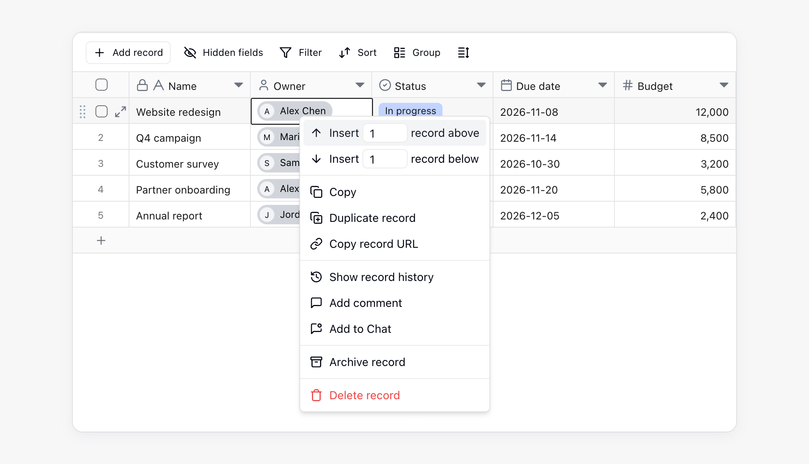
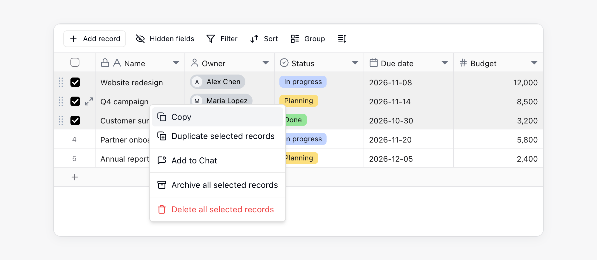
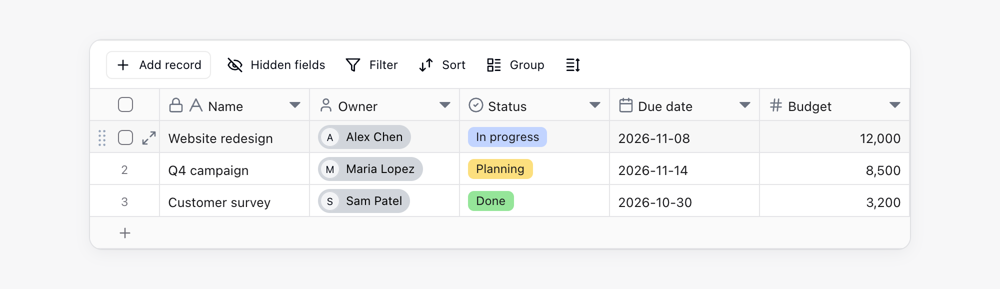
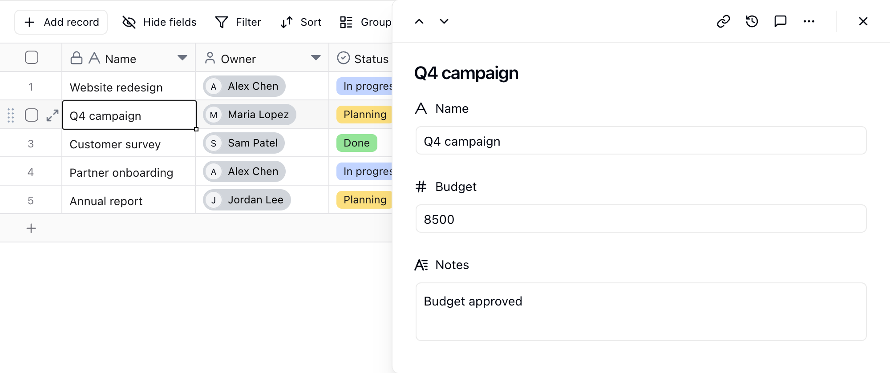

Les enregistrements stockent des entrées de données complètes. Chaque enregistrement est composé de plusieurs champs. Par exemple, un enregistrement client peut inclure le nom, le numéro de téléphone, le responsable et l’état du suivi. Un enregistrement de commande peut inclure le numéro de commande, le client, le montant et la date de livraison.

## Concepts de base

| Concept | Description |
| --- | --- |
| Enregistrement | Une ligne de données dans une table |
| Champ | Un attribut d’un enregistrement, correspondant à une colonne de table |
| Cellule | La valeur d’un enregistrement dans un champ |
| Champ principal | Le nom d’affichage principal d’un enregistrement, souvent utilisé dans les listes mobiles et les sélecteurs d’enregistrements liés |

## Créer des enregistrements

Vous pouvez créer des enregistrements de différentes manières :

| Point d’entrée | Action |
| --- | --- |
| Bas de la table | Cliquez sur le bouton `+` au bas de la vue de table pour ajouter un enregistrement à la fin |
| Barre d’outils supérieure | Cliquez sur `+ Ajouter un enregistrement` à gauche de la barre d’outils |
| Menu contextuel | Cliquez avec le bouton droit sur un enregistrement existant et insérez un enregistrement au-dessus ou au-dessous |

## Modifier des enregistrements

- **Modifier une cellule** : cliquez sur une cellule et saisissez ou modifiez son contenu.
- **Effacer le contenu** : sélectionnez une ou plusieurs cellules, puis appuyez sur `Supprimer` ou `Retour arrière`.
- **Sélection groupée** : faites glisser la souris pour sélectionner plusieurs cellules ou enregistrements, puis modifiez-les, supprimez-les ou copiez-les.
- **Copier et coller** : copiez et collez une ou plusieurs cellules. Utilisez le raccourci clavier, ou faites un clic droit sur la sélection et choisissez **Copier**. Si les données collées comportent plus de lignes que la table actuelle, Teable ajoute automatiquement de nouvelles lignes.

## Supprimer des enregistrements

Sélectionnez un ou plusieurs enregistrements, puis cliquez avec le bouton droit et choisissez **Supprimer l’enregistrement**. Pour une suppression groupée, vous pouvez sélectionner les cases à cocher au début des lignes avant de les supprimer.

Les enregistrements supprimés sont placés dans la corbeille de la table, où vous pouvez les consulter et les restaurer. Si vous souhaitez retirer des enregistrements de la table tout en les conservant disponibles, archivez-les plutôt que de les supprimer. Consultez [Archiver et corbeille](/fr/basic/record/archive-trash).

<Info>Si une autre table est liée à l’enregistrement par l’intermédiaire d’un champ [Lien vers un autre enregistrement](/fr/basic/field/link) **Obligatoire**, Teable refuse la suppression et indique la table et le champ qui seraient laissés vides. Faites pointer ce lien vers un autre enregistrement, désactivez le paramètre **Obligatoire** du champ ou supprimez les enregistrements liés en même temps que celui-ci.</Info>

## Détails de l’enregistrement

Cliquez sur l’icône d’agrandissement au début d’une ligne d’enregistrement, ou sélectionnez un enregistrement et appuyez sur Espace, pour ouvrir le panneau de détails de l’enregistrement à droite de la table.

Le panneau de détails est utile pour les enregistrements comportant de nombreux champs. Vous pouvez parcourir les champs verticalement, réduire le défilement horizontal, modifier des champs, consulter les commentaires et vérifier l’historique de l’enregistrement. Tant que le panneau est ouvert, vous pouvez continuer à travailler dans la table, et la ligne de l’enregistrement en cours reste en surbrillance.

- **Redimensionner** : faites glisser le bord gauche du panneau. La largeur est conservée, y compris pour les enregistrements d’autres tables.
- **Changer d’enregistrement** : cliquez sur les flèches haut et bas en haut à gauche du panneau. Cela fonctionne dans les vues grille, kanban, galerie et calendrier.
- **Consulter les enregistrements liés** : un enregistrement lié s’ouvre dans le même panneau, avec un fil d’Ariane en haut. Cliquez sur un niveau pour revenir à cet enregistrement.
- **Fermer** : appuyez sur `Esc` pour fermer l’enregistrement en cours, ou cliquez sur **×** en haut à droite pour fermer tout le panneau.

## Collaboration et suivi

| Fonctionnalité | Description |
| --- | --- |
| Commentaires | Chaque enregistrement dispose de son propre espace de commentaires pour discuter de données spécifiques, @mentionner des collègues ou ajouter du contexte. Consultez [Commentaires](/fr/basic/record/comment). |
| Historique de l’enregistrement | Teable enregistre les modifications apportées aux enregistrements afin que vous puissiez suivre les mises à jour. Consultez [Historique de l’enregistrement](/fr/basic/record/record-history). |
| Archiver et corbeille | Retirez les enregistrements terminés de la table ou restaurez ceux qui ont été supprimés. Consultez [Archiver et corbeille](/fr/basic/record/archive-trash). |
| Enregistrements liés | Utilisez un champ **Lien** pour connecter des enregistrements entre plusieurs tables. Consultez [Champ Lien](/fr/basic/field/link). |

## Remarques

- Le champ principal est utilisé comme nom d’affichage principal d’un enregistrement. Placez dans le champ principal des informations facilement identifiables telles qu’un nom, un titre de tâche ou un numéro de commande, plutôt qu’un contenu de type note.
- Chaque enregistrement possède un ID d’enregistrement unique. Après avoir ouvert le panneau de détails de l’enregistrement, la chaîne de l’URL du navigateur qui commence par `rec` est l’ID de l’enregistrement.
- Si vous ne pouvez pas modifier certains enregistrements, un administrateur a peut-être limité le périmètre modifiable au moyen de la **Matrice d’autorisations**. Consultez [Matrice d’autorisations](/fr/basic/authority-matrix).

