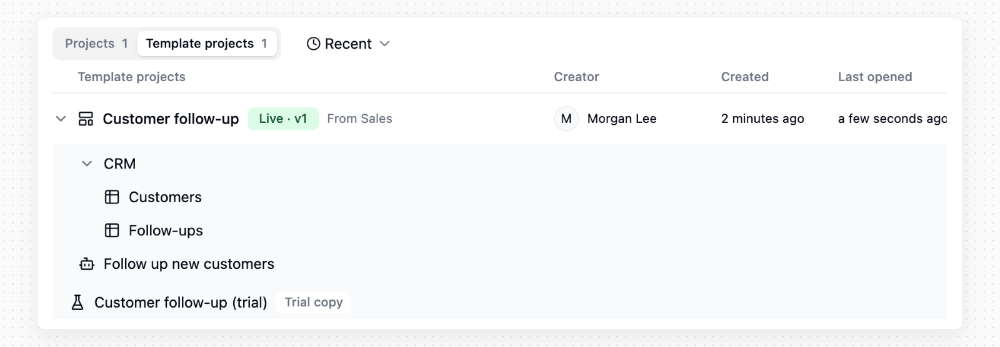

Les modèles se préparent dans un **projet de modèle**. Vous choisissez ce que vous voulez partager dans un Projet que vous utilisez, et Teable en copie la structure dans un projet de modèle distinct. Le Projet d’origine et ses données ne sont pas modifiés, et ils ne sont jamais publiés.

## Créer un modèle

Dans la barre latérale du Projet, faites un clic droit sur une table, une application, une automatisation ou un dossier, puis choisissez **En faire un modèle**. Pour choisir dans l’ensemble du Projet, cliquez sur le nom du Projet en haut à gauche et choisissez **En faire un modèle**.

Si vous partez du menu d’un élément, cet élément est déjà coché ; si vous partez du nom du Projet, cochez dans la liste ce que vous voulez emporter. Les tables utilisées par une application, une automatisation ou un tableau de bord sont ajoutées d’elles-mêmes, avec la raison indiquée à droite. Tout le reste se trouve sous **N laissés**, que vous pouvez déplier pour cocher d’autres éléments. Vérifiez le nom et cliquez sur **Créer le projet de modèle**.

Un projet de modèle ne copie que la structure : aucun enregistrement n’est repris, les automatisations sont désactivées au départ, et un champ de lien vers une table non reprise devient du texte. Il vous faut l’accès **Créateur** ou supérieur à la fois dans le Projet d’origine et dans l’Espace. Si un Projet a été publié directement auparavant et figure toujours dans le centre de modèles, le menu de son nom affiche **Publier dans le centre de modèles** à la place ; pour en tirer un nouveau modèle, partez du menu d’un élément de la barre latérale.

## Préparer le projet de modèle

Lorsque vous cliquez sur **Créer le projet de modèle**, Teable ouvre le nouveau projet de modèle. Son nom est suivi de l’étiquette **Modèle**, et le haut de sa barre latérale affiche son état, son origine (**Depuis Ventes**, visible par vous seul), **Essayer** et **Soumettre pour validation**.

Cuppy repère ensuite ce qui n’appartient qu’à vous, indique par quoi chaque élément serait remplacé, fait le remplacement une fois que vous avez confirmé, puis ajoute des enregistrements d’exemple et rédige une première version du guide d’installation. Vous pouvez aussi ajouter vous-même des enregistrements d’exemple : lors de la soumission, les enregistrements du projet de modèle sont publiés comme données d’exemple du modèle.

## Essayer le modèle

Cliquez sur **Essayer** : Teable crée une copie d’essai comme le ferait une installation et l’ouvre, pour que vous voyiez ce que les autres obtiendront. Cliquez sur **Retour au projet de modèle** pour revenir, ou sur **Supprimer l'essai** quand vous n’en avez plus besoin. Un nouvel essai place votre copie d’essai précédente dans la corbeille.

## Soumettre pour validation

Cliquez sur **Soumettre pour validation**, renseignez le nom, la description et la couverture, et choisissez ce qui s’ouvre par défaut après une installation. C’est tout le projet de modèle qui est soumis : **Publier les nœuds** indique combien d’éléments et d’enregistrements d’exemple seront publiés.

À droite, **Vérifications avant soumission** bloque ce qui n’appartient qu’à vous : noms, adresses e-mail et domaines de messagerie d’entreprise des personnes qui peuvent ouvrir l’Espace ou le Projet, ainsi que le texte qui ressemble à une clé d’API. Remplacez-les, ou cliquez sur **Corriger** pour que Cuppy s’en charge. **Ce sont des exemples** marque tout ce qui est listé comme contenu d’exemple et le laisse passer : ne l’utilisez que si tout est inventé.

Dès que **Contenu** affiche une coche verte, cliquez sur **Soumettre pour validation**. Les autres lignes sont des rappels et ne bloquent pas la soumission.

La ligne **Guide** de cette fenêtre ajoute au modèle quelques étapes de configuration. Chaque étape a un titre, une description d’une ligne, un emplacement à ouvrir et une condition d’achèvement. Rédigez-le avec **Le rédiger avec Teable AI** ou utilisez **Modifier dans le projet**. Les conditions possibles : données d’exemple remplacées par du contenu réel, application publiée, automatisation exécutée avec succès une fois, comptes requis connectés, ou case cochée par l’utilisateur. Une condition portant sur les données ne doit pas déjà être vraie sur les enregistrements d’exemple, sinon le modèle ne peut pas être soumis.

## Validation et mise en ligne

Après la soumission, la fenêtre **Soumis pour validation** s’ouvre ; vous pouvez y cliquer sur **Retirer** tant que la validation n’est pas terminée. La barre latérale affiche **En cours de validation** ; cliquez sur **Voir la soumission** pour revoir ce que vous avez soumis.

Une fois validé, le modèle est publié dans le centre de modèles et la barre latérale affiche **En ligne · v1**. S’il est renvoyé, la barre latérale affiche **Renvoyé** et la notification contient les remarques de l’examinateur ; apportez vos modifications et cliquez sur **Soumettre à nouveau**.

Une fois le modèle en ligne, continuez à modifier le même projet de modèle et cliquez sur **Soumettre v2** pour soumettre une nouvelle version. Tant que la nouvelle version n’est pas validée, les personnes qui installent le modèle obtiennent la version actuelle.

## Retrouver les projets de modèle d’un Espace

La page d’accueil d’un Espace comporte deux onglets : **Projets** et **Projets de modèle**. L’onglet **Projets de modèle** affiche l’état et l’origine de chaque modèle ; dépliez une ligne pour voir son contenu et sa copie d’essai. Pour partir d’un Projet vide, cliquez sur **Nouveau projet de modèle** en haut à droite de cet onglet.

<Note>Placer un projet de modèle dans la corbeille retire du centre de modèles le modèle en ligne, et restaurer le Projet depuis la corbeille ne le republie pas. Une soumission en cours de validation est retirée, et vos copies d’essai sont elles aussi placées dans la corbeille. Les copies que d’autres ont installées ne sont pas affectées.</Note>
