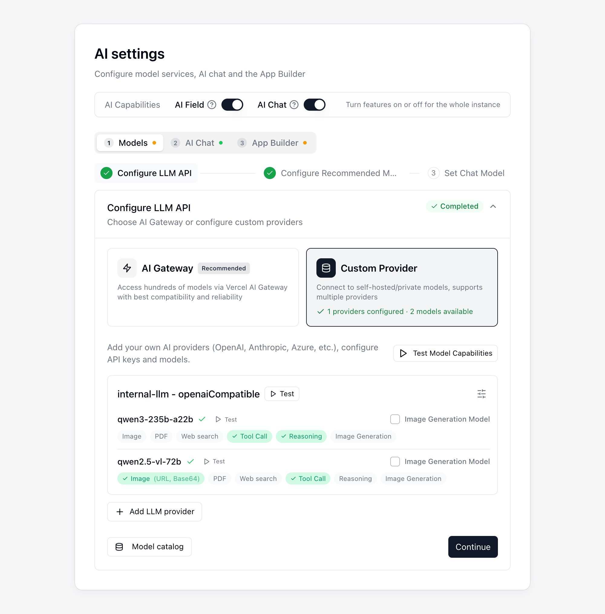

{/* mintlify-resync: 2026-10-22 */}
<Tip>Disponibile per il piano Business Self-hosted e versioni successive</Tip>

Percorso: Amministrazione di sistema → Impostazioni IA

La pagina **Impostazioni IA** consente di configurare **AI Chat**, **Campi IA**, **Automazione IA** e **App Builder**. In alto si trova l'interruttore **Funzionalità IA**; sotto, la configurazione procede in ordine nelle schede **Modelli**, **Chat IA** e **Generatore di app**. Ogni scheda dipende dalla precedente e, finché questa non è completa, la pagina indica quali impostazioni mancano. Il pannello **Configurazione in attesa** a destra elenca gli elementi obbligatori ancora mancanti: fai clic su uno di essi per passare alla scheda e al passaggio corrispondenti.

## Prima di iniziare

Prima di aprire la pagina Impostazioni IA, assicurati che siano pronti gli elementi seguenti.

| Requisito | Obbligatorio? | Note |
|------|------|------|
| **Configurazione di Agent Runtime** | Obbligatoria per AI Chat e App Builder | Utilizzata da AI Chat e App Builder |
| **Provider personalizzato** | Obbligatorio quando AI Chat o App Builder usa la tua chiave (BYOK) | Usa un provider **compatibile con OpenAI** o **Anthropic** |
| **Chiave API di OpenAI** | Facoltativa | Necessaria soltanto se vuoi abilitare l'**Input vocale** in AI Chat |
| **Accesso pubblico** | Obbligatorio quando è selezionato il motore di distribuzione **Vercel** | La tua **istanza Teable** e l'**archiviazione di oggetti (MinIO / S3)** devono essere accessibili pubblicamente da Vercel |

## Procedura di configurazione

La procedura guidata della scheda **Modelli** prevede tre passaggi per collegare e scegliere i modelli. I passaggi già completati restano compressi; fai clic su un passaggio per espanderlo e modificarlo:

<Steps>
  <Step title="Configura l’API LLM">
    Configura la connessione al modello e completa il test iniziale.
  </Step>
  <Step title="Configura i modelli consigliati">
    Scegli i modelli consigliati per i Campi IA e l'Automazione IA.
  </Step>
  <Step title="Imposta il modello di chat">
    Scegli un modello per ciascuno dei quattro livelli del modello di chat.
  </Step>
</Steps>

AI Chat e App Builder richiedono anche un runtime e la distribuzione delle app, che si configurano rispettivamente nelle schede **Chat IA** e **Generatore di app**. Scegli prima un'[opzione di distribuzione](/it/deploy/choose) e completa la distribuzione, quindi procedi come descritto di seguito.

### Configurare l'API LLM

Nel passaggio **Configura l’API LLM**, fai clic su **Aggiungi fornitore LLM** per aggiungere un provider di modelli, quindi testane i modelli. Se utilizzi la tua chiave (BYOK), scegli **Compatibile con OpenAI** o **Anthropic** come tipo di provider.

La finestra di contesto e l'output massimo per risposta vengono ricavati automaticamente dal **Catalogo dei modelli**; non c'è nulla da compilare. Per verificare i valori ricavati per un modello, apri **Catalogo dei modelli**, scegli un **Ambito** in **Ispeziona modello** e seleziona il modello; **Dettaglio dei parametri** elenca il contesto, l'output massimo e l'origine di ciascun valore.

Quando il catalogo non contiene una voce corrispondente (per esempio un modello appena pubblicato o gestito da te), il modello utilizza i valori impostati in **Nessuna corrispondenza**, all'interno di **Regole di corrispondenza**: per impostazione predefinita una finestra di contesto di 200000 e un output massimo di 32000, con **Regola di corrispondenza** indicata come origine di entrambi in **Dettaglio dei parametri**. Se questi valori non corrispondono al modello, modificali in **Regole di corrispondenza** e fai clic su **Salva**.

### Configurare i modelli consigliati

Scegli i modelli consigliati che gli utenti possono selezionare nei **Campi IA** e nell'**Automazione IA**.

### Impostare il modello di chat

In **Livelli del modello di chat** scegli un modello per **Ultra**, **Smart**, **Standard** e **Lite**; i modelli disponibili sono divisi per origine in due gruppi, **Vercel AI Gateway** e **Provider personalizzato**, e il gruppo **Vercel AI Gateway** elenca solo i modelli consigliati abilitati nel passaggio 2. Gli utenti scelgono per livello nel menu dei modelli di **AI Chat** nella barra laterale e vedono il nome del livello anziché quello del modello, quindi puoi sostituire in qualsiasi momento il modello dietro un livello senza conseguenze per chi lo ha già selezionato.

| Livello | Descrizione |
|------|------|
| **Ultra** | Capacità massima, per attività impegnative. Se lasciato vuoto mostra **Non disponibile** e non compare nel menu dei modelli degli utenti.|
| **Smart** | Il modello principale. Lo usano i campi IA, le attività in background e ogni livello privo di un modello proprio, quindi deve essere impostato.|
| **Standard** | Conversazioni quotidiane e attività generiche; serve anche per le attività in background intermedie. Se lasciato vuoto eredita **Smart**.|
| **Lite** | Lavoro ordinario a basso costo e alta frequenza; serve anche per attività leggere come la generazione dei titoli delle conversazioni. Se lasciato vuoto eredita **Smart**.|

A destra di ogni livello si trovano altri due controlli:

- **Imposta come predefinito**: il livello con cui gli utenti aprono il menu dei modelli. Un **Ultra** senza modello non può essere predefinito.
- **Abilitato**: disattivandolo, il livello non viene più offerto agli utenti. Il livello predefinito non può essere disattivato.

### Configurare il runtime

Il runtime si configura in **Runtime della chat IA**, nella scheda **Chat IA**. Al termine della distribuzione, fai clic su **Esegui il test** per verificare il runtime di AI Chat.

### Abilitare le funzionalità IA

In **Funzionalità IA**, nella parte superiore della pagina, abilita **Campo IA** e **Chat IA** secondo necessità; gli interruttori valgono per l'intera istanza. Configura il runtime prima di utilizzare **Chat IA**.

### Configurare App Builder

Nella scheda **Generatore di app**, in **Motore di deploy**, scegli come distribuire le app:

| Motore di distribuzione | Requisiti di configurazione |
|------|------|
| **Vercel** | Inserisci un token di accesso Vercel, fai clic su **Prova connessione** e usa **Prova l'accesso pubblico** per confermare che Vercel possa raggiungere l'istanza Teable e l'archiviazione di oggetti. |
| **Teable Infra** | Utilizza il runtime del container Teable Infra configurato. Qui non sono richieste credenziali aggiuntive né verifiche dell'accesso pubblico. |

Quando necessario, puoi aggiungere queste impostazioni facoltative di App Builder:

| Elemento facoltativo | Quando è necessario |
|------|------|
| **Dominio personalizzato** | Quando vuoi pubblicare le app nel tuo dominio |
| **Autenticazione delle app** | Quando le app generate richiedono l'accesso tramite **Codice OTP via email**, **Google** o **SSO (OIDC)** |

In **Autenticazione delle app**, puoi configurare i provider di accesso per le app generate:

- **Codice OTP via email** utilizza una casella SMTP indipendente per le email di verifica dell'accesso all'app.
- **OAuth di Google** richiede un ID client e un Segreto client. Aggiungi l'URI di reindirizzamento mostrato in questa pagina all'elenco degli URI di reindirizzamento autorizzati nella console Google Cloud.
- **SSO (OIDC)** consente ai visitatori dell'app di accedere tramite il provider di identità aziendale. Registra presso il provider di identità l'indirizzo mostrato nella pagina come URI di reindirizzamento, quindi compila **URL di autorizzazione**, **URL del token**, **URL delle informazioni utente**, **Client ID** e **Client Secret**. Se lasci vuoto **Scope**, viene usato `openid email profile`.

L'accesso con **Teable** è disponibile per impostazione predefinita. **Codice OTP via email** viene visualizzato in App Builder soltanto dopo aver completato le impostazioni SMTP, **Google** soltanto dopo aver configurato entrambe le credenziali OAuth e **SSO (OIDC)** soltanto dopo aver compilato tutti i campi SSO tranne lo scope.

In **Impostazioni app**, **Inietta automaticamente la chiave API dell'IA nelle app** è attivo per impostazione predefinita, così le app possono chiamare i modelli IA della piattaforma. Disattivandolo, le app non potranno più accedervi.

Se dopo un aggiornamento le app create con versioni precedenti non si aprono in anteprima o non si pubblicano, fai clic su **Esegui la riparazione** in **Compatibilità con i progetti legacy**, all'interno di **Strumenti di manutenzione**, per ripristinare automaticamente i file mancanti.

### Facoltativo. Configurare l'input vocale

Per utilizzare l'input vocale in AI Chat, abilita **Input vocale** nella scheda **Chat IA** e inserisci una **Chiave API di OpenAI**. Configura l'**Endpoint di trascrizione** soltanto se utilizzi un servizio di trascrizione personalizzato. Puoi anche limitare la durata della registrazione e il numero di richieste al minuto.

### Verificare la configurazione

Al termine della configurazione, verifica innanzitutto che tutti gli elementi obbligatori nel pannello **Configurazione in attesa** siano verdi. Quindi testa singolarmente **AI Chat**, **Campi IA**, **Automazione IA** e **App Builder**.

## Domande frequenti

<AccordionGroup>
<Accordion title="Ricevo un errore di superamento dei Crediti">

Controlla l'account o il provider utilizzato dal servizio di modelli configurato. Se necessario, ricarica il saldo o modifica la configurazione del modello.
</Accordion>

</AccordionGroup>
