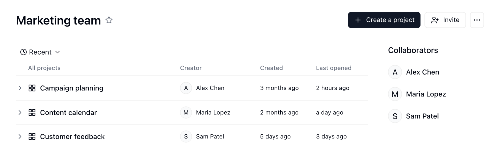
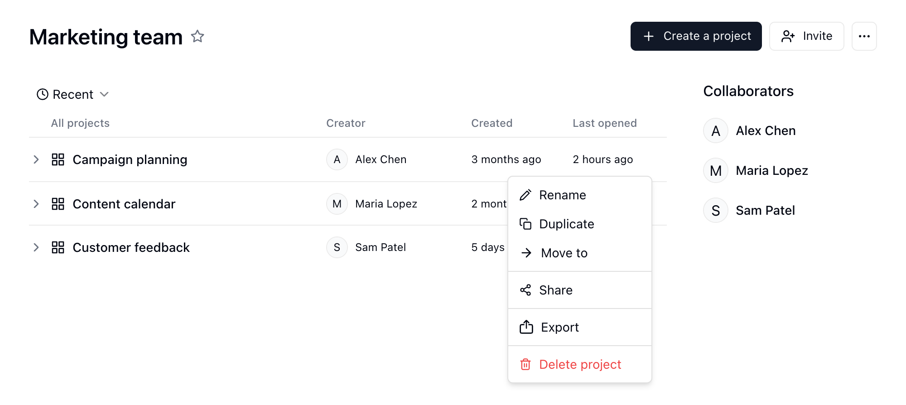
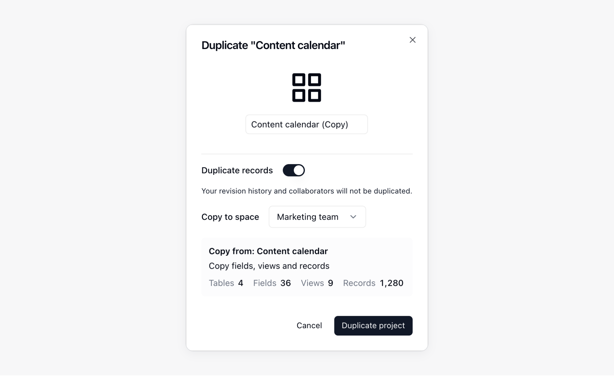
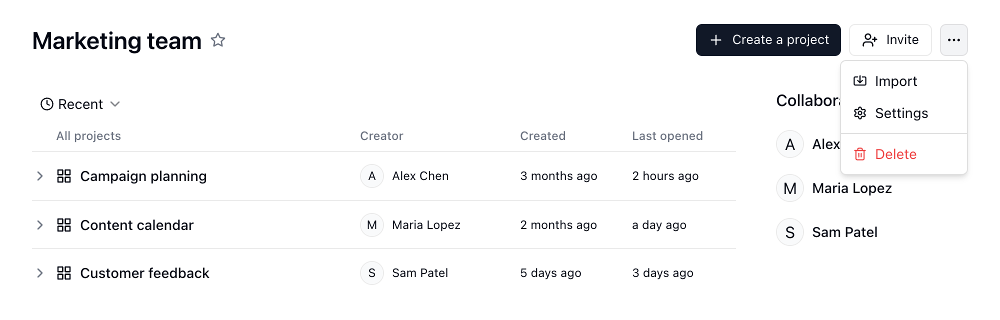
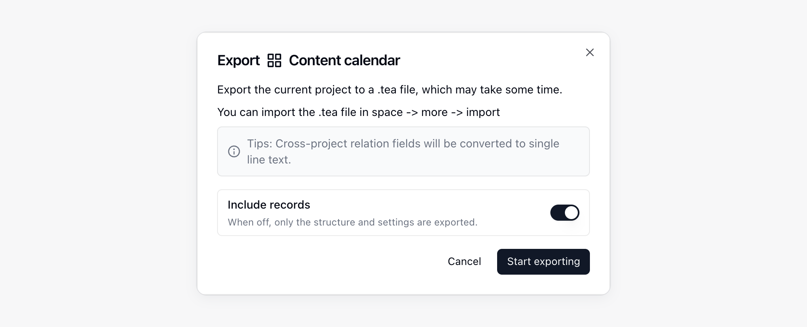
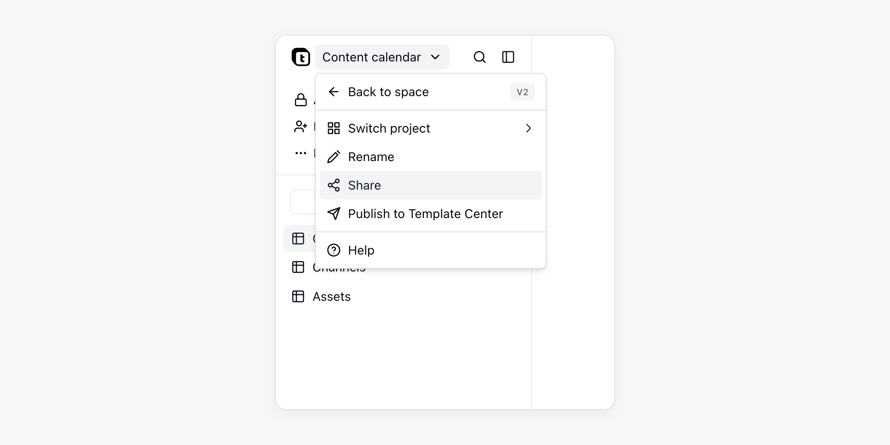
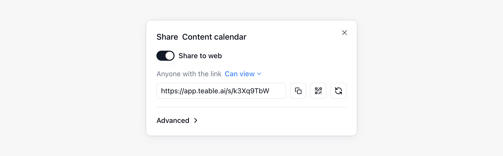

{/* mintlify-resync: 2026-05-26 */}
Un progetto riunisce tabelle, app e automazioni correlate. Ogni Spazio può contenere più progetti, ciascuno con le proprie risorse e autorizzazioni di collaborazione.

<Note>Progetto è il nome mostrato nell’interfaccia per la risorsa `base` dell’API e della CLI. I campi come `baseId`, il prefisso ID `bse` e gli URL `/base/...` restano invariati.</Note>

Per gli utenti che non conoscono i Progetti, è possibile considerarli come cartelle di lavoro di Excel, ciascuna delle quali può contenere più fogli.

## Creare e gestire i Progetti {#creare-e-gestire-le-base}

### Aggiungere un Progetto {#aggiungere-una-base}

1. Accedi a uno Spazio e fai clic su **Progetti** nella barra laterale
2. Fai clic su «Crea un progetto» nell'angolo in alto a destra

Quando avvii una chat in un nuovo Progetto, l'IA assegna un nome al Progetto in base al tuo messaggio. Se il Progetto ha già un nome, l'IA non lo modifica.

### Creare un Progetto da un modello

Il centro modelli raccoglie Progetti utilizzabili così come sono. Aprilo da **Modello** nella barra laterale dello Spazio oppure scegli **Da modello** quando crei un Progetto. Nel dettaglio del modello fai clic su **Installa**, scegli **Nuovo progetto** (un nuovo Progetto con il nome del modello) o **Aggiungi a un progetto esistente** (in un Progetto che puoi modificare), quindi fai clic di nuovo su **Installa**. Se installi da un link di condivisione, scegli prima lo Spazio. Ogni modello finisce in una propria cartella del Progetto; se includere dati di esempio lo decide chi ha pubblicato il modello. Se il modello include una guida all'installazione, dopo l'installazione compare una scheda **Per iniziare** nell'angolo in basso a destra delle sue tabelle, app e automazioni, che spunta da sola ogni passaggio in base ai tuoi dati. Ogni passaggio offre **Apri** e, a seconda del passaggio, **Chiedi all'IA**, **Segna come fatto** o **Salta** (un salto si può annullare); quando è tutto fatto, fai clic su **Nascondi**.

Se le automazioni del modello devono collegarsi a piattaforme esterne, il dettaglio del modello le elenca. Dopo l'installazione, Teable apre la chat del Progetto e sopra la casella di input mostra la scheda **Collega gli account**:

1. Collega gli account piattaforma per piattaforma. Se servono più account della stessa piattaforma (per esempio due canali YouTube), ognuno occupa una riga e si collega separatamente. Se in **Impostazioni** → **Integrazioni** hai collegato un solo account per una piattaforma, viene associato automaticamente; se ne hai collegati più di uno, fai clic su **Autorizza il mio** e scegli quale usare. Per una piattaforma non ancora collegata, **Collega account** avvia un flusso OAuth.
2. Le voci che richiedono una chiave API sono elencate sotto **Chiavi da inserire**. Con **Inserisci** ne crei una oppure scegli un secret già salvato.
3. Fai clic su **Avvia**. Ogni workflow e ogni [Routine](/it/basic/ai/routine) con credenziali complete viene attivato. Quelli pianificati eseguono subito il primo giro, visibile nella cronologia delle esecuzioni; quelli avviati da un evento di un'app di terze parti attendono il primo evento.

Con **Più tardi** puoi chiudere la scheda per il momento. Finché nel Progetto resta un'integrazione non collegata, la pagina mostra **N integrazioni non sono collegate**: con **Collega** puoi completarla in qualsiasi momento. Vedi [Credenziali e integrazioni](/it/basic/credential).

### Gestire i modelli installati

Nella barra laterale dello Spazio fai clic su **...** accanto al Progetto e scegli **Modelli installati** per vedere lo stato di ogni modello del Progetto (**Da configurare**, **In esecuzione**, **Richiede attenzione**, **Disattivato**), attivarne o disattivarne le automazioni o fare clic su **Disinstalla**. La disinstallazione disattiva ed elimina le automazioni e le routine del modello, sposta nel cestino le Tabelle, le app e gli altri elementi che ha aggiunto ed elimina la cartella quando resta vuota.

### Pubblicare nel centro modelli

Fai clic sul nome del Progetto in alto a sinistra, oppure su **...** accanto al Progetto nella barra laterale dello Spazio, e scegli **Pubblica nel centro modelli**. Inserisci nome, descrizione dettagliata e copertina, scegli cosa includere e se aggiungere dati di esempio, quindi fai clic su **Invia per la revisione**. Durante la revisione puoi fare clic su **Ritira**; una volta approvato, il modello viene pubblicato, mentre se viene respinto la notifica riporta la nota del revisore. Le modifiche successive al Progetto vanno inviate di nuovo e, finché non vengono approvate, chi installa il modello riceve la versione attuale. Un modello pubblicato si può ritirare con **Annulla pubblicazione**; le copie già installate non vengono toccate.

La **Guida** nella finestra di pubblicazione aggiunge al modello alcuni passaggi di configurazione. Ogni passaggio ha un titolo, una descrizione di una riga, un punto da aprire e una condizione di completamento. Scrivila con **Scrivila con Teable AI** oppure usa **Modifica nel progetto**. Le condizioni possibili: dati di esempio sostituiti con contenuti reali, un'app pubblicata, un'automazione eseguita con successo una volta, account necessari collegati, oppure spunta manuale dell'utente. Una condizione sui dati non deve già essere vera sui dati di esempio, altrimenti il modello non può essere inviato.

### Rinominare o eliminare un Progetto {#rinominare-o-eliminare-una-base}

1. Accedi a uno Spazio
2. Passa il puntatore su un Progetto
3. Fai clic sul pulsante «···» per aprire il menu
4. Fai clic su «Rinomina» o «Elimina»

### Organizzare le risorse in un Progetto {#organizzare-le-risorse-in-una-base}

Fai clic sul pulsante a forma di cartella **Mostra risorse** accanto al nome del Progetto nella barra laterale dello Spazio per esplorarne la directory a destra della chat. La directory contiene Tabelle, app, Automazioni e routine che puoi organizzare in cartelle. Le risorse si aprono in schede; fai clic su **+** (**Nuova scheda**) nella parte superiore del pannello per tornare all’elenco delle risorse.

Le operazioni comuni includono:

- **Creare cartelle**: crea cartelle nella directory del Progetto per raggruppare risorse correlate.
- **Spostare risorse**: trascina Tabelle, app o Automazioni nelle cartelle oppure trascinale per riordinarle.
- **Organizzare la gerarchia**: le cartelle possono contenere risorse come Tabelle e app, oltre a sottocartelle. Mantieni la gerarchia abbastanza semplice da facilitare la navigazione.
- **Eliminare le cartelle**: una cartella va nel cestino insieme a tutto il suo contenuto e può essere ripristinata finché vi resta; il ripristino mantiene la struttura della cartella. La finestra di conferma elenca ciò che viene coinvolto: gli elementi che non si possono eliminare bloccano l'intera eliminazione, gli elementi fuori dalla cartella che fanno riferimento alle sue tabelle genereranno errori, un'app pubblicata va subito offline (il suo dominio personalizzato viene rilasciato e le sue impostazioni di accesso vengono eliminate, quindi dopo il ripristino va pubblicata di nuovo, con il dominio da ricollegare e l'accesso da riconfigurare), un'app la cui Tabella utenti è nella cartella non può più far accedere gli utenti, e i link di condivisione vengono eliminati definitivamente. Se l'eliminazione si interrompe a metà, ciò che è già stato eliminato è nel cestino elemento per elemento; fai clic su **Continua a eliminare** per completarla.
- **Aggiungere descrizioni**: per Tabelle, app e Automazioni, fai clic su **Aggiungi descrizione** sotto il nome della risorsa nell'intestazione. Usa le descrizioni per annotare scopo, proprietario, note di passaggio o regole di utilizzo. Teable apre una descrizione la prima volta che apri la relativa risorsa e una volta ancora dopo ogni modifica.
- **Controllare le informazioni del nodo**: apri il menu `...` di una risorsa e scegli **Info nodo** per visualizzare l'ID della cartella, della Tabella, dell'Automazione o dell'app, oltre alle informazioni di creazione e modifica.

### Tavolozza dei comandi {#command-palette}

Premi `Ctrl + K` (`Command + K` su Mac) oppure fai clic sull'icona di ricerca in cima alla barra laterale sinistra per aprire la **Tavolozza dei comandi**:

- **Navigare**: digita un nome per cercare Tabelle, Viste, app e altre risorse; se non digiti nulla, la tavolozza mostra le risorse e le Viste in **Visitati di recente**. Se non trovi ciò che cerchi, puoi creare subito una Tabella con quel nome oppure scegliere **Cerca nella tabella corrente** per cercare il testo digitato.
- **Eseguire comandi**: digita il nome di un comando per eseguirlo; se inizi con `>`, la ricerca si limita ai comandi. Puoi creare Tabelle, dashboard, app, Automazioni, routine, cartelle o Viste, invitare collaboratori, cambiare l'aspetto oppure aprire le impostazioni e le scorciatoie da tastiera.
- **Chiedi a Cuppy**: in un Progetto, digita una domanda e scegli **Chiedi a Cuppy**; la domanda arriva ad AI Chat insieme al Progetto, alla Tabella e alla Vista correnti. Vedi [AI Chat](/it/basic/ai/ai-chat).

Quando apri la Tavolozza dei comandi dalla barra laterale dello spazio, i risultati sono suddivisi in schede per tipo di risorsa e includono anche le chat il cui nome o contenuto dei messaggi corrisponde. Vedi [Gestire le chat](/it/basic/ai/ai-chat#gestire-le-chat).

### Duplicare un Progetto in un altro Spazio {#duplicate-a-base-to-another-space}

Passaggio 1: nello Spazio, seleziona il Progetto che vuoi duplicare;

Passaggio 2: fai clic sull'icona del menu e seleziona **Duplica**;

Passaggio 3: nella finestra popup, scegli lo Spazio di destinazione. Devi disporre dell'autorizzazione Creatore in tale Spazio.

Per i Progetti più grandi, Teable mostra l'avanzamento nella finestra di duplicazione mentre copia struttura, Record e allegati del Progetto. Mantieni aperta la finestra fino al termine della copia. La cronologia delle revisioni e i collaboratori non vengono copiati.

Se il Progetto contiene Campi Collegamento, Lookup, Rollup, Lookup condizionale o Rollup condizionale che puntano a un altro Spazio, Teable mostra i Campi interessati prima della duplicazione. Se continui, Teable converte tali Campi in **Testo a riga singola** nel Progetto duplicato.

### Spostare un Progetto tra Spazi {#spostare-una-base-tra-spazi}

Se disponi delle autorizzazioni necessarie nello Spazio, puoi spostare un Progetto in un altro Spazio. Se lo spostamento lascia Campi basati su relazioni che puntano a Spazi diversi, Teable ti avvisa ed elenca i Campi interessati. Quando confermi, Teable converte tali Campi in **Testo a riga singola** durante lo spostamento.

### Spostare risorse in un altro Progetto

Puoi spostare Tabelle, cartelle, app, Automazioni e routine in un altro Progetto dello stesso Spazio. Dati e configurazione restano invariati; cambia solo il Progetto a cui appartengono.

<Warning>Il controllo che precede lo spostamento non garantisce di individuare tutti i riferimenti: alcuni riferimenti negli script delle Automazioni o nel codice delle app possono sfuggire. Dopo lo spostamento, verifica sempre che i tuoi processi non ne risentano e correggi ciò che serve.</Warning>

1. Nella directory del Progetto, apri il menu `...` della risorsa e seleziona **Sposta**.
2. Scegli un Progetto in **Progetto di destinazione**. Teable verifica prima gli effetti dello spostamento.
3. Esamina i risultati del controllo e fai clic su **Sposta**.
4. Al termine dello spostamento, verifica che le Automazioni, le app e le routine correlate funzionino ancora correttamente e modificale se necessario.

Il controllo si limita a leggere la configurazione del Progetto e non modifica alcun dato. Riporta:

- **Se lo spostamento è consentito**: Teable mostra il motivo e blocca lo spostamento quando il Progetto di destinazione si trova in un altro Spazio, uno dei due Progetti è di sola lettura, non disponi delle autorizzazioni necessarie o il Progetto di destinazione contiene già una cartella con lo stesso nome.
- **Risorse che potrebbero smettere di funzionare**: le Automazioni e le app che restano nel Progetto corrente ma fanno riferimento a una Tabella spostata potrebbero non funzionare più dopo lo spostamento. Succede, ad esempio, se un trigger o un'azione di un'Automazione punta alla Tabella, se uno script o una richiesta HTTP contiene l'ID della Tabella, oppure se un'app usa la Tabella per l'accesso o vi fa riferimento nel codice.
- **Collegamenti tra Progetti**: i Campi Collegamento tra una Tabella spostata e una Tabella rimasta nel Progetto di origine diventano collegamenti tra Progetti e continuano a funzionare.

**Sposta tutto ciò a cui si fa riferimento** è attivo per impostazione predefinita e sposta insieme le risorse della catena di riferimenti, così da non lasciare riferimenti interrotti. Le Tabelle collegate non vengono spostate.

<Note>
- Devi poter eliminare la risorsa nel Progetto corrente e creare lo stesso tipo di risorsa nel Progetto di destinazione.
- Quando la Matrice di autorità è attiva, le regole di autorizzazione associate ai ruoli del Progetto corrente non possono seguire le risorse e vengono rimosse. Le risorse spostate seguono quindi le impostazioni di autorizzazione del Progetto di destinazione. Per mantenere le stesse restrizioni, configurale di nuovo nel Progetto di destinazione.
</Note>

## Importare ed esportare Progetti {#importare-ed-esportare-base}

<a className="docs-card-link" href="/it/basic/ai/connect-everything">
<Card title="Collega e migra tutto" icon="sparkles">
  Usa AI Chat per migrare Airtable, Baserow, NocoDB, SmartSuite e altri sistemi in Teable.
</Card>
</a>

### Importare un Progetto (migrazione dei dati) {#importare-una-base-migrazione-dei-dati}

Un file di esportazione di un Progetto Teable (`.tea`) contiene la struttura e la configurazione del Progetto, oltre ai dati dei Record se inclusi durante l’esportazione. Importa il file per ripristinare un Progetto o crearlo in un’altra istanza Teable. È utile per:
- **Migrazione dei dati**: trasferire Progetti tra diverse istanze Teable (ad esempio da Cloud a Self-hosted)
- **Ripristino del backup**: ripristinare un Progetto esportato in precedenza
- **Condivisione dei modelli**: condividere strutture complete di Progetto con altri team

**Passaggi:**
1. Accedi allo Spazio
2. Fai clic sul pulsante 「···」 nell'angolo in alto a destra dello Spazio per aprire il menu
3. Fai clic su 「Importa」
4. Scegli **File Teable** e carica il file `.tea`.

Al termine del caricamento, la finestra di importazione mostra un'anteprima del file: il nome del progetto, il numero di risorse per tipo e le risorse disposte nelle loro cartelle (le cartelle partono chiuse). Se il file non è un file `.tea` valido, la finestra indica che non può essere importato; se invece non è possibile analizzarlo, puoi comunque proseguire con l'importazione.

<Tip>Se vuoi creare un Progetto da Airtable, scegli **Airtable** nella stessa finestra di importazione.</Tip>

### Esportare un Progetto (backup e migrazione) {#export-base-backup-&-migration}

Esporta un file di Progetto Teable (`.tea`) per salvare struttura e configurazione o importarle in un’altra istanza Teable. Attiva **Includi record** se ti servono anche i dati dei Record.

**Passaggi:**
1. Accedi allo Spazio
2. Passa il puntatore sul Progetto da esportare
3. Fai clic sul pulsante 「···」 per aprire il menu
4. Fai clic su 「Esporta」
5. Mantieni attiva l'opzione **Includi record** per esportare i dati dei Record. Disattivala per esportare soltanto la struttura e la configurazione.
6. Fai clic su **Avvia esportazione** e attendi il completamento dell'esportazione.
7. Fai clic su **Scarica** nella finestra di esportazione per salvare il file `.tea`.

<Note>
- Per trasferire i dati dei Record, attiva **Includi record** durante l’esportazione.
- Teable converte i Campi di relazione tra Progetti in Campi **Testo a riga singola** nel file esportato.
- Quando duplichi o sposti un Progetto tra Spazi, i Campi di relazione tra Spazi vengono convertiti in **Testo a riga singola**.
- Dopo l’importazione, autorizza nuovamente le integrazioni necessarie. I segnaposto esportati di integrazioni e segreti non contengono credenziali.
</Note>

## Condividere un Progetto {#condividere-una-base}

I Progetti possono essere condivisi tramite link pubblici. L'ambito di condivisione può essere l'intero Progetto o una singola risorsa al suo interno.

1. Accedi al Progetto desiderato
2. Apri il menu di condivisione del Progetto o della risorsa
3. Attiva **Condividi sul web**
4. Copia il link di condivisione o il codice QR

Gli ambiti di condivisione includono:

| Ambito | Descrizione |
|------|------|
| Intero Progetto | Apri **Condividi** dal menu di condivisione del Progetto per condividere tutte le risorse del Progetto corrente. Le nuove Tabelle e cartelle aggiunte successivamente vengono incluse automaticamente. |
| Singola risorsa | Apri **Condividi** dal menu di condivisione della risorsa per condividere solo quella risorsa. Quando viene condivisa una cartella, sono incluse le risorse che contiene. In una Tabella puoi passare da **Condividi tabella** a **Condividi vista** e viceversa. |

Solo i **Proprietari** e i **Creatori** del Progetto possono vedere e gestire link di condivisione, codici QR e codice di incorporamento del Progetto e delle sue risorse; gli altri membri vedono solo se è condiviso. La condivisione delle Viste segue l'autorizzazione di condivisione della Vista, vedi [Autorizzazioni di collaborazione](/it/basic/space/space-permission). Nelle impostazioni di condivisione puoi configurare le autorizzazioni del link, rigenerare il link o eliminare il link di condivisione. Espandendo **Avanzate** puoi impostare **Consenti ai lettori di copiare i dati**, **Proteggi con password** e **Configurazione incorporamento**. Quando attivi l'accesso tramite password, Teable genera automaticamente una password casuale: fai clic su **Copia link e password** per inviarli insieme a chi visita. Per i dettagli, vedi [Protezione dei link di condivisione](/it/basic/security#protezione-dei-link-di-condivisione).

Se l'ambito di condivisione include un'app, questa deve essere pubblicata prima di poter essere aperta tramite il link pubblico.

## Funzionalità all'interno di un Progetto {#funzionalità-allinterno-di-una-base}

Un Progetto può contenere più Tabelle per registrare e organizzare informazioni relative al lavoro o all'attività aziendale.

Ad esempio, un Progetto per la gestione dei clienti potrebbe avere Tabelle distinte per «Aziende clienti», «Contatti dei clienti» e «Record di follow-up dei clienti», mentre un Progetto per la gestione delle sale riunioni potrebbe disporre di Tabelle separate per registrare «Gestione sale riunioni», «Attrezzatura delle sale riunioni» e «Prenotazioni delle sale riunioni».

Pertanto, la maggior parte delle funzionalità di un Progetto riguarda le Tabelle:

* **Creazione di Tabelle**: i Progetti consentono agli utenti di creare nuove Tabelle in base alle esigenze specifiche del progetto, definendone struttura, Campi e tipi di dati.
* **Modifica delle Tabelle**: gli utenti possono modificare le Tabelle esistenti nel Progetto, anche aggiungendo, eliminando e modificando Record.
* **Esportazione e importazione dei dati**: i Progetti supportano l'esportazione dei dati in CSV e l'importazione in formato CSV e XLSX.

Per ulteriori informazioni sulle Tabelle, consulta la [sezione Tabelle](/it/basic/table).
