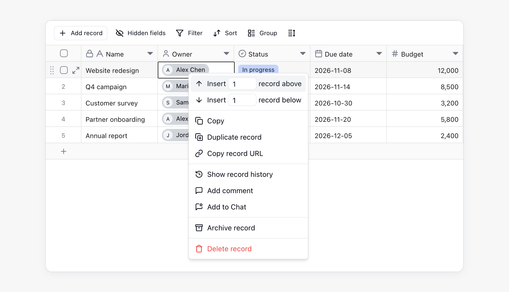
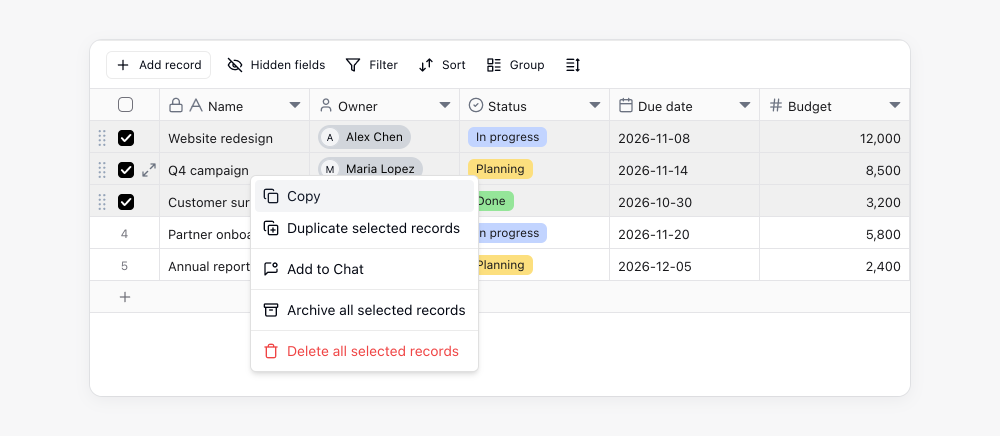
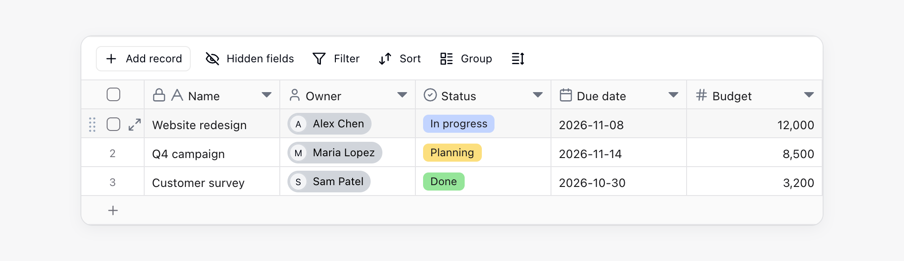
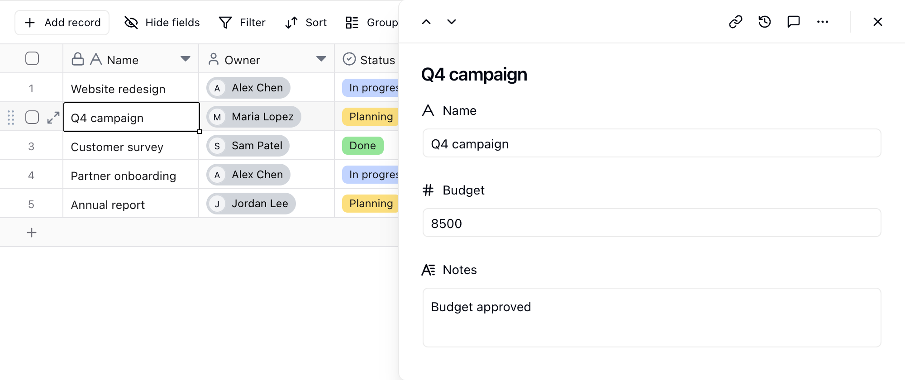

I Record archiviano voci di dati complete. Ogni Record è composto da più Campi. Ad esempio, un Record cliente può includere nome, numero di telefono, responsabile e stato del follow-up. Un Record ordine può includere numero d'ordine, cliente, importo e data di consegna.

## Concetti di base

| Concetto | Descrizione |
| --- | --- |
| Record | Una riga di dati in una Tabella |
| Campo | Un attributo di un Record, corrispondente a una colonna della Tabella |
| Cella | Il valore di un Record in un Campo |
| Campo primario | Il nome visualizzato principale di un Record, spesso utilizzato negli elenchi per dispositivi mobili e nei selettori dei Record collegati |

## Creare Record

Puoi creare Record nei modi seguenti:

| Punto di accesso | Azione |
| --- | --- |
| Parte inferiore della Tabella | Fai clic sul pulsante `+` nella parte inferiore della Vista Tabella per aggiungere un Record alla fine |
| Barra degli strumenti superiore | Fai clic su `+ Aggiungi Record` sul lato sinistro della barra degli strumenti |
| Menu contestuale | Fai clic con il pulsante destro del mouse su un Record esistente e inserisci un Record sopra o sotto |

## Modificare i Record

- **Modificare una cella**: fai clic su una cella e inseriscine o modificane il contenuto.
- **Cancellare il contenuto**: seleziona una o più celle, quindi premi `Delete` o `Backspace`.
- **Selezione in blocco**: trascina con il mouse per selezionare più celle o Record, quindi modificali, eliminali o copiali.
- **Copiare e incollare**: copia e incolla una o più celle. Usa la scorciatoia da tastiera, oppure fai clic con il tasto destro sulla selezione e scegli **Copia**. Se i dati incollati contengono più righe della Tabella corrente, Teable aggiunge automaticamente nuove righe.

## Eliminare i Record

Seleziona uno o più Record, quindi fai clic con il pulsante destro del mouse e scegli **Elimina Record**. Per l'eliminazione in blocco, puoi selezionare le caselle di controllo all'inizio delle righe prima di eliminarle.

I Record eliminati vengono spostati nel cestino della Tabella, dove puoi esaminarli e ripristinarli. Se vuoi rimuovere i Record dalla Tabella mantenendoli comunque disponibili, archiviali anziché eliminarli. Consulta [Archivio e cestino](/it/basic/record/archive-trash).

<Info>Se un'altra Tabella è collegata al Record tramite un Campo [Collegamento](/it/basic/field/link) **Obbligatorio**, Teable rifiuta l'eliminazione e indica la Tabella e il Campo che rimarrebbero vuoti. Collega quel Campo a un altro Record, disattiva l'impostazione **Obbligatorio** del Campo oppure elimina insieme a questo anche i Record collegati.</Info>

## Dettagli del Record

Fai clic sull'icona di espansione all'inizio della riga di un Record oppure seleziona un Record e premi Spazio per aprire il pannello dei dettagli a destra della Tabella.

Il pannello dei dettagli è utile per i Record con molti Campi. Puoi esplorare verticalmente i Campi, ridurre lo scorrimento orizzontale, modificare i Campi, visualizzare i commenti e controllare la cronologia del Record. Con il pannello aperto puoi continuare a lavorare nella Tabella, e la riga del Record corrente resta evidenziata.

- **Ridimensionare**: trascina il bordo sinistro del pannello. La larghezza viene mantenuta, anche per i Record di altre Tabelle.
- **Cambiare Record**: fai clic sulle frecce su e giù in alto a sinistra nel pannello. Funziona nelle Viste griglia, kanban, galleria e calendario.
- **Vedere i Record collegati**: un Record collegato si apre nello stesso pannello, con un percorso in alto. Fai clic su un livello qualsiasi per tornare a quel Record.
- **Chiudere**: premi `Esc` per chiudere il Record corrente, oppure fai clic su **×** in alto a destra per chiudere l'intero pannello.

## Collaborazione e monitoraggio

| Funzionalità | Descrizione |
| --- | --- |
| Commenti | Ogni Record dispone di una propria area commenti per discutere dati specifici, menzionare i compagni di squadra con @ o aggiungere contesto. Consulta [Commenti](/it/basic/record/comment). |
| Cronologia del Record | Teable registra le modifiche dei Record affinché sia possibile risalire agli aggiornamenti. Consulta [Cronologia del Record](/it/basic/record/record-history). |
| Archivio e cestino | Rimuovi dalla Tabella i Record completati oppure ripristina quelli eliminati. Consulta [Archivio e cestino](/it/basic/record/archive-trash). |
| Record collegati | Usa un Campo **Collegamento** per collegare Record tra Tabelle. Consulta [Campo Collegamento](/it/basic/field/link). |

## Note

- Il Campo primario viene utilizzato come nome visualizzato principale di un Record. Inserisci nel Campo primario informazioni riconoscibili, come un nome, il titolo di un'attività o un numero d'ordine, anziché contenuti simili a note.
- Ogni Record dispone di un ID univoco. Dopo aver aperto il pannello dei dettagli del Record, la stringa nell'URL del browser che inizia con `rec` è l'ID del Record.
- Se non puoi modificare alcuni Record, un amministratore potrebbe aver limitato l'ambito modificabile tramite la **Matrice di autorità**. Consulta [Matrice di autorità](/it/basic/authority-matrix).
