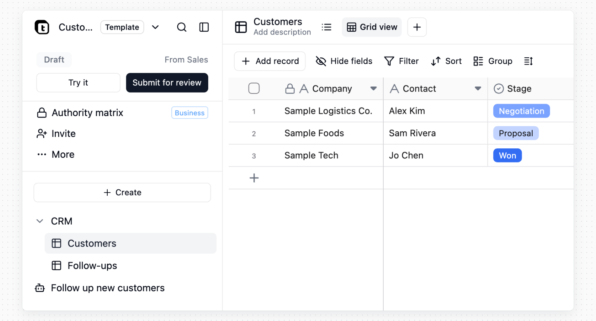
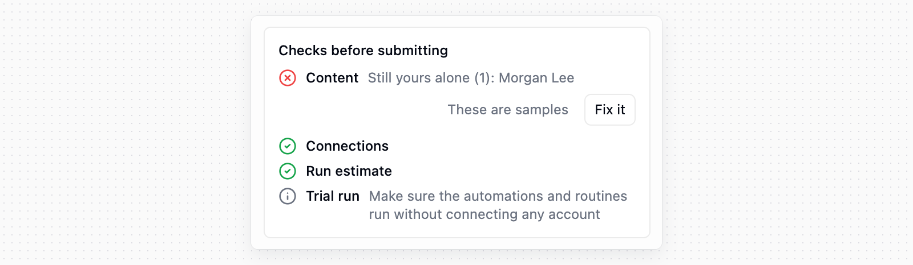

I modelli si preparano in un **progetto modello**. Scegli cosa condividere da un Progetto in cui lavori e Teable ne copia la struttura in un progetto modello separato. Il Progetto originale e i suoi dati non vengono modificati, e non vengono mai pubblicati.

## Creare un modello

Nella barra laterale del Progetto, fai clic con il tasto destro su una Tabella, un'app, un'Automazione o una cartella e scegli **Crea un modello**. Per scegliere da tutto il Progetto, fai clic sul nome del Progetto in alto a sinistra e scegli **Crea un modello**.

Se parti dal menu di un elemento, quell'elemento è già spuntato; se parti dal nome del Progetto, spunta nell'elenco ciò che vuoi portare con te. Le Tabelle usate da un'app, un'Automazione o una dashboard vengono incluse da sole, con il motivo indicato a destra. Tutto il resto si trova sotto **Ne restano N**, che puoi aprire per spuntare altri elementi. Controlla il nome e fai clic su **Crea progetto modello**.

Un progetto modello copia solo la struttura: non include Record, le Automazioni partono disattivate e un campo Collegamento a una Tabella lasciata fuori diventa testo. Ti serve l'accesso **Creatore** o superiore sia nel Progetto originale sia nello Spazio. Un Progetto pubblicato in precedenza direttamente e ancora presente nel centro modelli mostra invece **Pubblica nel centro modelli** nel menu del suo nome; per crearne un nuovo modello, parti dal menu di un elemento nella barra laterale.

## Preparare il progetto modello

Quando fai clic su **Crea progetto modello**, Teable apre il nuovo progetto modello. Ha l'etichetta **Modello** dopo il nome, e la parte alta della barra laterale mostra lo stato, la provenienza (**Da Vendite**, visibile solo a te), **Prova** e **Invia per la revisione**.

Cuppy trova poi ciò che appartiene solo a te, elenca con cosa verrebbe sostituito ciascun elemento, li sostituisce dopo la tua conferma, quindi aggiunge Record di esempio e prepara una bozza della guida all'installazione. Puoi anche aggiungere Record di esempio tu stesso: quando invii, i Record del progetto modello vengono pubblicati come dati di esempio del modello.

## Provare il modello

Fai clic su **Prova** e Teable crea una copia di prova come farebbe un'installazione e la apre, così vedi cosa riceveranno gli altri. Fai clic su **Torna al progetto modello** per tornare indietro, oppure su **Elimina prova** quando non ti serve più. Una nuova prova sposta nel cestino la tua copia di prova precedente.

## Inviare per la revisione

Fai clic su **Invia per la revisione**, inserisci nome, descrizione e copertina e scegli cosa si apre per impostazione predefinita dopo l'installazione. Viene inviato l'intero progetto modello: **Pubblica nodi** mostra quanti elementi e Record di esempio verranno pubblicati.

A destra, **Controlli prima dell'invio** blocca ciò che appartiene solo a te: nomi, indirizzi email e domini email aziendali delle persone che possono aprire lo Spazio o il Progetto, e testo che sembra una chiave API. Sostituiscili, oppure fai clic su **Correggi** per farli sostituire a Cuppy. **Sono esempi** contrassegna tutto ciò che è elencato come contenuto di esempio e lo lascia passare: usalo solo se è tutto inventato.

Quando **Contenuto** mostra un segno di spunta verde, fai clic su **Invia per la revisione**. Le altre righe sono promemoria e non bloccano l'invio.

La riga **Guida** nella finestra aggiunge al modello alcuni passaggi di configurazione. Ogni passaggio ha un titolo, una descrizione di una riga, un punto da aprire e una condizione di completamento. Scrivila con **Scrivila con Teable AI** oppure usa **Modifica nel progetto**. Le condizioni possibili: dati di esempio sostituiti con contenuti reali, un'app pubblicata, un'automazione eseguita con successo una volta, account necessari collegati, oppure spunta manuale dell'utente. Una condizione sui dati non deve già essere vera sui Record di esempio, altrimenti il modello non può essere inviato.

## Revisione e pubblicazione

Dopo l'invio si apre **Inviato per la revisione**, dove puoi fare clic su **Ritira** finché la revisione non è conclusa. La barra laterale mostra **In revisione**; fai clic su **Vedi invio** per rivedere ciò che hai inviato.

Una volta approvato, il modello viene pubblicato nel centro modelli e la barra laterale mostra **Online · v1**. Se viene rimandato indietro, la barra laterale mostra **Rimandato indietro** e la notifica riporta le note del revisore; apporta le modifiche e fai clic su **Invia di nuovo**.

Dopo la pubblicazione, continua a modificare lo stesso progetto modello e fai clic su **Invia v2** per inviare una nuova versione. Finché la nuova versione non viene approvata, chi installa il modello riceve quella attuale.

## Trovare i progetti modello di uno Spazio

La home page di uno Spazio ha due schede: **Progetti** e **Progetti modello**. La scheda **Progetti modello** mostra lo stato e la provenienza di ogni modello; apri una riga per vederne il contenuto e la copia di prova. Per partire da un Progetto vuoto, fai clic su **Nuovo progetto modello** in alto a destra in quella scheda.

<Note>Spostando un progetto modello nel cestino, il modello online viene tolto dal centro modelli, e ripristinare il Progetto dal cestino non lo ripubblica. L'invio in revisione viene ritirato e anche le tue copie di prova finiscono nel cestino. Le copie già installate da altri non vengono toccate.</Note>
