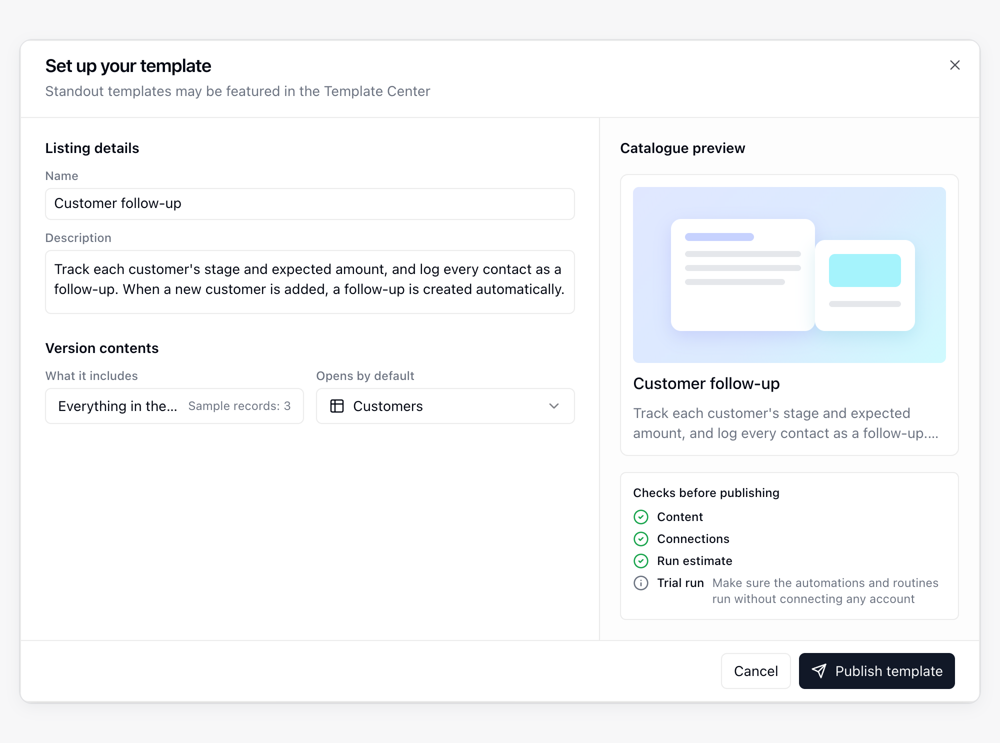

I modelli si preparano in un **progetto modello**. Scegli cosa condividere da un Progetto in cui lavori e Teable ne copia la struttura in un progetto modello separato. Il Progetto originale e i suoi dati non vengono modificati, e non vengono mai pubblicati.

## Creare un modello

Nella barra laterale del Progetto, fai clic con il tasto destro su una Tabella, un'app, un'Automazione o una cartella e scegli **Crea un modello**. Per scegliere da tutto il Progetto, fai clic sul nome del Progetto in alto a sinistra e scegli **Crea un modello**.

Se parti dal menu di un elemento, quell'elemento è già spuntato; se parti dal nome del Progetto, spunta nell'elenco ciò che vuoi portare con te. Le Tabelle usate da un'app, un'Automazione o una dashboard vengono incluse da sole, con il motivo indicato a destra. Tutto il resto si trova sotto **Ne restano N**, che puoi aprire per spuntare altri elementi. Controlla il nome e fai clic su **Crea progetto modello**.

Un progetto modello copia solo la struttura: non include Record, le Automazioni partono disattivate e un campo Collegamento a una Tabella lasciata fuori diventa testo. Ti serve l'accesso **Creatore** o superiore sia nel Progetto originale sia nello Spazio. Un Progetto pubblicato in precedenza direttamente e ancora presente nel centro modelli mostra invece **Pubblica nel centro modelli** nel menu del suo nome; per crearne un nuovo modello, parti dal menu di un elemento nella barra laterale.

## Preparare il progetto modello

Quando fai clic su **Crea progetto modello**, Teable apre il nuovo progetto modello. Dopo il nome compare l'etichetta **Modello**, e la parte alta della barra laterale mostra lo stato, la provenienza (**Da Vendite**, visibile solo a te), **Prova** e **Pubblica modello**.

Cuppy poi individua ciò che appartiene solo a te, indica con cosa sostituire ogni elemento, lo sostituisce dopo la tua conferma, quindi aggiunge Record di esempio e prepara una bozza della guida di installazione. Puoi aggiungere i Record di esempio anche da solo: alla pubblicazione, i Record del progetto modello vengono pubblicati come dati di esempio del modello.

## Provare il modello

Fai clic su **Prova** e Teable crea una copia di prova come farebbe un'installazione e la apre, così vedi cosa riceveranno gli altri. Fai clic su **Torna al progetto modello** per tornare indietro, oppure su **Elimina prova** quando non ti serve più. Una nuova prova sposta nel cestino la tua copia di prova precedente.

## Pubblicare il modello

Fai clic su **Pubblica modello**, inserisci nome e descrizione, carica una copertina e scegli cosa si apre per impostazione predefinita dopo l'installazione. Copertina e descrizione sono obbligatorie: vengono mostrate quando il link del modello viene condiviso. Viene pubblicato l'intero progetto modello: **Contenuto incluso** mostra quanti elementi e Record di esempio verranno pubblicati.

A destra, **Controlli prima della pubblicazione** blocca ciò che appartiene solo a te: nomi, indirizzi email e domini email aziendali delle persone che possono aprire lo Spazio o il Progetto, e testo che sembra una chiave API. Sostituiscili, oppure fai clic su **Correggi** per farli sostituire a Cuppy. **Sono esempi** contrassegna tutto ciò che è elencato come contenuto di esempio e lo lascia passare: usalo solo se è tutto inventato.

Quando la riga **Contenuto** mostra un segno di spunta verde, fai clic su **Pubblica modello**. Le altre righe sono promemoria e non bloccano la pubblicazione.

La riga **Guida** nella finestra aggiunge al modello alcuni passaggi di configurazione. Ogni passaggio ha un titolo, una descrizione di una riga, un punto da aprire e una condizione di completamento. Scrivila con **Scrivila con Teable AI** oppure usa **Modifica nel progetto**. Le condizioni possibili: dati di esempio sostituiti con contenuti reali, un Record proprio aggiunto dall'utente, un'app pubblicata, un'automazione eseguita con successo una volta, account necessari collegati, oppure passaggio segnato come completato dall'utente. Una condizione sui dati non deve già essere soddisfatta dai Record di esempio, altrimenti il modello non può essere pubblicato.

## Dopo la pubblicazione

Il modello va online non appena fai clic su **Pubblica modello**: si apre **Pubblicazione riuscita!** con **Pubblicato · v1** e il link del modello. Chiunque abbia il link può aprirlo e installarlo subito. Copia il link o condividilo direttamente.

Dopo la pubblicazione segue una revisione. Decide solo se il centro modelli include il modello e non incide sul link né sulle installazioni. Una volta incluso, la barra laterale mostra anche **Nel centro modelli**. Se non viene incluso, ricevi una notifica, e il link si può ancora aprire, installare e condividere.

Continua a modificare lo stesso progetto modello e fai clic su **Pubblica v2** per pubblicare una nuova versione. Anche questa va online subito, e le nuove installazioni la ricevono. Per un modello incluso, anche il centro modelli mostra la nuova versione, e la revisione arriva dopo.

Per mettere offline il modello, fai clic su **Annulla pubblicazione** nella finestra di pubblicazione. Il link non si apre più e il centro modelli non mostra più il modello. Le copie installate da altri non subiscono modifiche, e puoi pubblicarlo di nuovo in seguito.

## Trovare i progetti modello di uno Spazio

La home page di uno Spazio ha due schede: **Progetti** e **Progetti modello**. La scheda **Progetti modello** mostra lo stato e la provenienza di ogni modello; apri una riga per vederne il contenuto e la copia di prova. Per partire da un Progetto vuoto, fai clic su **Nuovo progetto modello** in alto a destra in quella scheda.

<Note>Spostare un progetto modello nel cestino annulla anche la pubblicazione del suo modello: il link non si apre più, il centro modelli non lo mostra più e ripristinare il progetto dal cestino non lo ripubblica. Anche le tue copie di prova finiscono nel cestino. Le copie installate da altri non subiscono modifiche.</Note>
