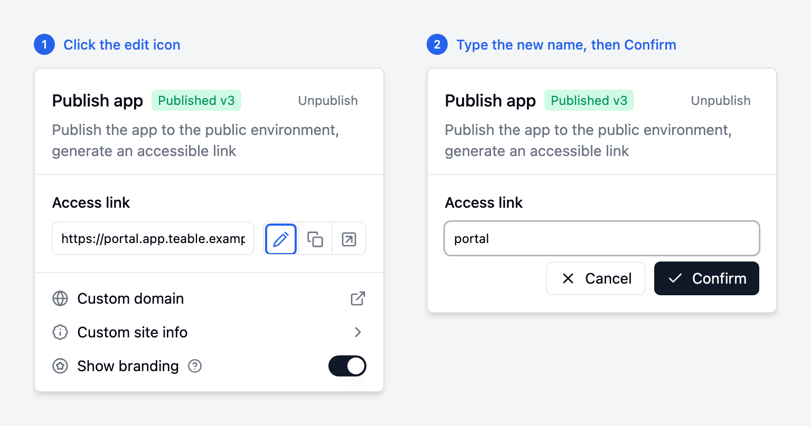
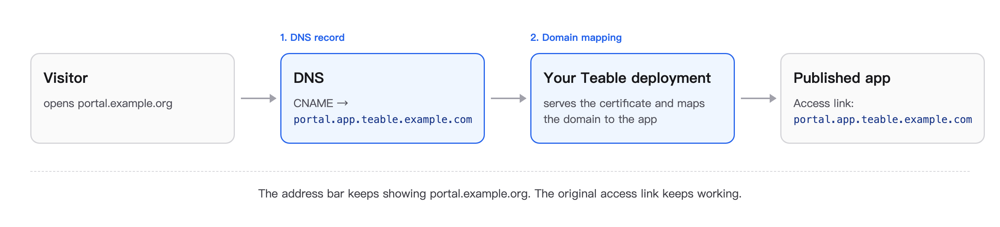

Ogni app che pubblichi con App Builder riceve un proprio indirizzo sotto il dominio del tuo deployment:

```text
https://<name>.app.<your-domain>      ad es. https://crm.app.teable.example.com
```

Questo indirizzo è già sul tuo dominio. Puoi cambiarlo in due modi:

| Cosa vuoi | Chi se ne occupa | Vai a |
|---|---|---|
| Un nome leggibile, ad esempio `crm.app.teable.example.com` invece di un ID casuale | Chiunque possa modificare l'app, nell'editor di app | [Rinominare il link di accesso](#rinominare-il-link-di-accesso) |
| Un dominio completamente separato, ad esempio `crm.example.org` | L'amministratore del server, una volta per ogni dominio | [Usare un dominio separato per la tua app](#usare-un-dominio-separato-per-la-tua-app) |

## Rinominare il link di accesso

La modifica ha effetto immediato, senza cambiare DNS o certificati.

1. Apri l'app nell'editor di app e fai clic su **Pubblica**.
2. Accanto a **Link di accesso**, fai clic sull'icona di modifica.
3. Digita il nuovo nome (lettere minuscole a–z senza accenti, numeri e trattini, con una lettera o un numero all'inizio e alla fine), quindi fai clic su **Conferma**.



Ora l'app è disponibile su `https://<new-name>.app.<your-domain>`. Se l'avevi già rinominata in precedenza, il nome precedente smette di funzionare, quindi aggiorna i link che hai condiviso.

## Usare un dominio separato per la tua app

Usa questa soluzione quando un'app deve trovarsi fuori dal tuo dominio Teable, ad esempio un portale clienti su `portal.example.org`. I visitatori continuano a vedere il tuo dominio nella barra degli indirizzi; non avviene alcun reindirizzamento.



Ti servono:

- Versione della piattaforma **v2026.11.5** o successiva ([changelog](https://github.com/teableio/teable-deployment/blob/main/CHANGELOG.md)). Perché l'accesso riporti i visitatori su questo dominio serve anche una versione di Teable del 2026-11-05 o successiva.
- Il link di accesso attuale dell'app, ad esempio `portal.app.teable.example.com`.
- L'accesso alle impostazioni DNS del dominio separato.
- L'accesso al server (Docker) o ai valori Helm (Kubernetes) del tuo deployment.

### Passaggio 1: puntare il dominio al tuo deployment

Aggiungi un record DNS per il dominio separato:

| Dominio | Record |
|---|---|
| Un sottodominio, ad esempio `portal.example.org` | `CNAME` → il link di accesso dell'app, ad esempio `portal.app.teable.example.com` |
| Un dominio radice, ad esempio `example.org` | `A` → l'IP pubblico del tuo server (o del load balancer dell'Ingress). La maggior parte dei provider DNS non consente un `CNAME` su un dominio radice. |

Verifica prima di proseguire: `dig +short portal.example.org` dovrebbe restituire il tuo link di accesso o l'IP del tuo server.

### Passaggio 2: associare il dominio alla tua app

<Tabs>
<Tab title="Docker">
Aggiungi la mappatura al file `.env` nella directory del tuo deployment. Separa più mappature con virgole, senza spazi:

```bash .env
APP_CUSTOM_DOMAINS=portal.example.org=portal.app.teable.example.com
```

Applica la configurazione:

```bash
./apply.sh server --with-app    # ometti --with-app se esegui solo il piano di runtime
docker compose up -d
```

I **certificati** vengono gestiti automaticamente:

- Se il tuo certificato (`TLS_CERT_FILE`) copre già il dominio, viene usato quello.
- Altrimenti viene richiesto un certificato Let's Encrypt, che viene rinnovato automaticamente. Per questo il dominio deve puntare al server e le porte 80 e 443 devono essere raggiungibili da Internet.

In un'intranet senza accesso in entrata da Internet, aggiungi invece il dominio al certificato che fornisci in `TLS_CERT_FILE`.
</Tab>
<Tab title="Kubernetes">
Aggiungi la mappatura ai tuoi valori Helm:

```yaml values.yaml
appRuntime:
  customDomains:
    - host: portal.example.org
      target: portal.app.teable.example.com
```

Applica la configurazione:

```bash
helm upgrade <release> <chart> -n <namespace> -f values.yaml
```

**Certificati**: per impostazione predefinita il chart chiede a cert-manager un certificato Let's Encrypt tramite HTTP-01; per questo il dominio deve puntare all'indirizzo pubblico del tuo controller Ingress. In una rete privata, crea un Secret TLS per il dominio nel namespace in cui hai installato il chart e fai riferimento a esso:

```yaml values.yaml
appRuntime:
  customDomains:
    - host: portal.example.org
      target: portal.app.teable.example.com
      tlsSecretName: portal-example-org-tls
```

Se il TLS termina su un load balancer davanti al cluster, aggiungi invece lì il certificato del dominio.
</Tab>
</Tabs>

### Passaggio 3: verificare il funzionamento

Apri `https://portal.example.org`. L'app si carica e la barra degli indirizzi resta su `portal.example.org`. Da un terminale:

```bash
curl -sI https://portal.example.org    # atteso: 200, senza reindirizzamento al link di accesso
```

Il link di accesso originale dell'app continua a funzionare. Nelle app che richiedono l'accesso, i visitatori tornano su questo dominio dopo aver effettuato l'accesso; se più domini puntano alla stessa app, tornano al primo dell'elenco.

### Modificare o rimuovere un dominio

- **Per spostare un dominio su un'altra app**, associalo al link di accesso dell'altra app e applica di nuovo la configurazione.
- **Dopo aver rinominato l'app o averne annullato la pubblicazione**, aggiorna o rimuovi subito la relativa mappatura: il link di accesso liberato può essere preso da un'altra app.
- **Per rimuovere un dominio**, elimina la relativa mappatura e applica di nuovo la configurazione, quindi rimuovi il record DNS.

## Risoluzione dei problemi

| Sintomo | Causa probabile |
|---|---|
| Errore `app_runtime_host_not_bound` | Il link di accesso nella mappatura non corrisponde a quello attuale dell'app (ad esempio dopo averla rinominata) oppure l'app non è pubblicata. |
| Pagina vuota o avviso sul certificato | Il dominio non è nella mappatura o la configurazione non è stata applicata; il DNS non punta ancora al tuo deployment; la porta 80 è bloccata, quindi Let's Encrypt non può verificare il dominio; oppure il tuo certificato non include il dominio. |
| Il browser non trova il dominio | Il record DNS manca o non si è ancora propagato. Verificalo con `dig +short <domain>`. |
