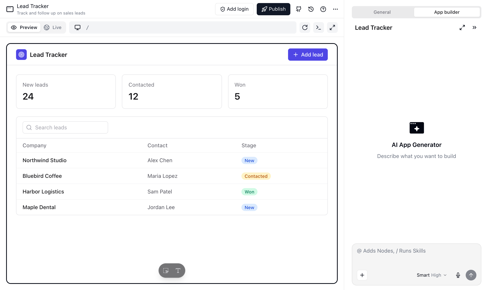
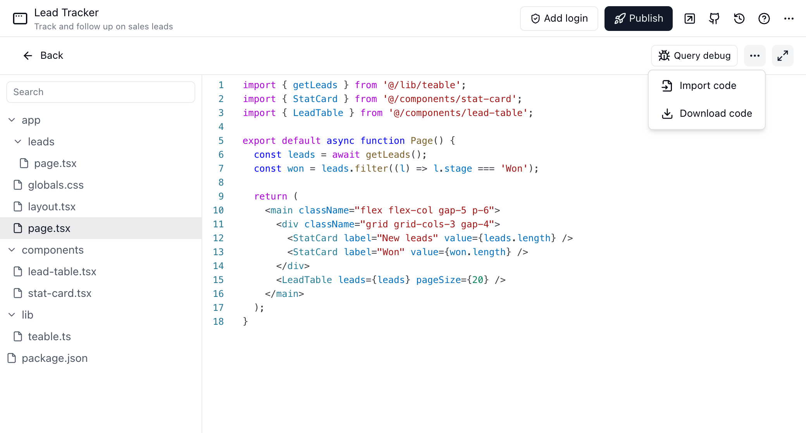
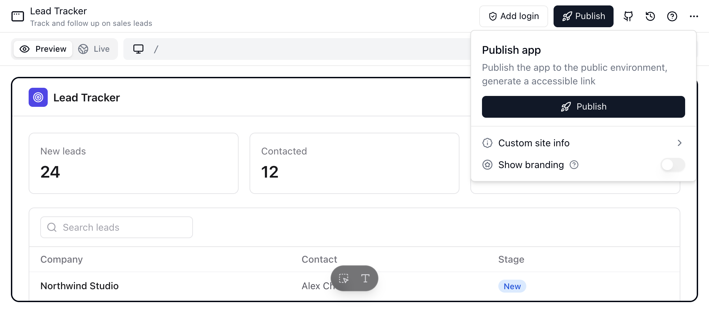
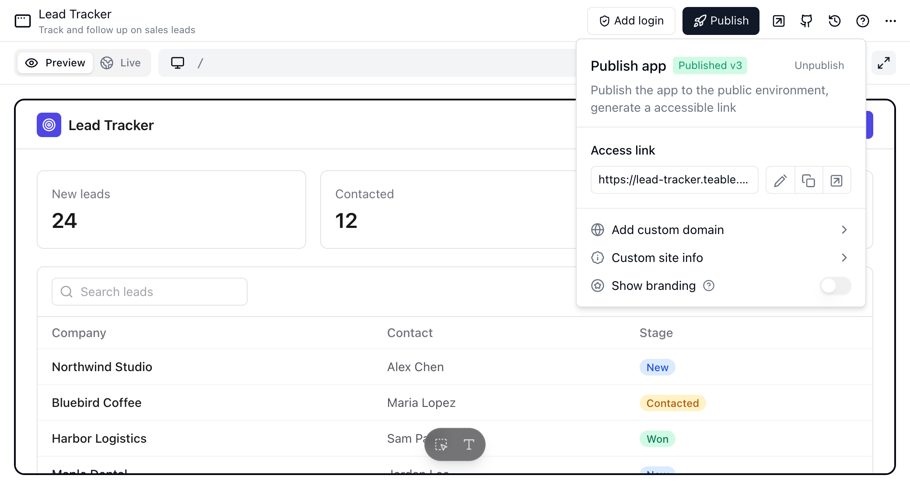
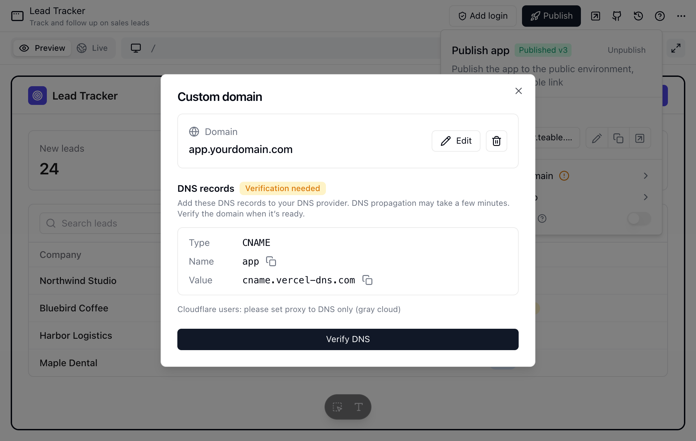
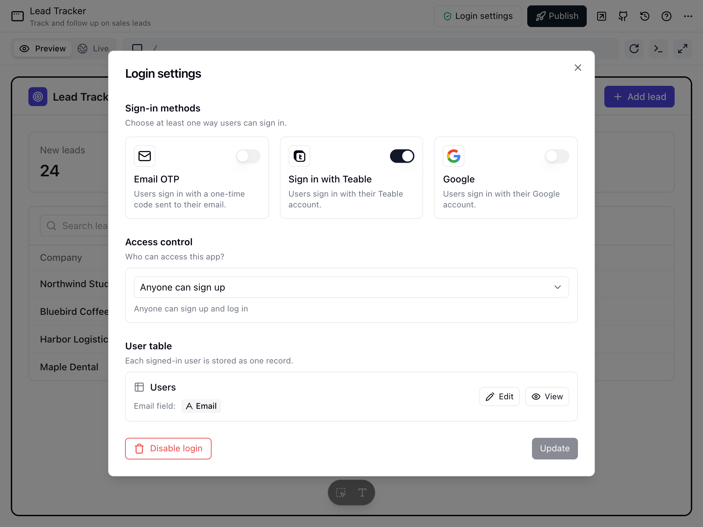
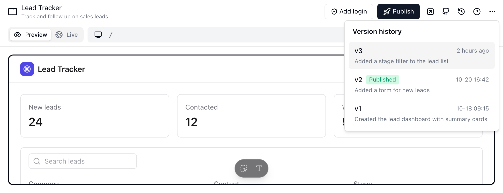

<Note>すべてのCloudプランで利用できます。セルフホストではBusinessプラン以上が必要です。</Note>

Teable App Builderを使用すると、コードを書かずに、プロジェクトを完全に機能するカスタマイズ済みWebアプリケーションへ変換できます。データ構造の力とAIによる設計を組み合わせることで、社内ツール、顧客ポータル、データダッシュボードを数分で公開できます。

## 概要

App Builderは、「プロンプトからアプリへ」というワークフローに従います。必要なものを説明すると、AIがアプリケーションの構造、ページ、ロジックを構築します。その後、ビジュアルエディターまたはコードを使用して、細部を調整できます。

<Note>
カスタムインターフェースや独立したアプリを作成するには、App Builderを使用します。プロジェクト内でのインタラクティブなデータ分析やその場限りの質問には、[AIチャット](/ja/basic/ai/ai-chat)を使用してください。
</Note>

具体的な活用例は、[AIによるアプリ構築の例](https://teable.ai/ja/ai-app-builder)をご覧ください。

## アプリを作成する

アプリを作成する主な方法は2つあります。

1. **プロジェクトから**：任意のプロジェクトで「アプリを作成」をクリックし、現在のデータにリンクされたアプリケーションを生成します。
2. **チャットから**：AIチャットを開き、「この顧客テーブル用のCRMアプリを作成して」と伝えます。

教育分野の活用例として、[Zakrlyが教育事業のデータを整理し、学習者ポータルの画面を設計する事例](https://teable.ai/ja/customers/zakrly)をご覧ください。

## アプリエディターの画面

App Builderには、技術者以外のユーザーと開発者の両方に対応する2つの画面があります。

### 1. チャット画面（AI駆動）
アプリの司令塔です。
- **自然言語による編集**：*「ヘッダーを青にして」*、*「新しいレコードの送信フォームを追加して」*など、変更内容を説明します。
- **自動ルーティング**：AIが参照しているコンポーネントまたはページを理解し、直接変更します。
- **認証情報のリクエスト**：アプリが実行時にサードパーティーアカウントやシークレットを必要とする場合、App Builderはチャットパネルに**このアプリにはあなたの Slack 接続が必要です**のようなカードを固定します。**自分のアカウントを接続**をクリックするとOAuthを実行し、新しい接続はそのままこのアプリへ付与されます。使える接続やシークレットをすでに持っている場合は、付与するだけで済み、接続し直す必要はありません。**スキップ**をクリックすると認証情報は渡されず、AIはそれなしで完了できる処理を続行します。
- **スキル**: **+**メニューを開いて**スキル**を選択し、このアプリの会話で使用するSkillを管理します。ここで追加したSkillは現在のアプリでのみ利用でき、アプリのプロジェクトとスペースで共有されているSkillも使用できます。入力ボックスに`/`と入力すると、有効なSkillを選択できます。
- **ファイル管理**：**+** → **その他** → **ファイル管理**を開き、アプリのサンドボックス内にあるファイルを表示します。対応ファイルのプレビュー、生成ファイルのダウンロード、不要になったファイルやフォルダーの削除に使用します。
- **会話を消去**：現在の会話が本題から外れた場合は、パネル右下の**チャットをクリア**をクリックして、新しいセッションを開始します。現在の会話のチャット履歴は消去されますが、アプリ自体は削除されません。初回は確認が表示され、次回から表示しないよう選択できます。

### 2. プレビューパネル
- **プレビューと公開版**：パネルには2つのタブがあります。**プレビュー**では、まだ公開していない変更を含め、構築中のバージョンが実行されます。**ライブ**では、公開アドレスから公開済みアプリを読み込み、ユーザーに表示される内容と作業中の内容を比較できます。アプリが公開されるまでは、代わりに**ライブ**へ公開を促すメッセージが表示されます。App Builderは、公開済みのアプリを**ライブ**で、未公開のアプリを**プレビュー**で開き、その後はアプリで最後に使用したタブを記憶します。
- **複数端末のシミュレーション**：上部の切り替えを使用して、**デスクトップ**、**タブレット**、**モバイル**のビューを切り替えます。
- **リアルタイム生成**：App Builderによる生成中、プレビューパネルにはアプリが形作られていく様子が表示されます。
- **即時フィードバック**：App Builderが変更を完了すると、最新の保存済みバージョンでプレビューが更新されます。

**プレビュー**タブでは、下部のフローティングツールバーを使用して、対象を絞った変更を行います。

- **編集する要素を選択**を選び、プレビュー内の要素をクリックします。App Builderがその要素をチャット入力欄へ追加します。指示を追加してメッセージを送信すると、AIがアプリの該当部分を更新します。
- **テキストを直接編集**を選び、プレビュー内の静的テキストをクリックして置換内容を入力します。**保存**をクリックする前に複数のテキスト要素を編集できます。保留中のテキスト変更を元に戻すには、**変更を破棄**をクリックします。

データから読み込まれた内容やアプリで計算された内容などの動的テキストは、直接編集できません。代わりに要素を選択し、チャットで変更内容を説明します。AIによる生成中は、要素の選択とテキストの直接編集が一時停止します。いずれかのモードを終了するには、`Esc`を押します。

### 3. 開発者モード（コードエディター）
制限なくカスタマイズできるよう、コードへ直接アクセスできます。
- **Monacoエディター**：ブラウザー内でVS Codeのような操作感を提供します。
- **Reactコンポーネント**：基盤となるReactコード、Tailwind CSSクラス、ロジックを編集します。
- **ファイルツリー**：プロジェクト構造内を移動します。

#### コードをダウンロードする
アプリ全体をZIPアーカイブとしていつでもダウンロードできます。
1. エディターの**コード**タブへ切り替えます。
2. タブバーの**`...`**メニューをクリックします。
3. **コードをダウンロード**を選択し、ダイアログでもう一度**コードをダウンロード**をクリックして、すべてのソースファイルを含むZIPアーカイブを保存します。

ZIPには、デフォルトではアプリの有効な認証情報が含まれません。ルートには[プラットフォームが注入するランタイム変数](#teable-access-token)（Teableがすべてのアプリへ自動的に追加する変数）を列挙した`.env.example`が入っており、TeableアクセストークンとAIアクセスキーの値は空欄です。あわせて、`.env`ファイルをGitの対象外にする`.gitignore`も含まれます。

コードをすぐにローカルで実行したい場合は、ダイアログで**有効な認証情報を含む .env を含める**を選択します。ZIPには代わりに実際の`.env`が入ります。中身はプラットフォームが注入するランタイム変数で、Teableアクセストークンと、AIアクセスが有効な場合はAIアクセスキーが含まれます。アプリへ付与された認証情報は含まれません。

<Warning>
この`.env`を入手した人は、アプリが属するプロジェクトのすべてのデータを読み書きできます。リポジトリへコミットしたり、他の人と共有したりしないでください。漏えいした可能性がある場合は、[Teableアクセストークンをローテーション](#teable-access-token)してください。
</Warning>

#### コードをインポートする
ZIPをインポートして、アプリのコードを更新できます。
1. エディターの**コード**タブへ切り替えます。
2. タブバーの**`...`**メニューをクリックします。
3. **コードをインポート**を選択し、20MB以下のZIPファイルを選びます。

<Note>
- ソースファイルだけを含めてください。`node_modules`、`.next`、その他のビルド成果物は自動的に無視されます。
- ZIPは既存のプロジェクトを置き換えます。含めなかったファイルは新しいバージョンから削除されます。
- ZIPにラッパーフォルダーが1つ含まれている場合、Teableはそのフォルダーを取り除きます。最上位のプロジェクトフォルダーをそのまま圧縮できます。
- インポートするプロジェクトには、プロジェクトのルートに`package.json`が必要です。
- ZIP内のルートにある`.env`ファイルのカスタム変数は、あなたのシークレットとして保存され、同じ名前でアプリへ付与されます。その他の`.env*`形式（`.env.local`など）は無視されます。
</Note>

#### 認証情報と設定

APIキー、認証情報、アプリの実行に必要な設定値は、ソースコードへ直接書かないでください。アプリが使うのは**あなたの認証情報**、つまりOAuthの接続か、あなたが保存したシークレットです。App Builderのチャットパネルで**+** → **その他** → **認証情報と設定**を開き、認証情報をアプリへ付与します。

| 項目 | 動作 |
| --- | --- |
| 適用範囲 | アプリへ付与した認証情報は、プレビュー環境と公開済みアプリの両方で使えます |
| 変数名 | 付与時に入力するエイリアス。先頭は大文字で、大文字、数字、アンダースコアのみ使用できます |
| シークレットの読み取り | サーバーサイドのコードが`process.env.MY_API_KEY`などの環境変数から読み取ります |
| 接続の読み取り | サーバーサイドのコードが`getConnectionToken('ALIAS')`を呼び出してアクセストークンを取得します |
| 保存した値 | 保存後は書き込み専用です。置き換えるには新しい値を入力します |

付与の追加や解除、認証情報の値の変更を行うと、アプリのプレビュー環境は新しい値を使います。公開済みのアプリは、再公開後に新しい値を使います。

アプリをコピーしても認証情報はコピーされません。パネルには**未バインド**のプレースホルダーが残るため、**自分のをバインド**で自分の認証情報を割り当てます。プロジェクトをコピーまたはエクスポートした場合や、テンプレートを使用した場合も、アプリのコード内の`.env`は引き継がれず、コピーされた各アプリにはそれぞれ専用のTeableアクセストークンが発行されます。認証情報の管理と使用状況については[認証情報と連携](/ja/basic/credential)を、テーブルやレコードなどプロジェクトの内容がどのようにコピーされるかについては[プロジェクトを別のスペースへ複製する](/ja/basic/base#duplicate-a-base-to-another-space)を参照してください。

#### Teableアクセストークン {#teable-access-token}

アプリの環境変数には、2つの出どころがあります。

- **プラットフォームが注入する変数**：Teableがすべてのアプリへ自動的に提供する変数です。Teableアクセストークン（`TEABLE_APP_TOKEN`）、APIエンドポイント、アプリとプロジェクトのIDが含まれます。**AI アクセス**を有効にすると、AIアクセス用のエンドポイントとキーが追加されます。
- **アプリへ付与された認証情報**：上記の**認証情報と設定**で付与したシークレットと接続です。

個人アクセストークン（**設定** → **開発者ツール** → **個人アクセストークン**）がアプリへ注入されることはなく、アプリのコードでも必要ありません。個人アクセストークンは、アプリの外部からTeableを呼び出すためのものです。[外部サービスとMCPで使う認証情報](#credentials-for-external-services-and-mcp)を参照してください。

Teableアクセストークンは、アプリがデータの読み書きに使う認証情報です。アプリが属するプロジェクト全体にアクセスでき、一部のテーブルやフィールドに限定することはできません。他のプロジェクトにはアクセスできません。アプリのプレビュー環境と公開済みアプリで使われます。Teableがこのトークンをアプリのリポジトリへコミットすることはなく、ダウンロードしたコードにもデフォルトでは含まれません。通常、トークンはアプリごとに個別に発行されます。[トークンの変更と失効](#when-the-token-changes-or-stops-working)を参照してください。

次のような場合は、トークンをローテーションしてください。

- トークンが漏えいした可能性がある。たとえば、`.env`をリポジトリへコミットした、またはGitHubのIssue、フォーラムの投稿、チャットに貼り付けた。
- 環境変数をコピーしたメンバー、または`.env`を含むコードをダウンロードしたメンバーが、プロジェクトの担当から外れた。
- アプリのコードを`.env`ごと他の人へ渡した。

チャットパネルで **+** → **その他** → **認証情報と設定**を開き、**プラットフォーム認証情報**カードの右上にある**ローテーション**をクリックします。TeableアクセストークンとAIアクセスキーは、どちらもここでローテーションします。アプリの編集権限が必要です。

アプリでAIアクセスが有効な場合は、確認ダイアログでローテーションする対象を**Teable アクセストークン**、**AI アクセスキー**、またはその両方から選べます。デフォルトは両方です。`.env`には両方の値が入っているため、漏えいが疑われる場合は両方をローテーションしてください。1つだけでも両方でも、プレビューと公開済みアプリの更新は1回だけです。確認ダイアログには、選択した内容による影響が表示されます。

| 項目 | ローテーション後 |
| --- | --- |
| 古いトークン | すぐに無効になります |
| 実行中のプレビュー | 再起動なしで新しいトークンに切り替わります |
| 公開済みアプリ | Teableがバックグラウンドで新しいトークンを使って再デプロイします。バージョン履歴には何も追加されません。再デプロイが完了するまで（通常は数分以内）、アプリはプロジェクトのデータを読み書きできません。アプリに未公開の変更がある場合は、自動では再デプロイされない（再デプロイすると未公開の変更も公開されてしまうため）ので、再公開する必要があります |
| ログイン中のアプリユーザー | アプリで[アプリへのログイン](#アプリへのログイン)を使用している場合、訪問者は再度サインインする必要があります |
| ローカルの`.env`とダウンロードしたコード | 含まれている古いトークンは使えなくなります。環境変数をもう一度コピーするか、**有効な認証情報を含む .env を含める**を選択してコードをダウンロードし直してください |

以前にコピーされたプロジェクトでは、複数のアプリが1つのトークンを共有していることがあります。そのうち1つをローテーションすると、プロジェクト内で同じトークンを共有している他のアプリもすべてローテーションされ、それぞれに専用の新しいトークンが発行されます。あわせてローテーションされたアプリの数は、通知で確認できます。

Teableによる自動再デプロイはトークンを切り替えるだけで、まだ公開していない変更を公開することはありません。一方、再公開は、公開メニューから現在のバージョンを自分で公開する操作です。「**認証情報をローテーションしましたが、公開済みアプリを自動更新できませんでした。再公開してください。**」または「**認証情報をローテーションしました。公開済みアプリには未公開の変更があるため自動更新されませんでした。再公開すると新しい値が使われます。**」と表示された場合や、数分経ってもこのアプリ（またはあわせてローテーションされたアプリ）がデータを読み取れない場合は、そのアプリを再公開して新しいトークンを反映させてください。プレビューでデータを読み取れない場合は、プレビューを再読み込みします。

#### トークンの変更と失効 {#when-the-token-changes-or-stops-working}

| 操作 | Teableアクセストークン |
| --- | --- |
| アプリを作成 | 新しいトークンが発行されます |
| アプリのコピー、プロジェクトのコピーまたはインポート、テンプレートの使用 | コピーごとに専用の新しいトークンが発行されます。元のアプリのトークンは変わりません |
| [アプリを別のプロジェクトへ移動](/ja/basic/base#リソースを別のプロジェクトへ移動する) | 新しいトークンに置き換えられ、古いトークンはすぐに無効になります。ローテーション後と同様に、プレビューは新しいトークンに切り替わり、公開済みアプリはバックグラウンドで再デプロイされます |
| 公開、再公開、バージョンのロールバック | 変わりません |
| 公開停止 | 変わりません。トークンは引き続き有効で、プレビューでもそのまま使われます |
| コードのダウンロード、環境変数のコピー | 変わりません。ローテーションするまでは、毎回同じトークンが得られます |
| ローテーション | 新しいトークンに置き換えられ、古いトークンはすぐに無効になります（上記を参照） |
| アプリを削除 | すぐに無効になります。ゴミ箱からアプリを復元すると、同じトークンが再び使えるようになります |

トークンは有効期間10年で発行され、ローテーションするかアプリを削除するまで有効です。途中で自然に期限切れになることはありません。漏えいが疑われる場合はローテーションしてください。ゴミ箱から復元したアプリのトークンが漏えいしている可能性がある場合は、復元後にローテーションしてください。

#### 監査記録 {#audit-records}

次の操作は監査ログに記録されます。

- **アプリのアクセストークンをローテーション**と**アプリの AI キーをローテーション**：**プラットフォーム認証情報**カードからローテーションすると、ローテーションした認証情報ごとに1件ずつ記録されます。
- **アプリの環境変数をコピー**：アクセストークンを含む環境変数のコピーです。
- **アプリのコードをエクスポート**：コードのダウンロードです。`.env`を含めたかどうかも記録されます。

アプリがアクセストークンを使ってプロジェクトのデータを書き込むと、監査ログの操作者は**App Robot**と表示されます。トークンごとの使用履歴やアラートの機能はなく、読み取りは記録されません。

セルフホストのインスタンス（Businessプラン以上）では、インスタンス管理者が**システム管理** → **監査ログ**でログを確認できます。ログの保持期間は1か月で、ユーザー、スペース、プロジェクト、操作の種類で絞り込めます。上記のエントリは**アプリ**に分類されます。[監査ログ](/ja/basic/admin-panel/audit-log)を参照してください。

#### 外部サービスとMCPで使う認証情報 {#credentials-for-external-services-and-mcp}

Teableアクセストークンは、アプリ自身が使うためだけのものです。アプリの外部のサービスでは使用しないでください。MCPの接続にも使用できません。

- **Teable APIを呼び出す外部サービス**（サーバーレス関数、スクリプト、CIなど）：[個人アクセストークン](/ja/api-doc/token)を使用します。必要なプロジェクトまたはスペースとスコープだけを追加し、有効期限を設定してください。個人アクセストークンは、作成したユーザーとして動作します。
- **MCPクライアント**：OAuthで接続します（推奨）。クライアントはあなたとして動作し、**設定** → **開発者ツール** → **MCP**でいつでも削除できます。ブラウザーのない環境では代わりに個人アクセストークンを使用し、この場合も必要なプロジェクトとスコープだけを付与してください。[MCPで接続する](/ja/basic/ai/teable-skill#mcpで接続する)を参照してください。

#### アプリファイルを管理する

App Builderは、アップロードファイル、生成された出力、ランタイムファイルをアプリのサンドボックスへ保存します。チャットパネルで**+** → **その他** → **ファイル管理**を開いて確認します。対応しているファイル形式はプレビューで開けます。ファイルのダウンロードや、不要になったファイルとフォルダーの削除も可能です。

#### アプリへAI機能を追加する

アプリでレコードの要約、リクエストの分類、返信の下書き、アプリユーザーからの質問への回答が必要な場合は、AIを追加します。

「サポートチケット用のAI返信アシスタントを追加して」や「各フォーム送信を要約して」など、必要な内容をApp Builderへ伝えます。App Builderは**AI アクセス**を有効にし、その機能のコードを追加できます。

<Info>
App BuilderがAI機能を追加すると、アプリのプレビューでは新しいバージョンが使用されます。公開済みアプリでは、再公開した後にのみ使用されます。
</Info>

AIアクセスキーもTeableが注入し、**プラットフォーム認証情報**カードにアクセストークンと並んで表示されます。キーを置き換えるには、カードの**ローテーション**をクリックし、**AI アクセスキー**だけを選択します。古いキーはすぐに無効になり、実行中のプレビューは新しいキーに切り替わります。公開済みアプリはバックグラウンドで再デプロイされ、完了するまでAIの呼び出しは失敗します。AIアクセスキーだけをローテーションしても、訪問者はログアウトされません。アプリに未公開の変更がある場合は自動では再デプロイされないため、数分経ってもAIの呼び出しが失敗する場合は、アプリを再公開してください。

## コードをGitHubと同期する

<Note>CloudのBusinessプラン以上で利用できます。</Note>

プルリクエストでコードを確認する場合、Teable外部にコピーを保持する場合、ローカルエディターでアプリを操作する場合は、アプリを非公開GitHubリポジトリへリンクします。リンクすると、アプリとリポジトリが双方向に同期されます。新しいアプリバージョンはすべてGitHubへプッシュされ、GitHubへプッシュしたコミットは新しいアプリバージョンになります。

### アカウントを接続してリポジトリを作成する

最初にアプリを少なくとも1回生成してください。アプリにコードがない間、GitHubボタンには**アプリを生成すると GitHub に接続できます**と表示され、操作できません。

<Steps>
  <Step title="GitHubパネルを開く">アプリのヘッダーにあるGitHubアイコンをクリックして、**GitHub 同期**を開きます。アプリの編集権限が必要です。</Step>
  <Step title="アカウントを接続する">**GitHub と連携**をクリックし、ポップアップウィンドウでインストールを完了します。個人アカウントまたは自分が管理する組織を選択します。ブラウザーでウィンドウがブロックされた場合は、ポップアップを許可してください。</Step>
  <Step title="アカウントを選択する">**GitHub アカウント**で接続済みアカウントを選択します。別のアカウントを接続するには**+**をクリックします。</Step>
  <Step title="リポジトリに名前を付ける">**リポジトリ名**には、アプリ名から生成された値があらかじめ入力されています。名前には文字、数字、`.`、`-`、`_`を使用でき、最大100文字です。</Step>
  <Step title="作成してリンクする">**リポジトリを作成して連携**をクリックします。個人アカウントの場合は、もう1つのポップアップで作成を許可するようGitHubから求められます。</Step>
</Steps>

Teableは新しい非公開リポジトリを作成し、現在のアプリコードを`main`ブランチへコミットします。アプリへのリンクと、両者が同期される仕組みを説明したREADMEも追加されます。アプリを既存のリポジトリへリンクすることはできません。

デフォルトでは、接続は作成者に属します。コラボレーターが同じ組織アカウントで構築できるようにするには、接続を選択し、**他のメンバーにこの連携の使用を許可**をオンにします。アプリの編集権限を持つ他のメンバーは、その組織内で自分のアプリ用リポジトリを作成できるようになります。GitHubではリポジトリの作成にアカウント所有者本人の許可が必要なため、個人の接続は共有できません。

### 同期の仕組み

| 方向 | 実行内容 |
| --- | --- |
| アプリ → GitHub | 新しいアプリバージョンが作成されるたびに、リポジトリの`main`ブランチへプッシュされます。|
| GitHub → アプリ | `main`へプッシュされたコミットが、新しいアプリバージョンになります。チャットパネルのメッセージに同期内容が表示され、開いているプレビューには新しいコードが再読み込みされます。|

環境ファイルがプッシュされることはありません。以下の**環境変数とローカル開発**をご覧ください。

パネルでは、リポジトリ名の横に現在の状態が表示されます。

| ステータス | 意味 | 対応方法 |
| --- | --- | --- |
| **同期済み** | リポジトリが最新のアプリバージョンと一致しています。| 対応は不要です。|
| **同期中** | プッシュが進行中です。| 待機してください。パネルは自動的に更新されます。|
| **競合** | `main`ブランチにTeableが作成していないコミットがあり、自動的に結合できません。| GitHubで`teable-sync`ブランチをマージします。以下をご覧ください。|
| **一時停止** | GitHub Appがアンインストールまたは一時停止されたため、Teableが同期を停止しました。| パネルに理由が表示されます。一時停止を解除すると、同期が自動的に再開されます。|
| **エラー** | 最後の同期試行に失敗しました。| パネルで理由を確認し、**再試行**をクリックします。|

### 競合を解決する

Teableがブランチを強制プッシュすることはありません。履歴が分岐すると、最新のアプリバージョンを`teable-sync`という名前のブランチへ移し、リンクを**競合**としてマークします。GitHubで`teable-sync`を`main`へマージしてください。マージ内容が新しいアプリバージョンとして反映され、リンクは**同期済み**へ戻ります。競合中も、それ以降のアプリバージョンによって`teable-sync`ブランチが更新され続けるため、マージ時には常に最新の作業が取り込まれます。

### 環境変数とローカル開発

リポジトリにはソースだけが保存されます。Teableは、プロジェクトのルート、サブフォルダー、コミット履歴のいずれにある場合でも、名前が`.env`で始まるファイルを決してプッシュしません。環境変数の値は、プラットフォームが注入する変数とアプリへ付与された認証情報に由来します（[Teableアクセストークン](#teable-access-token)を参照）。これらはTeableが管理し、Gitへ追加されることはありません。リポジトリの`.gitignore`にはすでに`.env*`が記載されているため、ローカルのクローンから誤ってコミットされることもありません。

自分のコンピューターでアプリを実行するには、次の手順を行います。

<Steps>
  <Step title="クローンしてインストールする">リポジトリをクローンし、`pnpm install`を実行します。</Step>
  <Step title="変数をコピーする">GitHubパネルまたは**認証情報と設定**で**環境変数をクリップボードにコピー**をクリックし、クリップボードの内容をプロジェクトのルートにある`.env`ファイルへ貼り付けます。</Step>
  <Step title="アプリを起動する">`pnpm dev`を実行します。</Step>
</Steps>

コピーされるのはプラットフォームが注入する変数だけで、APIエンドポイント、アクセストークン、AIアクセス用の変数が含まれます。**認証情報と設定**では、ボタンに**プラットフォームが注入するランタイム変数のみ。付与された認証情報は含まれません**という注記も表示されます。コピーした変数にもダウンロードしたコードにも、アプリへ付与された認証情報は含まれません。ローカルでのデバッグに必要な場合は、自分で`.env`に追加してください。

<Warning>
そのファイル内の`TEABLE_APP_TOKEN`行はアプリのデータへのアクセス権を付与します。そのため、アプリの編集権限を持つメンバーだけがコピーできます。ファイルをコミットしたり、課題やプルリクエストへ貼り付けたりしないでください。漏えいした可能性がある場合は、[Teableアクセストークンをローテーション](#teable-access-token)してください。
</Warning>

アプリが本番で使用する認証情報は、ローカルファイルではなくTeableの**認証情報と設定**で追加・変更します。ローカルファイルの編集も、GitHubへコミットした`.env`も反映されません。TeableアクセストークンやAIアクセスキーのローテーションなどでプラットフォーム変数が変わったときは、変数をもう一度コピーしてローカルの`.env`を更新します。

### リポジトリのリンクを解除する

リポジトリ名の横にある削除アイコンをクリックし、確定します。同期は停止しますが、リポジトリとそのコードはGitHubに残ります。後から同じアプリを再度リンクすると、古いリポジトリへ再接続せず、新しいリポジトリが作成されます。

## 公開と管理

### アプリを公開する
アプリの準備ができたら、右上の**公開**ボタン（矢印アイコン）をクリックします。
- **公開URL**: Teableが、アプリ用の安全で一般公開されるURLを生成します。
- **カスタムドメイン**：独自ドメインをアプリへ割り当てます。
- **ブランドバッジを表示**：**公開**メニューの**ブランドバッジを表示**を使用して、公開済みアプリに**Teableで構築**バッジを表示するかどうかを制御します。公開後にこの設定を変更した場合は、**再公開**をクリックして適用します。
- **公開を取り消す**：公開済みアプリでは、公開メニューの**公開を取り消す**を使用して公開リンクをオフラインにします。
- **アプリ設定の変更**：公開メニューに**実行時設定が変更されました。再公開すると公開中の App に反映されます**または**ブランド表示設定が変更されました。再公開すると公開中の App に反映されます**と表示されたら、**再公開**をクリックします。
- **公開済み App を開く**：アプリを公開すると、**公開**の横にあるアイコンから、公開中のアプリを新しいタブで開けます。

<Info>**Teableで構築**バッジを非表示にするには、Businessプラン以上が必要です。</Info>

公開サイトの活用例として、[WaconzyがApp Builderで音楽、ツール、デジタルサービスをまとめた事例](https://teable.ai/ja/customers/waconzy)をご覧ください。

### アプリの公開を停止する

公開済みアプリをオフラインにするには、**公開**メニューを開いて**公開を取り消す**をクリックします。確定すると、公開アプリのURLへアクセスできなくなります。

公開を停止しても、アプリや編集履歴は削除されません。アプリの編集を続け、後から再公開できます。

### カスタムドメイン

<Note>カスタムドメインにはBusinessプラン以上が必要です。</Note>

セルフホスト環境でアプリの実行にVercelを使用していない場合、**カスタムドメイン**をクリックすると[アプリのドメイン](/ja/deploy/app-domains)の設定ガイドが開き、ドメインの割り当てはサーバー管理者が行います。以下の手順はTeable Cloud向けです。

**カスタムドメイン**を使用して、公開済みアプリへドメインを関連付けます。`app.yourdomain.com`などのサブドメインを推奨します。ドメインを入力すると、追加するDNSレコードがTeableに表示されます。DNSプロバイダーでレコードを追加し、反映を待ってからTeableでドメインを確認します。

`teable.app`配下で利用可能なサブドメインを使用し、`teable.app`の接頭辞を編集することもできます。例：`your-name.teable.app`

スペースのBusinessプランが期限切れになると、Teableはカスタムドメインがまもなく名前解決されなくなることをスペースの所有者に通知します。それまでに更新すれば、ドメインを維持できます。更新しなかった場合、カスタムドメインは名前解決されなくなり、アプリの公開リンクはTeableの既定のアドレスに戻ります。その後Businessプランに再度アップグレードした場合は、カスタムドメインを手動で関連付け直す必要があります。

### カスタムサイト情報

**公開**メニューの**サイト情報をカスタマイズ**を使用して、公開済みアプリのブラウザータブアイコン、ページタイトル、説明を設定します。ダイアログには、編集時にそれらを組み合わせた外観がプレビュー表示されます。

| 設定 | 制御する内容 |
| --- | --- |
| **ファビコン** | ブラウザータブに表示されるアイコン。5MB以下のPNG、JPEG、WebP、SVG、ICOファイルをアップロードします。推奨サイズは32×32です。アップロードしたファイルを削除すると、デフォルトのTeableアイコンへ戻ります。|
| **タイトル** | 最大120文字のページタイトル。|
| **説明** | ページのメタデータに含まれる、最大500文字のサイト説明。|

フィールドを空のままにすると、App Builderが記述した値を維持します。保存すると変更がアプリのプレビュー環境へ適用され、公開済みアプリでは再公開した後にのみ使用されます。

### アプリへのログイン

アプリを使用する前に訪問者のサインインを必須にするには、アプリのヘッダーで**ログインを追加**をクリックします。ログインを設定すると、ボタンが**ログイン設定**へ変わります。

ログインを有効にする場合：

1. アプリユーザーの保存場所を選択します。**ユーザー**テーブルを作成するか、メールフィールドを持つ既存のテーブルを再利用できます。サインインした各ユーザーは1件のレコードとして保存され、同じユーザーテーブルを複数のアプリで再利用できます。
2. **Email OTP**、**Google**、**SSO（OIDC）**、**Teableでサインイン**など、1つ以上のサインイン方法を選択します。利用可能な方法は、インスタンスの認証設定によって異なります。以前に作成したアプリで**SSO（OIDC）**を有効にすると、AIがログインページにSSOボタンを自動的に追加します。
3. アクセスポリシーとして、**誰でも登録可能**、**許可されたメールドメイン**、**招待のみ**のいずれかを選択します。

再読み込み後、ログインの変更がアプリのプレビュー環境へ表示されます。変更を公開済みアプリへ適用するには、アプリを再公開してください。

独自のGoogle OAuthクライアント、自分のメールアドレスからのログインコード送信、またはパスワードによるログインが必要な場合は、チャットで明確に依頼してください。アプリビルダーはプラットフォームの組み込みログインを無効にし、アプリ内にカスタムログインを実装します。公開済みのアプリを再公開する前に、プレビューでログインと各ページへのアクセス制御を確認してください。

この機能の活用例は、[アプリのログイン機能の例](https://teable.ai/ja/blog/built-in-login-for-app-builder)をご覧ください。

### バージョン履歴とロールバック
Teableは、すべてのデプロイを自動的に追跡します。
- **履歴**ボタン（時計アイコン）をクリックし、デプロイ済みのすべてのバージョンを一覧表示します。
- **ワンクリックロールバック**：新しい更新によって問題が発生した場合、公開中のアプリを以前の安定版へすぐに戻せます。

App Builderは、各ターンの変更を新しいバージョンとして保存します。保存に失敗すると、チャットにカードが表示されます。

<Warning>
保存に失敗したターンの変更はサンドボックスにしか残らず、サンドボックスが回収されると失われます。返信を生成し直しても保存はやり直されません。カードが出たら早めに対処してください。
</Warning>

- **バージョンの保存に失敗しました**：このバージョンは保存されていません。App Builderにそのまま作業を続けさせれば、次に保存が成功したときにこれらの変更も一緒に保存されます。
- **変更サイズが大きすぎて保存できません**：このターンの変更が保存サイズの上限を超えています。カードの**AI に送信**をクリックすると、App Builderが大きすぎるテスト成果物、デバッグファイル、添付ファイルを調べて整理し、あらためて保存します。こうしたファイルは未保存のコミット履歴に入っていることがあり、ファイルを削除するだけでは足りない場合があるため、履歴の整理もApp Builderに任せてください。

### 自動修正
カスタムコードの変更によってビルドエラーが発生すると、デプロイは失敗します。
- Teableは、エラーログの横に**自動修正**ボタンを表示します。
- クリックすると、AIがコンパイルエラーを分析し、問題を解決するためにコードを自動修正します。

### アプリを削除する
アプリを削除するには、ヘッダーの**設定**ボタン（歯車アイコン）をクリックし、**削除**を選択します。

## ベストプラクティス

プロンプトのパターン、構築のヒント、ロールバックに関する助言、一般的なトラブルシューティングについては、[App Builder実践ガイド](/ja/basic/ai/app-builder-practical-guide)をご覧ください。

## よくある質問

<AccordionGroup>
  <Accordion title="会話を消去するとアプリも削除されますか？">
    いいえ。会話を消去しても、現在のアプリの会話にあるチャット履歴だけが削除されます。アプリ自体は削除されません。会話が本題から外れ、最初からやり直したい場合に使用します。
  </Accordion>

  <Accordion title="アプリのコードをダウンロードまたはインポートするにはどうすればよいですか？">
    エディターの**コード**タブへ切り替え、タブバーの**`...`**メニューをクリックして、**コードをダウンロード**または**コードをインポート**を選択します。インポートするZIPファイルは最大20MBで、既存のプロジェクトを置き換えます。保持するすべてのソースファイルを含めてください。インポートするプロジェクトには、ルートの`package.json`が必要です。ルートにある`.env`ファイルのカスタム変数は、あなたのシークレットとして保存され、同じ名前でアプリへ付与されます。
  </Accordion>

  <Accordion title="アプリのアクセストークンが漏えいした場合はどうすればよいですか？">
    チャットパネルで **+** → **その他** → **認証情報と設定**を開き、**プラットフォーム認証情報**カードの**ローテーション**をクリックします。アプリでAIアクセスが有効な場合は、両方の認証情報を選択したままにします。古いトークンはすぐに無効になり、プレビューと公開済みアプリは自動的に新しいトークンへ切り替わります。公開済みアプリは再デプロイ中（通常は数分間）にデータを読み書きできず、アプリでログインを有効にしている場合は、訪問者が再度サインインする必要があります。[Teableアクセストークン](#teable-access-token)を参照してください。
  </Accordion>

  <Accordion title="ログイン設定はいつ公開中のアプリへ適用されますか？">
    再読み込み後、ログイン設定がアプリのプレビュー環境へ表示されます。変更を公開済みアプリへ適用するには、アプリを再公開してください。
  </Accordion>

  <Accordion title="実行時にアプリからAIモデルを呼び出すにはどうすればよいですか？">
    返信アシスタント、送信内容の要約、リクエスト分類など、必要なAI機能をApp Builderへ伝えます。App Builderは**AI アクセス**を有効にし、その機能のコードを追加できます。App Builderが変更を完了すると、アプリのプレビューで新しいバージョンが使用されます。公開済みアプリでは、再公開した後にのみ使用されます。このアプリ経由のAI呼び出しは、クレジット使用量の詳細に**アプリ AI**として表示されます。
  </Accordion>

  <Accordion title="組み込みAIとアプリ内AIにはどのように課金されますか？">
    **組み込みAI**には、AIフィールド生成、AIチャット、IMボット、App Builderなど、Teableで直接利用できるAI機能が含まれます。現在、これらの機能では大幅に割引されたレートでクレジットが使用されます。

    **アプリ内AI**は、App Builderで作成したアプリ内で使用されるAI機能を指します。使用量は選択したモデルプロバイダーの[公式API料金](https://vercel.com/ai-gateway/models)で課金され、上乗せや割引はありません。API使用量1米ドルは100クレジットに相当します。
  </Accordion>

  <Accordion title="以前のバージョンへロールバックするにはどうすればよいですか？">
    **履歴**ボタン（時計アイコン）をクリックしてデプロイ済みバージョンを表示し、公開中のアプリを以前の安定版へ戻します。
  </Accordion>

  <Accordion title="App Builderでエージェントが別の会話で処理中と表示されるのはなぜですか？">
    各ユーザーは、AIチャットとApp Builderを含め、同時に最大3つのエージェントを実行できます。App Builderでエージェントが別の会話で処理中と表示された場合、別のタスクがまだ実行中です。前のタスクが完了するまで待ってから続行してください。
  </Accordion>

  <Accordion title="App Builderの実行に失敗した場合、クレジットはどのように返還されますか？">
    App Builderの1回の実行には、複数の処理ステップが含まれることがあります。会話ページと請求ページの両方に、その実行の合計クレジットが表示されます。Cuppyがすでに完了して保存した作業は、引き続き利用できます。予期しないエラーによって最後のステップが中断された場合、その中断されたステップのクレジットは自動的に返還されます。同じアプリの会話で作業を続けられます。
  </Accordion>

  <Accordion title="セルフホスト版のApp Builderはどこで設定しますか？">
    Teableをセルフホストで実行している場合は、[AI設定](/ja/basic/admin-panel/ai-setting)ページの手順に従ってください。App Builderで独自キー（BYOK）を使用する場合、チャットモデルは**OpenAI Compatible**または**Anthropic**プロバイダーから選択する必要があります。デプロイのサポートについては、**support@teable.ai**までお問い合わせください。

    <Note>
    **デプロイエンジン**で**Vercel**を選択する場合は、Teableインスタンスとオブジェクトストレージ（MinIO / S3）の両方が一般公開でアクセスできることを確認してから、[AI設定](/ja/basic/admin-panel/ai-setting)ページの**パブリックアクセスをテスト**を使用します。**Teable Infra**を選択した場合、この確認は不要です。
    </Note>
  </Accordion>
</AccordionGroup>

プラットフォームを選ぶ際は、[TeableとLovableの比較](https://teable.ai/ja/compare/lovable-alternative)または[TeableとSoftrの比較](https://teable.ai/ja/compare/softr-alternative)をご覧ください。
