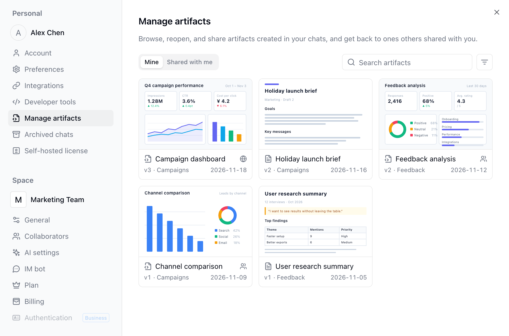

AIが会話の中でグラフ、レポート、ダッシュボード形式のページ、計算ツールのような小規模なツールを生成すると、その結果は**アーティファクト**として保存されます。これは会話の外部で単独で表示されるページで、インタラクティブなHTMLページまたはMarkdownレポートです。アーティファクトはチャット内にカードとして表示され、会話が終わった後も利用できます。

アーティファクトを生成するには、[AIチャット](/ja/basic/ai/ai-chat)で必要な結果を伝えます。たとえば「週ごとの売上推移グラフを生成してください」や「これらのレコードから概要レポートを作成してください」と依頼します。[ルーティン](/ja/basic/ai/routine)の実行中に生成されたアーティファクトは、その実行の担当者のものになります。

<Info>
アーティファクトには、作成時にAIが入力したデータが保持されるため、自動的には更新されません。また、ページ内からテーブルを読み取ったり変更したりすることもできません。テーブルのリアルタイムデータを継続的に読み取るページや、入力を収集して状態を保存するページには、[App Builder](/ja/basic/ai/app-builder)でアプリを作成します。
</Info>

## 表示と修正

チャット内のカードをクリックすると、アーティファクトのビューアーが開きます。ビューアーでは、次の操作を行えます。

- **全画面**または**新しいページで開く**を使用して、アーティファクトを広く表示します。
- 表示中のバージョンを**ダウンロード**します。HTMLページは`.html`ファイル、Markdownレポートは`.md`ファイルとしてダウンロードされます。
- バージョン一覧を開いて以前のバージョンを確認します。
- アーティファクトを**削除**します。削除は元に戻せません。会話内のカードは削除済み表示に変わり、共有リンクも無効になります。

アーティファクトを変更するには、同じ会話内でAIに依頼します。各修正は別のアーティファクトではなく、同じアーティファクトの新しいバージョンになるため、共有リンクは引き続き機能します。以前のバージョンを開いて**このバージョンを復元**をクリックすると、その内容で新しいバージョンが追加されます。それ以降のバージョンも残ります。

ページの実行に失敗した場合は、ビューアーの上部にエラー情報が表示されます。**AIで修正**をクリックすると、Teableはそのアーティファクトが属するプロジェクトに新しいチャットを作成し、エラー情報をAIに渡します。通知の**表示**をクリックすると修正用チャットを開き、進捗を確認できます。

## アーティファクトを共有する

アーティファクトは、デフォルトでは作成者本人だけが閲覧でき、同じプロジェクトのほかのメンバーにも表示されません。ほかのユーザーが閲覧できるようにするには、共有を有効にします。

<Steps>
  <Step title="共有を有効にする">
    ビューアーで**共有**をクリックして、**共有を有効にする**をオンにします。ほかのユーザーがこのアーティファクトのリンクから閲覧できるようになります。
  </Step>
  <Step title="閲覧できる人を選択する">
    **閲覧できる人**のデフォルトは**リンクを知っている全員**で、サインインせずに開けます。**スペースメンバー**に設定すると、サインインしている、そのスペースまたはそのプロジェクトのメンバーだけが開けます。
  </Step>
  <Step title="パスワードを追加する（任意）">
    **詳細設定**で**パスワード保護**をオンにすると、Teableがパスワードを自動生成します。閲覧者は、アーティファクトが読み込まれる前にパスワードを入力する必要があります。パスワードは生成直後にしか表示されないため、その場で**リンクとパスワードをコピー**をクリックして両方をまとめてコピーしてください。後から**パスワードを設定**をクリックして、任意のパスワードを設定したり変更したりできます。変更後、閲覧者は新しいパスワードを入力する必要があります。
  </Step>
  <Step title="リンクを送信する">
    リンクの横にある**リンクをコピー**ボタンをクリックしてコピーします。リンクが広まりすぎた場合は、**共有を有効にする**をオフにすると、ほかのユーザーはリンクを使えなくなります。再びオンにすると同じリンクに戻り、以前の閲覧できる人とパスワードの設定も保持されます。すでにリンクを持っている人のアクセスを止めたい場合は、オンにした直後に**スペースメンバー**へ変更するか、**パスワード保護**をオンにしてパスワードを変更してください。
  </Step>
</Steps>

リンクからアクセスした人には常に最新バージョンが表示され、以前のバージョンは表示されません。ページの**ダウンロード**をクリックして、そのバージョンをダウンロードすることもできます。共有を有効にすると、このリンクをiframeでほかのWebサイトに埋め込むこともできます。

この機能の活用例は、[共有できるAIレポートの例](https://teable.ai/ja/blog/introducing-artifacts-share-data-reports-anywhere)をご覧ください。

## 後からアーティファクトを見つける

左下のアバター → **設定** → **Artifact 管理**を開きます。チャットの**+** → **その他** → **Artifact 管理**からも開けます。

- **自分**：自分が作成したアーティファクトがカードで表示されます。カードの上部にはページの最初の画面のサムネイルが表示され、カード上のアイコンで共有範囲がわかります。カードの **...** メニューから**共有**、**ダウンロード**、**新しいページで開く**、**削除**を選択でき、カードをクリックするとビューアーが開きます。
- **共有されたもの**：チームメンバーが**スペースメンバー**に共有したアーティファクト（そのスペースまたはプロジェクトのメンバーであれば、リンクを開かなくても表示されます）と、**リンクを知っている全員**に共有され、サインインした状態で開いたアーティファクトです。カードには共有者が表示され、クリックすると新しいタブで開きます。共有がオフにされた場合、共有範囲から外れた場合、アーティファクトが削除された場合、その項目は表示されなくなります。

どちらのタブも最終更新日時の新しい順に並び、名前または共有者で検索できます。検索ボックスの横にある**フィルター**ボタンをクリックすると、**閲覧できる人**（**自分**タブでは**未共有**も選べます）と**プロジェクト**で絞り込めます。削除されたプロジェクトやアクセスできなくなったプロジェクトは、**利用できないプロジェクト**にまとめて表示されます。

[リソースパネル](/ja/basic/ai/ai-chat#チャットの横でリソースを表示する)の**アーティファクト**タブには、デフォルトで現在のスペースにある自分のアーティファクトと、チームメンバーがスペースメンバーに共有したアーティファクトが表示されます。**フィルター**ボタンで**作成者**（**自分が作成**または**他のユーザーが共有**）と**プロジェクト**（**現在のプロジェクト**など）で絞り込めます。自分のアーティファクトはリソースパネルで、チームメンバーが共有したものは新しいページで開きます。

## よくある質問

<AccordionGroup>
  <Accordion id="artifact-sharing-faq" title="チームメンバーは、私が作成したアーティファクトを開けますか？">
    デフォルトでは開けません。同じプロジェクトのメンバーにも表示されません。ビューアーで**共有を有効にする**をオンにしてリンクを送信し、アーティファクトをスペース内に限定する場合は**スペースメンバー**を選択します。スペースメンバーは、**Artifact 管理**の**共有されたもの**からも直接見つけられます。
  </Accordion>

  <Accordion title="アーティファクトとApp Builderで作成したアプリの違いは何ですか？">
    アーティファクトは、AIが生成した時点のデータのスナップショットで、一度きりのレポート、グラフ、分析結果に適しています。アプリはテーブルをリアルタイムで読み書きし、入力の収集や状態の保存ができるため、継続して使うツールやページに適しています。
  </Accordion>

  <Accordion title="アーティファクトの生成にクレジットは消費されますか？">
    アーティファクトの生成と修正はAIチャットの会話の一部として扱われ、会話の実際の使用量に応じてクレジットに計上されます。閲覧、共有、ダウンロードではクレジットは消費されません。
  </Accordion>
</AccordionGroup>
