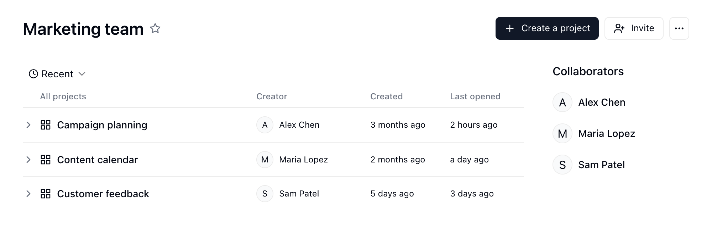
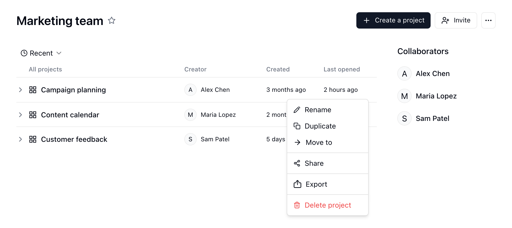
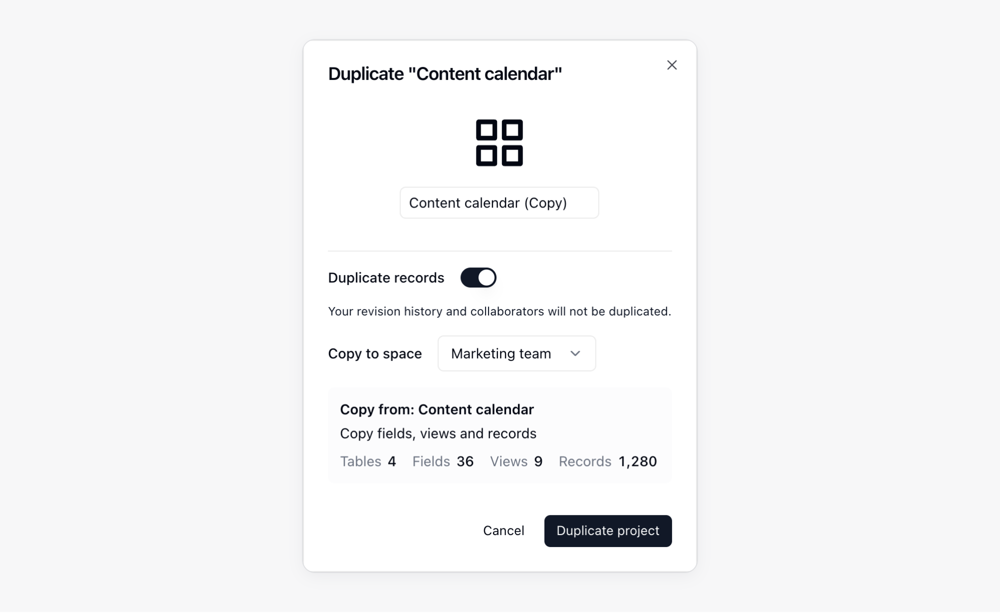
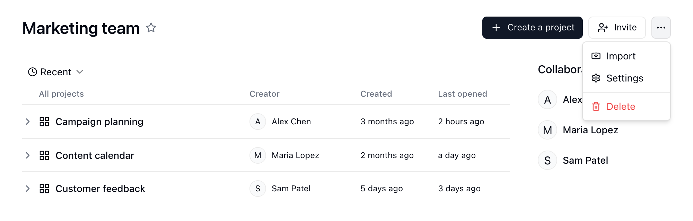
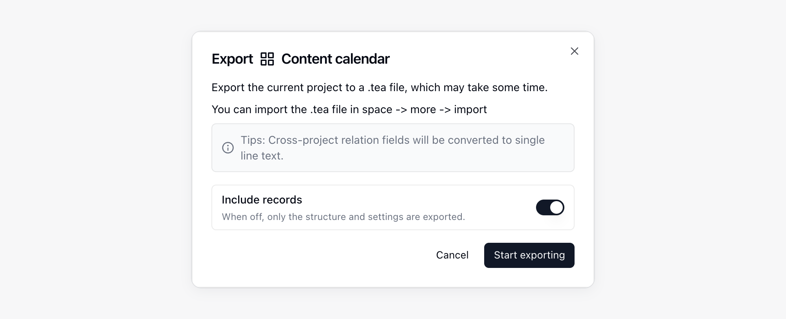
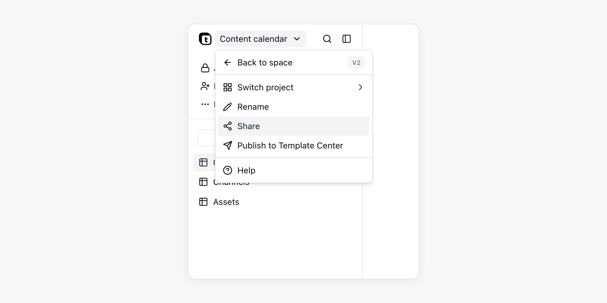

{/* mintlify-resync: 2026-05-26 */}
プロジェクトは、関連するテーブル、アプリ、自動化をまとめる単位です。各スペースには複数のプロジェクトを作成でき、プロジェクトごとにリソースと共同作業の権限を管理できます。

<Note>画面の「プロジェクト」は、API と CLI の `base` リソースに対応します。`baseId` などの API フィールド、ID の接頭辞 `bse`、`/base/...` の URL は変わりません。</Note>

プロジェクトに馴染みがない場合は、Excelのワークブックに似たものと考えてください。各ワークブックには複数のシートを含められます。

## プロジェクトを作成、管理する {#ベースを作成管理する}

### プロジェクトを追加する {#ベースを追加する}

1. スペースを開き、サイドバーの **プロジェクト** をクリックします
2. 右上の「プロジェクトの作成」をクリックします

新しいプロジェクトでチャットを始めると、AIがメッセージの内容に基づいてプロジェクトに名前を付けます。すでに名前があるプロジェクトの名前は変更されません。

### テンプレートからプロジェクトを作成する

テンプレートセンターには、そのまま使えるプロジェクトが並んでいます。スペースのサイドバーの **テンプレート**、またはプロジェクト作成時の **テンプレートから** で開けます。テンプレートの詳細で **インストール** をクリックし、**新しいプロジェクト**（テンプレート名の新しいプロジェクト）または **既存のプロジェクトに追加**（編集できる既存のプロジェクトに追加）を選んで、もう一度 **インストール** をクリックします。共有リンクからインストールする場合は、先にスペースを選びます。テンプレートはそれぞれプロジェクト内の専用フォルダーに入り、サンプルデータを含むかどうかはテンプレートの公開者が決めます。テンプレートにインストールガイドがある場合、インストール後に、そのテーブル、アプリ、オートメーションの右下に**はじめに**カードが表示され、データの状況に応じて各ステップが自動でチェックされます。各ステップには**開く**があり、ステップによって**AI に聞く**、**完了にする**、**スキップ**（スキップは取り消せます）も表示されます。すべて終わったら**非表示**をクリックします。

テンプレートのオートメーションが外部プラットフォームへの接続を必要とする場合は、テンプレートの詳細にそのプラットフォームが表示されます。インストール後、Teable はプロジェクトのチャットを開き、入力欄の上に **アカウントを接続** カードを表示します。

1. プラットフォームごとにアカウントを接続します。同じプラットフォームで複数のアカウントが必要な場合（例：2 つのYouTubeチャンネル）は、アカウントごとに 1 行ずつ表示され、それぞれ紐づけます。**設定** → **統合** でそのプラットフォームのアカウントを 1 つだけ接続している場合は、そのアカウントが自動的に紐づきます。複数接続している場合は、**自分のものを認可** をクリックして使うアカウントを選びます。まだ接続していない場合は、**アカウントを接続** でOAuthを実行します。
2. API キーが必要な項目は **入力が必要なキー** に並びます。**入力** で新しく作るか、保存済みのシークレットを選びます。
3. **開始** をクリックすると、認証情報がそろったワークフローと[ルーティン](/ja/basic/ai/routine)が有効になります。スケジュール実行のものはすぐに 1 回目が走り、実行履歴で確認できます。サードパーティアプリのイベントで起動するものは、最初のイベントを待ちます。

**後で** をクリックすると、カードをいったん閉じられます。未接続の統合がプロジェクトに残っているあいだは、ページに **N 件の連携が未接続です** と表示され、**接続する** からいつでも補えます。詳しくは[認証情報と連携](/ja/basic/credential)を参照してください。

### インストールしたテンプレートを管理する

スペースのサイドバーでプロジェクトの横にある **...** をクリックし、**インストール済みテンプレート** を選ぶと、プロジェクト内の各テンプレートの状態（**要設定**、**実行中**、**要確認**、**オフ**）を確認したり、オートメーションをオン・オフしたり、**アンインストール** をクリックしたりできます。アンインストールすると、そのテンプレートのオートメーションとルーティンは停止して削除され、テンプレートで追加されたテーブルやアプリなどはゴミ箱に移動します。フォルダーが空になると、フォルダーも削除されます。

### テンプレートセンターに公開する

左上のプロジェクト名をクリックするか、スペースのサイドバーでプロジェクトの横にある **...** をクリックし、**テンプレートセンターに公開** を選びます。名前、詳細な説明、カバーを入力し、含める内容とサンプルデータを含めるかどうかを選んで、**審査に提出** をクリックします。審査中は **取り下げる** で取り下げられます。承認されるとテンプレートが公開され、差し戻された場合は通知に審査メモが添えられます。その後プロジェクトを変更した場合は再度提出が必要で、承認されるまでは、ほかのユーザーがインストールするのは現在のバージョンのままです。公開中のテンプレートは **公開停止** で取り下げられ、インストール済みのコピーには影響しません。

公開画面の**ガイド**では、テンプレートにセットアップ手順を数ステップ追加できます。各ステップには、タイトル、1行の説明、開く場所、完了条件があります。**Teable AI で下書き**で作成するか、**プロジェクトで編集**を使います。完了条件には、サンプルデータが実際の内容に置き換わったこと、アプリが公開されたこと、オートメーションが1回成功したこと、必要なアカウントが接続されたこと、ユーザー自身がチェックすることがあります。データに関する条件がサンプルデータの時点ですでに成立していると、テンプレートは送信できません。

### プロジェクト名を変更、プロジェクトを削除する {#ベース名を変更ベースを削除する}

1. スペースを開きます
2. プロジェクトにカーソルを合わせます
3. 「···」ボタンをクリックしてメニューを開きます
4. 「名前を変更」または「削除」をクリックします

### プロジェクト内のリソースを整理する {#ベース内のリソースを整理する}

スペースのサイドバーでプロジェクト名の横にあるフォルダーボタン **リソースを表示** をクリックすると、チャットの右側にプロジェクトのディレクトリが開きます。テーブル、アプリ、オートメーション、ルーティンをフォルダーで整理できます。リソースはタブで開きます。パネル上部の **+**（**新しいタブ**）をクリックすると、リソース一覧に戻ります。

一般的な操作は次のとおりです。

- **フォルダーを作成**：プロジェクトのディレクトリにフォルダーを作成し、関連するリソースをまとめます。
- **リソースを移動**：テーブル、アプリ、オートメーションをフォルダーへドラッグするか、ドラッグして順序を変更します。
- **階層を整理**：フォルダーには、テーブルやアプリなどのリソースのほか、サブフォルダーも入れられます。移動しやすいよう、階層を十分に浅く保ちます。
- **フォルダーを削除**：フォルダーは中身ごとゴミ箱へ移動し、保管されている間は復元できます。復元するとフォルダー構成も保たれます。確認画面には影響を受ける内容が一覧表示されます。削除できない項目があると、削除全体が行われません。フォルダー外でそのテーブルを参照している項目はエラーになります。公開済みのアプリはすぐにオフラインになります（カスタムドメインは解放され、ログイン設定は削除されるため、復元後は再公開、ドメインの再設定、ログインの再設定が必要です）。フォルダー内のテーブルをユーザーテーブルとして使うアプリは、サインインできなくなります。共有リンクは完全に削除されます。削除が途中で止まった場合、削除済みの項目は個別にゴミ箱に入っているので、**削除を続ける**をクリックして完了させます。
- **説明を追加**：テーブル、アプリ、オートメーションでは、ヘッダーのリソース名の下にある**説明を追加**をクリックします。目的、所有者、引き継ぎ事項、使用規則の記録に説明を使用します。Teableは、リソースを初めて開いたときと、説明の変更後にもう一度、説明を表示します。
- **ノード情報を確認**：リソースの`...`メニューを開き、**ノード情報**を選択すると、フォルダー、テーブル、オートメーション、アプリのIDに加え、作成情報と更新情報を確認できます。

### コマンドパレット {#command-palette}

`Ctrl + K`（Mac：`Command + K`）を押すか、左側のサイドバー上部にある検索アイコンをクリックすると、**コマンドパレット**が開きます。

- **移動**：テーブル、ビュー、アプリなどのリソースを名前で検索します。何も入力していないときは、**最近アクセスした項目**としてリソースとビューが表示されます。見つからない場合は、同じ名前のテーブルをその場で作成するか、**現在のテーブルを検索**で入力した語句を検索できます。
- **コマンドを実行**：コマンド名を入力して実行します。`>`で始めると、コマンドだけを検索します。テーブル、ダッシュボード、アプリ、オートメーション、ルーティン、フォルダー、ビューの作成、共同作業者の招待、外観の切り替え、設定やキーボードショートカットの表示ができます。
- **Cuppyに質問**：プロジェクト内で質問を入力して**Cuppyに質問**を選ぶと、現在のプロジェクト、テーブル、ビューの情報とともにAIチャットへ送信されます。詳しくは[AIチャット](/ja/basic/ai/ai-chat)をご覧ください。

スペースのサイドバーからコマンドパレットを開くと、検索結果がリソースの種類ごとのタブに分かれ、名前やメッセージの内容が一致するチャットも表示されます。詳しくは[チャットを管理する](/ja/basic/ai/ai-chat#チャットを管理する)をご覧ください。

### プロジェクトを別のスペースへ複製する {#duplicate-a-base-to-another-space}

手順1: スペース内で複製するプロジェクトを選択します。

手順2: メニューアイコンをクリックし、「複製」を選択します。

手順3: ポップアップで移行先のスペースを選択します。そのスペースの作成者権限が必要です。

大規模なプロジェクトでは、プロジェクト構造、レコード、添付ファイルのコピー中、複製ダイアログに進捗が表示されます。コピーが完了するまでダイアログを開いたままにしてください。変更履歴とコラボレーターはコピーされません。

プロジェクトに、別のスペースを参照するリンク、ルックアップ、ロールアップ、条件付きルックアップ、条件付きロールアップのフィールドが含まれる場合、複製前に影響を受けるフィールドがTeableに表示されます。続行すると、複製したプロジェクトではこれらのフィールドが**1行テキスト**へ変換されます。

### スペース間でプロジェクトを移動する {#スペース間でベースを移動する}

必要なスペース権限を持っている場合は、プロジェクトを別のスペースへ移動できます。移動によってリレーションベースのフィールドがスペースをまたいで参照することになる場合、Teableから警告が表示され、影響を受けるフィールドが一覧表示されます。確定すると、移動の一環としてこれらのフィールドが**1行テキスト**へ変換されます。

### リソースを別のプロジェクトへ移動する

テーブル、フォルダー、アプリ、オートメーション、ルーティンは、同じスペース内の別のプロジェクトへ移動できます。移動してもデータと設定はそのままで、所属するプロジェクトだけが変わります。

<Warning>移動前のチェックで、すべての参照を見つけられるとは限りません。オートメーションのスクリプトやアプリのコード内の参照は、一部検出されない場合があります。移動後は、関連する業務に影響がないか必ず確認し、必要に応じて調整してください。</Warning>

1. プロジェクトのディレクトリでリソースの `...` メニューを開き、**移動**を選択します。
2. **移動先のプロジェクト**でプロジェクトを選択します。Teableが、移動による影響を先にチェックします。
3. チェック結果を確認し、**移動**をクリックします。
4. 移動が完了したら、関連するオートメーション、アプリ、ルーティンが正常に動作するか確認し、必要に応じて調整します。

チェックではプロジェクトの設定を読み取るだけで、データは変更しません。チェック結果には次の内容が含まれます。

- **移動できるかどうか**：移動先のプロジェクトが別のスペースにある、いずれかのプロジェクトが読み取り専用である、権限が不足している、移動先のプロジェクトに同じ名前のフォルダーがすでにある、のいずれかに当てはまる場合は、理由が表示され、移動できません。
- **動作しなくなる可能性があるリソース**：元のプロジェクトに残り、移動するテーブルを参照しているオートメーションやアプリは、移動後に使用できなくなる場合があります。たとえば、オートメーションのトリガーやアクションでそのテーブルを指定している、スクリプトやHTTPリクエストにそのテーブルのIDが含まれている、アプリがそのテーブルでログインしている、またはコード内でそのテーブルを参照している場合です。
- **プロジェクトをまたぐリンク**：移動するテーブルと元のプロジェクトに残るテーブルの間のリンクフィールドは、プロジェクトをまたぐリンクになり、引き続き使用できます。

**参照しているものをすべて移動**は既定でオンになっており、参照チェーン上のリソースをまとめて移動するため、無効な参照が残りません。リンク先のテーブルは一緒に移動しません。

<Note>
- 現在のプロジェクトでそのリソースを削除でき、移動先のプロジェクトで同じ種類のリソースを作成できる権限が必要です。
- 権限マトリクスを有効にしている場合、現在のプロジェクトのロールに紐づく権限ルールはリソースと一緒に移動できず、削除されます。移動後のリソースには移動先のプロジェクトの権限設定が適用されます。同じ制限が必要な場合は、移動先のプロジェクトで設定し直してください。
</Note>

## プロジェクトをインポート、エクスポートする {#ベースをインポートエクスポートする}

<a className="docs-card-link" href="/ja/basic/ai/connect-everything">
<Card title="あらゆるデータへ接続・移行" icon="sparkles">
  AIチャットを使用して、Airtable、Baserow、NocoDB、SmartSuite、その他のシステムをTeableへ移行します。
</Card>
</a>

### プロジェクトをインポートする（データ移行） {#ベースをインポートするデータ移行}

Teable のプロジェクトエクスポートファイル（`.tea`）には、プロジェクトの構造と設定が含まれます。レコードデータは、エクスポート時に含めた場合に保存されます。このファイルをインポートすると、プロジェクトを復元したり、別の Teable インスタンスに作成したりできます。次の用途に便利です。
- **データ移行**：異なるTeableインスタンス間でプロジェクトを移動します（例：Cloudからセルフホストへ）
- **バックアップの復元**：以前にエクスポートしたプロジェクトを復元します
- **テンプレートの共有**：完全なプロジェクト構造を他のチームと共有します

**手順：**
1. スペースを開きます
2. スペースの右上にある「···」ボタンをクリックしてメニューを開きます
3. 「インポート」をクリックします
4. **Teable ファイル**を選択し、`.tea`ファイルをアップロードします。

アップロードが終わると、インポート画面にファイルの内容がプレビュー表示されます。プロジェクト名、種類ごとのリソース数、フォルダーごとに並べたリソースの一覧です（フォルダーは最初は閉じています）。有効な `.tea` ファイルでない場合は、インポートできない旨が表示されます。内容を解析できないだけの場合は、そのままインポートを続けられます。

<Tip>Airtableからプロジェクトを作成する場合は、同じインポートダイアログで**Airtable**を選択します。</Tip>

### プロジェクトをエクスポートする（バックアップと移行） {#export-base-backup-&-migration}

構造と設定をバックアップしたり、別の Teable インスタンスへインポートしたりするには、Teable プロジェクトファイル（`.tea`）をエクスポートします。レコードデータも必要な場合は、**レコードを含める**をオンにします。

**手順：**
1. スペースを開きます
2. エクスポートするプロジェクトにカーソルを合わせます
3. 「···」ボタンをクリックしてメニューを開きます
4. 「エクスポート」をクリックします
5. レコードデータをエクスポートするには、**レコードを含める**をオンのままにします。構造と設定だけをエクスポートするにはオフにします。
6. **エクスポート開始**をクリックし、完了するまで待ちます。
7. エクスポートダイアログの**ダウンロード**をクリックして、`.tea`ファイルを保存します。

<Note>
- レコードデータを移行する場合は、エクスポート時に**レコードを含める**をオンにします。
- エクスポートしたファイルでは、Teableがプロジェクトをまたぐリレーションフィールドを**1行テキスト**フィールドへ変換します。
- スペースをまたいでプロジェクトを複製または移動すると、スペースをまたぐリレーションフィールドは**1行テキスト**へ変換されます。
- インポート後、必要な連携を再認証します。エクスポートした連携とシークレットのプレースホルダーには認証情報は含まれません。
</Note>

## プロジェクトを共有する {#ベースを共有する}

プロジェクトは公開リンクで共有できます。共有範囲は、プロジェクト全体またはその中の1つのリソースに設定できます。

1. 対象のプロジェクトを開きます
2. プロジェクトまたはリソースの共有メニューを開きます
3. **Webに公開**をオンにします
4. 共有リンクまたはQRコードをコピーします

共有範囲は次のとおりです。

| 範囲 | 説明 |
|------|------|
| プロジェクト全体 | プロジェクトの共有メニューから**共有**を開き、現在のプロジェクト内のすべてのリソースを共有します。後から追加した新しいテーブルとフォルダーも自動的に含まれます。|
| 1つのリソース | リソースの共有メニューから**共有**を開き、そのリソースだけを共有します。フォルダーを共有すると、その中のリソースも含まれます。テーブルで共有する場合は、**テーブルを共有**と**ビューを共有**を切り替えられます。|

プロジェクトとリソースの共有リンク、QRコード、埋め込みコードを表示、管理できるのは、プロジェクトの**所有者**と**作成者**だけです。その他のメンバーには、共有済みかどうかだけが表示されます。ビューの共有はビューの共有権限に従います。[コラボレーション権限](/ja/basic/space/space-permission)を参照してください。共有設定では、リンク権限の設定、リンクの再生成、共有リンクの削除ができます。**詳細設定**を展開すると、**閲覧者にデータのコピーを許可**、**パスワードで保護**、**埋め込み設定**を設定できます。パスワードアクセスをオンにすると、Teableがランダムなパスワードを自動生成します。**リンクとパスワードをコピー**をクリックすれば、まとめて閲覧者に送信できます。詳しくは[共有リンクの保護](/ja/basic/security#共有リンクの保護)を参照してください。

共有範囲にアプリが含まれる場合、公開リンクからアクセスするには、そのアプリを公開する必要があります。

## プロジェクト内の機能 {#ベース内の機能}

プロジェクトには、仕事や業務に関連する情報を記録、整理するための複数のテーブルを含められます。

たとえば、顧客管理プロジェクトでは、「顧客企業」、「顧客連絡先」、「顧客フォローアップレコード」を別々のテーブルにし、会議室管理プロジェクトでは、「会議室管理」、「会議室設備」、「会議室予約」を別々のテーブルにできます。

そのため、プロジェクト内のほとんどの機能はテーブルに関連しています。

* **テーブルを作成**：プロジェクト固有の要件に基づいて新しいテーブルを作成し、テーブル構造、フィールド、データ型を定義できます。
* **テーブルを編集**：プロジェクト内の既存のテーブルを編集し、レコードの追加、削除、変更を行えます。
* **データをエクスポート、インポート**：データのCSVへのエクスポートと、CSVおよびXLSX形式のデータのインポートに対応しています。

テーブルの詳細については、[テーブルのセクション](/ja/basic/table)をご覧ください。
