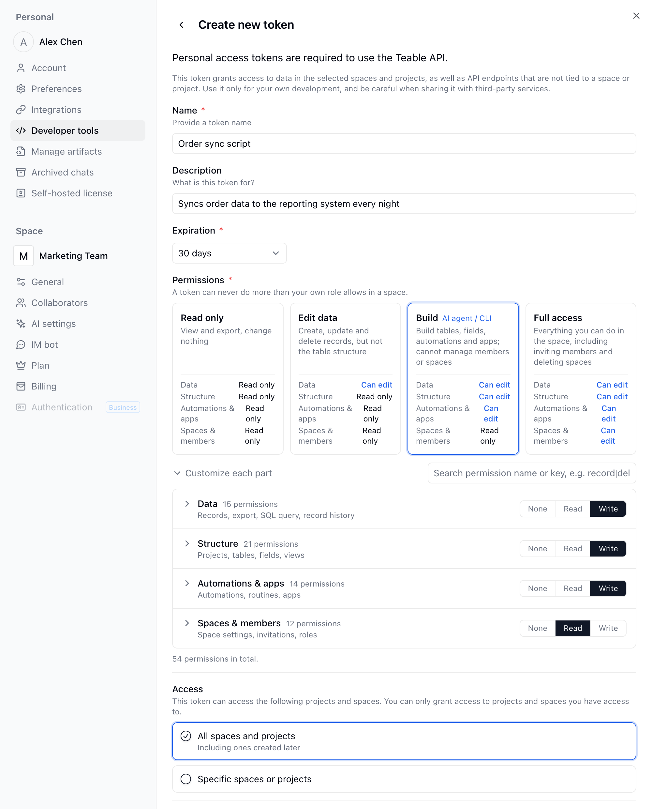

{/* mintlify-resync: 2026-10-22 */}

Персональные токены доступа лучше всего подходят для скриптов, внутренних инструментов и серверных интеграций.

Если вы создаёте мультитенантную интеграцию для внешних пользователей, используйте OAuth: см. [OAuth App](/ru/api-doc/oauth).

## Создание токена

1. Нажмите на аватар в левом нижнем углу и откройте **Настройки** → **Инструменты разработчика** → **Персональные токены доступа** (или сразу [страницу управления токенами](https://app.teable.ai/setting/personal-access-token)). Нажмите **Создать новый токен**.

2. Выберите срок действия токена. Обратите внимание, что после установки этот срок нельзя изменить.

3. В разделе **Права** выберите уровень. Для нового токена по умолчанию выбран уровень **Сборка**:

   | Уровень | Что можно делать |
   | --- | --- |
   | **Только чтение** | Просматривать и экспортировать данные, ничего не изменяя |
   | **Редактирование данных** | Создавать, изменять и удалять записи, не меняя структуру таблиц |
   | **Сборка** | Создавать таблицы, изменять поля, настраивать автоматизации и приложения, но не управлять участниками и Пространствами; подходит для ИИ-агентов и CLI |
   | **Полный доступ** | Всё, что вы можете делать в Пространстве, включая приглашение участников и удаление Пространства |

   Для тонкой настройки разверните **Настроить по частям** и для разделов **Данные**, **Структура**, **Автоматизации и приложения** и **Пространства и участники** выберите **Нет**, **Чтение** или **Запись**. Права токена никогда не превышают вашу собственную роль в Пространстве.

4. В поле **Доступ** выберите **Все пространства и проекты**, чтобы открыть токену доступ ко всем текущим и будущим Пространствам и Проектам. Если нужны только отдельные ресурсы, выберите **Отдельные пространства или проекты** и нажмите **Добавить проект или пространство**, чтобы выбрать нужные Проекты или Пространства.



<Note>После создания токен будет показан только один раз. Рекомендуем скопировать его и сохранить в безопасном месте.</Note>


## Использование токена

Передайте токен в заголовке `Authorization`:

```bash
curl -H 'Authorization: Bearer __token__' \
  'https://app.teable.ai/api/table/__tableId__/record'
```

Нужна помощь в поиске ID, таких как `tbl...`? См. [Получение ID](/ru/api-doc/get-id).
