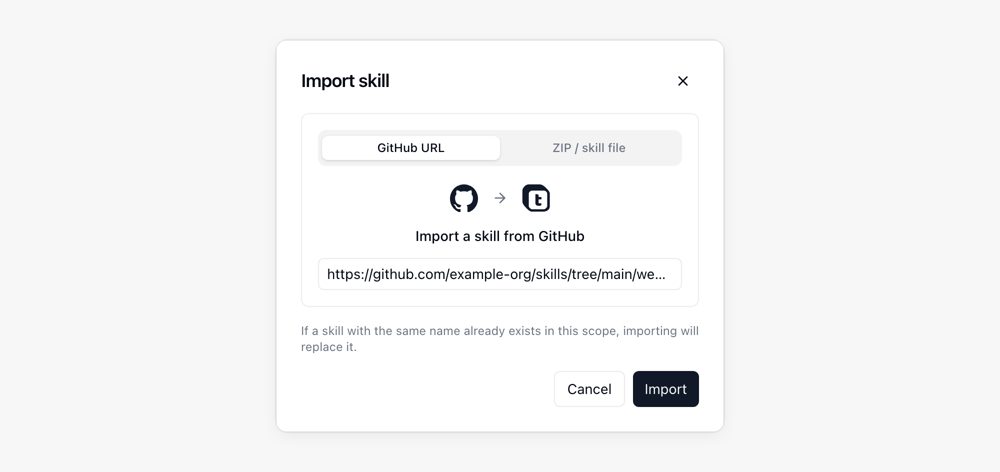
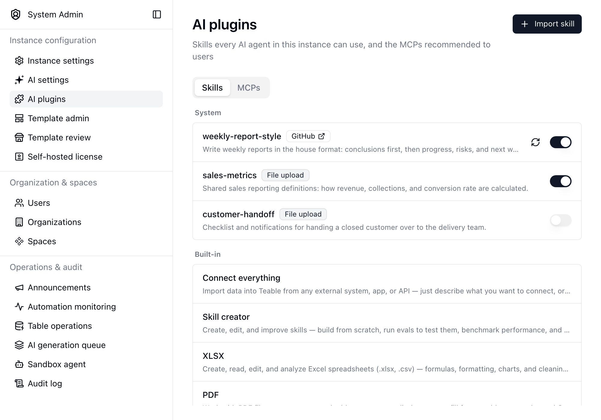

{/* mintlify-resync: 2026-11-13 */}

<Tip>Доступно для самостоятельного развертывания на тарифе Business и выше</Tip>

Путь: Системное администрирование → ИИ-плагины

На вкладке **Skills** страницы **ИИ-плагины** публикуются навыки для всего экземпляра; вкладка **MCPs** управляет MCP, рекомендуемыми пользователям. Навык, добавленный здесь, доступен в каждом ИИ-чате, Конструкторе приложений и беседе с ботом, поэтому используйте его для методов работы, которые ваша организация должна применять по умолчанию: например, для корпоративного стиля письма, правил подготовки отчетов или общего процесса интеграции.

Навыки, добавленные пользователями в других местах, остаются в собственной области действия. См. [ИИ-чат](/ru/basic/ai/ai-chat) для личных навыков, навыков проекта и пространства.

## Рекомендуемые MCP

Список **Рекомендуемые** на вкладке **MCPs** определяет, какие рекомендуемые серверы пользователи видят в **Настройки** → **Интеграции** → **Добавить MCP**. Их можно включать и выключать по одному или выключить все сразу кнопкой **Выключить все** (когда все выключены, кнопка меняется на **Включить все**). Выключенный сервер исчезает из списка рекомендуемых; уже добавленные пользователями серверы не затрагиваются. Если выключены все, пользователи перестают видеть **Рекомендуемые**.

## Добавление навыка

Нажмите **Импортировать навык** и выберите источник навыка:

| Источник | Что предоставить |
| --- | --- |
| **URL GitHub** | Ссылка на папку навыка или на файл `SKILL.md` в ней, например `https://github.com/owner/repo/tree/main/skills/my-skill`. Если навык лежит в корне репозитория, достаточно вставить ссылку на репозиторий |
| **ZIP-файл** | Файл `.zip` или `.skill`, содержащий `SKILL.md` |

Если в этой области действия уже существует навык с тем же именем, импорт заменяет его.

## Управление опубликованными навыками

Список группирует навыки по области действия и показывает источник каждого из них. Встроенные навыки перечислены внизу для справки и не редактируются.

- Используйте переключатель в строке, чтобы включить или отключить навык без удаления. Отключенный навык остается в списке, но не предлагается агентам.
- Для навыка, импортированного из GitHub, нажмите кнопку обновления, чтобы получить последнюю версию из источника.
- Нажмите строку, чтобы прочитать его `SKILL.md`, изменить название и описание, скачать его, заменить файлы или удалить его.

<Info>Только администраторы экземпляра могут добавлять, изменять или удалять навыки на этой странице. Каждый вошедший пользователь может использовать опубликованные навыки в своих беседах.</Info>

## Когда имя используется дважды

Навык, опубликованный здесь, является значением по умолчанию для экземпляра. Если навык проекта, пространства, личный навык, навык приложения или бота использует то же имя, в этой беседе действует более узкий навык, а навык экземпляра игнорируется.

