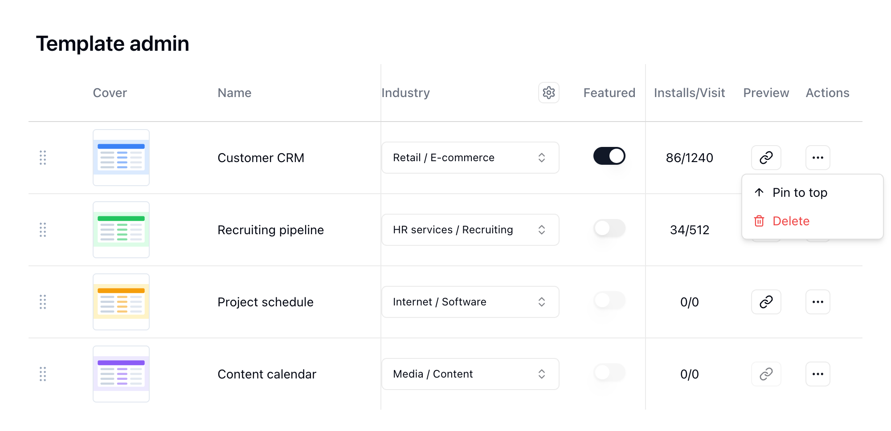

{/* mintlify-resync: 2026-10-22 */}

<Tip>Доступно для самостоятельного развертывания на тарифе Business и выше</Tip>

### Управление шаблонами

Шаблоны появляются из отправленных проектов: участник отправляет проект на проверку через **Опубликовать в центре шаблонов**, и шаблон публикуется в центре шаблонов только после того, как администратор одобрит его в разделе **Проверка шаблонов**. Здесь администраторы могут изменять сведения о шаблонах, управлять их публикацией и порядком.

#### Сведения о шаблоне

* **Обложка**: Изображение обложки для карточки шаблона
* **Название** и **Описание**: Заголовок и краткое описание, отображаемые в центре шаблонов
* **Описание в markdown**: Подробное описание с поддержкой форматирования Markdown
* **Категория**: Группирует шаблоны по отраслям и подотраслям или по командам. Нажмите значок настроек рядом с заголовком столбца, чтобы открыть **Управление категориями**, где можно создавать отрасли, подотрасли и команды
* **URL-слаг**: Идентификатор в адресе публичной страницы шаблона. Может содержать только строчные латинские буквы, цифры и дефисы
* **Рекомендуемый**: Выделяет шаблон в центре шаблонов. Доступно только после публикации шаблона
* **Интеграции**: Платформы, к которым должны подключаться автоматизации шаблона. После установки пользователю предлагается выполнить эти подключения
* **Время снимка**: Когда содержимое шаблона последний раз было одобрено
* **Создан**: Пользователь, опубликовавший шаблон
* **Использование/Посещения**: Сколько раз шаблон использовали и посещали

#### Операции с шаблонами

* **Опубликован**: Включает или отключает показ шаблона в центре шаблонов. Требуются снимок, название и описание.
* **Предпросмотр**: Открывает шаблон в новой вкладке
* **Закрепить сверху**: Перемещает шаблон в начало списка. Порядок также можно менять, перетаскивая маркер в начале строки
* **Удалить**: Удаляет шаблон

Чтобы обновить содержимое шаблона, снова откройте **Опубликовать в центре шаблонов** в исходном проекте и нажмите **Submit v\{версия\} for review**. До одобрения обновления при установке другие получают текущую версию.

### Проверка шаблонов

В разделе **Системное администрирование** > **Проверка шаблонов** на вкладке **Очередь проверки** перечислены отправленные шаблоны, ожидающие проверки, с автором, временем отправки и результатами автоматических проверок. Проверки служат только напоминанием и не мешают одобрению: **Подключения** — шаблон использует интеграции, которые нельзя подключить в этом развёртывании; **Конфиденциальность** — в шаблоне есть записи, убедитесь, что в них нет персональных данных; **Оценка запусков** — число запусков в месяц может превысить бесплатный лимит; **Пробный запуск** — автоматизациям не нужен ни один аккаунт, убедитесь, что они работают без подключений. Нажмите **Открыть**, чтобы открыть сведения об отправке, посмотреть копию и выбрать отрасль шаблона.

* **Одобрить**: Публикуется копия, которую автор отправил. Для уже опубликованного шаблона каждое одобренное обновление увеличивает номер версии на единицу. Последующие изменения автору нужно отправить снова
* **Отклонить**: Автор получит ваше примечание и после правок сможет отправить шаблон снова

При обоих действиях можно добавить примечание, и автор получит уведомление о результате.

### Использование официальных шаблонов

Пользователи самостоятельного развертывания могут импортировать шаблоны из официального Teable Cloud:

1. **Скачать**: Получите файл экспорта Проекта Teable (`.tea`) в [Официальном центре шаблонов](https://teable.ai/templates)
2. **Импортировать**: Импортируйте файл `.tea` как новый проект в своем пространстве
3. **Откройте окно публикации**: В импортированном проекте нажмите название проекта в левом верхнем углу и выберите **Опубликовать в центре шаблонов**
4. **Заполните сведения**: Введите название и подробное описание, выберите, что включить и добавлять ли демонстрационные данные; при необходимости загрузите обложку
5. **Отправьте и одобрите**: Нажмите **Отправить на проверку**, затем в разделе **Системное администрирование** > **Проверка шаблонов** нажмите **Одобрить**. Шаблон сразу публикуется и появляется в разделе **Системное администрирование** > **Управление шаблонами**
