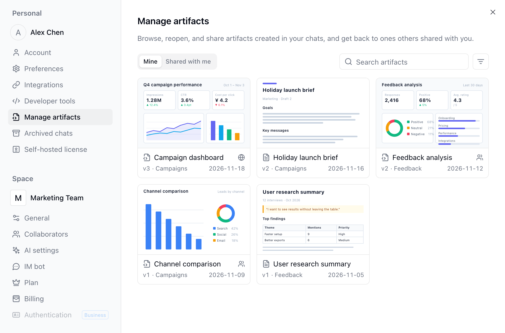

Когда ИИ создаёт в чате диаграмму, отчёт, страницу в стиле панели мониторинга или небольшой инструмент вроде калькулятора, он сохраняет результат как **артефакт** — отдельную страницу, которая отображается вне беседы: интерактивную HTML-страницу или отчёт Markdown. В чате артефакт выглядит как карточка и остаётся доступным и после завершения беседы.

Чтобы получить артефакт, опишите нужный результат в [ИИ-чате](/ru/basic/ai/ai-chat), например «Создай диаграмму недельной динамики продаж» или «Создай сводный отчёт по этим записям». Артефакты, созданные во время запуска [рутины](/ru/basic/ai/routine), принадлежат ответственному за этот запуск.

<Info>
Артефакт хранит данные, которые ИИ поместил в него при создании, поэтому он не обновляется автоматически, а сама страница не может читать или изменять таблицы. Для страницы, которая продолжает читать актуальные данные таблицы или собирает ввод и хранит состояние, создайте приложение с помощью [Конструктора приложений](/ru/basic/ai/app-builder).
</Info>

## Просмотр и изменение

Нажмите карточку в чате, чтобы открыть просмотрщик артефакта. В нём можно:

- выбрать **Во весь экран** или **Открыть на новой странице**, чтобы дать артефакту больше места;
- **Скачать** версию, которую вы сейчас просматриваете: HTML-страница скачивается как файл `.html`, отчёт Markdown — как файл `.md`;
- открыть список версий и просмотреть прежние версии;
- **Удалить** артефакт. Удаление нельзя отменить: карточки в беседе превратятся в заглушку удалённого артефакта, а ссылка для общего доступа сразу перестанет работать.

Чтобы изменить артефакт, попросите ИИ в той же беседе. Каждая правка становится новой версией того же артефакта, а не отдельным артефактом, поэтому ссылка для общего доступа продолжает работать. Если открыть прежнюю версию и нажать **Восстановить эту версию**, её содержимое добавится как новая версия, а более поздние версии сохранятся.

Если страница не запускается, вверху просмотрщика появляется сообщение об ошибке. Нажмите **Исправить с ИИ**: Teable создаст новый чат в проекте, которому принадлежит артефакт, и передаст ошибку ИИ. Нажмите **Открыть** в уведомлении, чтобы перейти в чат исправления и следить за ходом работы.

## Поделиться артефактом

По умолчанию артефакт видит только его создатель — даже другие участники того же проекта его не видят. Чтобы показать артефакт другим, включите общий доступ.

<Steps>
  <Step title="Включите общий доступ">
    Нажмите **Поделиться** в просмотрщике и включите **Включить доступ**. После этого другие смогут открыть артефакт по его ссылке.
  </Step>
  <Step title="Выберите, кто может просматривать">
    По умолчанию для **Кто может просматривать** выбрано **Все, у кого есть ссылка**: артефакт открывается без входа в аккаунт. Если выбрать **Участники пространства**, открыть его смогут только вошедшие в аккаунт участники этого пространства или этого проекта.
  </Step>
  <Step title="Добавьте пароль (необязательно)">
    В разделе **Дополнительно** включите **Защита паролем**, и Teable автоматически создаст пароль. Зрители должны ввести его, прежде чем увидят содержимое. Пароль показывается только сразу после создания, поэтому тут же нажмите **Копировать ссылку и пароль**, чтобы скопировать их вместе. Позже можно нажать **Установить пароль**, чтобы задать свой пароль или сменить его; после смены зрителям понадобится новый пароль.
  </Step>
  <Step title="Отправьте ссылку">
    Нажмите кнопку **Скопировать ссылку** рядом со ссылкой. Если ссылка разошлась шире, чем нужно, выключите **Включить доступ** — ссылка перестанет работать для других. При повторном включении ссылка остаётся прежней, как и настройки доступа и пароля. Чтобы закрыть доступ тем, у кого ссылка уже есть, сразу после включения выберите **Участники пространства** или включите **Защита паролем** и смените пароль.
  </Step>
</Steps>

По ссылке всегда открывается последняя версия, прежние версии зрителям недоступны. Эту версию также можно скачать кнопкой **Скачать** на странице. Ссылку на артефакт с включённым общим доступом также можно встроить на другой сайт через iframe.

Примеры использования этой функции приведены в статье «[примеры отчётов ИИ с общим доступом](https://teable.ai/ru/blog/introducing-artifacts-share-data-reports-anywhere)».

## Найти артефакты позже

Откройте аватар внизу слева → **Настройки** → **Управление артефактами**. Этот список также можно открыть из чата через **+** → **Больше** → **Управление артефактами**.

- **Мои**: созданные вами артефакты в виде карточек; вверху каждой карточки — миниатюра первого экрана страницы, а значок на карточке показывает, кому открыт доступ. В меню **...** карточки доступны **Поделиться**, **Скачать**, **Открыть на новой странице** и **Удалить**, а нажатие на карточку открывает просмотрщик.
- **Доступные мне**: артефакты, которыми коллеги поделились с вариантом **Участники пространства** (они видны, если вы состоите в этом пространстве или проекте, открывать ссылку заранее не нужно), а также артефакты с доступом **Все, у кого есть ссылка**, которые вы открывали, войдя в аккаунт. На карточке указан автор ссылки, а нажатие открывает артефакт в новой вкладке. Если общий доступ выключен, больше не включает вас или артефакт удалён, элемент больше не отображается.

Обе вкладки отсортированы по последнему обновлению, искать можно по названию или по тому, кто поделился. Кнопка **Фильтр** рядом с полем поиска позволяет отфильтровать по **Кто может просматривать** (на вкладке **Мои** есть ещё **Без доступа**) и **Проект**; удалённые проекты и проекты, к которым у вас больше нет доступа, объединены в вариант **Недоступные проекты**.

На вкладке **Артефакты** [панели ресурсов](/ru/basic/ai/ai-chat#просмотр-ресурсов-рядом-с-чатом) по умолчанию собраны ваши артефакты в текущем пространстве и артефакты, которыми коллеги поделились с участниками пространства. Кнопка **Фильтр** сужает список по **Автор** (**Созданные мной** или **Поделились другие**) и **Проект** (например, **Текущий проект**). Ваши артефакты открываются в панели ресурсов, а артефакты коллег — на новой странице.

## Часто задаваемые вопросы

<AccordionGroup>
  <Accordion id="artifact-sharing-faq" title="Могут ли мои коллеги открыть созданный мной артефакт?">
    По умолчанию нет, даже если они работают в том же проекте. Включите **Включить доступ** в просмотрщике и отправьте им ссылку. Если артефакт должен оставаться внутри пространства, выберите для **Кто может просматривать** значение **Участники пространства**. Участники пространства также найдут его на вкладке **Доступные мне** в разделе **Управление артефактами**.
  </Accordion>

  <Accordion title="Чем артефакт отличается от приложения из Конструктора приложений?">
    Артефакт — это снимок данных на момент создания ИИ, он подходит для разовых отчётов, диаграмм и результатов анализа. Приложение читает и изменяет таблицы в реальном времени, может собирать ввод и хранить состояние, поэтому подходит для инструментов и страниц, которыми пользуются постоянно.
  </Accordion>

  <Accordion title="Расходует ли создание артефакта кредиты?">
    Создание и изменение артефакта — часть ИИ-чата, поэтому кредиты расходуются по фактическому использованию в беседе. Просмотр, общий доступ и скачивание кредиты не расходуют.
  </Accordion>
</AccordionGroup>
