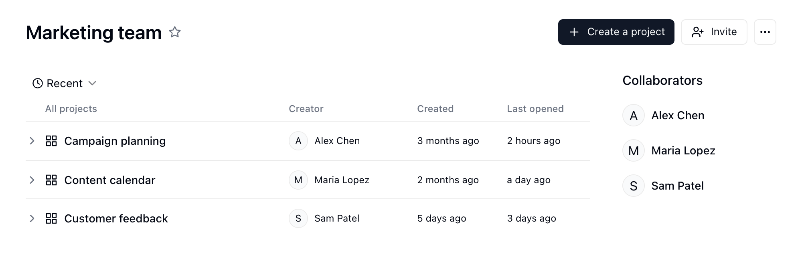
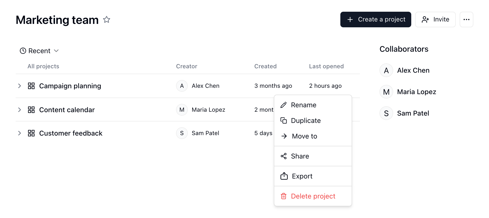
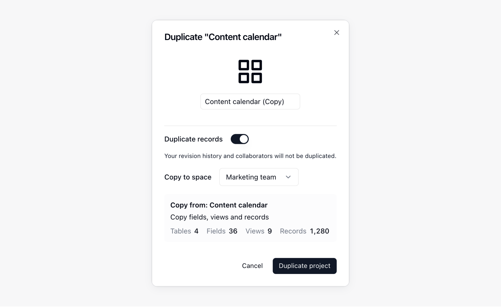
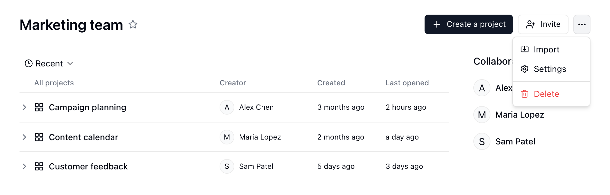
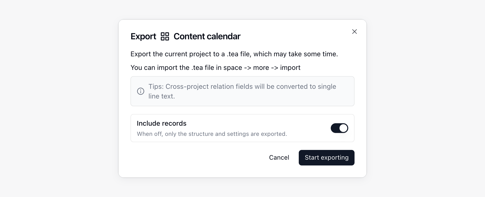
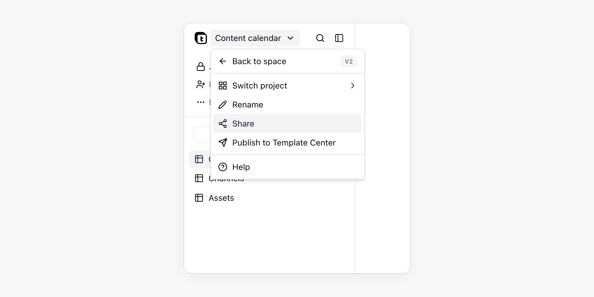
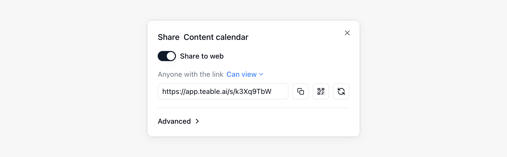

{/* mintlify-resync: 2026-05-26 */}
Проект объединяет связанные таблицы, приложения и автоматизации. В каждом Пространстве может быть несколько проектов, каждый со своими ресурсами и правами совместной работы.

<Note>Проект — название ресурса `base` в интерфейсе. В API и CLI сохраняются `base`, поля вроде `baseId`, префикс идентификатора `bse` и URL `/base/...`.</Note>

Пользователям, которые не знакомы с Проектами, можно представить их как рабочие книги в Excel: каждая рабочая книга может содержать несколько листов.

## Создание Проектов и управление ими {#создание-баз-и-управление-ими}

### Добавление Проекта {#добавление-базы}

1. Перейдите в Пространство и нажмите **Проекты** на боковой панели
2. Нажмите «Создать проект» в правом верхнем углу

Когда вы начинаете чат в новом Проекте, ИИ даёт Проекту название на основе вашего сообщения. Если у Проекта уже есть название, ИИ его не меняет.

### Создание Проекта из шаблона

В центре шаблонов собраны Проекты, которые можно взять как есть. Откройте его через **Шаблон** на боковой панели Пространства или выберите **Из шаблона** при создании Проекта. В карточке шаблона нажмите **Установить**, выберите **Новый проект** (новый Проект с названием шаблона) или **Добавить в существующий проект** (Проект, который вы можете редактировать) и снова нажмите **Установить**. При установке по ссылке общего доступа сначала выберите Пространство. Каждый шаблон помещается в собственную папку Проекта; будут ли в нём демонстрационные данные, решает автор шаблона. Если у шаблона есть руководство по установке, после установки в правом нижнем углу его таблиц, приложений и автоматизаций появится карточка **С чего начать**, которая сама отмечает каждый шаг по вашим данным. У каждого шага есть **Открыть** и, в зависимости от шага, **Спросить ИИ**, **Отметить как выполненное** или **Пропустить** (пропуск можно отменить); когда всё готово, нажмите **Скрыть**.

Если автоматизациям шаблона нужно подключение к внешним платформам, карточка шаблона перечисляет эти платформы. После установки Teable открывает чат Проекта и показывает над полем ввода карточку **Подключите аккаунты**:

1. Подключите аккаунты по платформам. Если для одной платформы нужно несколько аккаунтов (например, два канала YouTube), каждый занимает отдельную строку и привязывается отдельно. Если для платформы в разделе **Настройки** → **Интеграции** подключён только один аккаунт, он привязывается автоматически; если подключено несколько, нажмите **Авторизовать своё** и выберите нужный. Для ещё не подключённой платформы нажмите **Подключить аккаунт**, чтобы пройти OAuth.
2. Пункты, которым нужен ключ API, собраны под заголовком **Ключи, которые нужно ввести**. Нажмите **Ввести**, чтобы создать ключ, либо выберите уже сохранённый секрет.
3. Нажмите **Начать**. Все рабочие процессы и [рутины](/ru/basic/ai/routine) с полным набором учётных данных включаются. Запускаемые по расписанию сразу проходят первый круг (его видно в истории выполнения), а запускаемые событием стороннего приложения ждут первого события.

Нажмите **Позже**, чтобы пока свернуть карточку. Пока в Проекте остаётся неподключённая интеграция, страница показывает **N интеграций не подключено**; нажмите **Подключить**, чтобы дополнить в любой момент. См. [Учётные данные и интеграции](/ru/basic/credential).

### Управление установленными шаблонами

На боковой панели Пространства нажмите **...** рядом с Проектом и выберите **Установленные шаблоны**. Там видно состояние каждого шаблона в Проекте (**Требует настройки**, **Работает**, **Требует внимания**, **Выключен**), можно включать и отключать его автоматизации или нажать **Удалить**. Удаление шаблона отключает и удаляет его автоматизации и рутины, переносит добавленные им Таблицы, приложения и другие элементы в корзину, а опустевшую папку удаляет.

### Публикация в центре шаблонов

Нажмите название Проекта в левом верхнем углу или **...** рядом с Проектом на боковой панели Пространства и выберите **Опубликовать в центре шаблонов**. Укажите название, подробное описание и обложку, выберите, что включить и добавлять ли демонстрационные данные, затем нажмите **Отправить на проверку**. Пока идёт проверка, отправку можно отозвать кнопкой **Отозвать**. После одобрения шаблон публикуется, а если его вернут, в уведомлении будет примечание проверяющего. Последующие изменения Проекта нужно отправлять заново; до их одобрения при установке другие получают текущую версию. Опубликованный шаблон можно снять кнопкой **Снять с публикации** — уже установленные копии это не затрагивает.

**Руководство** в окне публикации добавляет к шаблону несколько шагов настройки. У каждого шага есть заголовок, описание в одну строку, место, которое нужно открыть, и условие выполнения. Составьте его с помощью **Составить с Teable AI** или воспользуйтесь **Изменить в проекте**. Условия: демонстрационные данные заменены реальными, приложение опубликовано, автоматизация один раз выполнена успешно, нужные аккаунты подключены или пользователь отметил шаг сам. Условие по данным не должно быть выполнено заранее на демонстрационных данных, иначе шаблон нельзя отправить.

### Переименование/удаление Проекта {#переименованиеудаление-базы}

1. Перейдите в Пространство
2. Наведите указатель на Проект
3. Нажмите кнопку «···», чтобы открыть меню
4. Нажмите «Переименовать» или «Удалить»

### Организация ресурсов в Проекте {#организация-ресурсов-в-базе}

Нажмите кнопку с папкой **Показать ресурсы** рядом с названием Проекта на боковой панели Пространства, чтобы открыть его каталог справа от чата. В каталоге находятся Таблицы, приложения, Автоматизации и регулярные задачи, которые можно упорядочить по папкам. Ресурсы открываются во вкладках; нажмите **+** (**Новая вкладка**) вверху панели, чтобы вернуться к списку ресурсов.

К распространённым операциям относятся:

- **Создание папок**: Создавайте папки в каталоге Проекта для группировки связанных ресурсов.
- **Перемещение ресурсов**: Перетаскивайте Таблицы, приложения или Автоматизации в папки либо меняйте их порядок перетаскиванием.
- **Организация иерархии**: Папки могут содержать ресурсы, например Таблицы и приложения, а также вложенные папки. Сохраняйте достаточно простую иерархию для удобной навигации.
- **Удаление папок**: папка вместе со всем содержимым попадает в корзину и может быть восстановлена, пока хранится там; при восстановлении структура папки сохраняется. Окно подтверждения перечисляет, что затронуто: элементы, которые нельзя удалить, блокируют всё удаление, элементы вне папки, ссылающиеся на её таблицы, начнут выдавать ошибки, опубликованное приложение сразу уходит в офлайн (его собственный домен освобождается, а настройки входа удаляются, поэтому после восстановления его нужно опубликовать заново, снова привязать домен и снова настроить вход), приложение, чья таблица пользователей лежит в папке, перестаёт пускать пользователей, а ссылки для общего доступа удаляются безвозвратно. Если удаление остановилось на полпути, уже удалённое лежит в корзине по отдельности; нажмите **Продолжить удаление**, чтобы завершить.
- **Добавление описаний**: Для Таблиц, приложений и Автоматизаций нажмите **Добавить описание** под названием ресурса в заголовке. Используйте описания, чтобы фиксировать назначение, владельца, примечания по передаче или правила использования. Teable открывает описание при первом открытии ресурса и ещё раз после его изменения.
- **Проверка сведений об узле**: Откройте меню `...` ресурса и выберите **Информация об узле**, чтобы просмотреть ID папки, Таблицы, Автоматизации или приложения, а также сведения о создании и изменении.

### Палитра команд {#command-palette}

Нажмите `Ctrl + K` (на Mac — `Command + K`) или щёлкните значок поиска вверху левой боковой панели, чтобы открыть окно **Палитра команд**:

- **Переход**: Введите название, чтобы найти Таблицы, представления, приложения и другие ресурсы. Пока строка поиска пуста, в разделе **Недавно открытые** показаны недавно открытые ресурсы и представления. Если ничего не нашлось, можно сразу создать Таблицу с таким названием или выбрать **Поиск в текущей таблице**, чтобы найти введённый текст.
- **Выполнение команд**: Введите название команды, чтобы выполнить её; если начать ввод с `>`, поиск пойдёт только по командам. Так можно создать Таблицу, панель мониторинга, приложение, Автоматизацию, рутину, папку или представление, пригласить соавторов, сменить внешний вид или открыть настройки и сочетания клавиш.
- **Спросить Cuppy**: Введите вопрос в Проекте и выберите **Спросить Cuppy** — вопрос уйдёт в ИИ-чат вместе с текущим Проектом, Таблицей и представлением. Подробнее см. в разделе [ИИ-чат](/ru/basic/ai/ai-chat).

Если открыть палитру команд с боковой панели пространства, результаты поиска распределяются по вкладкам по типу ресурса, а также показываются чаты, у которых совпадает название или текст сообщений. Подробнее см. в разделе [Управление чатами](/ru/basic/ai/ai-chat#управление-чатами).

### Дублирование Проекта в другое Пространство {#duplicate-a-base-to-another-space}

Шаг 1: В Пространстве выберите Проект, который хотите дублировать;

Шаг 2: Нажмите значок меню и выберите пункт «Дублировать»;

Шаг 3: Во всплывающем окне выберите целевое Пространство. В этом Пространстве вам нужны права Создателя.

Для крупных Проектов Teable показывает ход выполнения в диалоговом окне дублирования, пока копирует структуру Проекта, Записи и вложения. Не закрывайте диалоговое окно до завершения копирования. История версий и соавторы не копируются.

Если Проект содержит Поля «Ссылка», «Поиск», «Сводка», «Условный поиск» или «Условная сводка», указывающие на другое Пространство, перед дублированием Teable показывает затронутые Поля. Если вы продолжите, Teable преобразует эти Поля в **Текст в одну строку** в дублированном Проекте.

### Перемещение Проекта между Пространствами {#перемещение-базы-между-пространствами}

Если у вас есть необходимые права в Пространстве, вы можете переместить Проект в другое Пространство. Если после перемещения Поля, основанные на связях, будут указывать на другие Пространства, Teable предупредит вас и перечислит затронутые Поля. После подтверждения Teable преобразует эти Поля в **Текст в одну строку** в рамках перемещения.

### Перемещение ресурсов в другой Проект

Таблицы, папки, приложения, Автоматизации и рутины можно переместить в другой Проект того же Пространства. Их данные и настройки не меняются, меняется только Проект, к которому они относятся.

<Warning>Проверка перед перемещением не гарантирует, что найдёт все ссылки: часть ссылок в скриптах Автоматизаций или в коде приложений может остаться незамеченной. После перемещения обязательно проверьте, не пострадали ли ваши бизнес-процессы, и при необходимости внесите правки.</Warning>

1. В каталоге Проекта откройте меню `...` ресурса и выберите **Переместить**.
2. Выберите Проект в поле **Целевой проект**. Teable сначала проверит, на что повлияет перемещение.
3. Просмотрите результаты проверки и нажмите **Переместить**.
4. После перемещения убедитесь, что связанные Автоматизации, приложения и рутины работают правильно, и при необходимости поправьте их.

Проверка только читает конфигурацию Проекта и не меняет данные. В её результатах указано:

- **Можно ли переместить**: Если целевой Проект находится в другом Пространстве, один из Проектов доступен только для чтения, у вас недостаточно прав или в целевом Проекте уже есть папка с таким же названием, Teable покажет причину и заблокирует перемещение.
- **Ресурсы, которые могут перестать работать**: Автоматизации и приложения, которые остаются в текущем Проекте, но ссылаются на перемещаемую Таблицу, после перемещения могут перестать работать. Например, на эту Таблицу указывает триггер или действие Автоматизации, её ID содержится в скрипте или HTTP-запросе, либо приложение использует её для входа или обращается к ней в коде.
- **Межпроектные связи**: Поля «Ссылка» между перемещаемой Таблицей и Таблицей, которая остаётся на месте, становятся межпроектными связями и продолжают работать.

Параметр **Перемещать всё, на что есть ссылки** включён по умолчанию: ресурсы по цепочке ссылок перемещаются вместе, и неработающих ссылок не остаётся. Связанные Таблицы при этом не перемещаются.

<Note>
- Нужны права на удаление ресурса в текущем Проекте и на создание ресурса того же типа в целевом Проекте.
- Если включена Матрица полномочий, правила доступа, привязанные к ролям текущего Проекта, не переносятся вместе с ресурсами и удаляются. После этого перемещённые ресурсы подчиняются настройкам доступа целевого Проекта. Чтобы сохранить те же ограничения, настройте их заново в целевом Проекте.
</Note>

## Импорт и экспорт Проектов {#импорт-и-экспорт-баз}

<a className="docs-card-link" href="/ru/basic/ai/connect-everything">
<Card title="Подключите и перенесите всё" icon="sparkles">
  Используйте AI Chat для переноса Airtable, Baserow, NocoDB, SmartSuite и других систем в Teable.
</Card>
</a>

### Импорт Проекта (миграция данных) {#импорт-базы-миграция-данных}

Файл экспорта Проекта Teable (`.tea`) содержит структуру и настройки Проекта, а также данные Записей, если они были включены при экспорте. Импортируйте файл для восстановления Проекта или создания его в другом экземпляре Teable. Это полезно для:
- **Миграции данных**: Перемещения Проектов между разными экземплярами Teable (например, из Cloud в Self-Hosted)
- **Восстановления резервной копии**: Восстановления ранее экспортированного Проекта
- **Обмена шаблонами**: Передачи полных структур Проектов другим командам

**Шаги:**
1. Перейдите в Пространство
2. Нажмите кнопку 「···」 в правом верхнем углу Пространства, чтобы открыть меню
3. Нажмите 「Импортировать」
4. Выберите **Файл Teable** и загрузите файл `.tea`.

После завершения загрузки окно импорта показывает превью файла: название проекта, число ресурсов каждого типа и ресурсы, разложенные по папкам (папки сначала свёрнуты). Если файл не является корректным файлом `.tea`, окно сообщает, что его нельзя импортировать; если файл просто не удалось проанализировать, импорт всё равно можно продолжить.

<Tip>Если вы хотите создать Проект из Airtable, выберите **Airtable** в том же диалоговом окне импорта.</Tip>

### Экспорт Проекта (резервное копирование и миграция) {#export-base-backup-&-migration}

Экспортируйте Проект в файл Teable (`.tea`), чтобы сохранить его структуру и настройки или импортировать их в другой экземпляр Teable. Для экспорта данных Записей включите **Включить Записи**.

**Шаги:**
1. Перейдите в Пространство
2. Наведите указатель на Проект, который хотите экспортировать
3. Нажмите кнопку 「···», чтобы открыть меню
4. Нажмите 「Экспортировать」
5. Оставьте параметр **Включить Записи** включённым, чтобы экспортировать данные Записей. Отключите его, чтобы экспортировать только структуру и конфигурацию.
6. Нажмите **Начать экспорт** и дождитесь завершения экспорта.
7. Нажмите **Скачать** в диалоговом окне экспорта, чтобы сохранить файл `.tea`.

<Note>
- Для переноса данных Записей включите **Включить Записи** при экспорте.
- Teable преобразует поля связей между Проектами в Поля **Текст в одну строку** в экспортированном файле.
- При дублировании или перемещении Проекта между Пространствами Поля связей между Пространствами преобразуются в **Текст в одну строку**.
- После импорта повторно авторизуйте необходимые интеграции. Экспортированные заполнители интеграций и секретов не содержат учётных данных.
</Note>

## Публикация Проекта {#публикация-базы}

Проектами можно делиться через публичные ссылки. Область публикации может охватывать весь Проект или один ресурс в нём.

1. Перейдите в целевый Проект
2. Откройте меню публикации для Проекта или ресурса
3. Включите **Поделиться в интернете**
4. Скопируйте ссылку для публикации или QR-код

Области публикации включают:

| Область | Описание |
|------|------|
| Весь Проект | Откройте **Поделиться** из меню публикации Проекта, чтобы опубликовать все ресурсы текущего Проекта. Новые Таблицы и папки, добавленные позже, включаются автоматически. |
| Один ресурс | Откройте **Поделиться** из меню публикации ресурса, чтобы опубликовать только его. При публикации папки включаются ресурсы внутри неё. Если публиковать из Таблицы, можно переключаться между **Поделиться таблицей** и **Поделиться представлением**. |

Ссылки для публикации, QR-коды и код встраивания для Проекта и его ресурсов видят и могут менять только **Владельцы** и **Создатели** Проекта; остальные участники видят лишь, опубликован ли ресурс. Публикация представлений зависит от права на публикацию представления, см. [Полномочия для совместной работы](/ru/basic/space/space-permission). В настройках публикации можно настроить разрешения для ссылки, повторно сгенерировать ссылку или удалить ссылку для публикации. В развёрнутом разделе **Дополнительно** доступны **Разрешить читателям копировать данные**, **Защита паролем** и **Настройки встраивания**. При включении доступа по паролю Teable автоматически создает случайный пароль; нажмите **Копировать ссылку и пароль**, чтобы отправить их посетителям вместе. Подробнее см. [Защита общих ссылок](/ru/basic/security#защита-общих-ссылок).

Если область публикации включает приложение, приложение необходимо опубликовать, прежде чем к нему можно будет получить доступ через публичную ссылку.

## Возможности Проекта {#возможности-базы}

Проект может содержать несколько Таблиц для записи и организации рабочей или бизнес-информации.

Например: Проект для управления клиентами может иметь отдельные Таблицы для «Компаний-клиентов», «Контактов клиентов» и «Записей о взаимодействиях с клиентами», а Проект для управления переговорными комнатами — отдельные Таблицы для «Управления переговорными комнатами», «Оборудования переговорных комнат» и «Бронирований переговорных комнат».

Поэтому большинство возможностей Проекта связано с Таблицами:

* **Создание Таблиц**: Проекты позволяют пользователям создавать новые Таблицы в соответствии с требованиями проекта, определяя структуру Таблицы, Поля и типы данных.
* **Редактирование Таблиц**: Пользователи могут редактировать существующие Таблицы в Проекте, включая добавление, удаление и изменение Записей.
* **Экспорт и импорт данных**: Проекты поддерживают экспорт данных в CSV и импорт данных в форматах CSV и XLSX.

Дополнительную информацию о Таблицах см. в [разделе «Таблицы»](/ru/basic/table).

