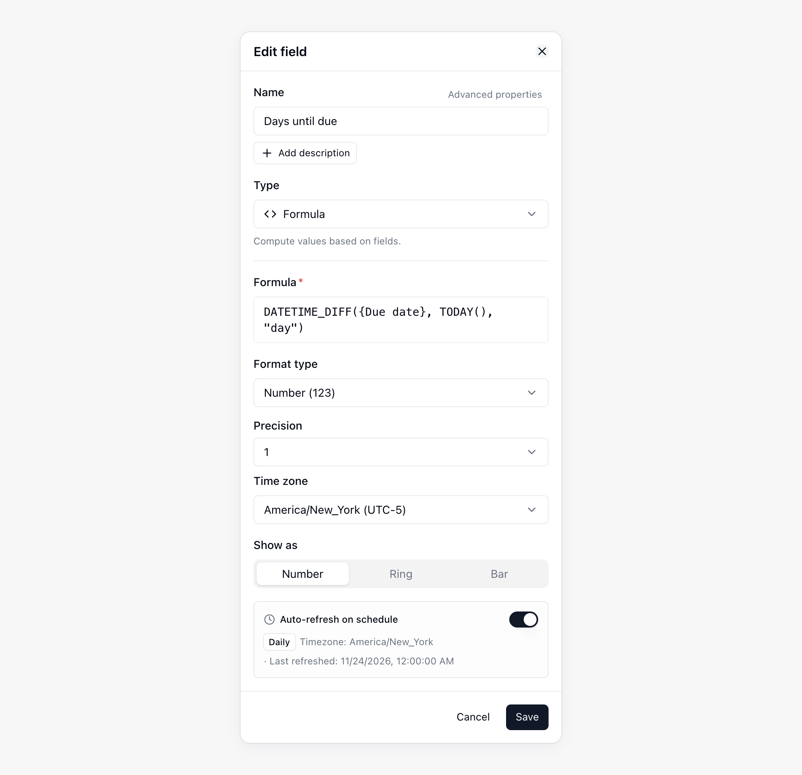

{/* mintlify-resync: 2026-10-22 */}

Поля формул рассчитывают результаты на основе других полей той же записи. Они поддерживают математические операции, объединение текста, вычисления с датами и условную логику. Используйте их, чтобы превратить повторяющиеся правила расчёта в поля.

## Сценарии использования

| Сценарий | Для чего подходит |
| --- | --- |
| Автоматический расчёт | Расчёт общей стоимости, прибыли или оценки на основе количества, цены за единицу, скидки и других полей |
| Обработка текста | Объединение текста, извлечение содержимого или разбор информации по разделителю |
| Обработка дат | Расчёт разницы между датами, проверка временных диапазонов или создание будущих дат |
| Условная логика | Возврат разных результатов в зависимости от условий, например статусов, подсказок или категорий |

## Основы формул

### Типы данных

Перед написанием формулы проверьте типы полей, используемых в вычислении. Разные типы поддерживают разные операции и функции.

| Тип | Описание | Типичные способы использования |
| --- | --- | --- |
| Число | Целые или десятичные числа | Арифметика, сводки, сравнения |
| Текст | Строковые значения | Объединение, извлечение, замена, разделение |
| Дата | Значения даты или даты и времени | Расчёт интервалов, сравнение дат |
| Логический | `TRUE` или `FALSE` | Условия и логические операции |

### Ссылки на поля

В формуле обращайтесь к другому полю по его имени. Заключите имя поля в `{}` и убедитесь, что оно совпадает с фактическим именем поля:

```js
{Цена за единицу} * {Количество}
```


### Операторы

| Оператор | Назначение |
| --- | --- |
| `+` | Вычисляет сумму чисел или объединяет строки |
| `-` | Вычисляет разность чисел |
| `*` | Вычисляет произведение чисел |
| `/` | Вычисляет частное чисел |
| `%` | Вычисляет остаток от деления |

## Функции и выражения

### Основные функции

Функции выполняют определённые операции. Например, `SUM` вычисляет сумму, `LEFT` извлекает символы из начала текста, `TEXTBEFORE` извлекает текст перед разделителем, а `TEXTSPLIT` разделяет текст по разделителю.

Другие функции см. в [шпаргалке по формулам](/ru/basic/field/formula/cheat-sheet).

### Обработка текста

| Операция | Примеры функций | Описание |
| --- | --- | --- |
| Объединение текста | `&`, `CONCATENATE` | Объединяет два или более текстовых значения |
| Извлечение текста | `LEFT`, `RIGHT`, `MID`, `TEXTBEFORE` | Извлекает часть строки |
| Разделение текста | `TEXTSPLIT` | Разделяет текст на несколько значений по разделителю |

### Логические условия

Используйте функцию `IF`, чтобы возвращать разные значения в зависимости от условия:

```js
IF(condition, value_if_true, value_if_false)
```

При проверке поля на пустое значение сравнивайте его с `BLANK()`. Например, `IF({Вес}=BLANK(), 1, 2)` возвращает `1`, когда числовое поле пусто, и `2` в остальных случаях.

### Сложные выражения

Сложная формула может содержать несколько функций, ссылок на поля и операторов. Используйте скобки, чтобы управлять порядком вычислений:

```js
({Цена за единицу} * {Количество}) * (1 - {Скидка})
```

## Отображение результатов и обслуживание

### Форматирование и интерактивное отображение

К результатам формул также можно применять настройки [форматирования](/ru/basic/field/common/formatter) и [интерактивного отображения](/ru/basic/field/common/show-as), например проценты, индикатор выполнения или стили значков. Доступные варианты зависят от типа результата формулы.

### Отладка и оптимизация

- **Проверяйте типы данных**: убедитесь, что операции и функции используют правильные типы данных.
- **Проверяйте ссылки на поля**: убедитесь, что имена полей записаны правильно.
- **Тестируйте поэтапно**: разбивайте сложные формулы на более мелкие части и проверяйте их отдельно.
- **Избегайте повторных вычислений**: если один и тот же расчёт используется в нескольких местах, рассмотрите возможность хранить результат в отдельном поле.

### Обновление по расписанию

Обычно формула пересчитывается, когда меняются поля, на которые она ссылается. Формула с `TODAY()`, `NOW()`, `FROMNOW()` или `TONOW()` меняется ещё и со временем — например, «дней до срока»: даже если запись не изменилась, на следующий день результат должен быть другим.

Для таких полей нажмите **Обновить сейчас** в меню заголовка столбца, чтобы сразу пересчитать весь столбец по текущему времени. Чтобы поле оставалось актуальным автоматически, включите в настройках поля **Автообновление по расписанию** (тариф Business или выше):



- Формула, в которой используется только `TODAY()`, обновляется раз в день; смена даты определяется по часовому поясу, указанному в настройках.
- Формула с `NOW()`, `FROMNOW()` или `TONOW()` обновляется примерно каждые 15 минут и каждый раз пересчитывает все записи таблицы. На больших таблицах это может потреблять много ресурсов; если достаточно точности до дня, используйте `TODAY()`.

Автообновление выполняется, только пока проектом недавно пользовались; проект, которым давно не пользовались, догоняет пропущенное при следующем открытии таблицы. **Последнее обновление** в настройках поля показывает время последнего обновления. При понижении тарифа автообновление приостанавливается с сохранением настройки и возобновляется после перехода на Business или выше; **Обновить сейчас** продолжает работать.

Поля [подстановки](/ru/basic/field/lookup), [сводки](/ru/basic/field/rollup), [условной подстановки](/ru/basic/field/conditional-lookup) и [условной сводки](/ru/basic/field/conditional-rollup), в фильтре которых используется относительная дата, например **сегодня**, **текущая неделя** или **прошлое количество дней**, тоже можно обновить сейчас или по расписанию. Они обновляются ежедневно, еженедельно или ежемесячно — по самому короткому периоду в фильтре.

### Пределы сложности

При сохранении формулы Teable сначала разворачивает её в структуру, которая действительно участвует в вычислении, и проверяет размер этой структуры. Если предел превышен, сохранение отклоняется, а сообщение называет превышенный показатель и его предел — число развёрнутых узлов, глубину вложенности вычисления, глубину ссылок между формулами — и правка не сохраняется.

Превысить предел может и короткая формула: когда одна формула ссылается на другую, а та — на третью, развёрнутая структура растёт быстро. Обычно достаточно вынести промежуточные результаты в отдельные поля и сократить повторные ссылки и сложные ветвления.

Если сохранённая формула упирается в предел при вычислении, поле показывает `Компиляция формулы превышает лимит вычислений; результаты не обновлены` в разделе [отслеживания вычисления полей](/ru/basic/view/grid). После упрощения формулы следующая запись пересчитает поле.
