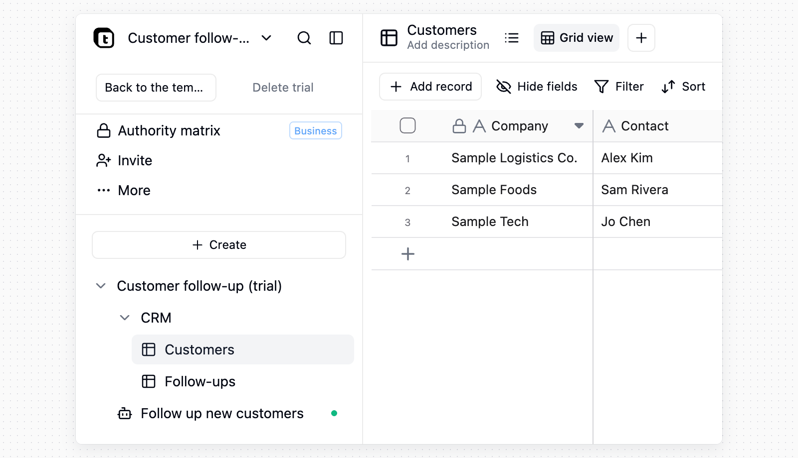

Для шаблона создаётся отдельный **Проект шаблона**. Вы выбираете, чем поделиться из рабочего Проекта, и Teable копирует структуру выбранного в Проект шаблона. Исходный Проект и его данные не меняются и никогда не публикуются.

## Создание шаблона

На боковой панели Проекта щёлкните правой кнопкой мыши таблицу, приложение, автоматизацию или папку и выберите **Сделать шаблоном**. Чтобы выбирать из всего Проекта, нажмите название Проекта в левом верхнем углу и выберите **Сделать шаблоном**.

Если вы начали с меню элемента, этот элемент уже отмечен; если с названия Проекта — отметьте в списке, что взять. Таблицы, которые использует приложение, автоматизация или панель мониторинга, добавляются сами, а причина указана справа. Всё остальное собрано в разделе **Остаётся: N**; разверните его, чтобы отметить ещё. Проверьте название и нажмите **Создать проект шаблона**.

Проект шаблона копирует только структуру: записи не переносятся, автоматизации изначально выключены, а связь с таблицей, которая не переносится, становится текстом. Нужно разрешение **Создатель** или выше и в исходном Проекте, и в Пространстве. У Проекта, который раньше публиковался напрямую и всё ещё есть в центре шаблонов, в меню названия Проекта вместо этого пункта показано **Опубликовать в центре шаблонов**; чтобы сделать из него новый шаблон, начните с меню элемента на боковой панели.

## Подготовка Проекта шаблона

После нажатия **Создать проект шаблона** Teable открывает новый Проект шаблона. Рядом с его названием стоит метка **Шаблон**, а вверху боковой панели показаны статус, откуда он взят (**Из «Продажи»**, видно только вам), а также **Попробовать** и **Отправить на проверку**.

Затем Cuppy находит то, что принадлежит только вам, показывает, чем заменит каждый пункт, заменяет их после вашего подтверждения, а потом добавляет демонстрационные записи и составляет черновик руководства по установке. Демонстрационные записи можно добавить и самостоятельно: при отправке записи из Проекта шаблона уходят вместе с шаблоном как его демонстрационные данные.

## Пробная копия

Нажмите **Попробовать**, и Teable создаст пробную копию так же, как при установке, и откроет её — вы увидите то, что получат другие. Чтобы вернуться, нажмите **Назад к проекту шаблона**, а когда копия больше не нужна — **Удалить пробную копию**. Если попробовать снова, ваша предыдущая пробная копия переносится в корзину.

## Отправка на проверку

Нажмите **Отправить на проверку**, укажите название, описание и обложку и выберите, что откроется по умолчанию после установки. Отправляется весь Проект шаблона: раздел **Опубликовать узлы** показывает, сколько элементов и демонстрационных записей будет отправлено.

Блок **Проверки перед отправкой** справа не пропускает то, что принадлежит только вам: имена, адреса электронной почты и почтовые домены компании тех, кто может открыть Пространство или Проект, а также текст, похожий на ключ API. Замените их или нажмите **Исправить**, чтобы их заменил Cuppy. Кнопка **Это примеры** помечает всё перечисленное как примеры и пропускает, поэтому нажимайте её, только если всё это выдумано.

Когда у строки **Содержимое** появится зелёная галочка, нажмите **Отправить на проверку**. Остальные строки — напоминания и не мешают отправке.

Строка **Руководство** в этом окне добавляет к шаблону несколько шагов настройки. У каждого шага есть заголовок, описание в одну строку, место, которое нужно открыть, и условие выполнения. Составьте его с помощью **Составить с Teable AI** или воспользуйтесь **Изменить в проекте**. Условия: демонстрационные данные заменены реальными, приложение опубликовано, автоматизация один раз выполнена успешно, нужные аккаунты подключены или пользователь отметил шаг сам. Условие по данным не должно быть выполнено заранее на демонстрационных записях, иначе шаблон нельзя отправить.

## Проверка и публикация

После отправки открывается окно **Отправлено на проверку**, где до окончания проверки можно нажать **Отозвать**. На боковой панели отображается **На проверке**; нажмите **Посмотреть отправку**, чтобы увидеть, что вы отправили.

После одобрения шаблон появляется в центре шаблонов, а на боковой панели отображается **Опубликован · v1**. Если шаблон вернут, на боковой панели появится **Возвращён на доработку**, а в уведомлении будут примечания проверяющего; внесите изменения и нажмите **Отправить снова**.

После публикации продолжайте редактировать тот же Проект шаблона и нажмите **Отправить v2**, чтобы отправить новую версию. Пока новая версия не одобрена, при установке шаблона пользователи получают текущую.

## Проекты шаблонов на главной странице Пространства

На главной странице Пространства две вкладки: **Проекты** и **Проекты шаблонов**. На вкладке **Проекты шаблонов** видны статус и источник каждого шаблона; разверните строку, чтобы увидеть его содержимое и пробную копию. Чтобы начать с пустого Проекта, нажмите **Новый проект шаблона** в правом верхнем углу этой вкладки.

<Note>Если переместить Проект шаблона в корзину, опубликованный шаблон снимается с публикации в центре шаблонов, и восстановление Проекта из корзины не публикует его снова. Отправка, которая находится на проверке, отзывается, а ваши пробные копии тоже переносятся в корзину. Копии, которые уже установили другие, это не затрагивает.</Note>
