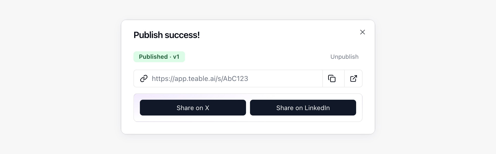

Для шаблона создаётся отдельный **Проект шаблона**. Вы выбираете, чем поделиться из рабочего Проекта, и Teable копирует структуру выбранного в Проект шаблона. Исходный Проект и его данные не меняются и никогда не публикуются.

## Создание шаблона

На боковой панели Проекта щёлкните правой кнопкой мыши таблицу, приложение, автоматизацию или папку и выберите **Сделать шаблоном**. Чтобы выбирать из всего Проекта, нажмите название Проекта в левом верхнем углу и выберите **Сделать шаблоном**.

Если вы начали с меню элемента, этот элемент уже отмечен; если с названия Проекта — отметьте в списке, что взять. Таблицы, которые использует приложение, автоматизация или панель мониторинга, добавляются сами, а причина указана справа. Всё остальное собрано в разделе **Остаётся: N**; разверните его, чтобы отметить ещё. Проверьте название и нажмите **Создать проект шаблона**.

Проект шаблона копирует только структуру: записи не переносятся, автоматизации изначально выключены, а связь с таблицей, которая не переносится, становится текстом. Нужно разрешение **Создатель** или выше и в исходном Проекте, и в Пространстве. У Проекта, который раньше публиковался напрямую и всё ещё есть в центре шаблонов, в меню названия Проекта вместо этого пункта показано **Опубликовать в центре шаблонов**; чтобы сделать из него новый шаблон, начните с меню элемента на боковой панели.

## Подготовка Проекта шаблона

После нажатия **Создать проект шаблона** Teable открывает новый Проект шаблона. После его названия стоит метка **Шаблон**, а вверху боковой панели показаны статус, источник (**Из «Продажи»**, видно только вам), **Попробовать** и **Опубликовать шаблон**.

Затем Cuppy находит то, что принадлежит только вам, показывает, чем заменить каждый элемент, заменяет их после вашего подтверждения, добавляет демонстрационные записи и составляет черновик руководства по установке. Демонстрационные записи можно добавить и самостоятельно: при публикации записи Проекта шаблона публикуются как демонстрационные данные шаблона.

## Пробная копия

Нажмите **Попробовать**, и Teable создаст пробную копию так же, как при установке, и откроет её — вы увидите то, что получат другие. Чтобы вернуться, нажмите **Назад к проекту шаблона**, а когда копия больше не нужна — **Удалить пробную копию**. Если попробовать снова, ваша предыдущая пробная копия переносится в корзину.

## Публикация шаблона

Нажмите **Опубликовать шаблон**, укажите название и описание, загрузите обложку и выберите, что откроется по умолчанию после установки. Обложка и описание обязательны: они показываются, когда ссылкой на шаблон делятся. Публикуется весь Проект шаблона: раздел **Опубликовать узлы** показывает, сколько элементов и демонстрационных записей будет опубликовано.

Блок **Проверки перед публикацией** справа не пропускает то, что принадлежит только вам: имена, адреса электронной почты и почтовые домены компании тех, кто может открыть Пространство или Проект, а также текст, похожий на ключ API. Замените их или нажмите **Исправить**, чтобы их заменил Cuppy. Кнопка **Это примеры** помечает всё перечисленное как примеры и пропускает, поэтому нажимайте её, только если всё это выдумано.

Когда в строке **Содержимое** появится зелёная галочка, нажмите **Опубликовать шаблон**. Остальные строки — напоминания, они не мешают публикации.

Строка **Руководство** в этом окне добавляет к шаблону несколько шагов настройки. У каждого шага есть заголовок, описание в одну строку, место, которое нужно открыть, и условие выполнения. Составьте его с помощью **Составить с Teable AI** или воспользуйтесь **Изменить в проекте**. Условия: демонстрационные данные заменены реальными, пользователь добавил свою запись, приложение опубликовано, автоматизация один раз выполнена успешно, нужные аккаунты подключены или пользователь сам отметил шаг выполненным. Условие по данным не должно быть выполнено заранее на демонстрационных записях, иначе шаблон нельзя опубликовать.

## После публикации

Шаблон становится доступен сразу после нажатия **Опубликовать шаблон**: открывается окно **Успешно опубликовано!** с меткой **Опубликован · v1** и ссылкой на шаблон. Любой, у кого есть ссылка, может сразу открыть и установить шаблон. Скопируйте ссылку или поделитесь ею.

После публикации шаблон проходит проверку. Она решает только, будет ли шаблон в центре шаблонов, и не влияет на ссылку и установки. Когда шаблон добавлен, на боковой панели появляется ещё и **В центре шаблонов**. Если его не добавили, вы получите уведомление, а ссылку по-прежнему можно открывать, устанавливать и отправлять.

Дальше продолжайте вносить изменения в тот же Проект шаблона и нажмите **Опубликовать v2**, чтобы опубликовать новую версию. Она тоже сразу становится доступна, и новые установки получают её. Если шаблон есть в центре шаблонов, там тоже показывается новая версия, а проверка проходит после.

Чтобы убрать шаблон, нажмите **Снять с публикации** в окне публикации. Ссылка перестанет открываться, а центр шаблонов больше не будет его показывать. Копии, которые уже установили другие, не затрагиваются, а опубликовать шаблон снова можно позже.

## Проекты шаблонов на главной странице Пространства

На главной странице Пространства две вкладки: **Проекты** и **Проекты шаблонов**. На вкладке **Проекты шаблонов** видны статус и источник каждого шаблона; разверните строку, чтобы увидеть его содержимое и пробную копию. Чтобы начать с пустого Проекта, нажмите **Новый проект шаблона** в правом верхнем углу этой вкладки.

<Note>Если переместить Проект шаблона в корзину, его шаблон тоже снимается с публикации: ссылка перестаёт открываться, центр шаблонов его больше не показывает, а восстановление Проекта из корзины не публикует его снова. Ваши пробные копии тоже перемещаются в корзину. Копии, которые установили другие, не затрагиваются.</Note>
