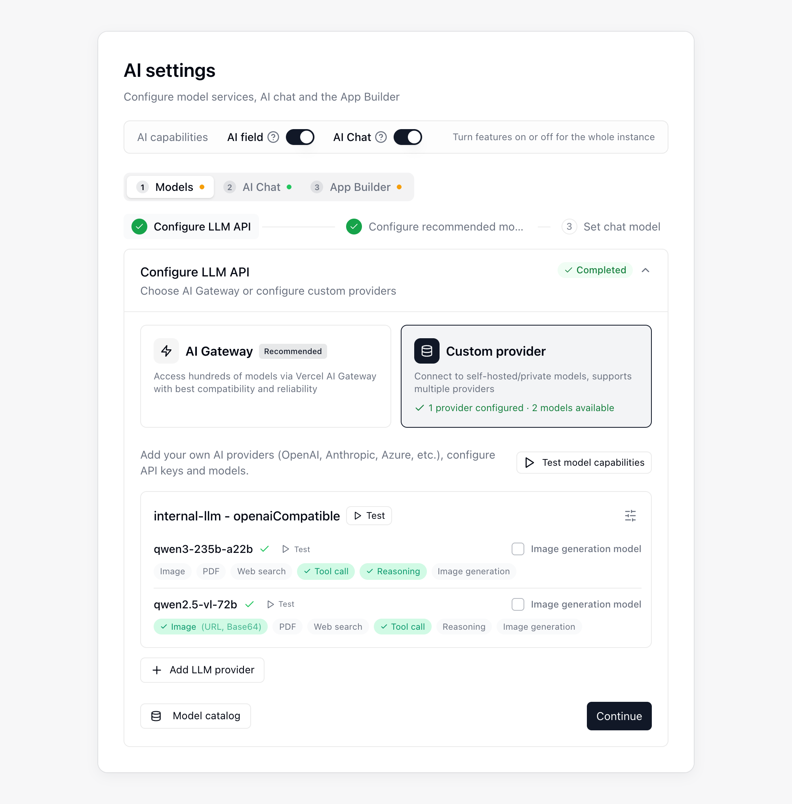

{/* mintlify-resync: 2026-10-22 */}
<Tip>Kendi sunucunuzda barındırılan Business ve üzeri planlarda kullanılabilir</Tip>

Yol: Sistem Yönetimi → Yapay zekâ ayarları

**Yapay zekâ ayarları** sayfası; **AI Chat**, **AI Alanları**, **AI otomasyonu** ve **App Builder** yapılandırması için kullanılır. Sayfanın üst kısmında **Yapay Zekâ Yetenekleri** anahtarları bulunur; altındaki **Modeller**, **Yapay Zekâ Sohbeti** ve **Uygulama oluşturucu** sekmeleri sırayla yapılandırılır. Her sekme bir öncekine bağlıdır; önceki sekme tamamlanmadıysa sayfa hangi ayarların eksik olduğunu belirtir. Sağdaki **Yapılandırma bekleyen öğeler** paneli şu anda eksik olan zorunlu öğeleri listeler; bir öğeye tıkladığınızda ilgili sekmeye ve adıma gidersiniz.

## Başlamadan önce

Yapay zekâ ayarları sayfasını açmadan önce aşağıdaki öğelerin hazır olduğundan emin olun.

| Gereksinim | Zorunlu mu? | Notlar |
|------|------|------|
| **Aracı Çalışma Zamanı kurulumu** | AI Chat ve App Builder için zorunlu | AI Chat ve App Builder tarafından kullanılır |
| **Özel sağlayıcı** | AI Chat veya App Builder kendi anahtarınızı (BYOK) kullandığında zorunlu | **OpenAI Compatible** veya **Anthropic** sağlayıcısı kullanın |
| **OpenAI API anahtarı** | İsteğe bağlı | Yalnızca AI Chat'te **Sesli giriş** seçeneğini etkinleştirmek istiyorsanız gereklidir |
| **Genel erişim** | **Vercel** dağıtım motoru seçildiğinde zorunlu | **Teable örneğiniz** ve **nesne depolamanız (MinIO / S3)** Vercel tarafından genel olarak erişilebilir olmalıdır |

## Kurulum adımları

**Modeller** sekmesindeki kurulum sihirbazı, modelleri bağlamak ve seçmek için üç adımdan oluşur. Tamamlanan adımlar varsayılan olarak daraltılır; değiştirmek için adıma tıklayıp genişletin:

<Steps>
  <Step title="LLM API'sini yapılandır">
    Model bağlantınızı kurup ilk testi tamamlayın.
  </Step>
  <Step title="Önerilen modelleri yapılandır">
    AI Alanları ve AI otomasyonu için önerilen modelleri seçin.
  </Step>
  <Step title="Sohbet modelini ayarla">
    Dört sohbet modeli katmanının her biri için bir model seçin.
  </Step>
</Steps>

AI Chat ve App Builder ayrıca bir çalışma zamanına ve uygulama dağıtımına ihtiyaç duyar; bunlar sırasıyla **Yapay Zekâ Sohbeti** ve **Uygulama oluşturucu** sekmelerinde yapılandırılır. Önce bir [dağıtım seçeneği](/tr/deploy/choose) belirleyip dağıtımı tamamlayın, ardından aşağıda açıklandığı gibi yapılandırın.

### LLM API'yi yapılandırma

**LLM API'sini yapılandır** adımında **Model sağlayıcı ekle**'ye tıklayarak bir model sağlayıcısı ekleyin ve modellerini test edin. Kendi anahtarınızı (BYOK) kullanıyorsanız sağlayıcı türü olarak **OpenAI Compatible** veya **Anthropic** seçin.

Bir modelin bağlam penceresi ve yanıt başına en fazla çıktısı **Model kataloğu** üzerinden otomatik olarak belirlenir; elle girmeniz gereken bir değer yoktur. Bir model için belirlenen değerleri görmek istediğinizde **Model kataloğu**'nu açın, **Model incele** bölümünde bir **Kapsam** seçip modeli belirleyin; **Parametre ayrıntıları** bağlamı, en fazla çıktıyı ve her değerin kaynağını listeler.

Katalogda eşleşen bir kayıt bulunmadığında (örneğin yeni yayımlanmış veya kendi kurduğunuz bir model), model **Eşleştirme kuralları** içindeki **Hiçbiri eşleşmedi** bölümünde tanımlı değerlerle çalışır: varsayılan olarak 200000 bağlam penceresi ve 32000 en fazla çıktı; **Parametre ayrıntıları** bölümünde her ikisinin kaynağı **Eşleştirme kuralı** olarak görünür. Bu değerler modele uymuyorsa **Eşleştirme kuralları** bölümünde değiştirip **Kaydet**'e tıklayın.

### Önerilen Modelleri yapılandırma

Kullanıcıların **AI Alanları** ve **AI otomasyonu** içinde seçebileceği önerilen modelleri belirleyin.

### Sohbet modelini ayarlama

**Sohbet modeli katmanları** bölümünde **Ultra**, **Smart**, **Standard** ve **Lite** katmanlarının her biri için bir model seçin; seçebileceğiniz modeller kaynaklarına göre **Vercel AI Gateway** ve **Özel sağlayıcı** olmak üzere iki grupta listelenir; **Vercel AI Gateway** grubunda yalnızca 2. adımda etkinleştirilen önerilen modeller yer alır. Kullanıcılar kenar çubuğundaki **AI Chat** model menüsünde katmana göre seçim yapar ve model adı yerine katman adını görür; bu nedenle bir katmanın arkasındaki modeli istediğiniz zaman değiştirebilirsiniz, o katmanı zaten seçmiş kullanıcılar etkilenmez.

| Katman | Açıklama |
|------|------|
| **Ultra** | En yüksek yetenek, zorlu işler için. Boş bırakılırsa **Sunulmuyor** görünür ve kullanıcıların model menüsünde yer almaz.|
| **Smart** | Ana model. Yapay zekâ alanları, arka plan görevleri ve kendi modeli olmayan her katman bunu kullanır, bu yüzden mutlaka ayarlanmalıdır.|
| **Standard** | Günlük sohbetler ve genel görevler; orta düzey arka plan görevlerinde de kullanılır. Boş bırakılırsa **Smart** devralınır.|
| **Lite** | Düşük maliyetli, sık yapılan rutin işler; sohbet başlığı üretme gibi hafif görevlerde de kullanılır. Boş bırakılırsa **Smart** devralınır.|

Her katmanın sağında iki denetim daha bulunur:

- **Varsayılan yap**: kullanıcıların model menüsünü açtığında karşılaştığı katmanı belirler. Modeli olmayan **Ultra** varsayılan yapılamaz.
- **Etkin**: kapatıldığında o katman kullanıcılara sunulmaz. Varsayılan katman kapatılamaz.

### Çalışma zamanını yapılandırma

Çalışma zamanı, **Yapay Zekâ Sohbeti** sekmesindeki **Yapay Zeka Sohbet Çalışma Ortamı** bölümünde yapılandırılır. Dağıtım tamamlandıktan sonra AI Chat çalışma zamanını doğrulamak için **Run test**'e tıklayın.

### AI özelliklerini etkinleştirme

Sayfanın üst kısmındaki **Yapay Zekâ Yetenekleri** bölümünde gerektiği şekilde **AI Alan** ve **AI Sohbet** anahtarlarını etkinleştirin; bu anahtarlar tüm örnek için geçerlidir. **AI Sohbet** özelliğini kullanmadan önce çalışma zamanını yapılandırın.

### App Builder'ı yapılandırma

Uygulamaların nasıl dağıtılacağını **Uygulama oluşturucu** sekmesindeki **Dağıtım motoru** bölümünden seçin:

| Dağıtım motoru | Kurulum gereksinimleri |
|------|------|
| **Vercel** | Bir Vercel erişim token'ı girin, **Test Connection**'a tıklayın ve Vercel'in Teable örneğinize ve nesne depolamanıza erişebildiğini doğrulamak için **Herkese açık erişimi test et** seçeneğini kullanın. |
| **Teable Infra** | Yapılandırılmış Teable Infra kapsayıcı çalışma zamanını kullanır. Burada ek kimlik bilgileri veya genel erişim testi gerekmez. |

Gerektiğinde aşağıdaki isteğe bağlı App Builder ayarlarını ekleyebilirsiniz:

| İsteğe bağlı öğe | Gerektiği durum |
|------|------|
| **Özel alan adı** | Uygulamaları kendi alan adınız altında yayımlamak istediğinizde |
| **Uygulama kimlik doğrulaması** | Oluşturulan uygulamalarda **E-posta OTP**, **Google** veya **SSO (OIDC)** ile oturum açma gerektiğinde |

**Uygulama kimlik doğrulaması** bölümünde, oluşturulan uygulamalar için oturum açma sağlayıcılarını yapılandırabilirsiniz:

- **E-posta OTP**, uygulama giriş doğrulama e-postaları için bağımsız bir SMTP posta kutusu kullanır.
- **Google OAuth**, bir İstemci Kimliği ve İstemci Gizli Anahtarı gerektirir. Bu sayfada gösterilen yönlendirme URI'sini Google Cloud Console'daki yetkilendirilmiş yönlendirme URI'leri listesine ekleyin.
- **SSO (OIDC)**, uygulama ziyaretçilerinin kurumsal kimlik sağlayıcısıyla oturum açmasını sağlar. Sayfada gösterilen adresi kimlik sağlayıcısında yönlendirme URI'si olarak kaydedin, ardından **Yetkilendirme URL'si**, **Token URL'si**, **Kullanıcı Bilgisi URL'si**, **İstemci kimliği** ve **İstemci gizli anahtarı** alanlarını doldurun. **Scope** boş bırakılırsa `openid email profile` kullanılır. Kayıtlı **Token URL'si** değiştirildikten sonra **İstemci gizli anahtarı**'nın yeniden girilmesi gerekir.

**Teable** ile oturum açma varsayılan olarak kullanılabilir. **Email OTP**, yalnızca SMTP ayarları tamamlandıktan sonra App Builder'da görünür; **Google** yalnızca her iki OAuth kimlik bilgisi yapılandırıldıktan sonra, **SSO (OIDC)** ise Scope dışındaki tüm SSO alanları doldurulduktan sonra görünür.

**Uygulama ayarları** bölümündeki **Yapay zekâ API anahtarını uygulamalara otomatik ekle** varsayılan olarak açıktır; böylece uygulamalar platformun AI modellerini çağırabilir. Bu ayarı kapatırsanız uygulamalar artık bu modellere erişemez.

Yükseltmeden sonra eski uygulamalar düzgün önizlenemiyor veya yayımlanamıyorsa **Bakım araçları** altındaki **Eski proje uyumluluğu** bölümünde **Onarımı çalıştır**'a tıklayın; eksik dosyalar otomatik olarak tamamlanır.

### İsteğe bağlı: Sesli girişi yapılandırma

AI Chat'te sesli giriş kullanmak için **Yapay Zekâ Sohbeti** sekmesinde **Sesli giriş**'i etkinleştirip bir **OpenAI API anahtarı** girin. **Yazıya dökme uç noktası** alanını yalnızca özel bir transkripsiyon hizmeti kullanırken yapılandırın; kayıtlı **Yazıya dökme uç noktası** değiştirildikten sonra **OpenAI API anahtarı**'nın yeniden girilmesi gerekir. Kayıt uzunluğunu ve dakika başına istek sayısını da sınırlayabilirsiniz.

### Kurulumu doğrulama

Kurulum tamamlandıktan sonra önce **Yapılandırma bekleyen öğeler** panelindeki tüm zorunlu öğelerin yeşil olduğunu doğrulayın. Ardından **AI Chat**, **AI Alanları**, **AI otomasyonu** ve **App Builder** özelliklerini tek tek test edin.

## SSS

<AccordionGroup>
<Accordion title="Kredi sınırı aşıldı hatası alıyorum">

Yapılandırılmış model hizmetinizin kullandığı hesabı veya sağlayıcıyı kontrol edin. Gerekirse bakiye yükleyin veya model yapılandırmasını değiştirin.
</Accordion>

</AccordionGroup>
