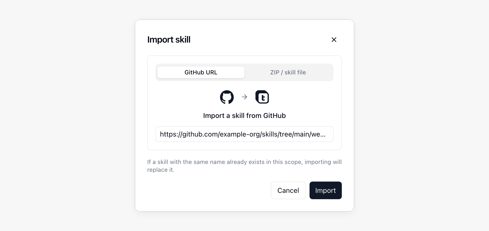
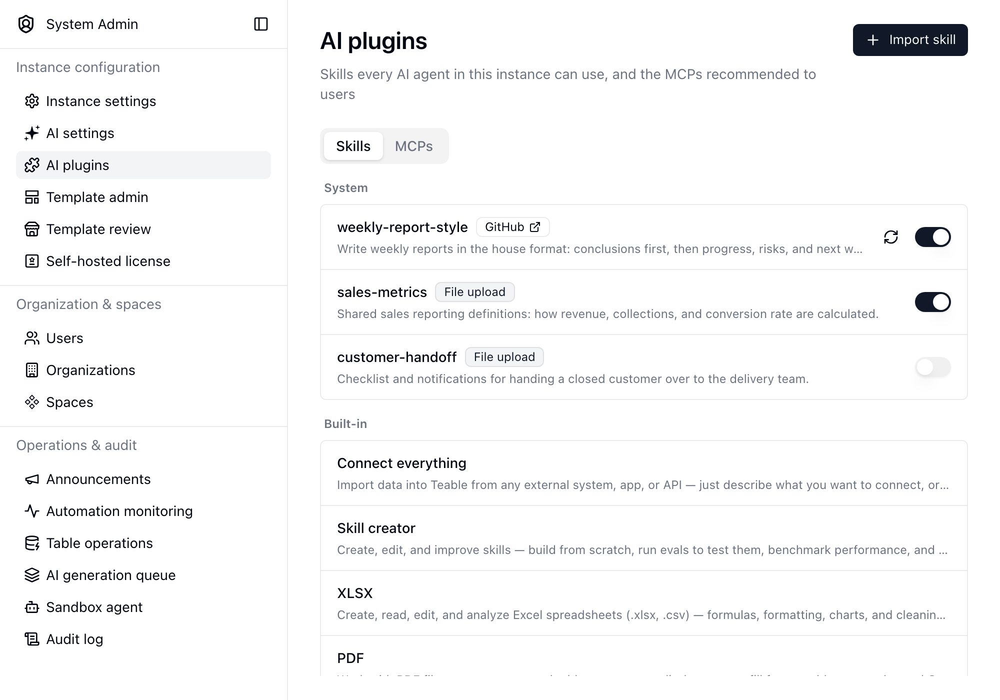

{/* mintlify-resync: 2026-11-13 */}

<Tip>Kendi sunucunuzda barındırılan Business ve üzeri planlarda kullanılabilir</Tip>

Yol: Sistem Yönetimi → Yapay zekâ eklentileri

**Yapay zekâ eklentileri** sayfasının **Skills** sekmesi Skill'leri tüm örnekte yayımlar; **MCPs** sekmesi kullanıcılara önerilen MCP'leri yönetir. Buraya eklenen bir Skill her AI Chat, App Builder ve bot sohbetinde kullanılabilir. Bu nedenle kuruluşunuzun varsayılan olarak paylaşması gereken kurum içi yazım tarzı, raporlama standardı veya ortak entegrasyon prosedürü gibi çalışma yöntemleri için kullanın.

Kullanıcıların başka yerlerde eklediği Skill'ler kendi kapsamlarında kalır. Kişisel, Proje ve Alan Skill'leri için [AI Chat](/tr/basic/ai/ai-chat) bölümüne bakın.

## Önerilen MCP'ler

**MCPs** sekmesindeki **Önerilen** listesi, kullanıcıların **Ayarlar** → **Entegrasyonlar** → **MCP ekle** altında hangi önerilen sunucuları göreceğini belirler. Bunları tek tek açıp kapatabilir veya **Tümünü kapat** ile hepsini birden kapatabilirsiniz (hepsi kapalıyken düğme **Tümünü aç** olur). Kapatılan sunucu önerilenler listesinde görünmez; kullanıcıların daha önce eklediği sunucular etkilenmez. Hepsi kapatıldığında kullanıcılar **Önerilen** bölümünü artık görmez.

## Skill Ekleme

**Beceri İçe Aktar**'a tıklayıp Skill'in kaynağını seçin:

| Kaynak | Sağlanacak öğe |
| --- | --- |
| **GitHub URL** | Skill klasörünün veya içindeki `SKILL.md` dosyasının bağlantısı; örneğin `https://github.com/owner/repo/tree/main/skills/my-skill`. Skill deponun kök dizinindeyse depo bağlantısını doğrudan yapıştırabilirsiniz |
| **ZIP Dosyası** | Bir `.zip` veya `.skill` dosyası; `SKILL.md` içermelidir |

Bu kapsamda aynı ada sahip bir Skill zaten varsa içe aktarma işlemi onun yerini alır.

## Yayımlanmış Skill'leri Yönetme

Liste, Skill'leri kapsama göre gruplandırır ve her birinin nereden geldiğini gösterir. Yerleşik Skill'ler referans amacıyla en altta listelenir ve düzenlenemez.

- Bir Skill'i silmeden etkinleştirmek veya devre dışı bırakmak için satırındaki anahtarı kullanın. Devre dışı bırakılan bir Skill listede kalır ancak aracılara sunulmaz.
- GitHub'dan içe aktarılan bir Skill'in en yeni sürümünü kaynağından almak için yenileme düğmesine tıklayın.
- Bir satıra tıklayarak `SKILL.md` dosyasını okuyabilir, adını ve açıklamasını düzenleyebilir, indirebilir, dosyalarını değiştirebilir veya Skill'i silebilirsiniz.

<Info>Bu sayfada Skill ekleme, değiştirme veya kaldırma işlemlerini yalnızca örnek yöneticileri yapabilir. Oturum açmış her kullanıcı, yayımlanan Skill'leri sohbetlerinde kullanabilir.</Info>

## Aynı Ad İki Kez Kullanıldığında

Burada yayımlanan Skill, örnek için varsayılandır. Bir Proje, Alan, kişisel, uygulama veya bot Skill'i aynı adı kullanıyorsa ilgili sohbette kapsamı daha dar olan geçerli olur ve örnek Skill'i yok sayılır.
