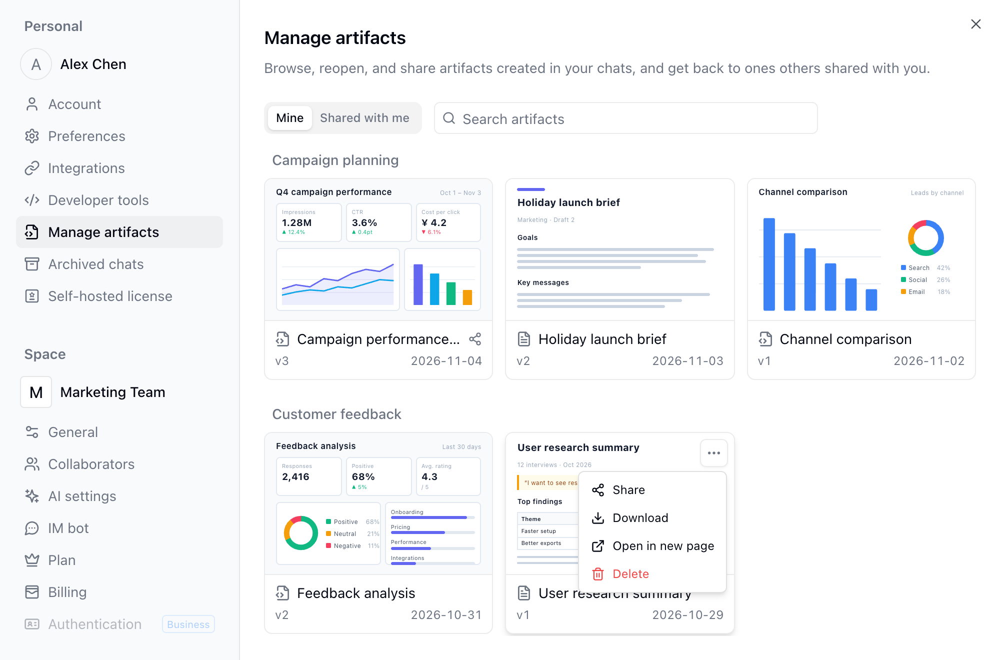

AI sohbette bir grafik, rapor, pano tarzı sayfa veya hesap makinesi gibi küçük bir araç oluşturduğunda sonucu bir **yapıt** (artifact) olarak kaydeder: Sohbetin dışında ayrı olarak görüntülenen, etkileşimli bir HTML sayfası veya Markdown raporu. Yapıtlar sohbette kart olarak görünür ve sohbet bittikten sonra da kullanılabilir kalır.

Yapıt oluşturmak için [AI Chat](/tr/basic/ai/ai-chat)'te istediğiniz sonucu anlatmanız yeterlidir; örneğin "Haftalık satış eğilimi grafiği oluştur" veya "Bu Kayıtlardan bir özet rapor oluştur". [Rutinlerin](/tr/basic/ai/routine) çalışırken oluşturduğu yapıtlar o çalıştırmanın sorumlusuna aittir.

<Info>
Bir yapıt, oluşturulduğu sırada AI'ın içine yerleştirdiği verileri barındırır; bu nedenle kendiliğinden yenilenmez ve sayfa Tabloları okuyamaz ya da değiştiremez. Canlı Tablo verilerini sürekli okuyan veya girdi toplayıp durum saklayan bir sayfa için [App Builder](/tr/basic/ai/app-builder) ile uygulama oluşturun.
</Info>

## Görüntüleme ve Düzenleme

Yapıt görüntüleyicisini açmak için sohbetteki karta tıklayın. Görüntüleyicide şunları yapabilirsiniz:

- Daha fazla alan için **Tam ekran** veya **Yeni sayfada aç** seçeneğini kullanın.
- Görüntülediğiniz sürümü **indirin**: HTML sayfaları `.html`, Markdown raporları `.md` dosyası olarak indirilir.
- Önceki sürümleri görmek için sürüm listesini açın.
- Yapıtı **silin**. Silme işlemi geri alınamaz; sohbetteki kart silinmiş olarak görünür ve paylaşım bağlantısı da hemen çalışmaz hâle gelir.

Bir yapıtı değiştirmek için aynı sohbette AI'dan istekte bulunun. Her düzenleme ayrı bir yapıt yerine aynı yapıtın yeni bir sürümüne dönüşür; böylece paylaşım bağlantısı çalışmaya devam eder. Önceki bir sürümü açıp **Bu sürümü geri yükle**'ye tıkladığınızda o sürümün içeriğiyle yeni bir sürüm eklenir; sonraki sürümler de korunur.

Sayfa çalışmazsa görüntüleyicinin üstünde hata mesajı görünür. **Yapay zekâ ile düzelt** seçeneğine tıkladığınızda Teable, yapıtın ait olduğu projede yeni bir sohbet açar ve hatayı AI'a iletir. Onarım sohbetini açıp ilerlemeyi izlemek için bildirimde **Görüntüle** seçeneğine tıklayın.

## Yapıt Paylaşma

Varsayılan olarak bir yapıtı yalnızca onu oluşturan kişi görebilir; aynı projedeki diğer üyeler de göremez. Başkalarının görebilmesi için paylaşımı açın.

<Steps>
  <Step title="Paylaşımı etkinleştirin">
    Görüntüleyicide **Paylaş**'a tıklayıp **Paylaşımı etkinleştir** seçeneğini açın. Başkaları artık yapıta bağlantısı üzerinden erişebilir.
  </Step>
  <Step title="Kimlerin görebileceğini seçin">
    **Kimler görebilir** ayarı varsayılan olarak **Bağlantıya sahip herkes** şeklindedir; bağlantıyı açmak için oturum açmak gerekmez. **Alan üyeleri**'ni seçtiğinizde yalnızca oturum açmış, o Alanın veya o projenin üyesi olan kişiler açabilir.
  </Step>
  <Step title="Parola ekleyin (isteğe bağlı)">
    **Gelişmiş** bölümünde **Parola koruması**'nı etkinleştirdiğinizde Teable otomatik olarak bir parola oluşturur. Görüntüleyenlerin içeriği görmeden önce bu parolayı girmesi gerekir. Parola yalnızca oluşturulduğu anda gösterilir; ikisini birlikte kopyalamak için hemen **Bağlantıyı ve şifreyi kopyala**'ya tıklayın. Daha sonra parolayı özelleştirmek veya değiştirmek için **Şifre belirle**'ye tıklayabilirsiniz; değiştirdikten sonra görüntüleyenlerin yeni parolayı girmesi gerekir.
  </Step>
  <Step title="Bağlantıyı gönderin">
    Bağlantının yanındaki **Bağlantıyı kopyala** düğmesine tıklayarak kopyalayın. Bağlantı gereğinden fazla yayıldıysa **Paylaşımı etkinleştir** seçeneğini kapatın; bağlantı başkaları için çalışmaz hâle gelir. Yeniden açtığınızda bağlantı aynı kalır, önceki görünürlük ve parola ayarları da korunur. Bağlantıyı zaten almış kişilerin erişmeye devam etmesini engellemek için yeniden açtıktan hemen sonra **Alan üyeleri**'ni seçin veya **Parola koruması**'nı açıp parolayı değiştirin.
  </Step>
</Steps>

Bağlantıyla erişen kişiler her zaman en son sürümü görür; önceki sürümleri göremez. Paylaşım açıkken bu bağlantıyı iframe ile başka web sitelerine de yerleştirebilirsiniz.

Bu özelliğin kullanım örnekleri için [paylaşılabilir AI raporu örnekleri](https://teable.ai/tr/blog/introducing-artifacts-share-data-reports-anywhere) yazısını okuyun.

## Yapıtları Daha Sonra Bulma

Sol alttaki avatarınız → **Ayarlar** → **Artifact yönetimi** yolunu açın ya da sohbette **+** → **Daha Fazla** → **Artifact yönetimi** yolunu kullanın.

- **Benim**: Oluşturduğunuz yapıtları projeye göre kartlar hâlinde listeler; her kartın üstünde sayfanın ilk ekranının küçük resmi bulunur ve adlarına göre arama yapabilirsiniz. Paylaşımı açık yapıtların adının yanında paylaşım simgesi görünür. Kartın **...** menüsünde **Paylaş**, **İndir**, **Yeni sayfada aç** ve **Sil** seçenekleri bulunur; görüntüleyiciyi açmak için karta tıklayın.
- **Benimle paylaşılan**: Oturum açıkken açtığınız, başkalarının paylaştığı yapıtlar; paylaşan kişi ve son açılma tarihiyle listelenir. Yeniden yeni sekmede açmak için tıklayın. Paylaşım kapatıldığında veya yapıt silindiğinde öğe artık görünmez.

[Kaynak panelinin](/tr/basic/ai/ai-chat#sohbetin-yanında-kaynakları-görüntüleme) **Artifact'ler** sekmesinde geçerli projedeki yapıtlarınızı görebilirsiniz.

## SSS

<AccordionGroup>
  <Accordion id="artifact-sharing-faq" title="Ekip arkadaşlarım oluşturduğum bir yapıtı açabilir mi?">
    Varsayılan olarak hayır; aynı projede olsalar bile göremezler. Görüntüleyicide **Paylaşımı etkinleştir** seçeneğini açıp bağlantıyı gönderin; içeriğin Alan dışına çıkmaması gerekiyorsa görünürlüğü **Alan üyeleri** olarak ayarlayın.
  </Accordion>

  <Accordion title="Yapıtlar ile App Builder'da oluşturulan uygulamalar arasındaki fark nedir?">
    Yapıt, AI'ın onu oluşturduğu andaki verilerin bir anlık görüntüsüdür; tek seferlik raporlar, grafikler ve analiz sonuçları için uygundur. Uygulamalar ise Tabloları canlı olarak okuyup yazar, girdi toplayabilir ve durum saklayabilir; uzun süre kullanılacak araçlar ve sayfalar için uygundur.
  </Accordion>

  <Accordion title="Yapıt oluşturmak kredi harcar mı?">
    Yapıt oluşturmak ve düzenlemek AI Chat'in bir parçasıdır ve sohbetin gerçek kullanımına göre krediden düşülür. Görüntüleme, paylaşma ve indirme kredi harcamaz.
  </Accordion>
</AccordionGroup>
