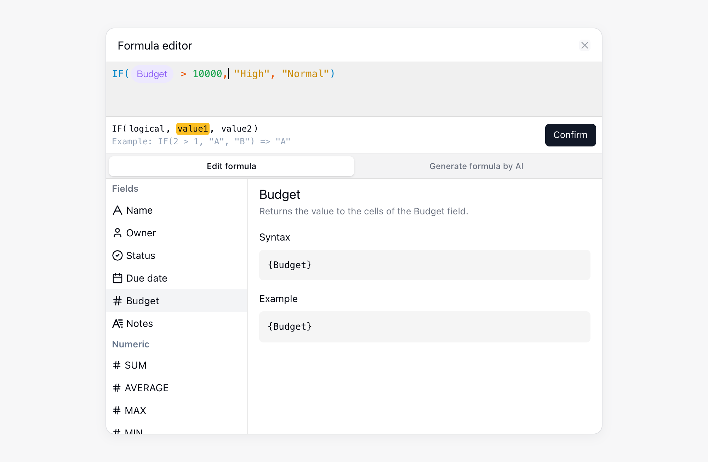

{/* mintlify-resync: 2026-10-22 */}

Formül alanları, aynı kayıttaki diğer alanlardan sonuçlar hesaplar. Matematiksel işlemleri, metin birleştirmeyi, tarih hesaplamalarını ve koşullu mantığı işleyebilir. Yinelenen hesaplama kurallarını alanlara dönüştürmek için bunları kullanın.

## Kullanım Alanları

| Senaryo | Uygun olduğu durumlar |
| --- | --- |
| Otomatik hesaplama | Miktar, birim fiyat, indirim ve diğer alanlardan toplam fiyat, kâr veya puan hesaplama |
| Metin işleme | Metni birleştirme, içeriği ayıklama veya bilgileri sınırlayıcıya göre ayrıştırma |
| Tarih işleme | Tarih farklarını hesaplama, zaman aralıklarını kontrol etme veya gelecekteki tarihleri oluşturma |
| Koşullu mantık | Durum, ipucu veya kategori gibi koşullara göre farklı sonuçlar döndürme |

## Formülün Temelleri

### Veri Türleri

Bir formül yazmadan önce hesaplamada kullanılan alanların türlerini doğrulayın. Farklı türler farklı işlemleri ve işlevleri destekler.

| Tür | Açıklama | Yaygın kullanımlar |
| --- | --- | --- |
| Sayı | Tam sayılar veya ondalık sayılar | Aritmetik, özetler, karşılaştırmalar |
| Metin | Dize değerleri | Birleştirme, ayıklama, değiştirme, bölme |
| Tarih | Tarih veya tarih-saat değerleri | Aralıkları hesaplama, tarihleri karşılaştırma |
| Boole | `TRUE` veya `FALSE` | Koşullar ve mantıksal işlemler |

### Alanlara Başvurma

Bir formülde başka bir alana alan adıyla başvurun. Alan adını `{}` içine alın ve gerçek alan adıyla tutarlı olmasını sağlayın:

```js
{Unit price} * {Quantity}
```



### İşleçler

| İşleç | Kullanım |
| --- | --- |
| `+` | Sayıların toplamını hesaplar veya dizeleri birleştirir |
| `-` | Sayılar arasındaki farkı hesaplar |
| `*` | Sayıların çarpımını hesaplar |
| `/` | Sayıların bölümünü hesaplar |
| `%` | Kalanı hesaplar |

## İşlevler ve İfadeler

### Yaygın İşlevler

İşlevler belirli işlemleri gerçekleştirir. Örneğin `SUM` toplamı hesaplar, `LEFT` metnin başından karakterleri ayıklar, `TEXTBEFORE` sınırlayıcıdan önceki metni ayıklar ve `TEXTSPLIT` metni sınırlayıcıya göre böler.

Daha fazla işlev için [formül hızlı başvuru kılavuzuna](/tr/basic/field/formula/cheat-sheet) bakın.

### Metin İşleme

| İşlem | İşlev örnekleri | Açıklama |
| --- | --- | --- |
| Metni birleştirme | `&`, `CONCATENATE` | İki veya daha fazla metin değerini birleştirir |
| Metni ayıklama | `LEFT`, `RIGHT`, `MID`, `TEXTBEFORE` | Bir dizenin bir bölümünü ayıklar |
| Metni bölme | `TEXTSPLIT` | Metni sınırlayıcıya göre birden fazla değere böler |

### Mantıksal Koşullar

Bir koşula göre farklı değerler döndürmek için `IF` işlevini kullanın:

```js
IF(condition, value_if_true, value_if_false)
```

Bir alanın boş olup olmadığını kontrol ederken `BLANK()` ile karşılaştırın. Örneğin `IF({Weight}=BLANK(), 1, 2)`, bir sayı alanı boş olduğunda `1`, aksi hâlde `2` döndürür.

### Karmaşık İfadeler

Karmaşık bir formül birden fazla işlev, alan başvurusu ve işleç içerebilir. Hesaplama sırasını denetlemek için parantezleri kullanın:

```js
({Unit price} * {Quantity}) * (1 - {Discount})
```

## Sonuç Görüntüleme ve Bakım

### Biçimlendirme ve Etkileşimli Görüntüleme

Formül sonuçlarında yüzde, ilerleme çubuğu veya simge stilleri gibi [biçimlendirme](/tr/basic/field/common/formatter) ve [etkileşimli görüntüleme](/tr/basic/field/common/show-as) ayarları da kullanılabilir. Kullanılabilir seçenekler formül sonucunun türüne bağlıdır.

### Hata Ayıklama ve Optimizasyon

- **Veri türlerini kontrol edin**: İşlemlerin ve işlevlerin doğru veri türlerini kullandığını doğrulayın.
- **Alan başvurularını doğrulayın**: Alan adlarının doğru yazıldığını doğrulayın.
- **Adım adım test edin**: Karmaşık formülleri daha küçük parçalara ayırın ve ayrı ayrı test edin.
- **Yinelenen hesaplamalardan kaçının**: Aynı hesaplama birden fazla yerde kullanılıyorsa sonucu ayrı bir alanda saklamayı değerlendirin.

### Zamanlanmış yenileme

Formüller genellikle başvurdukları alanlar değiştiğinde yeniden hesaplanır. `TODAY()`, `NOW()`, `FROMNOW()` veya `TONOW()` kullanan bir formül zamanla da değişir; örneğin "son tarihe kalan gün": kayıt değişmese bile sonuç ertesi gün güncellenmelidir.

Bu alanlarda sütun başlığı menüsünden **Şimdi yenile**'ye tıklayarak tüm sütunu o anki zamana göre hemen yeniden hesaplayabilirsiniz. Alanın otomatik olarak güncel kalması için alan ayarlarında **Plana göre otomatik yenile**'yi açın (Business veya üzeri):


- Yalnızca `TODAY()` kullanan bir formül günde bir kez yenilenir; tarih değişimi ayarlarda gösterilen saat dilimine göre belirlenir.
- `NOW()`, `FROMNOW()` veya `TONOW()` kullanan bir formül yaklaşık 15 dakikada bir yenilenir ve her seferinde tablodaki tüm kayıtları yeniden hesaplar. Büyük tablolarda bu çok kaynak tüketebilir; gün hassasiyeti yeterliyse bunun yerine `TODAY()` kullanın.

Otomatik yenileme yalnızca proje yakın zamanda kullanılıyorsa çalışır; bir süredir kullanılmayan bir proje, bir sonraki tablo açılışında eksiklerini tamamlar. Alan ayarlarındaki **Son yenileme**, en son yenilemenin zamanını gösterir. Plan düşürülürse otomatik yenileme ayarı korunarak duraklatılır ve Business veya üzerine yükseltildiğinde devam eder; **Şimdi yenile** bundan etkilenmez.

Filtresinde **bugün**, **bu hafta** veya **geçmiş gün sayısı** gibi göreli bir tarih kullanan [arama](/tr/basic/field/lookup), [toplama](/tr/basic/field/rollup), [koşullu arama](/tr/basic/field/conditional-lookup) ve [koşullu toplama](/tr/basic/field/conditional-rollup) alanları da hemen veya plana göre yenilenebilir. Filtredeki en kısa döneme göre günlük, haftalık veya aylık yenilenirler.

### Karmaşıklık sınırları

Bir formülü kaydettiğinizde Teable önce onu hesaplamaya gerçekten katılan yapıya açar, sonra bu yapının boyutunu denetler. Bir sınır aşılırsa kayıt reddedilir; ileti neyin aştığını ve geçerli sınırı belirtir — açılmış düğüm sayısı, hesaplama yapısının iç içe geçme derinliği, formüller arası başvuru derinliği — ve değişiklik kaydedilmez.

Kısa bir formül de sınırı aşabilir: bir formül başka bir formüle, o da bir üçüncüsüne başvurduğunda açılmış yapı hızla büyür. Ara sonuçları ayrı alanlarda saklamak, yinelenen başvuruları ve karmaşık dalları azaltmak çoğunlukla sınırın altına inmeye yeter.

Kayıtlı bir formül hesaplama sırasında sınıra takılırsa alan, [hesaplanan alan etkinliğinde](/tr/basic/view/grid) `Formül derlemesi hesaplama sınırını aşıyor; sonuçlar güncellenmedi` bildirir. Formül sadeleştikten sonra bir sonraki yazma alanı yeniden hesaplar.
