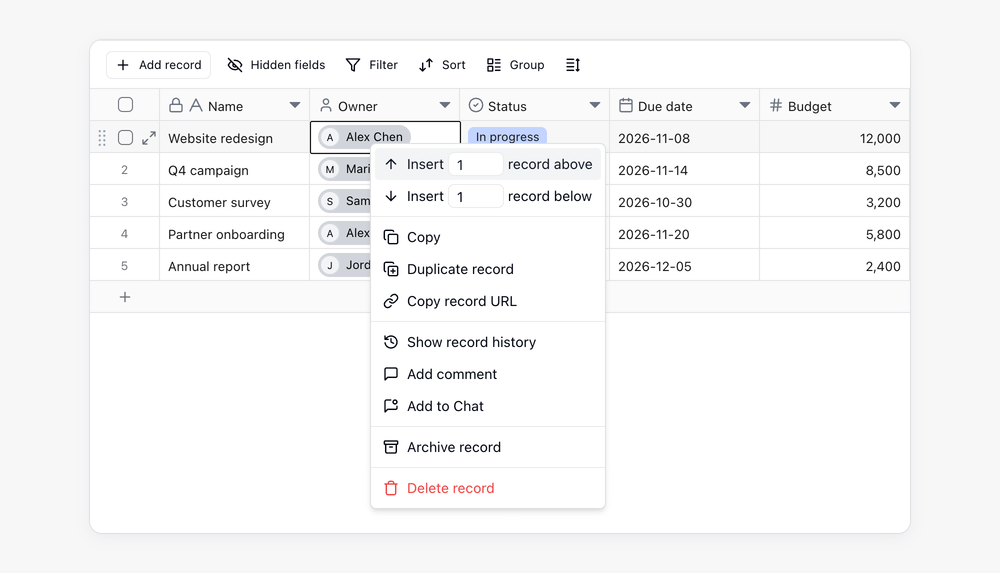
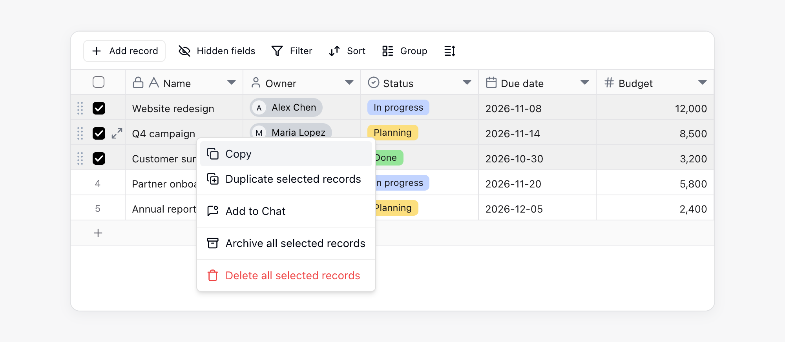
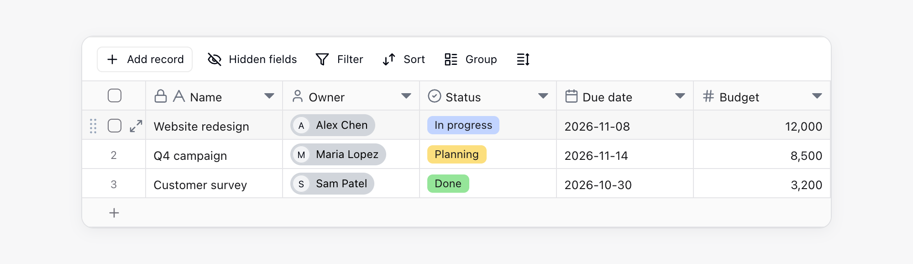
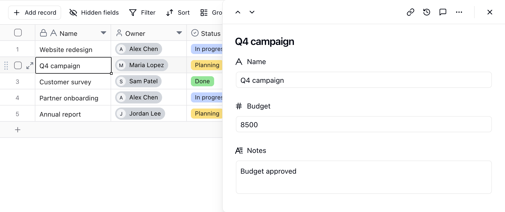

Kayıtlar eksiksiz veri girdilerini saklar. Her kayıt birden fazla alandan oluşur. Örneğin bir müşteri kaydı ad, telefon numarası, sorumlu kişi ve takip durumu içerebilir. Bir sipariş kaydı ise sipariş numarası, müşteri, tutar ve teslimat tarihi içerebilir.

## Temel Kavramlar

| Kavram | Açıklama |
| --- | --- |
| Kayıt | Tablodaki bir veri satırı |
| Alan | Bir kaydın tablo sütununa karşılık gelen özelliği |
| Hücre | Bir kaydın belirli bir alandaki değeri |
| Birincil alan | Bir kaydın ana görünen adı; mobil listelerde ve bağlantılı kayıt seçicilerinde sıkça kullanılır |

## Kayıt Oluşturma

Kayıtları aşağıdaki yöntemlerle oluşturabilirsiniz:

| Giriş noktası | Eylem |
| --- | --- |
| Tablonun altı | Sona kayıt eklemek için tablo görünümünün altındaki `+` düğmesine tıklayın |
| Üst araç çubuğu | Araç çubuğunun solundaki `+ Kayıt ekle` seçeneğine tıklayın |
| Bağlam menüsü | Mevcut bir kayda sağ tıklayıp üstüne veya altına kayıt ekleyin |

## Kayıtları Düzenleme

- **Hücreyi düzenleme**: Herhangi bir hücreye tıklayıp içeriğini girin veya değiştirin.
- **İçeriği temizleme**: Bir veya daha fazla hücre seçip `Delete` veya `Backspace` tuşuna basın.
- **Toplu seçim**: Birden fazla hücreyi veya kaydı seçmek için fareyle sürükleyin, ardından bunları düzenleyin, silin veya kopyalayın.
- **Kopyalama ve yapıştırma**: Bir veya daha fazla hücreyi kopyalayıp yapıştırın. Klavye kısayolunu kullanabilir ya da seçime sağ tıklayıp **Kopyala** seçeneğini belirleyebilirsiniz. Yapıştırılan veride geçerli tablodan daha fazla satır varsa Teable otomatik olarak yeni satırlar ekler.

## Kayıtları Silme

Bir veya daha fazla kayıt seçip sağ tıklayın ve **Kaydı sil**'i seçin. Toplu silme için kayıtları silmeden önce satırların başındaki onay kutularını seçebilirsiniz.

Silinen kayıtlar tablonun çöp kutusuna gider; burada kayıtları inceleyip geri yükleyebilirsiniz. Kayıtları tablodan çıkarmak ancak kullanılabilir durumda tutmak istiyorsanız silmek yerine arşivleyin. Bkz. [Arşiv ve Çöp Kutusu](/tr/basic/record/archive-trash).

<Info>Başka bir tablo kayda **Zorunlu** bir [Bağlantı](/tr/basic/field/link) alanı üzerinden bağlanıyorsa Teable silme işlemini reddeder ve boş kalacak tabloyla alanın adını belirtir. Bu bağlantıyı başka bir kayda yönlendirin, alandaki **Zorunlu** ayarını kaldırın veya bağlantı kuran kayıtlarla bu kaydı birlikte silin.</Info>

## Kayıt Ayrıntıları

Kayıt ayrıntısı panelini tablonun sağında açmak için kayıt satırının başındaki genişletme simgesine tıklayın veya bir kayıt seçip Boşluk tuşuna basın.

Ayrıntı paneli çok sayıda alan içeren kayıtlarda kullanışlıdır. Alanlara dikey olarak göz atabilir, yatay kaydırmayı azaltabilir, alanları düzenleyebilir, yorumları görüntüleyebilir ve kayıt geçmişini denetleyebilirsiniz. Panel açıkken tabloda çalışmaya devam edebilirsiniz; geçerli kaydın satırı vurgulu kalır.

- **Genişliği değiştirme**: Panelin sol kenarını sürükleyin. Genişlik korunur ve diğer tablolardaki kayıtlar için de geçerli olur.
- **Kayıt değiştirme**: Panelin sol üstündeki yukarı ve aşağı oklara tıklayın. Bu, ızgara, kanban, galeri ve takvim görünümlerinde çalışır.
- **Bağlantılı kayıtları görüntüleme**: Bağlantılı kayıt aynı panelde açılır ve üstte bir yol gösterilir. O kayda dönmek için herhangi bir düzeye tıklayın.
- **Kapatma**: Geçerli kaydı kapatmak için `Esc` tuşuna basın, panelin tamamını kapatmak için sağ üstteki **×** simgesine tıklayın.

## İşbirliği ve İzleme

| Özellik | Açıklama |
| --- | --- |
| Yorumlar | Her kaydın belirli verileri tartışmak, ekip arkadaşlarından @bahsetmek veya bağlam eklemek için kendine ait bir yorum alanı vardır. Bkz. [Yorumlar](/tr/basic/record/comment). |
| Kayıt geçmişi | Teable güncellemeleri izleyebilmeniz için kayıt değişikliklerini kaydeder. Bkz. [Kayıt Geçmişi](/tr/basic/record/record-history). |
| Arşiv ve çöp kutusu | Tamamlanmış kayıtları tablodan çıkarın veya silinenleri geri yükleyin. Bkz. [Arşiv ve Çöp Kutusu](/tr/basic/record/archive-trash). |
| Bağlantılı kayıtlar | Tablolar arasındaki kayıtları bağlamak için bir **Bağlantı** alanı kullanın. Bkz. [Bağlantı Alanı](/tr/basic/field/link). |

## Notlar

- Birincil alan, kaydın ana görünen adı olarak kullanılır. Birincil alana not biçimindeki içerik yerine ad, görev başlığı veya sipariş numarası gibi tanınabilir bilgiler girin.
- Her kaydın benzersiz bir kayıt kimliği vardır. Kayıt ayrıntısı panelini açtıktan sonra tarayıcı URL'sinde `rec` ile başlayan dize kayıt kimliğidir.
- Bazı kayıtları düzenleyemiyorsanız yönetici, düzenlenebilir kapsamı **Yetki Matrisi** üzerinden sınırlandırmış olabilir. Bkz. [Yetki Matrisi](/tr/basic/authority-matrix).
