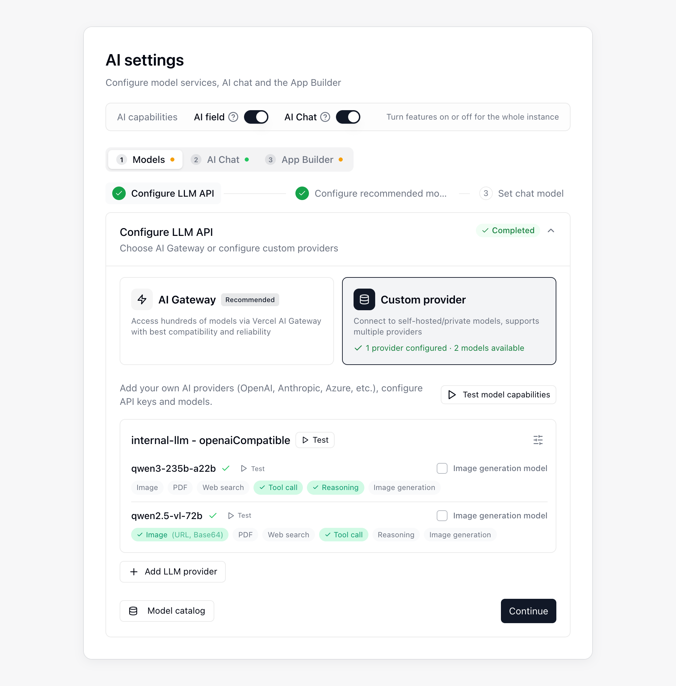

{/* mintlify-resync: 2026-10-22 */}
<Tip>Доступно для самостійно розгорнутого тарифного плану Business та вище</Tip>

Шлях: Системне адміністрування → Налаштування ШІ

Сторінка **Налаштування ШІ** призначена для налаштування **AI Chat**, **Полів ШІ**, **автоматизації з ШІ** та **App Builder**. Угорі сторінки розташовано перемикач **Можливості ШІ**, а нижче налаштування виконується послідовно на вкладках **Моделі**, **ШІ-чат** і **Конструктор застосунків**. Кожна наступна вкладка залежить від попередньої: доки попередню не налаштовано, сторінка підказує, яких налаштувань бракує. Панель **Очікування налаштування** праворуч перелічує обов’язкові елементи, яких бракує; натисніть елемент, щоб перейти до відповідної вкладки й кроку.

## Підготовка

Перш ніж відкрити сторінку налаштувань ШІ, підготуйте наведені нижче елементи.

| Вимога | Коли обов’язкова | Примітки |
|------|------|------|
| **Налаштування середовища виконання агента** | Обов’язкове для AI Chat і App Builder | Використовується AI Chat і App Builder |
| **Власний провайдер** | Обов’язковий, якщо AI Chat або App Builder використовує ваш власний ключ (BYOK) | Використовуйте постачальника **OpenAI Compatible** або **Anthropic** |
| **Ключ API OpenAI** | Необов’язковий | Потрібен лише щоб увімкнути **Голосове введення** в AI Chat |
| **Загальний доступ** | Обов’язковий, якщо вибрано рушій розгортання **Vercel** | Ваш **екземпляр Teable** і **сховище об’єктів (MinIO / S3)** мають бути загальнодоступними для Vercel |

## Етапи налаштування

Майстер налаштування на вкладці **Моделі** складається з трьох кроків для підключення й вибору моделей. Завершені кроки за замовчуванням згорнуто; натисніть крок, щоб розгорнути й змінити його:

<Steps>
  <Step title="Налаштувати API LLM">
    Налаштуйте підключення моделі й виконайте початкову перевірку.
  </Step>
  <Step title="Налаштувати рекомендовані моделі">
    Виберіть рекомендовані моделі для Полів ШІ й автоматизації з ШІ.
  </Step>
  <Step title="Задати модель чату">
    Виберіть модель для кожного з чотирьох рівнів моделей чату.
  </Step>
</Steps>

AI Chat і App Builder також потребують середовища виконання й розгортання застосунків; їх налаштовують відповідно на вкладках **ШІ-чат** і **Конструктор застосунків**. Спочатку виберіть [варіант розгортання](/uk/deploy/choose) і завершіть розгортання, а потім виконайте налаштування, як описано нижче.

### Налаштування API LLM

На кроці **Налаштувати API LLM** натисніть **Додати LLM провайдера**, щоб додати постачальника моделей, і перевірте його моделі. Якщо ви використовуєте власний ключ (BYOK), виберіть тип постачальника **OpenAI Compatible** або **Anthropic**.

Вікно контексту та максимальний вивід за одну відповідь визначаються автоматично за даними розділу **Каталог моделей**, заповнювати їх вручну не потрібно. Щоб перевірити значення, визначені для моделі, відкрийте **Каталог моделей**, виберіть **Область** на вкладці **Перевірка моделі** та вкажіть модель: у розділі **Подробиці параметрів** з’являться контекст, макс. вивід і джерело кожного значення.

Якщо в каталозі немає відповідного запису (наприклад, для щойно випущеної або власної моделі), модель працює зі значеннями з блоку **Збігів немає** на вкладці **Правила зіставлення**: типово вікно контексту 200000 і максимальний вивід 32000, а у розділі **Подробиці параметрів** джерелом обох указано **Правило зіставлення**. Якщо ці значення не відповідають моделі, змініть їх на вкладці **Правила зіставлення** та натисніть **Зберегти**.

### Налаштування рекомендованих моделей

Виберіть рекомендовані моделі, які користувачі зможуть використовувати в **Полях ШІ** й **автоматизації з ШІ**.

### Установлення моделі чату

У розділі **Рівні моделей чату** виберіть модель для рівнів **Ultra**, **Smart**, **Standard** і **Lite**; доступні моделі поділено за джерелом на дві групи, **Vercel AI Gateway** і **Власний провайдер**, причому в групі **Vercel AI Gateway** показано лише рекомендовані моделі, увімкнені на кроці 2. Користувачі вибирають рівень у меню моделей **AI Chat** на бічній панелі й бачать назву рівня, а не моделі, тож модель за рівнем можна замінити будь-коли, і на тих, хто вже вибрав цей рівень, це не вплине.

| Рівень | Опис |
|------|------|
| **Ultra** | Найвищі можливості для складних завдань. Якщо модель не задано, показується **Не пропонується**, і рівень не з’являється в меню моделей користувачів.|
| **Smart** | Основна модель. Її використовують поля ШІ, фонові завдання та будь-який рівень без власної моделі, тож її потрібно задати обов’язково.|
| **Standard** | Повсякденні розмови й загальні завдання, а також фонові завдання середнього обсягу. Якщо модель не задано, використовується **Smart**.|
| **Lite** | Недорога й часта рутинна робота, а також легкі завдання на кшталт створення заголовків чатів. Якщо модель не задано, використовується **Smart**.|

Праворуч від кожного рівня є ще два елементи керування:

- **Зробити за замовчуванням**: рівень, на якому користувачі відкривають меню моделей. **Ultra** без моделі не може бути рівнем за замовчуванням.
- **Увімкнено**: якщо вимкнути, рівень більше не пропонується користувачам. Рівень за замовчуванням вимкнути не можна.

### Налаштування середовища виконання

Середовище виконання налаштовується в розділі **Середовище виконання ШІ-чату** на вкладці **ШІ-чат**. Після завершення розгортання натисніть **Run test**, щоб перевірити середовище виконання AI Chat.

### Увімкнення функцій ШІ

У розділі **Можливості ШІ** вгорі сторінки за потреби ввімкніть **ШІ поле** й **ШІ чат**; перемикачі діють для всього екземпляра. Перш ніж використовувати **ШІ чат**, налаштуйте середовище виконання.

### Налаштування App Builder

На вкладці **Конструктор застосунків** у розділі **Рушій розгортання** виберіть спосіб розгортання застосунків:

| Рушій розгортання | Вимоги до налаштування |
|------|------|
| **Vercel** | Введіть токен доступу Vercel, натисніть **Test Connection** й скористайтеся командою **Перевірити публічний доступ**, щоб підтвердити, що Vercel може отримати доступ до вашого екземпляра Teable і сховища об’єктів. |
| **Teable Infra** | Використовує налаштоване контейнерне середовище виконання Teable Infra. Тут не потрібні додаткові облікові дані або перевірка загального доступу. |

За потреби можна додати такі необов’язкові налаштування App Builder:

| Необов’язковий елемент | Коли він потрібен |
|------|------|
| **Власний домен** | Якщо ви хочете публікувати застосунки у власному домені |
| **Автентифікація застосунків** | Якщо створеним застосункам потрібен вхід через **OTP електронною поштою**, **Google** або **SSO (OIDC)** |

У розділі **Автентифікація застосунків** можна налаштувати постачальників входу для створених застосунків:

- Для **OTP електронною поштою** використовується окрема поштова скринька SMTP, з якої надсилаються листи для підтвердження входу в застосунок.
- Для **Google OAuth** потрібні Client ID і Client Secret. Додайте URI переспрямування, указаний на цій сторінці, до списку авторизованих URI переспрямування в Google Cloud Console.
- **SSO (OIDC)** дає змогу відвідувачам застосунку входити через корпоративного постачальника ідентифікації. Зареєструйте адресу, показану на сторінці, як URI переспрямування у постачальника ідентифікації, а потім заповніть поля **URL авторизації**, **URL токена**, **URL інформації користувача**, **Client ID** і **Client Secret**. Якщо поле **Scope** залишити порожнім, використовується `openid email profile`. Після зміни збереженого **URL токена** потрібно знову ввести **Client Secret**.

Вхід через **Teable** доступний за замовчуванням. Варіант **Email OTP** з’являється в App Builder лише після завершення налаштування SMTP, **Google** — лише після налаштування обох облікових даних OAuth, а **SSO (OIDC)** — лише після заповнення всіх полів SSO, крім Scope.

Параметр **Автоматично впроваджувати ключ API ШІ в застосунки** у розділі **Налаштування застосунків** увімкнено за замовчуванням, тому застосунки можуть викликати моделі ШІ платформи. Якщо вимкнути його, застосунки більше не матимуть до них доступу.

Якщо після оновлення старі застосунки не відкриваються в попередньому перегляді або не публікуються, у розділі **Інструменти обслуговування** → **Сумісність зі старими проєктами** натисніть **Запустити відновлення**, щоб автоматично відновити відсутні файли.

### Необов’язково. Налаштування голосового введення

Щоб використовувати голосове введення в AI Chat, на вкладці **ШІ-чат** увімкніть **Голосове введення** та введіть **Ключ API OpenAI**. Налаштовуйте поле **Ендпоінт транскрипції** лише під час використання власного сервісу транскрибування; після зміни збереженого значення в полі **Ендпоінт транскрипції** потрібно знову ввести **Ключ API OpenAI**. Також можна обмежити тривалість запису й кількість запитів за хвилину.

### Перевірка налаштування

Завершивши налаштування, спочатку переконайтеся, що всі обов’язкові елементи на панелі **Очікування налаштування** позначені зеленим. Потім по черзі перевірте **AI Chat**, **Поля ШІ**, **автоматизацію з ШІ** та **App Builder**.

## Поширені запитання

<AccordionGroup>
<Accordion title="З’являється помилка про перевищення кредитів">

Перевірте обліковий запис або постачальника, якого використовує налаштований сервіс моделей. За потреби поповніть баланс або змініть конфігурацію моделі.
</Accordion>

</AccordionGroup>
