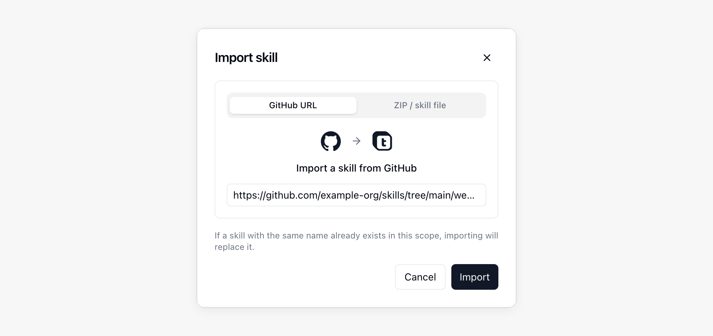
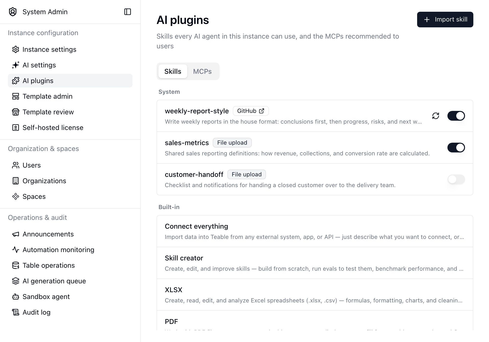

{/* mintlify-resync: 2026-11-13 */}

<Tip>Доступно для самостійно розгорнутого тарифного плану Business та вище</Tip>

Шлях: Системне адміністрування → ШІ-плагіни

На вкладці **Skills** сторінки **ШІ-плагіни** публікуються навички для всього екземпляра; вкладка **MCPs** керує MCP, рекомендованими користувачам. Додана тут навичка доступна в кожній розмові AI Chat, App Builder і ботів, тому використовуйте цей рівень для методів роботи, які ваша організація має застосовувати за замовчуванням, наприклад корпоративного стилю текстів, стандарту звітності або спільної процедури інтеграції.

Навички, додані користувачами в інших місцях, залишаються у відповідній області. Докладніше про особисті навички й навички Проєкту та Простору див. у розділі [AI Chat](/uk/basic/ai/ai-chat).

## Рекомендовані MCP

Список **Рекомендовані** на вкладці **MCPs** визначає, які рекомендовані сервери користувачі бачать у **Налаштування** → **Інтеграції** → **Додати MCP**. Їх можна вмикати й вимикати по одному або вимкнути всі одразу кнопкою **Вимкнути всі** (коли всі вимкнено, кнопка змінюється на **Увімкнути всі**). Вимкнений сервер зникає зі списку рекомендованих; сервери, які користувачі вже додали, не зачіпаються. Якщо вимкнено всі, користувачі перестають бачити **Рекомендовані**.

## Додавання навички

Натисніть **Імпортувати навичку** й виберіть її джерело:

| Джерело | Що потрібно надати |
| --- | --- |
| **URL GitHub** | Посилання на папку навички або на файл `SKILL.md` у ній, наприклад `https://github.com/owner/repo/tree/main/skills/my-skill`. Якщо навичка лежить у корені репозиторію, достатньо вставити посилання на репозиторій |
| **ZIP-файл** | Файл `.zip` або `.skill`, що містить `SKILL.md` |

Якщо навичка з такою назвою вже існує в цій області, імпорт замінить її.

## Керування опублікованими навичками

У списку навички згруповано за областю та вказано джерело кожної з них. Вбудовані навички наведено внизу для довідки; їх не можна редагувати.

- Скористайтеся перемикачем у рядку, щоб увімкнути або вимкнути навичку без її видалення. Вимкнена навичка залишається в списку, але не пропонується агентам.
- Для навички, імпортованої з GitHub, натисніть кнопку оновлення, щоб отримати найновішу версію з її джерела.
- Натисніть рядок, щоб прочитати файл `SKILL.md`, змінити назву й опис навички, завантажити її, замінити файли або видалити.

<Info>Лише адміністратори екземпляра можуть додавати, змінювати або видаляти навички на цій сторінці. Кожен користувач, який увійшов у систему, може використовувати опубліковані навички у своїх розмовах.</Info>

## Якщо назва використовується двічі

Опублікована тут навичка є стандартною для екземпляра. Якщо навичка Проєкту, Простору, користувача, застосунку або бота має таку саму назву, у цій розмові діє навичка з вужчою областю, а навичка екземпляра ігнорується.
