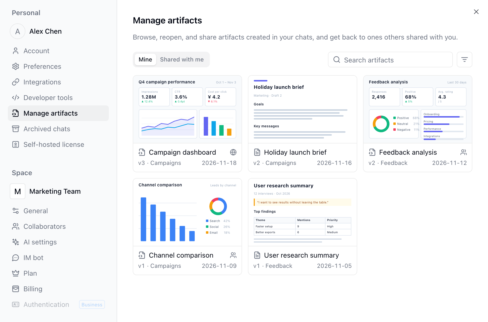

Коли ШІ створює в чаті діаграму, звіт, сторінку у стилі інформаційної панелі або невеликий інструмент на кшталт калькулятора, він зберігає результат як **артефакт** — окрему сторінку, що відображається поза розмовою: інтерактивну HTML-сторінку або звіт Markdown. У чаті артефакт має вигляд картки й залишається доступним і після завершення розмови.

Щоб отримати артефакт, опишіть потрібний результат в [AI Chat](/uk/basic/ai/ai-chat), наприклад «Створи діаграму тижневого тренду продажів» або «Створи зведений звіт із цих Записів». Артефакти, створені під час запуску [рутини](/uk/basic/ai/routine), належать відповідальному за цей запуск.

<Info>
Артефакт містить дані, які ШІ додав до нього під час створення, тому самостійно не оновлюється, а сама сторінка не може читати чи змінювати Таблиці. Для сторінки, яка постійно отримує актуальні дані Таблиці або збирає введені дані й зберігає стан, створіть застосунок за допомогою [App Builder](/uk/basic/ai/app-builder).
</Info>

## Перегляд і зміна

Натисніть картку в чаті, щоб відкрити засіб перегляду артефакту. У ньому можна:

- вибрати **На весь екран** або **Відкрити на новій сторінці**, щоб надати артефакту більше місця;
- **Завантажити** версію, яку ви зараз переглядаєте: HTML-сторінка завантажується як файл `.html`, звіт Markdown — як файл `.md`;
- відкрити список версій і переглянути попередні версії;
- **Видалити** артефакт. Видалення не можна скасувати: картки в розмові перетворяться на заглушку видаленого артефакту, а посилання для поширення одразу перестане працювати.

Щоб змінити артефакт, зверніться до ШІ в тій самій розмові. Кожна зміна стає новою версією того самого артефакту, а не окремим об’єктом, тому посилання для поширення продовжує працювати. Якщо відкрити попередню версію й натиснути **Відновити цю версію**, її вміст буде додано як нову версію, а пізніші версії збережуться.

Якщо сторінка не запускається, угорі засобу перегляду з’являється повідомлення про помилку. Натисніть **Виправити за допомогою ШІ**: Teable створить новий чат у проєкті, якому належить артефакт, і передасть помилку ШІ. Натисніть **Переглянути** у сповіщенні, щоб перейти до чату виправлення та стежити за перебігом роботи.

## Поширення артефакту

За замовчуванням артефакт бачить лише його творець — навіть інші учасники того самого проєкту його не бачать. Щоб показати артефакт іншим, увімкніть поширення.

<Steps>
  <Step title="Увімкніть поширення">
    Натисніть **Поділитися** в засобі перегляду й увімкніть **Увімкнути доступ**. Після цього інші зможуть відкрити артефакт за його посиланням.
  </Step>
  <Step title="Виберіть, хто може переглядати">
    За замовчуванням для параметра **Хто може переглядати** вибрано **Усі, хто має посилання**: артефакт відкривається без входу в обліковий запис. Якщо вибрати **Учасники простору**, відкрити його зможуть лише учасники цього простору або цього проєкту, які ввійшли в обліковий запис.
  </Step>
  <Step title="Додайте пароль (необов’язково)">
    У розділі **Додатково** увімкніть **Захист паролем**, і Teable автоматично згенерує пароль. Глядачі мають ввести його, перш ніж побачать вміст. Пароль показано лише одразу після створення, тож відразу натисніть **Копіювати посилання та пароль**, щоб скопіювати їх разом. Пізніше можна натиснути **Встановити пароль**, щоб задати власний пароль або змінити його; після зміни глядачам знадобиться новий пароль.
  </Step>
  <Step title="Надішліть посилання">
    Натисніть кнопку **Скопіювати посилання** поруч із посиланням. Якщо посилання потрапило до ширшого кола, ніж потрібно, вимкніть **Увімкнути доступ** — посилання перестане працювати для інших. Після повторного ввімкнення посилання залишається тим самим, як і налаштування доступу та пароля. Щоб закрити доступ тим, хто вже має посилання, одразу після ввімкнення виберіть **Учасники простору** або увімкніть **Захист паролем** і змініть пароль.
  </Step>
</Steps>

За посиланням завжди відкривається найновіша версія, попередні версії глядачам недоступні. Цю версію також можна завантажити кнопкою **Завантажити** на сторінці. Посилання на артефакт з увімкненим поширенням також можна вбудувати на інший сайт через iframe.

Приклади використання цієї функції наведено в статті «[приклади звітів ШІ зі спільним доступом](https://teable.ai/uk/blog/introducing-artifacts-share-data-reports-anywhere)».

## Як знайти артефакти пізніше

Відкрийте аватар унизу ліворуч → **Налаштування** → **Керування артефактами**. Цей список також можна відкрити з чату через **+** → **Більше** → **Керування артефактами**.

- **Мої**: створені вами артефакти у вигляді карток; угорі кожної картки — мініатюра першого екрана сторінки, а значок на картці показує, кому відкрито доступ. У меню **...** картки доступні **Поділитися**, **Завантажити**, **Відкрити на новій сторінці** і **Видалити**, а натискання картки відкриває засіб перегляду.
- **Доступні мені**: артефакти, якими колеги поділилися з варіантом **Учасники простору** (вони видні, якщо ви належите до цього простору або проєкту, відкривати посилання заздалегідь не потрібно), а також артефакти з доступом **Усі, хто має посилання**, які ви відкривали, увійшовши в обліковий запис. На картці вказано, хто поділився, а натискання відкриває артефакт у новій вкладці. Якщо поширення вимкнено, воно більше не охоплює вас або артефакт видалено, елемент більше не відображається.

Обидві вкладки впорядковано за останнім оновленням, шукати можна за назвою або за тим, хто поділився. Кнопка **Фільтр** поруч із полем пошуку дає змогу фільтрувати за **Хто може переглядати** (на вкладці **Мої** є ще **Без доступу**) і **Проєкт**; видалені проєкти та проєкти, до яких у вас більше немає доступу, об’єднано у варіант **Недоступні проєкти**.

На вкладці **Артефакти** [панелі ресурсів](/uk/basic/ai/ai-chat#перегляд-ресурсів-поруч-із-чатом) за замовчуванням зібрано ваші артефакти в поточному просторі та артефакти, якими колеги поділилися з учасниками простору. Кнопка **Фільтр** звужує список за **Автор** (**Створені мною** або **Поділилися інші**) і **Проєкт** (наприклад, **Поточний проєкт**). Ваші артефакти відкриваються в панелі ресурсів, а артефакти колег — на новій сторінці.

## Поширені запитання

<AccordionGroup>
  <Accordion id="artifact-sharing-faq" title="Чи можуть колеги відкрити створений мною артефакт?">
    За замовчуванням — ні, навіть якщо вони працюють у тому самому проєкті. Увімкніть **Увімкнути доступ** у засобі перегляду й надішліть їм посилання. Якщо артефакт має залишатися в межах простору, виберіть для **Хто може переглядати** значення **Учасники простору**. Учасники простору також знайдуть його на вкладці **Доступні мені** в розділі **Керування артефактами**.
  </Accordion>

  <Accordion title="Чим артефакт відрізняється від застосунку з App Builder?">
    Артефакт — це знімок даних на момент створення ШІ, він підходить для разових звітів, діаграм і результатів аналізу. Застосунок читає й змінює Таблиці в реальному часі, може збирати введені дані та зберігати стан, тому підходить для інструментів і сторінок, якими користуються постійно.
  </Accordion>

  <Accordion title="Чи витрачає створення артефакту кредити?">
    Створення та зміна артефакту — частина AI Chat, тому кредити витрачаються відповідно до фактичного використання в розмові. Перегляд, поширення й завантаження кредитів не витрачають.
  </Accordion>
</AccordionGroup>
