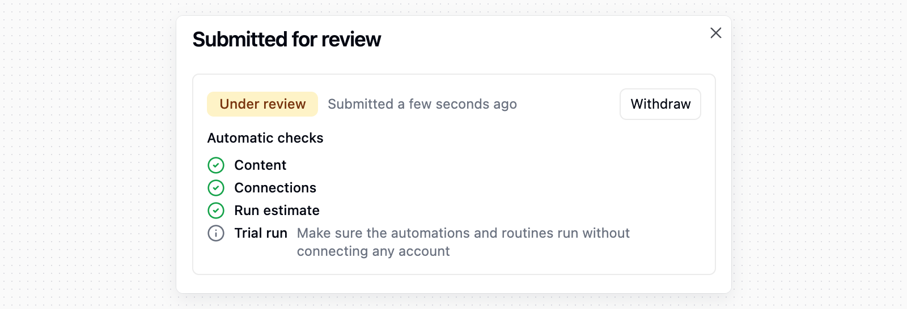

Для шаблону створюється окремий **Проєкт шаблону**. Ви вибираєте, чим поділитися з робочого Проєкту, і Teable копіює структуру вибраного до Проєкту шаблону. Вихідний Проєкт і його дані не змінюються й ніколи не публікуються.

## Створення шаблону

На бічній панелі Проєкту клацніть правою кнопкою миші таблицю, застосунок, автоматизацію або папку й виберіть **Зробити шаблоном**. Щоб вибирати з усього Проєкту, натисніть назву Проєкту в лівому верхньому куті й виберіть **Зробити шаблоном**.

Якщо ви почали з меню елемента, цей елемент уже позначено; якщо з назви Проєкту — позначте в списку, що взяти. Таблиці, які використовує застосунок, автоматизація чи інформаційна панель, додаються самі, а причину вказано праворуч. Усе інше зібрано в розділі **Залишається: N**; розгорніть його, щоб позначити ще. Перевірте назву й натисніть **Створити проєкт шаблону**.

Проєкт шаблону копіює лише структуру: записи не переносяться, автоматизації спочатку вимкнені, а зв’язок із таблицею, яка не переноситься, стає текстом. Потрібен дозвіл **Творець** або вищий і у вихідному Проєкті, і в Просторі. У Проєкту, який раніше публікувався напряму й досі є в центрі шаблонів, у меню назви Проєкту замість цього пункту показано **Опублікувати в центрі шаблонів**; щоб зробити з нього новий шаблон, почніть із меню елемента на бічній панелі.

## Підготовка Проєкту шаблону

Після натискання **Створити проєкт шаблону** Teable відкриває новий Проєкт шаблону. Біля його назви стоїть мітка **Шаблон**, а вгорі бічної панелі показано статус, звідки його взято (**З «Продажі»**, бачите лише ви), а також **Спробувати** й **Надіслати на перевірку**.

Потім Cuppy знаходить те, що належить лише вам, показує, чим замінить кожен пункт, замінює їх після вашого підтвердження, а тоді додає демонстраційні записи й складає чернетку посібника зі встановлення. Демонстраційні записи можна додати й самостійно: під час надсилання записи з Проєкту шаблону вирушають разом із шаблоном як його демонстраційні дані.

## Пробна копія

Натисніть **Спробувати**, і Teable створить пробну копію так само, як під час встановлення, і відкриє її — ви побачите те, що отримають інші. Щоб повернутися, натисніть **Назад до проєкту шаблону**, а коли копія вже не потрібна — **Видалити пробну копію**. Якщо спробувати знову, ваша попередня пробна копія переноситься до кошика.

## Надсилання на перевірку

Натисніть **Надіслати на перевірку**, укажіть назву, опис і обкладинку та виберіть, що відкриватиметься за замовчуванням після встановлення. Надсилається весь Проєкт шаблону: розділ **Опублікувати вузли** показує, скільки елементів і демонстраційних записів буде надіслано.

Блок **Перевірки перед поданням** праворуч не пропускає те, що належить лише вам: імена, адреси електронної пошти й поштові домени компанії людей, які можуть відкрити Простір або Проєкт, а також текст, схожий на ключ API. Замініть їх або натисніть **Виправити**, щоб їх замінив Cuppy. Кнопка **Це приклади** позначає все перелічене як приклади й пропускає, тож натискайте її, лише якщо все це вигадане.

Коли в рядку **Вміст** з’явиться зелена галочка, натисніть **Надіслати на перевірку**. Інші рядки — нагадування й не заважають надсиланню.

Рядок **Посібник** у цьому вікні додає до шаблону кілька кроків налаштування. Кожен крок має заголовок, опис в один рядок, місце, яке потрібно відкрити, і умову виконання. Складіть його за допомогою **Скласти з Teable AI** або скористайтеся **Змінити в проєкті**. Умови: демонстраційні дані замінено реальними, застосунок опубліковано, автоматизацію один раз успішно виконано, потрібні облікові записи підключено або користувач позначив крок сам. Умова щодо даних не повинна вже виконуватися на демонстраційних записах, інакше шаблон неможливо надіслати.

## Перевірка й публікація

Після надсилання відкривається вікно **Надіслано на перевірку**, де до завершення перевірки можна натиснути **Відкликати**. На бічній панелі відображається **На перевірці**; натисніть **Переглянути подання**, щоб побачити, що ви надіслали.

Після схвалення шаблон з’являється в центрі шаблонів, а на бічній панелі відображається **Опубліковано · v1**. Якщо шаблон повернуть, на бічній панелі з’явиться **Повернуто на доопрацювання**, а в сповіщенні будуть примітки рецензента; внесіть зміни й натисніть **Надіслати знову**.

Після публікації продовжуйте редагувати той самий Проєкт шаблону й натисніть **Надіслати v2**, щоб надіслати нову версію. Доки нову версію не схвалено, під час встановлення шаблону інші отримують поточну.

## Проєкти шаблонів на головній сторінці Простору

Головна сторінка Простору має дві вкладки: **Проєкти** та **Проєкти шаблонів**. На вкладці **Проєкти шаблонів** видно статус і джерело кожного шаблону; розгорніть рядок, щоб побачити його вміст і пробну копію. Щоб почати з порожнього Проєкту, натисніть **Новий проєкт шаблону** у правому верхньому куті цієї вкладки.

<Note>Якщо перенести Проєкт шаблону до кошика, опублікований шаблон знімається з публікації в центрі шаблонів, і відновлення Проєкту з кошика не публікує його знову. Подання, що перебуває на перевірці, відкликається, а ваші пробні копії теж переносяться до кошика. Копій, які вже встановили інші, це не стосується.</Note>
