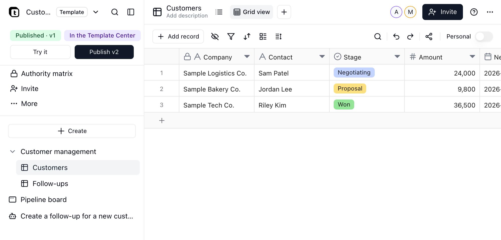

Для шаблону створюється окремий **Проєкт шаблону**. Ви вибираєте, чим поділитися з робочого Проєкту, і Teable копіює структуру вибраного до Проєкту шаблону. Вихідний Проєкт і його дані не змінюються й ніколи не публікуються.

## Створення шаблону

На бічній панелі Проєкту клацніть правою кнопкою миші таблицю, застосунок, автоматизацію або папку й виберіть **Зробити шаблоном**. Щоб вибирати з усього Проєкту, натисніть назву Проєкту в лівому верхньому куті й виберіть **Зробити шаблоном**.

Якщо ви почали з меню елемента, цей елемент уже позначено; якщо з назви Проєкту — позначте в списку, що взяти. Таблиці, які використовує застосунок, автоматизація чи інформаційна панель, додаються самі, а причину вказано праворуч. Усе інше зібрано в розділі **Залишається: N**; розгорніть його, щоб позначити ще. Перевірте назву й натисніть **Створити проєкт шаблону**.

Проєкт шаблону копіює лише структуру: записи не переносяться, автоматизації спочатку вимкнені, а зв’язок із таблицею, яка не переноситься, стає текстом. Потрібен дозвіл **Творець** або вищий і у вихідному Проєкті, і в Просторі. У Проєкту, який раніше публікувався напряму й досі є в центрі шаблонів, у меню назви Проєкту замість цього пункту показано **Опублікувати в центрі шаблонів**; щоб зробити з нього новий шаблон, почніть із меню елемента на бічній панелі.

## Підготовка Проєкту шаблону

Після натискання **Створити проєкт шаблону** Teable відкриває новий Проєкт шаблону. Після його назви стоїть мітка **Шаблон**, а вгорі бічної панелі показано статус, джерело (**З «Продажі»**, видно лише вам), **Спробувати** й **Опублікувати шаблон**.

Потім Cuppy знаходить те, що належить лише вам, показує, чим замінити кожен елемент, замінює їх після вашого підтвердження, додає демонстраційні записи й складає чернетку посібника з установлення. Демонстраційні записи можна додати й самостійно: під час публікації записи Проєкту шаблону публікуються як демонстраційні дані шаблону.

## Пробна копія

Натисніть **Спробувати**, і Teable створить пробну копію так само, як під час встановлення, і відкриє її — ви побачите те, що отримають інші. Щоб повернутися, натисніть **Назад до проєкту шаблону**, а коли копія вже не потрібна — **Видалити пробну копію**. Якщо спробувати знову, ваша попередня пробна копія переноситься до кошика.

## Публікація шаблону

Натисніть **Опублікувати шаблон**, укажіть назву й опис, завантажте обкладинку та виберіть, що відкриватиметься за замовчуванням після встановлення. Обкладинка й опис обов’язкові: їх показано, коли посиланням на шаблон діляться. Публікується весь Проєкт шаблону: розділ **Опублікувати вузли** показує, скільки елементів і демонстраційних записів буде опубліковано.

Блок **Перевірки перед публікацією** праворуч не пропускає те, що належить лише вам: імена, адреси електронної пошти й поштові домени компанії людей, які можуть відкрити Простір або Проєкт, а також текст, схожий на ключ API. Замініть їх або натисніть **Виправити**, щоб їх замінив Cuppy. Кнопка **Це приклади** позначає все перелічене як приклади й пропускає, тож натискайте її, лише якщо все це вигадане.

Коли в рядку **Вміст** з’явиться зелена позначка, натисніть **Опублікувати шаблон**. Решта рядків — нагадування, вони не заважають публікації.

Рядок **Посібник** у цьому вікні додає до шаблону кілька кроків налаштування. Кожен крок має заголовок, опис в один рядок, місце, яке потрібно відкрити, і умову виконання. Складіть його за допомогою **Скласти з Teable AI** або скористайтеся **Змінити в проєкті**. Умови: демонстраційні дані замінено реальними, користувач додав власний запис, застосунок опубліковано, автоматизацію один раз успішно виконано, потрібні облікові записи підключено або користувач сам позначив крок виконаним. Умова щодо даних не повинна вже виконуватися на демонстраційних записах, інакше шаблон неможливо опублікувати.

## Після публікації

Шаблон стає доступним одразу після натискання **Опублікувати шаблон**: відкривається вікно **Успішно опубліковано!** з міткою **Опубліковано · v1** і посиланням на шаблон. Будь-хто з посиланням може одразу відкрити й установити шаблон. Скопіюйте посилання або поділіться ним.

Після публікації шаблон проходить перевірку. Вона вирішує лише, чи буде шаблон у центрі шаблонів, і не впливає на посилання та встановлення. Коли шаблон додано, на бічній панелі з’являється ще й **У центрі шаблонів**. Якщо його не додали, ви отримаєте сповіщення, а посилання й далі можна відкривати, встановлювати й надсилати.

Далі продовжуйте вносити зміни в той самий Проєкт шаблону й натисніть **Опублікувати v2**, щоб опублікувати нову версію. Вона теж одразу стає доступною, і нові встановлення отримують її. Якщо шаблон є в центрі шаблонів, там теж показано нову версію, а перевірка відбувається після.

Щоб прибрати шаблон, натисніть **Зняти з публікації** у вікні публікації. Посилання перестане відкриватися, а центр шаблонів більше не показуватиме його. Копії, які вже встановили інші, не зачіпаються, а опублікувати шаблон знову можна пізніше.

## Проєкти шаблонів на головній сторінці Простору

Головна сторінка Простору має дві вкладки: **Проєкти** та **Проєкти шаблонів**. На вкладці **Проєкти шаблонів** видно статус і джерело кожного шаблону; розгорніть рядок, щоб побачити його вміст і пробну копію. Щоб почати з порожнього Проєкту, натисніть **Новий проєкт шаблону** у правому верхньому куті цієї вкладки.

<Note>Якщо перемістити Проєкт шаблону до кошика, його шаблон теж знімається з публікації: посилання перестає відкриватися, центр шаблонів його більше не показує, а відновлення Проєкту з кошика не публікує його знову. Ваші пробні копії теж переміщуються до кошика. Копії, які встановили інші, не зачіпаються.</Note>
