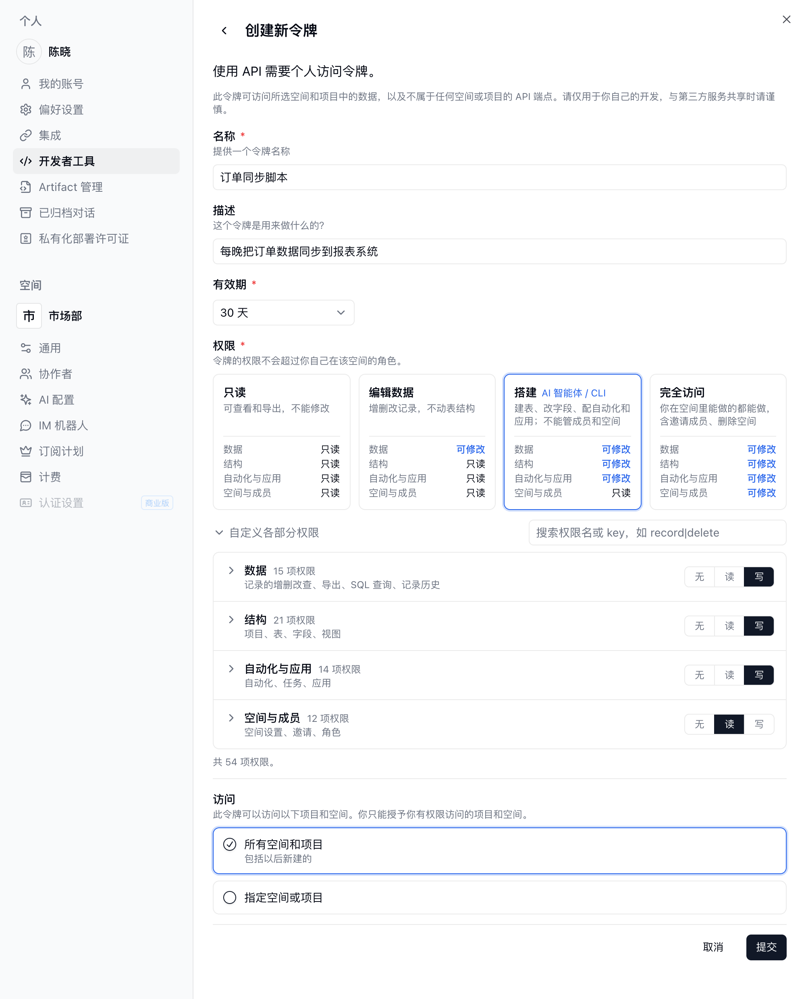
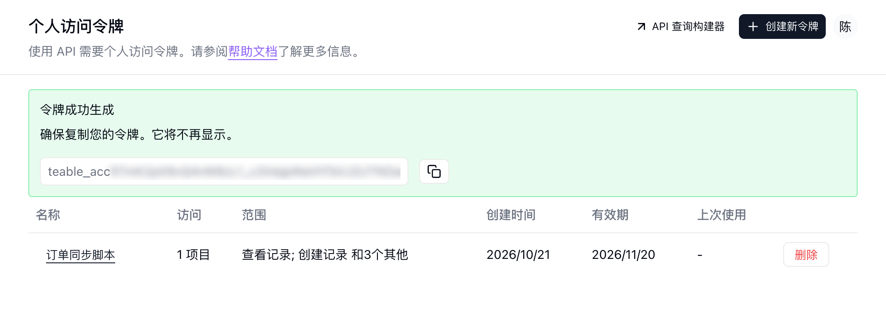

{/* mintlify-resync: 2026-10-22 */}

个人访问令牌适合脚本、内部工具、服务端集成等场景。

如果你要做面向外部用户的多租户集成，更推荐使用 OAuth：见 [OAuth 应用](/zh/api-doc/oauth)。

## 创建令牌

1. 点击左下角头像，打开 **设置** → **开发者工具** → **个人访问令牌**（也可直接进入[令牌管理页面](https://app.teable.cn/setting/personal-access-token)），点击 **创建新令牌**。

2. 为您的令牌选择一个有效期，注意该有效期无法修改。

3. 在 **权限** 中选择一个档位。新令牌默认选中 **搭建**：

   | 档位 | 可以做什么 |
   | --- | --- |
   | **只读** | 查看和导出，不修改任何内容 |
   | **编辑数据** | 增删改记录，不修改表结构 |
   | **搭建** | 建表、改字段、配置自动化和应用，不能管理成员和空间；适合 AI 智能体和 CLI |
   | **完全访问** | 你在空间里能做的都能做，包括邀请成员和删除空间 |

   需要细调时，展开 **自定义各部分权限**，分别为 **数据**、**结构**、**自动化与应用**、**空间与成员** 选择 **无**、**读** 或 **写**。令牌的权限不会超过你自己在该空间的角色。

4. 在 **访问** 中，选择 **所有空间和项目** 授权令牌访问当前和以后新建的所有空间与项目；如只需访问部分资源，选择 **指定空间或项目**，再点击 **添加项目或空间** 选择具体的项目或空间。



<Note>一旦您的令牌创建成功，我们只会向您显示一次，我们建议您将其复制粘贴到你认为安全的地方进行存储。</Note>



## 使用令牌

将令牌放到 `Authorization` 请求头中：

```bash
curl -H 'Authorization: Bearer __token__' \
  'https://app.teable.cn/api/table/__tableId__/record'
```

需要获取 `tbl...` 这类 ID？见 [如何获取 ID](/zh/api-doc/get-id)。
