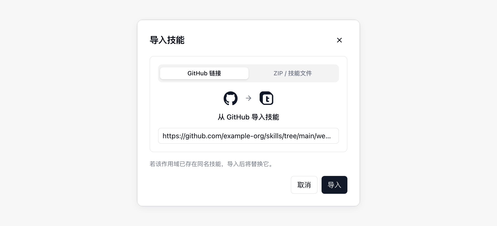
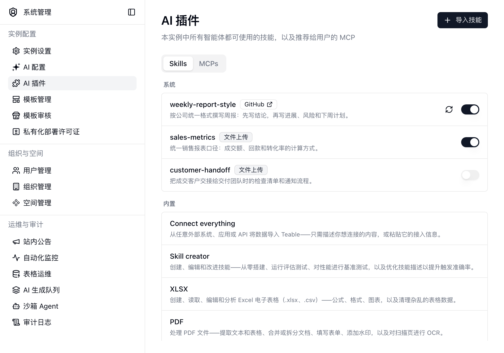

{/* mintlify-resync: 2026-11-13 */}

<Tip>私有化部署商业版及以上适用</Tip>

路径：系统管理 → AI 插件

**AI 插件** 页面的 **Skills** 标签页可以为整个实例发布技能；**MCPs** 标签页管理推荐给用户的 MCP。在这里添加的技能，会出现在所有 AI 对话、应用构建器和机器人会话中，适合放置组织内需要统一遵循的做法，例如统一的写作风格、报表口径或对接流程。

用户在其他位置添加的技能仍然只在各自作用域内生效。个人、项目和空间技能请参阅 [AI 对话](/zh/basic/ai/ai-chat)。

## 推荐的 MCP

**MCPs** 标签页的 **推荐** 列表控制用户在 **设置** → **集成** → **添加 MCP** 中看到哪些推荐服务器，可以逐个开关，也可以点击 **全部关闭** 一次关掉全部（全部关闭后，按钮变为 **全部开启**）。关闭的服务器不再出现在推荐列表里，用户已经添加的不受影响；全部关闭后，用户那边不再显示 **推荐**。

## 添加技能

点击 **导入技能**，选择技能来源：

| 来源 | 需要提供的内容 |
| --- | --- |
| **GitHub 链接** | 技能目录或其中 `SKILL.md` 文件的链接，例如 `https://github.com/owner/repo/tree/main/skills/my-skill`。技能放在仓库根目录时，直接粘贴仓库链接即可 |
| **ZIP / 技能文件** | 包含 `SKILL.md` 的 `.zip` 或 `.skill` 文件 |

如果当前作用域中已存在同名技能，导入会覆盖原有技能。

## 管理已发布的技能

列表按作用域分组，并标注每个技能的来源。内置技能列在最下方，仅供参考，不可编辑。

- 用行末的开关启用或停用技能，不必删除。停用后技能仍留在列表中，但不会提供给智能体使用。
- 从 GitHub 导入的技能，可以点击刷新按钮从来源同步最新版本。
- 点击某一行可以查看 `SKILL.md`，修改名称和描述，下载、替换文件或删除该技能。

<Info>只有实例管理员可以在此页面添加、修改或删除技能。已发布的技能对所有已登录用户可用。</Info>

## 出现同名技能时

在这里发布的技能是实例默认值。如果项目、空间、个人、应用或机器人中存在同名技能，则在对应会话中以范围更小的技能为准，实例技能不再生效。
