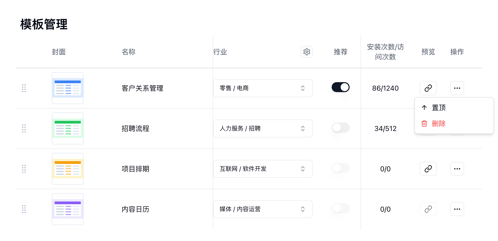

{/* mintlify-resync: 2026-10-22 */}

<Tip>私有化部署商业版及以上适用</Tip>

### 模板管理

模板来自成员发布：成员发布模板后，模板链接立即可以打开和安装；管理员在 **模板审核** 中收录后，模板才会上架并显示在模板中心。管理员可以在这里调整模板信息、上架状态和排序。

#### 模板信息

* **封面**：模板卡片显示的封面图片
* **名称** 和 **描述**：在模板中心显示的标题和简短介绍
* **Markdown 描述**：支持 Markdown 格式的详细介绍
* **行业**：按行业和细分行业对模板分组，也可以按团队分组。点击列标题旁的设置图标打开 **行业与团队管理**，可以新建行业、细分和团队
* **网址标识**：模板公开页网址中的标识，只能使用小写字母、数字和连字符
* **推荐**：在模板中心推荐该模板。模板上架后才能开启
* **集成**：模板中的自动化需要连接的平台。用户安装后会被引导完成这些连接
* **快照时间**：模板内容最近一次发布的时间
* **创建者**：发布该模板的用户
* **安装次数** / **访问次数**：模板被安装和被访问的次数

#### 模板操作

* **上架**：控制模板是否在模板中心可见，不影响模板链接和安装。需要已有快照，且名称和描述不为空
* **预览**：在新标签页中打开模板
* **置顶**：将模板移到列表顶部。也可以拖动行首的手柄调整顺序
* **删除**：移除模板

如需更新模板内容，请在源项目中再次打开发布窗口，点击 **发布 v\{版本号\}**。新版本立即上线，其他人安装到的就是新版本；已上架的模板随后回到审核队列。

### 审核模板

在 **系统管理** > **模板审核** 的 **审核队列** 中查看待审核的模板，包括作者、发布时间和自动检查结果。自动检查只作提醒，不影响审核：**连接** 提示模板用到当前部署无法连接的集成；**隐私** 提示模板带有记录，需要确认其中没有个人信息；**运行量估算** 提示每月运行量可能超出免费额度；**试运行** 提示自动化不需要任何账号，请确认不连接账号也能运行。点击 **查看** 可以打开模板详情、预览副本，并为模板选择行业。

* **收录**：在模板中心展示当前版本。作者之后发布的新版本会直接上线，并回到审核队列
* **暂不收录**：模板不在模板中心展示，已收录的会移出；链接照常能打开和安装

两种操作都可以填写备注，结果都会通知作者。

### 使用官方模板

私有化部署用户可以导入 Teable 官方云端的模板：

1. **下载**：从 [官方模板中心](https://teable.cn/templates) 下载 Teable 项目导出文件（`.tea`）
2. **导入**：将 `.tea` 文件作为新项目导入到您的空间中
3. **做成模板**：在导入的项目中点击左上角的项目名称，选择 **做成模板**，勾选要带走的内容后点击 **生成模板项目**。模板项目只复制结构，不带记录，需要示例数据时在模板项目中补上，详见[把项目做成模板](/zh/basic/template)
4. **填写信息**：在模板项目侧栏点击 **发布模板**，填写名称和详细介绍，上传封面
5. **发布并收录**：点击 **发布模板**，然后在 **系统管理** > **模板审核** 中点击 **收录**。模板随即上架，并出现在 **系统管理** > **模板管理** 中
