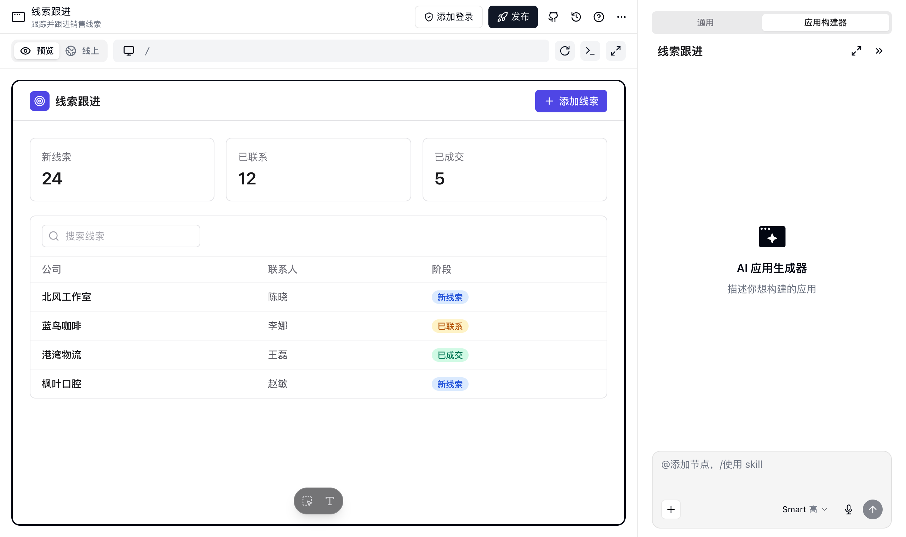
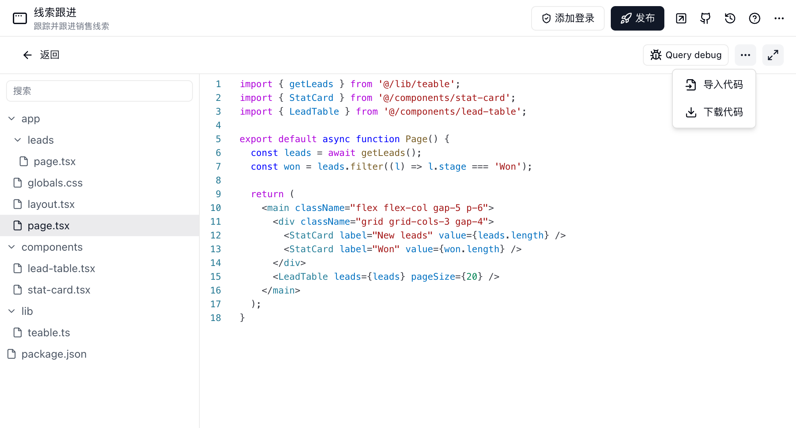
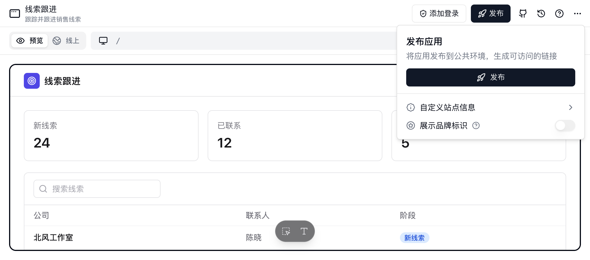
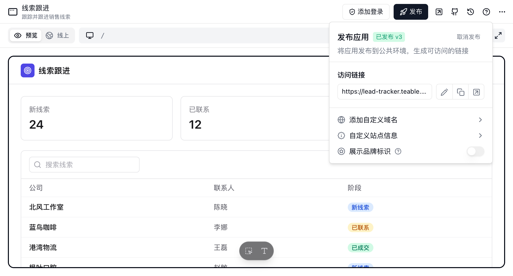
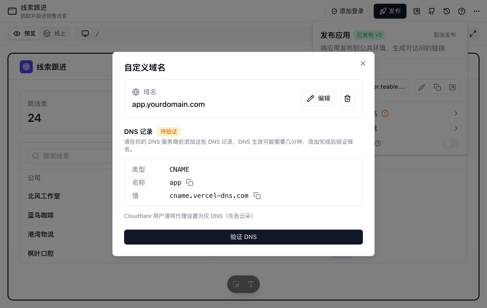
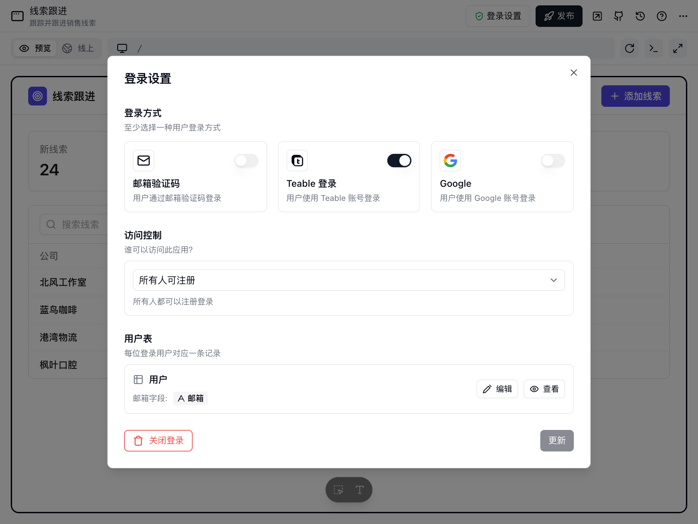
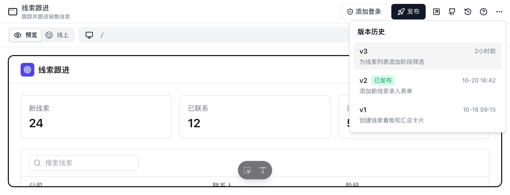

<Note>云端版本所有方案可用；私有部署版本需要商业版及以上方案。</Note>

Teable 应用构建器 (App Builder) 允许您在不编写代码的情况下，将项目转化为功能齐全、定制化的 Web 应用程序。结合数据结构的力量和 AI 驱动的设计，您可以在几分钟内发布内部工具、客户门户和数据仪表板。

## 概览

应用构建器（App Builder）遵循 "Prompt to App"（提示词即应用）的工作流。您描述想要的内容，AI 为您构建应用结构、页面和逻辑。然后，您可以使用可视化编辑器或代码微调每一个细节。

<Note>
应用构建器用于创建自定义界面和独立应用。如果需要在项目内部进行交互式数据分析和临时提问，请使用 [AI 对话](/zh/basic/ai/ai-chat)。
</Note>

具体业务场景可参考[AI 应用构建示例](https://teable.ai/zh/ai-app-builder)。

## 创建应用

主要有两种创建应用的方式：

1. **从项目创建**：在项目中，点击 "+ 创建" 选择 "新应用" 生成一个链接到当前数据的应用。
2. **从对话创建**：打开 AI Chat 并说 "为这个客户表创建一个 CRM 应用"。

教育场景可以参考 [Zakrly 如何整理教学业务数据并设计学生门户界面](https://teable.ai/zh/customers/zakrly)。

## 应用编辑器界面

应用构建器为非技术用户和开发者提供了双重界面。

### 1. 对话界面（AI 驱动）

这是您的应用控制中心。
- **自然语言编辑**：描述您想做的更改，如 *"把标题改成蓝色"* 或 *"添加一个新记录提交表单"*。
- **智能路由**：AI 能够理解您指的是哪个组件或页面，并直接对其进行修改。
- **凭据请求**：当应用运行时需要访问第三方账号或某个 Secret 时，应用构建器会在对话面板中固定一张卡片，例如 **这个应用需要使用你的 Slack 连接**。点击 **连接我的账号** 走一次 OAuth，连接完成后直接授权给这个应用；已经有可用的连接或 Secret 时，直接授权即可，不必再连一次。点击 **跳过** 则不提供这份凭据，AI 会在不使用它的情况下继续处理可完成的部分。
- **技能**：打开 **+** 菜单，选择 **技能**，可以管理当前应用对话可用的技能。这里添加的 App 技能只在当前应用中可用；应用所属项目和空间中共用的技能，在这里也能直接使用。在输入框中输入 `/`，可以选择已启用的技能。
- **文件管理**：打开 **+** → **更多** → **文件管理**，可以查看当前应用沙箱中的文件，用于预览支持的文件类型、下载生成文件，或删除不再需要的文件和文件夹。
- **清除对话历史**：如果当前对话已经跑偏，可点击面板右下角的 **清除对话**，重新开始一个新的会话。这样会丢失当前对话的历史上下文，但不会删除应用本身。首次使用会弹出确认，并可选择下次不再提示。

### 2. 预览面板

- **预览与线上**：面板顶部有两个标签页。**预览** 运行的是你正在构建的版本，包含尚未发布的改动；**线上** 会从公开地址加载已发布的应用，方便对照用户看到的效果。应用发布之前，**线上** 标签页只显示发布提示。已发布的应用默认打开 **线上**，未发布的默认打开 **预览**，之后会记住你上次为该应用选择的标签页。
- **多设备模拟**：使用顶部的切换器在 **桌面**、**平板** 和 **移动** 视图之间切换。
- **生成中预览**：应用构建器生成应用时，你可以在预览面板看到界面逐步成形。
- **即时反馈**：应用构建器完成修改后，预览会刷新为最新保存的版本。

在 **预览** 标签页中，可以使用底部的浮动工具栏进行定点修改：

- 选择 **选择要修改的元素**，再点击预览中的元素。应用构建器会把该元素添加到对话输入框中。补充修改要求并发送后，AI 会针对这个元素修改应用。
- 选择 **直接编辑文本**，再点击预览中的静态文本并输入新内容。可以连续修改多处文本，再点击 **保存**；点击 **放弃修改** 可以撤销尚未保存的文本修改。

从数据读取或由应用计算的动态文本不能直接编辑。请选中对应元素，再通过对话描述修改要求。AI 生成期间，元素选择和文本编辑会暂停。按 `Esc` 可以退出任一模式。

### 3. 开发者模式（代码编辑器）

为了实现无限的定制能力，我们提供了直接访问代码的权限。

- **Monaco Editor**：浏览器中类似 VS Code 的编码体验。
- **React 组件**：直接编辑底层 React 代码、Tailwind CSS 类和逻辑。
- **文件树**：完整浏览项目文件结构。

#### 下载代码

您可以随时将整个应用下载为 ZIP 压缩包：

1. 切换到编辑器中的 **Code** 标签页。
2. 点击标签栏中的 **`...`** 菜单。
3. 选择 **下载代码**，在弹出的对话框中再次点击 **下载代码**，包含所有源文件的 ZIP 压缩包将保存到您的电脑。

压缩包默认不包含这个应用的有效凭据。根目录附带一份 `.env.example`，列出[平台注入的运行时变量](#teable-访问令牌)（Teable 自动为每个应用提供的变量），其中 Teable 访问令牌和 AI 访问密钥的值留空；压缩包还附带 `.gitignore`，让 Git 忽略 `.env` 文件。

需要在本地直接运行时，在对话框中勾选 **包含带有效凭据的 .env**，压缩包会改为附带真实的 `.env`。其中只有平台注入的运行时变量，包括 Teable 访问令牌，开启 AI 访问时还有 AI 访问密钥；授权给应用的凭据不在其中。

<Warning>
拿到这个 `.env` 的人可以读写应用所属项目的全部数据。不要把它提交到代码仓库或分享给他人；怀疑已经泄露时，[轮换 Teable 访问令牌](#teable-访问令牌)。
</Warning>

#### 导入代码

您可以通过导入 ZIP 来更新应用代码：

1. 切换到编辑器中的 **Code** 标签页。
2. 点击标签栏中的 **`...`** 菜单。
3. 选择 **导入代码**，导入不超过 20 MB 的 ZIP。

<Note>
- 仅需包含源代码文件，`node_modules`、`.next` 等构建产物会被自动忽略。
- ZIP 会替换现有项目。未放入 ZIP 的现有文件，会从新版本中移除。
- 如果 ZIP 中包含一个公共外层文件夹，Teable 会自动剥离这一层。你可以直接压缩最外层项目文件夹。
- 导入的项目根目录必须包含 `package.json`。
- ZIP 根目录中的 `.env` 里的自定义变量会存成你的 Secret，并按同名变量授权给这个应用。其他 `.env*` 变体（如 `.env.local`）会被忽略。
</Note>

#### 凭据与配置

不要把 API Key、访问凭证和应用运行所需的配置直接写进源码。应用用的是**你的凭据**：OAuth 连接或你保存的 Secret。在应用构建器对话面板中打开 **+** → **更多** → **凭据与配置**，把凭据授权给这个应用。

| 细节 | 行为 |
| --- | --- |
| 生效范围 | 授权给应用的凭据可用于应用预览环境和已发布应用 |
| 变量名称 | 授权时填写的别名，需以大写字母开头，只能包含大写字母、数字和下划线 |
| 代码读取 Secret | 服务端代码通过 `process.env.MY_API_KEY` 等环境变量读取 |
| 代码读取连接 | 服务端代码调用 `getConnectionToken('别名')` 换取访问令牌 |
| 已保存的值 | 保存后不会明文展示；需要更换时，输入新值 |

新增、移除授权或更换凭据值后，应用预览环境会使用新值；已发布应用需要重新发布后才会使用。

复制应用后，凭据不会跟着复制，面板里会留下 **尚未授权** 的占位项，点击 **绑定我的** 补上你自己的凭据。复制或导出项目、使用模板时，应用代码中的 `.env` 也不会带过去，复制出的应用会获得自己的 Teable 访问令牌。凭据的管理和使用位置详见 [凭据与集成](/zh/basic/credential)；项目中的表格、记录等其他内容如何复制，见 [复制项目到另一个空间](/zh/basic/base#复制数据库到另一个空间)。

#### Teable 访问令牌

应用的环境变量有两类来源：

- **平台注入的变量**：Teable 为每个应用自动提供，包括 Teable 访问令牌（`TEABLE_APP_TOKEN`）、接口地址、应用和项目的 ID；开启 **AI 访问** 后还有 AI 访问的地址和密钥。
- **授权给应用的凭据**：你在 **凭据与配置** 中授权的 Secret 和连接，见上文。

个人访问令牌（**设置** → **开发者工具** → **个人访问令牌**）不会注入应用，应用代码也用不到它；它用于从应用之外调用 Teable，见 [外部服务和 MCP 使用的凭据](#外部服务和-mcp-使用的凭据)。

Teable 访问令牌是应用读写本项目数据所用的凭据，可以访问应用所属的整个项目，不能限定到部分表格或字段，也不能访问其他项目。它在应用的预览环境和已发布应用中使用，Teable 不会把它提交到应用的代码仓库，下载代码时默认也不包含。通常每个应用有自己的令牌，令牌何时更换、何时失效见 [令牌的更换与失效](#令牌的更换与失效)。

遇到以下情况，建议轮换令牌：

- 令牌可能已经泄露，例如 `.env` 被提交到代码仓库，或贴进了 GitHub issue、论坛帖子或聊天记录。
- 复制过环境变量或下载过带 `.env` 代码的成员不再参与这个项目。
- 应用代码连同 `.env` 一起交给了他人。

在对话面板中打开 **+** → **更多** → **凭据与配置**，在 **平台凭据** 卡片右上角点击 **轮换**。Teable 访问令牌和 AI 访问密钥都在这里轮换，需要应用的编辑权限。

应用开启了 AI 访问时，确认框里可以选择要轮换的凭据：**Teable 访问令牌**、**AI 访问密钥**，默认两个都勾选。`.env` 里同时有这两个值，怀疑它泄露时建议一起轮换；无论选一个还是两个，预览和已发布应用都只更新一次。确认框会按所选内容列出影响。

| 对象 | 轮换后的变化 |
| --- | --- |
| 旧令牌 | 立即失效 |
| 正在运行的预览 | 自动换用新令牌，不需要重启 |
| 已发布应用 | Teable 在后台自动重新部署，换用新令牌，版本历史里不会多出记录。部署完成前（通常几分钟）应用无法读写项目数据。应用有未发布的修改时不会自动重新部署（否则会把这些修改一起发布），需要你重新发布 |
| 应用登录的用户 | 开启了 [应用登录](#应用登录) 的应用，访问者需要重新登录 |
| 本地 `.env` 和下载的代码 | 其中的旧令牌已失效，需要重新复制环境变量，或下载代码时勾选 **包含带有效凭据的 .env** |

一些较早复制出来的项目里，几个应用可能共用同一个令牌。轮换其中一个时，项目中仍共用这个令牌的其他应用会一并轮换，各自换成独立的新令牌，界面会提示一并轮换的数量。

重新部署由 Teable 自动完成，只换用新令牌，不会发布你还没发布的修改；重新发布则是你在发布面板中手动发布当前版本。如果提示 **访问令牌已轮换，但已发布的应用未能自动更新，请重新发布** 或 **访问令牌已轮换。已发布的应用有未发布的修改，没有自动更新；重新发布后才能读取数据。**，或这个应用（以及一并轮换的应用）几分钟后仍无法读取数据，重新发布对应的应用即可换用新令牌；预览无法读取数据时，重新加载预览。

#### 令牌的更换与失效

| 操作 | Teable 访问令牌 |
| --- | --- |
| 新建应用 | 签发新令牌 |
| 复制应用、复制或导入项目、使用模板 | 副本获得自己的新令牌，原应用的令牌不变 |
| 把应用 [移动到其他项目](/zh/basic/base#将资源移动到其他项目) | 换成新令牌，旧令牌立即失效；预览自动换用新令牌，已发布应用在后台重新部署，与轮换相同 |
| 发布、重新发布、回滚版本 | 不变 |
| 取消发布 | 不变，令牌仍然有效，预览继续使用它 |
| 下载代码、复制环境变量 | 不变，轮换之前每次拿到的都是同一个令牌 |
| 轮换 | 换成新令牌，旧令牌立即失效，见上文 |
| 删除应用 | 立即失效；从回收站恢复应用后，同一个令牌会重新生效 |
| 私有化部署更换 JWT 密钥后，管理员在系统管理中重签 | 换成新令牌，旧令牌失效 |

令牌签发时的有效期为 10 年，在轮换或删除应用之前一直有效，不会自行过期。怀疑泄露时请直接轮换；从回收站恢复的应用，如果令牌可能已经泄露，恢复后也请轮换一次。

#### 审计记录

以下操作会记入审计日志：

- **轮换应用访问令牌**：在 **平台凭据** 卡片中轮换。
- **复制应用环境变量**：复制带访问令牌的环境变量。
- **导出应用代码**：下载代码，记录中包含是否附带了 `.env`。

应用用访问令牌写入项目数据时，审计日志中的操作者显示为 **App Robot**。目前没有按令牌汇总的使用记录或告警，也不记录读取操作。

私有化部署（商业版及以上）的实例管理员在 **系统管理** → **审计日志** 中查看，日志保留一个月，可以按用户、空间、项目和操作类型筛选，详见 [审计日志](/zh/basic/admin-panel/audit-log)。

{/* TODO(T8077)：待确认云端用户在哪里看审计日志；App Robot 能否在用户筛选中选到；审计日志能否导出。 */}

#### 外部服务和 MCP 使用的凭据

Teable 访问令牌只供应用自身使用，不要把它用在应用之外的服务中；它也不能用于连接 MCP。

- **外部服务调用 Teable API**（例如 serverless 函数、脚本、CI）：使用 [个人访问令牌](/zh/api-doc/token)，只添加需要的项目或空间和权限范围，并设置有效期。个人访问令牌以创建者的身份操作。
- **连接 MCP 客户端**：推荐用 OAuth 授权，客户端以你的身份操作，可以随时在 **设置** → **开发者工具** → **MCP** 中移除授权；在没有浏览器的环境中改用个人访问令牌，同样只授予需要的项目和权限范围，详见 [通过 MCP 连接](/zh/basic/ai/teable-skill#通过-mcp-连接)。

#### 管理应用文件

应用构建器会把上传文件、生成结果和运行时文件保存在应用沙箱中。在对话面板中打开 **+** → **更多** → **文件管理**，可以查看这些文件。支持的文件类型可直接预览，也可以下载文件，或删除不再需要的文件和文件夹。

#### 为应用添加 AI 功能

当应用需要总结记录、分类请求、生成回复，或为应用用户回答问题时，可以添加 AI 功能。

你可以直接告诉应用构建器你想做什么，比如“给工单添加 AI 回复助手”或“总结每条表单提交内容”。应用构建器可以帮你开启 **AI 访问**，并添加对应功能所需的代码。

<Info>
应用构建器添加好 AI 功能后，应用预览会使用新版本；已发布应用需要重新发布后才会使用。
</Info>

AI 访问的密钥同样由 Teable 注入，在 **平台凭据** 卡片中和访问令牌一起显示。需要更换时，点击卡片的 **轮换**，只勾选 **AI 访问密钥**：旧密钥立即失效，运行中的预览直接换用新密钥，已发布应用会在后台重新部署，完成前 AI 调用会失败。只轮换 AI 访问密钥不会让访问者登出。应用有未发布的修改时不会自动重新部署；几分钟后 AI 调用仍然失败，重新发布一次。

## 与 GitHub 同步代码

<Note>云端 Business 及以上套餐可用。</Note>

需要在 Pull Request 里评审代码、在 Teable 之外留一份代码，或者用本地编辑器改应用时，可以把应用绑定到一个私有 GitHub 仓库。绑定后应用与仓库双向同步：应用每产生一个新版本就推送到 GitHub，你推送到 GitHub 的提交也会变成新的应用版本。

### 连接账号并创建仓库

先至少生成一次应用。应用还没有代码时，GitHub 按钮显示 **生成应用后即可连接 GitHub**，点击无效。

<Steps>
  <Step title="打开 GitHub 面板">点击应用顶部的 GitHub 图标，打开 **GitHub 同步**，需要该应用的编辑权限。</Step>
  <Step title="连接账号">点击 **连接 GitHub**，在弹出窗口里完成安装，可以选择个人账号或你有管理权限的组织。如果浏览器拦截了弹窗，请允许弹窗后重试。</Step>
  <Step title="选择账号">在 **GitHub 账号** 中选择已连接的账号，点击 **+** 可以再连接一个。</Step>
  <Step title="填写仓库名称">**仓库名称** 会用应用名预填。名称仅可包含字母、数字、`.`、`-` 和 `_`，最多 100 个字符。</Step>
  <Step title="创建并绑定">点击 **创建仓库并绑定**。个人账号会再弹出一个窗口，需要你授权本次创建。</Step>
</Steps>

Teable 会新建一个私有仓库，把当前应用代码提交到 `main` 分支，同时附上一个 README，指回 Teable 中的应用并说明两边如何同步。应用无法绑定到已有仓库。

连接默认只有创建者本人可用。想让协作者在同一个组织账号下建仓库，选中该连接并打开 **允许其他成员使用此连接**，其他有应用编辑权限的成员就能在这个组织下为自己的应用创建仓库。个人账号的连接无法共享，因为 GitHub 要求由账号本人授权才能建仓库。

### 同步如何进行

| 方向 | 行为 |
| --- | --- |
| 应用 → GitHub | 每个新的应用版本都会推送到仓库的 `main` 分支。|
| GitHub → 应用 | 推送到 `main` 的提交会生成一个新的应用版本，对话面板会给出一条同步说明，正在打开的预览会加载新代码。|

环境变量文件不会被推送，详见下面的「环境变量与本地开发」。

面板会在仓库名旁显示当前状态：

| 状态 | 含义 | 处理方式 |
| --- | --- | --- |
| **已同步** | 仓库内容与最新的应用版本一致。| 无需处理。|
| **同步中** | 有一次推送正在进行。| 等待即可，面板会自动更新。|
| **冲突** | `main` 分支上有 Teable 不知道的提交，无法自动合并。| 在 GitHub 上合并 `teable-sync` 分支，见下文。|
| **已暂停** | GitHub App 被卸载或被暂停，同步已停止。| 面板会说明具体原因。解除暂停后同步会自动恢复。|
| **错误** | 上一次同步失败。| 在面板中查看原因，点击 **重试**。|

### 处理冲突

Teable 不会强制覆盖你的分支。两边历史分叉时，Teable 把最新的应用版本放在 `teable-sync` 分支上，并把状态标记为 **冲突**。在 GitHub 上把 `teable-sync` 合并进 `main`，这次合并会作为新的应用版本同步回来，状态也随之回到 **已同步**。冲突期间新的应用版本会继续推进 `teable-sync` 分支，所以合并它拿到的始终是最新代码。

### 环境变量与本地开发

仓库里只有源码。Teable 不会推送任何以 `.env` 开头的文件，项目根目录、子目录、提交历史里都没有。环境变量的值来自平台注入的变量和授权给应用的凭据（见 [Teable 访问令牌](#teable-访问令牌)），由 Teable 管理，不会进入 Git。仓库的 `.gitignore` 里已经写好了 `.env*`，本地克隆后也不会误提交。

在本地运行应用：

<Steps>
  <Step title="克隆并安装">克隆仓库，执行 `pnpm install`。</Step>
  <Step title="取环境变量">在 GitHub 面板或 **凭据与配置** 中点击 **复制环境变量到剪贴板**，把剪贴板内容粘贴到项目根目录的 `.env` 文件中。</Step>
  <Step title="启动">执行 `pnpm dev`。</Step>
</Steps>

复制出来的只有平台注入的运行时变量：接口地址、访问令牌和 AI 访问相关变量，**凭据与配置** 中的按钮旁也标注了 **仅包含平台注入的运行时变量，不包含已授权的凭据**。复制的变量和下载的代码都不包含授权给应用的凭据，本地调试需要用到时，请自行在 `.env` 中补充。

<Warning>
文件里的 `TEABLE_APP_TOKEN` 可以访问应用的数据，所以只有拥有应用编辑权限的成员才能复制。切勿提交这个文件，也不要粘贴到 issue 或 Pull Request 里。怀疑已经泄露时，[轮换 Teable 访问令牌](#teable-访问令牌)。
</Warning>

应用线上运行使用的凭据，始终在 Teable 的 **凭据与配置** 中新增或更换，修改本地文件或把 `.env` 提交到 GitHub 都不会生效。平台变量变化后（例如轮换了 Teable 访问令牌或刷新了 AI 访问密钥），重新复制一次环境变量并覆盖本地的 `.env`。

### 解除绑定

点击仓库名旁的删除图标并确认。同步随即停止，GitHub 上的仓库和代码都会保留。之后再次绑定同一个应用会创建一个新仓库，不会连回原来那个。

## 发布与管理

### 发布您的应用

当应用准备就绪时，点击右上角的 **发布** 按钮（箭头图标）。

- **公开链接**：Teable 会为您的应用生成一个安全的、可公开访问的 URL。
- **自定义域名**：支持绑定您自己的域名。
- **展示品牌标识**：在 **发布** 菜单中控制已发布应用是否显示 **Build with Teable** 标识。发布后修改此设置，需要点击 **重新发布** 才会生效。
- **取消发布**：已发布应用可在发布菜单中点击 **取消发布**，让公开链接暂时下线。
- **应用配置变更**：发布菜单提示 **运行配置已修改，重新发布后在线上生效** 或 **品牌标识设置已修改，重新发布后在线上生效** 时，点击 **重新发布**。
- **访问已发布 App**：应用发布后，**发布** 按钮旁的图标会在新标签页中打开线上应用。

<Info>关闭 **Build with Teable** 标识需要商业版及以上方案。</Info>

面向公众的网站可以参考 [Waconzy 如何用应用构建器整合音乐、工具与数字服务](https://teable.ai/zh/customers/waconzy)。

### 取消发布应用

要让已发布应用暂时下线，打开 **发布** 菜单，点击 **取消发布**。确认后，公开应用链接将无法访问。

取消发布不会删除应用或编辑历史。您可以继续编辑应用，并在之后重新发布。

### 自定义域名

<Note>自定义域名需要商业版及以上方案。</Note>

在 **自定义域名** 中可以为已发布应用绑定访问域名。建议使用子域名，例如 `app.yourdomain.com`。输入域名后，Teable 会显示需要添加的 DNS 记录；在域名服务商处添加记录，等待生效后回到 Teable 完成验证。

也可以使用 `teable.app` 下可用的子域名，并编辑 `teable.app` 前缀，例如 `your-name.teable.app`。

空间的商业版到期后，Teable 会通知空间所有者自定义域名即将停止解析，在此之前续费即可保留域名。未续费时，自定义域名会停止解析，应用的公开链接恢复为 Teable 默认地址。之后升级到商业版，需要手动重新绑定自定义域名。

### 自定义站点信息

在 **发布** 菜单中打开 **自定义站点信息**，可以设置已发布应用的浏览器标签页图标、站点标题和描述。编辑时弹窗会实时预览这三项的整体效果。

| 设置项 | 作用 |
| --- | --- |
| **网站图标** | 浏览器标签页显示的图标。支持上传 PNG、JPEG、WebP、SVG 或 ICO 文件，大小不超过 5MB，建议尺寸 32×32。移除已上传的文件即可恢复默认的 Teable 图标。|
| **标题** | 站点标题，最多 120 个字符。|
| **描述** | 页面元信息中的站点描述，最多 500 个字符。|

留空的字段会保留应用构建器生成的原值。保存后改动会应用到应用预览环境；已发布应用需要重新发布后才会生效。

### 应用登录

在应用顶部点击 **添加登录**，可以要求访问者登录后再使用应用。配置后，该按钮会变为 **登录设置**。

启用登录时：

1. 选择登录用户的存储位置。可以创建 **用户** 表，也可以复用已有的、包含邮箱字段的表。每位登录用户会作为一条记录保存，同一用户表可被多个应用复用。
2. 至少选择一种登录方式，例如 **邮箱验证码**、**Google** 或 **Teable**。可选方式取决于实例的认证配置。
3. 设置访问控制：**所有人可注册**、**允许的邮箱域名** 或 **仅邀请用户**。

登录配置会在应用预览环境重新加载后生效。要让已发布应用使用新的登录配置，需要重新发布应用。

如果需要使用自己的 Google OAuth 客户端、自己的邮箱发送登录验证码，或使用密码登录，请在对话中明确提出要求。应用构建器会关闭平台内置登录，并在应用中实现自定义登录。完成后，请先在预览中检查登录和页面访问控制，再重新发布已上线的应用。

这项功能的使用示例可参考[应用登录示例](https://teable.ai/zh/blog/built-in-login-for-app-builder)。

### 版本历史与回滚

Teable 自动跟踪每一次部署。

- 点击 **历史** 按钮（时钟图标）查看所有已部署的版本列表。
- **一键回滚**：如果新的更新出现问题，您可以即时将线上应用恢复到任何之前的稳定版本。

应用构建器每改完一轮，会把这一轮的改动保存为一个新版本。保存失败时，对话中会出现一张提示卡片。

<Warning>
保存失败的这一轮改动只留在沙箱里，沙箱回收后会丢失，重新生成这条回复也不会重新保存。看到提示卡片请及时按下面的方式处理。
</Warning>

- **版本保存失败**：本轮版本未保存。让应用构建器继续修改，下一次保存成功时会把这些改动一并带上。
- **改动体积过大，无法保存**：本次改动超出保存大小限制。点击卡片上的 **发送给 AI**，应用构建器会排查过大的测试产物、调试文件或附件，清理之后再保存。这类文件可能已经进入尚未保存的提交记录，只删除文件不一定够，需要由应用构建器一并整理。

### 自动修复 (Auto-fix)

如果您的自定义代码导致构建错误，部署将会失败。

- Teable 在错误日志旁提供了一个 **Auto-fix（自动修复）** 按钮。
- 点击它，AI 将分析编译错误并自动修补代码以解决问题。

### 删除应用

要删除应用，请点击顶部的 **设置**（齿轮图标） 按钮，然后选择 **删除**。

## 最佳实践

应用构建器的构建技巧、提示词写法、版本回退建议和常见问题，请参考 [应用构建器最佳实践](/zh/basic/ai/app-builder-practical-guide)。

## 常见问题

<AccordionGroup>
  <Accordion title="清除对话历史会删除应用吗？">
    不会。清除对话只会清除当前应用对话的历史上下文，不会删除应用本身。如果对话已经跑偏，可以用它重新开始。
  </Accordion>

  <Accordion title="如何下载或导入应用代码？">
    切换到编辑器中的 **Code** 标签页，点击标签栏中的 **`...`** 菜单，然后选择 **下载代码** 或 **导入代码**。导入的 ZIP 最大 20 MB，且会替换现有项目，因此请放入需要保留的全部源代码文件。导入的项目根目录必须包含 `package.json`。ZIP 根目录中的 `.env` 里的自定义变量会存成你的 Secret，并按同名变量授权给这个应用。
  </Accordion>

  <Accordion title="应用的访问令牌泄露了怎么办？">
    在对话面板中打开 **+** → **更多** → **凭据与配置**，在 **平台凭据** 卡片点击 **轮换**；开启了 AI 访问的应用保持两项都勾选。旧令牌立即失效，预览和已发布应用会自动换用新令牌，已发布应用重新部署期间（通常几分钟）无法读写数据，开启了登录的应用访问者需要重新登录。详见 [Teable 访问令牌](#teable-访问令牌)。
  </Accordion>

  <Accordion title="登录配置什么时候会对线上应用生效？">
    登录配置会在应用预览环境重新加载后生效。要让已发布应用使用新的登录配置，需要重新发布应用。
  </Accordion>

  <Accordion title="应用如何在运行时调用 AI 模型？">
    告诉应用构建器你想实现什么 AI 功能，比如回复助手、提交内容总结或请求分类。应用构建器可以帮你开启 **AI 访问**，并添加对应功能所需的代码。应用构建器完成修改后，应用预览会使用新版本；已发布应用需要重新发布后才会使用。通过应用发起的 AI 调用会在算力明细中显示为 **应用 AI**。
  </Accordion>

  <Accordion title="内置 AI 和应用内 AI 如何计费？">
    **内置 AI** 包括 Teable 直接提供的 AI 功能，例如 AI 字段生成、AI 对话、IM Bot 和应用构建器。目前按大幅优惠后的算力费率计费。

    **应用内 AI** 是指在应用构建器创建的应用中使用的 AI 功能。用量按所选模型提供商的[官方 API 价格](https://vercel.com/ai-gateway/models)计费，不加价，也不打折。每 1 美元的 API 用量等于 100 算力。
  </Accordion>

  <Accordion title="如何回滚应用到之前的版本？">
    点击 **历史** 按钮（时钟图标）查看已部署版本，并将线上应用恢复到之前的稳定版本。
  </Accordion>

  <Accordion title="为什么提示 Agent 正在其他对话中执行？">
    每个用户最多可同时运行 3 个 Agent，包括 AI 对话和应用构建器。如果应用构建器提示 Agent 正在其他对话中执行，说明已有任务正在运行，请等待上一个任务完成后再继续。
  </Accordion>

  <Accordion title="应用构建器运行失败时如何返还算力？">
    一次应用构建器运行可能包含多个处理步骤，对话里和账单里都会汇总展示同一轮运行的算力消耗。已经完成并保存的工作可以继续使用；如果最后一步意外中断，会自动返还中断那一步消耗的算力。你可以继续在同一个应用对话里推进后续工作。
  </Accordion>

  <Accordion title="私有化部署需要在哪里配置应用构建器？">
    如果您使用私有化部署的 Teable，请参考 [AI 配置](/zh/basic/admin-panel/ai-setting) 页面完成配置。如需让应用构建器使用自带 Key，聊天模型必须来自 **OpenAI Compatible**（OpenAI 兼容）或 **Anthropic** 类型的提供商。如需部署协助，请联系 Teable：**support@teable.ai**。

    <Note>
    如果在 **部署引擎** 中选择 **Vercel**，请确保 Teable 实例和对象存储（MinIO / S3）均可被公网访问，并在 [AI 配置](/zh/basic/admin-panel/ai-setting) 页面使用 **测试公网访问** 进行验证。选择 **Teable Infra** 时不需要这项检查。
    </Note>
  </Accordion>
</AccordionGroup>

如果正在选择平台，可以查看[Teable 与 Lovable 对比](https://teable.ai/zh/compare/lovable-alternative)或[Teable 与 Softr 对比](https://teable.ai/zh/compare/softr-alternative)。
