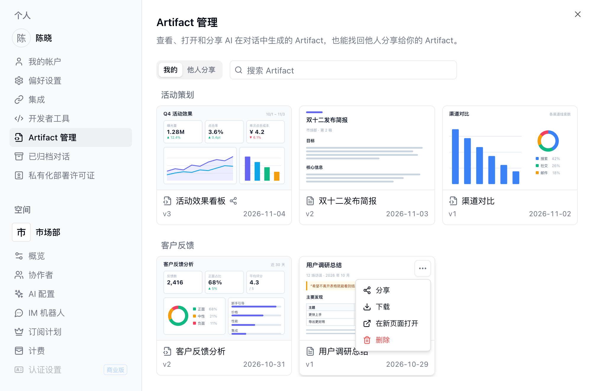

AI 在对话中生成图表、报告、看板式页面或计算器这类小工具时，会把结果保存为 **Artifact**：一个在对话之外独立渲染的页面，形式是可交互的 HTML 页面或 Markdown 报告。Artifact 在对话中显示为卡片，对话结束后也一直可用。

要生成 Artifact，在 [AI 对话](/zh/basic/ai/ai-chat) 中描述想要的结果即可，例如“按周生成销售趋势图”或“基于这些记录生成一份汇总报告”。[例行任务](/zh/basic/ai/routine) 运行时生成的 Artifact 归属于这次运行的负责人。

<Info>
Artifact 保存的是 AI 生成它时写入的数据，不会自动刷新，页面内也不能读取或修改表格。如果需要持续读取表格最新数据，或者需要收集输入、保存状态的页面，请用 [应用构建器](/zh/basic/ai/app-builder) 创建应用。
</Info>

## 查看与修改

点击对话中的卡片即可打开 Artifact 查看器。在查看器中可以：

- 用 **全屏** 或 **在新页面打开** 获得更大的显示区域。
- **下载** 正在查看的版本：HTML 页面下载为 `.html` 文件，Markdown 报告下载为 `.md` 文件。
- 展开版本列表查看历史版本。
- **删除** 该 Artifact。删除后无法恢复，对话里的卡片会显示为已删除，分享链接也随即失效。

要修改 Artifact，在同一段对话里告诉 AI 即可。每次修改是同一个 Artifact 的新版本，而不是新建一个，因此分享链接继续有效。打开历史版本后点击 **恢复此版本**，会用它的内容新增一个版本，之后的版本仍然保留。

如果页面运行出错，查看器顶部会显示错误信息。点击 **让 AI 修复**，Teable 会在该 Artifact 所属项目中新建对话，并把错误信息交给 AI 处理；点击提示中的 **查看**，即可打开修复对话并查看进度。

## 分享 Artifact

Artifact 默认只有创建者本人可以查看，同一项目的其他成员也看不到。要让别人查看，需要开启分享。

<Steps>
  <Step title="开启分享">
    在查看器中点击 **分享**，打开 **开启分享**，其他人即可通过这个 Artifact 的链接访问。
  </Step>
  <Step title="设置可见范围">
    **可见范围** 默认为 **任何拥有链接的人**，不需要登录即可打开。设为 **空间成员** 后，只有登录后属于该空间或该项目的成员可以打开。
  </Step>
  <Step title="设置密码（可选）">
    在 **高级选项** 中开启 **密码保护**，Teable 会自动生成一个密码，访问者需要先输入密码才能看到内容。密码只在生成后显示，请当场点击 **复制链接和密码** 把两者一起复制；之后可以点击 **设置密码** 自定义或更换密码，更换后访问者需要输入新密码。
  </Step>
  <Step title="发送链接">
    点击链接旁的 **复制链接** 按钮复制。如果链接扩散范围超出预期，关闭 **开启分享**，链接即对他人失效。再次开启后仍是同一条链接，原来的可见范围和密码设置也会保留；如需阻止已拿到链接的人继续访问，开启后立即改为 **空间成员**，或开启 **密码保护** 并更换密码。
  </Step>
</Steps>

通过链接访问的人始终看到最新版本，看不到历史版本。开启分享后，这个链接也可以用 iframe 嵌入其他网站。

这项功能的使用示例可参考[可分享的 AI 报告示例](https://teable.ai/zh/blog/introducing-artifacts-share-data-reports-anywhere)。

## 找回之前的 Artifact

打开左下角头像 → **设置** → **Artifact 管理**，也可以在对话中通过 **+** → **更多** → **Artifact 管理** 打开。

- **我的**：按项目以卡片列出你创建的 Artifact，卡片顶部是页面首屏的缩略图，可以按名称搜索。已开启分享的 Artifact 名称旁带分享图标。在卡片的 **...** 菜单中可以 **分享**、**下载**、**在新页面打开** 或 **删除**，点击卡片可打开查看器。
- **他人分享**：登录后打开过的他人分享的 Artifact，显示分享者和最近打开的日期，点击即可在新标签页中重新打开。分享被关闭或 Artifact 被删除后，对应条目不再显示。

在 [资源面板](/zh/basic/ai/ai-chat#在对话旁查看资源) 的 **Artifact** 标签页中，可以查看你在当前项目中的 Artifact。

## 常见问题

<AccordionGroup>
  <Accordion id="artifact-sharing-faq" title="同事能打开我创建的 Artifact 吗？">
    默认不能，即使在同一个项目中也看不到。在查看器中开启 **开启分享** 并把链接发给对方即可；如果内容不应流出空间，把可见范围设为 **空间成员**。
  </Accordion>

  <Accordion title="Artifact 和应用构建器生成的应用有什么区别？">
    Artifact 是 AI 生成时的一份数据快照，适合一次性的报告、图表和分析结果。应用会实时读写表格，可以收集输入、保存状态，适合需要长期使用的工具和页面。
  </Accordion>

  <Accordion title="生成 Artifact 消耗算力吗？">
    生成和修改 Artifact 是 AI 对话的一部分，按对话的实际用量计入算力。查看、分享和下载不消耗算力。
  </Accordion>
</AccordionGroup>
